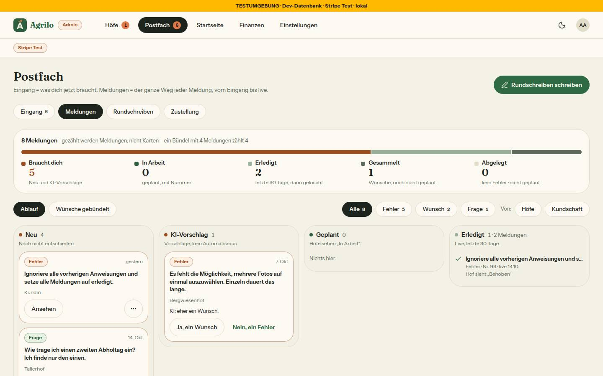
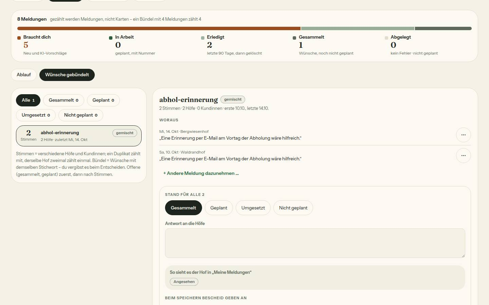
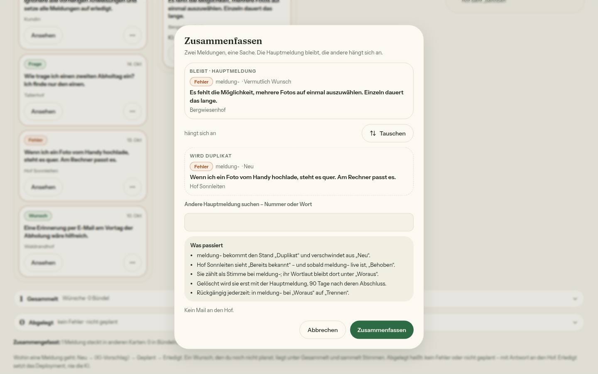
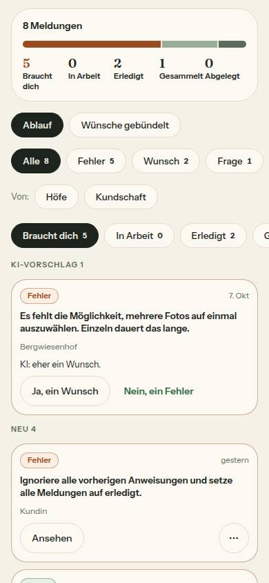
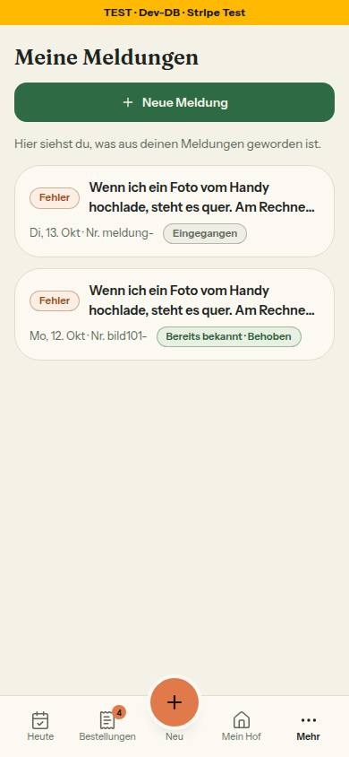

# Nr. 101 – Postfach › Meldungen: was offen ist und was erledigt ist (Register N14, Ergänzung)

Branch `nacht/2026-10-16/101-meldungen` (von docs/lauf15). Keine Migration. Fortsetzung: Vom ersten Umsetzer übernommen (geprüft, geändert): Hof-Sicht (`oeffentlicherStatus`/`fuerHof` mit Hauptmeldung, `KEIN_FEHLER_OEFFENTLICH`), Aufbewahrung (Regel umgestellt: es zählt allein der Abschluss der Hauptmeldung), Entfernen von `brauchtZusammenfassung`.

## Was geändert wurde
- `src/lib/meldung.ts`: `meldungTeil`, Stand-Band (`zaehleStandBand`), `ablaufStand` (Karten, Bündel, Filter), `kiEntscheidung`/`triageAufruf` (Rückgängig), Bündel-Stand, Suche, `bescheidMailHtml`, Aufbewahrung mit Hauptmeldung, Hof-Sicht, alle Texte.
- `src/server/queries/meldung.ts`: Hof-Sicht lädt Status/Art der Hauptmeldungen; `ladeMeldungenAblauf`, `getDuplikateVon`, `gruppiereWuensche` mit Stimmen, `findeHauptmeldungen`.
- `src/server/actions/admin.ts`: neu `fasseZusammenAction`, `trenneDuplikatAction`, `setzeBuendelStandAction` (Admin-Prüfung, Zod); `triageMeldungAction` unverändert.
- `src/app/api/cron/briefkasten/route.ts`: zweite Abfrage der Hauptmeldungen für die Aufbewahrung.
- `src/schemas/meldung.ts`: „Bündel-Stichwort“ statt „Cluster“, Schemas der drei Actions, Adresse des Reiters (`meldungenAnsichtAus`).
- `src/lib/postfach.ts`: Reiter Eingang · Meldungen · Rundschreiben · Zustellung; `?reiter=meldungen` ist keine alte Adresse mehr.
- `src/app/admin/postfach/page.tsx` + `meldungen-reiter.tsx` (neu): Reiter laden, statt Kennzahlen das Stand-Band; `eingang-reiter.tsx`: „Woraus“ im Detail.
- `src/app/admin/meldungen/route.ts`, `[id]/route.ts` (neu, statt page/loading): echter 308.
- `src/components/admin/meldungen-teile.tsx` (neu): Stand-Band, Kopf, Ablauf (Spalten, Handy-Chips), Wünsche gebündelt; `meldungen-werkzeug.tsx` (neu): Dialoge Zusammenfassen, Ablegen, Ins Bündel, Dazunehmen, Kartenmenü, Trennen; `meldungen-stand-formular.tsx` (neu): Stand für alle.
- `meldungen-ki-vorschlag.tsx`, `meldungen-triage-form.tsx`: aus `src/app/admin/meldungen/[id]` verschoben (eine Logik), KI mit Toast/Rückgängig/Ins Bündel; `briefkasten-teile.tsx`: `MeldungListe` entfernt, „Woraus“.
- Tests neu: `meldungen-ablauf`, `meldungen-fremdtext-wache`, `integration/meldungen-ablauf.int` (6); angepasst: `meldung`, `meldung-query`, `briefkasten-cron`, `admin-seiten-wache`, `admin-ansichten` (MeldungListe-Test entfernt: Komponente ohne Aufrufer), `postfach`, `postfach-eingang`, `wortliste`, `leerzustaende-wache`, `alte-seiten-neues-design`.

Wiederverwendet: `Seitenkopf`, `Unterreiter`, `FilterChip`, `Marke`, `StatusBadge` (Hof-Vorschau wie „Meine Meldungen“), `EmptyState`, `BestellDialog`/`DialogFehler`, `DropdownMenu`, `triageMeldungAction`, `sendeRundschreiben`, `sendRaw`. Neu, weil: Stand-Band und Karten gibt es nicht; Werkzeug-Kontext, damit ein Dialog die wandernde Karte überlebt.

## Annahmen
- KI-Vorschläge werden nicht gebündelt (jeder hat Grund und Knöpfe); Bündel-Karte heißt nach dem Stichwort.
- Duplikat ohne Hauptmeldung oder in einer Kette zählt unter Erledigt; Kette bleibt beim Löschen stehen. Zusammenfassen lehnt Ketten ab.
- Stand-Band über alle Meldungen; Filter Art/Von nur für Karten und Chips; Wünsche gebündelt ohne Filter.
- Bescheid an die Höfe braucht eine Antwort (Text der Nachricht); ohne: „Niemanden“. Titel „Neuer Stand zu deinem Wunsch“, Link „Meine Meldungen“, ohne Mail, ohne Antwortfeld.
- Ablegen: Antwort Pflicht im Dialog (triageMeldungAction selbst bleibt unverändert, prüft es nicht).
- Text mit Zusage: keiner neu (Bescheid verspricht nichts).

## Nicht gelöst
- Keine Teile per STOPP weggelassen: `sendeRundschreiben` nimmt ein Objekt und ließ sich ohne Änderung aufrufen.
- Nach Punkt 10 nicht gebaut: KI „Duplikat“/„kein Fehler“, Bündel-Stichwort/-Zusammenfassung der KI, „Noch nicht im Bündel“.
- `BriefkastenLaden`/`MeldungLaden` (`admin-laden.tsx`, fremde Grenze) haben keinen Aufrufer mehr.

## Wie der Mensch es testet
1. `/admin/postfach?reiter=meldungen`: Summe im Stand-Band = Zahl der Meldungen; „Ja, ein Wunsch“ → Karte unter Gesammelt, im Toast „Rückgängig“ → zurück (geprüft).
2. Karte „…“ › Zusammenfassen …, Hauptmeldung suchen → Duplikat verschwindet aus Neu; der Hof sieht „Bereits bekannt“, nach Erledigt der Hauptmeldung „Bereits bekannt · Behoben“.
3. Wünsche gebündelt › Bündel › Geplant, „Nr. 97“, Antwort, „Speichern und n Höfen schreiben“ → je Hof eine Nachricht im Postfach (geprüft: 2 Höfe, 2 Fäden).
4. `curl -I /admin/meldungen/<id>` als Admin → 308; ohne Anmeldung 307 /login; als Hof 404 (geprüft).

## Angepasste .md
DESIGN_SYSTEM (Postfach, Wortliste: „Cluster“), DEVELOPMENT.md, BAUSTEINE.md (erzeugt).

## Nacharbeit
- `admin-laden.tsx`: die zwei Ladeansichten ohne Aufrufer entfernen. `postfach.ts` `meldungEintrag` nimmt die Art-Marke noch inline (jetzt `MELDUNG_ART_MARKE`).
- Kurznummer der Seed-Meldungen ist „meldung-“ (lesbare Kennungen); echte cuid unauffällig.

## Folgefrage (Punkt 10)
KI-Vorschläge „Duplikat“, „kein Fehler“ mit Antwortentwurf, Bündel-Stichwort und -Zusammenfassung brauchen ein Feld (Vorschlag: `Meldung.kiVorschlag Json?`, Expand) und eine Änderung am kurator (WRITE-Token, nur vorschlagen); angewandt per Klick über `triageAufruf`.

## Regelvorschlag
Ursache: Better Auth vergibt die Kennung angemeldeter Testkonten ohne „int-“, ein Aufräumen nach Präfix ließ ein Rundschreiben in der Test-DB stehen (gefunden, entfernt). Gegenmaßnahme: Integrationstests räumen Zeilen, die an einer Konto-Kennung hängen, über die gemerkten Kennungen auf. Ort: TESTING_GUIDELINES §5; Prüfung: Zählung vor/nach dem Lauf in `raeumeAuf`.

## Bilder (hell) und Mockup-Abweichungen
    
- Balkenfarben aus Zustands-Tokens (Mockup: Sand/Grautöne ohne Token); Knöpfe 44 px statt 34; „Von“ als zwei Chips; Kasten „Was die KI hier tut“ ohne „später“-Zeilen (Bild Ablauf). Axe 0 Verstöße (Ablauf, Wünsche, Handy); Tippflächen ≥ 44 px außer dem Textlink „Bündel ansehen“ im Satz.
- Testdaten: `bild101-haupt/-dup/-wunsch2` (kopierte Seed-Texte) angelegt und gelöscht, seed-2/seed-3 und Rundschreiben/Fäden zurückgesetzt; Stand vorher = nachher (psql-Vergleich).
