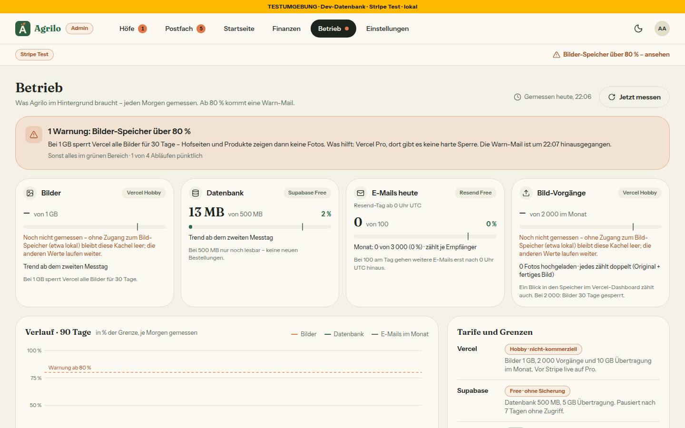

# Bericht Nr. 103 – Admin › Betrieb: Speicher, Grenzen, Abläufe, Warn-Mail (Register N18 neu, N15 geändert)

## Was geändert wurde
- `prisma/schema.prisma` + Migration (unten): `BetriebMessung`, `AblaufLauf`, `BetriebWarnung` – nur Expand, RLS an, keine Personendaten.
- `src/lib/betrieb.ts` (neu, rein): `TARIFE`, `GRENZEN`/`GRENZE`, `BETRIEB_ARTEN`, `ABLAEUFE`, `anteil`, `stufe`, `vollIn`, `ablaufStand`, `grenzSchritt`/`ablaufSchritt` (Warnregeln), `betriebHinweis`, Kacheln/Verlauf/Abläufe/Warnkarte als Daten, alle Texte (`BETRIEB_TEXT`), Warn-Mail (`betriebMail`), CSV.
- `src/schemas/betrieb-messung.ts` (neu): Zod für die Art einer gelesenen Zeile.
- `src/server/betrieb.ts` (neu): `listeBilder` (Blob `list()` seitenweise), `messeBetrieb`, `pruefeGrenzen`/`pruefeAblaeufe` (Stufe bedingt in EINER Anweisung, erst dann die Mail), `mitHerzschlag`, `messeUndPruefe`.
- `src/server/betrieb-zaehler.ts` (neu): `zaehleMail` – eine Anweisung je Mail; `src/lib/email.ts`: dynamischer Zähler-Aufruf nach dem Versand (fail-open) und `sendBetriebWarnung`; `src/emails/betrieb-warnung.tsx` (neu): Vorlage nach Mockup.
- `src/server/queries/betrieb.ts` (neu): Lesen, BigInt → Zahl an einer Stelle, größte Tabellen, Hinweis der Shell.
- `src/server/actions/betrieb.ts` (neu): „Jetzt messen“ (Admin-Wache, 10-Minuten-Regel).
- `src/app/admin/betrieb/` (neu): `page.tsx`, `loading.tsx`, `betrieb-teile.tsx`, `jetzt-messen.tsx`, `export/route.ts` (CSV, `verlangeAdminAktion`, no-store).
- `src/app/api/cron/betrieb/route.ts` (neu) + `vercel.json` (`0 4 * * *`); die drei bestehenden Cron-Routen: nur der Herzschlag-Rahmen.
- `src/lib/admin-navigation.ts`, `admin-shell.tsx`, `app/admin/layout.tsx`, `server/adminbereich.ts`: Reiter Betrieb mit Punkt, Hinweis in der Betriebsleiste (nur Produktion, fail-open).
- `src/lib/plattform-einstellung.ts`, `einstellungen-gruppen.tsx`, `app/admin/einstellungen/page.tsx`: Gruppe Betrieb entfällt, `?gruppe=betrieb` → `/admin/betrieb`.
- `src/lib/zustellung.ts`: Art `betrieb` fest an (Text, Reihenfolge), Satz zur Drossel bei `antwortHof`.
- Tests: neu `betrieb`, `betrieb-server`, `betrieb-zaehler`, `betrieb-seite`, `integration/betrieb.int`; angepasst 7 (Navigation, Admin-Wache, Leerzustände, zwei Cron-Tests, Einstellungen).

```sql
-- prisma/migrations/20261016130000_betrieb/migration.sql (Kopfkommentar gekürzt, Spalten je Tabelle in einer Zeile)
SET lock_timeout = '5s';
CREATE TABLE IF NOT EXISTS "BetriebMessung" ("tag" DATE NOT NULL, "art" TEXT NOT NULL, "wert" BIGINT NOT NULL, "gemessenAm" TIMESTAMP(3) NOT NULL DEFAULT CURRENT_TIMESTAMP, CONSTRAINT "BetriebMessung_pkey" PRIMARY KEY ("tag","art"));
CREATE TABLE IF NOT EXISTS "AblaufLauf" ("name" TEXT NOT NULL, "gestartetAm" TIMESTAMP(3) NOT NULL, "beendetAm" TIMESTAMP(3), "ok" BOOLEAN NOT NULL, "fehlerKlasse" TEXT, "dauerMs" INTEGER, CONSTRAINT "AblaufLauf_pkey" PRIMARY KEY ("name"));
CREATE TABLE IF NOT EXISTS "BetriebWarnung" ("art" TEXT NOT NULL, "stufe" INTEGER NOT NULL, "seit" TIMESTAMP(3) NOT NULL, "gemeldetAm" TIMESTAMP(3) NOT NULL, CONSTRAINT "BetriebWarnung_pkey" PRIMARY KEY ("art"));
ALTER TABLE "public"."BetriebMessung" ENABLE ROW LEVEL SECURITY;
ALTER TABLE "public"."AblaufLauf" ENABLE ROW LEVEL SECURITY;
ALTER TABLE "public"."BetriebWarnung" ENABLE ROW LEVEL SECURITY;
```

## Eigene Dateien (`git diff --name-only 43a5076...HEAD`)
DEVELOPMENT.md, docs/ai/{ARCHITECTURE,BAUSTEINE,DESIGN_SYSTEM}.md, docs/nachtlauf/berichte/103.md, docs/nachtlauf/berichte/bilder/103/*.jpg (3), prisma/migrations/20261016130000_betrieb/migration.sql, prisma/schema.prisma, src/app/admin/betrieb/{betrieb-teile.tsx,export/route.ts,jetzt-messen.tsx,loading.tsx,page.tsx}, src/app/admin/einstellungen/page.tsx, src/app/admin/layout.tsx, src/app/api/cron/{betrieb,briefkasten,cleanup-reservations,verwaiste-bestellungen}/route.ts, src/components/admin/einstellungen-gruppen.tsx, src/components/shells/admin-shell.tsx, src/emails/betrieb-warnung.tsx, src/lib/{admin-navigation,betrieb,email,plattform-einstellung,zustellung}.ts, src/schemas/betrieb-messung.ts, src/server/actions/betrieb.ts, src/server/{adminbereich,betrieb-zaehler,betrieb}.ts, src/server/queries/betrieb.ts, tests/{admin-navigation,admin-seiten-wache,betrieb-seite,betrieb-server,betrieb-zaehler,betrieb,briefkasten-cron,cron-verwaiste-bestellungen,leerzustaende-wache,plattform-einstellung}.test.ts, tests/integration/betrieb.int.test.ts, vercel.json

## Annahmen
- Speicher in Dezimal-Einheiten (1 GB = 10⁹ Bytes): die kleinere Zahl warnt früher, nie später. „Größte Tabellen · zusammen“ = Summe der fünf gezeigten Tabellen.
- Nach einer Entwarnung kann ein neuer Ausfall desselben Ablaufs am selben Tag wieder eine Mail auslösen (neuer Vorfall); ohne Entwarnung höchstens eine je Tag.
- Die Warnkarte nennt einen überfälligen Ablauf ohne Warnzeile nur in der Produktion (wie die Prüfung). Ein Lauf ohne Ende gilt nach 15 Minuten als gescheitert.

## Nicht gelöst
- Karte „Bilder ohne Verwendung“, Spalte „Bleibt“, Knopf in der Warnkarte – Nr. 104. Monats-Übertragung (10 GB/5 GB) nur als Link „Nur im Dashboard“ (nicht messbar).

## Wie der Mensch es testet
- Vorschau `/admin/betrieb`: oben „Vorschau: …“, „Jetzt messen“ → „Gemessen. …“, Kacheln mit Zahlen (Bilder = gemeinsamer Speicher), kein Punkt am Reiter; nochmal innerhalb 10 min → „Gerade erst gemessen – um hh:mm“. „Messungen als CSV“ lädt eine Datei mit Tag;Art;Wert.
- `/admin/einstellungen?gruppe=betrieb` → landet auf Betrieb; Einstellungen ohne Gruppe Betrieb. Postfach › Zustellung nennt „Betrieb – … immer an“.
- Produktion am nächsten Morgen: „Gemessen heute, 06:xx“, drei Abläufe pünktlich, „Wochenbericht (Postfach): noch kein Lauf“ bis Montag, kein Punkt.

## Angepasste .md
ARCHITECTURE (§4 Ausnahme in `email.ts`, §5 „Betrieb: Messen, Herzschlag, Warnen“), DESIGN_SYSTEM (Reiter, Abschnitt „Betrieb“ mit Balken und Warnstrich), DEVELOPMENT.md, BAUSTEINE (erzeugt).

## Nacharbeit
- `?gruppe=betrieb` leitet im Browser über den Stream um (Seite unter Suspense: 200 mit Weiterleitung statt 307) – funktioniert, im Test über `redirect()` belegt.

## Regelvorschlag
Ursache: Ein als Escape gemeintes U+FEFF (BOM der CSV) kam als unsichtbares Zeichen in Quelltext und Test (beim Prüfen gefunden, ersetzt durch die Escape-Folge). Gegenmaßnahme: Wache „kein U+FEFF mitten in Dateien unter src/ und tests/“ (Ort `tests/keine-emojis.test.ts`; vier alte Komponenten tragen es am Dateianfang).

## Bilder (hell; Wiederverwendet: Seitenkopf, Chip, Marke, StatusBadge, EmptyState, KARTE/LEISE/KNOPF_RAHMEN / Neu, weil: `GrenzBalken` braucht den Warnstrich, `Klappkarte` die zugeklappte Karte am Handy)
  
- Aufgenommen lokal mit `VERCEL_ENV=production` beim Start (Punkt nur in der Produktion; ohne `RESEND_API_KEY` keine Mail), Test-DB; Warnzeile per psql angelegt, danach alle drei Tabellen geleert (0/0/0 belegt). Axe 0 Verstöße (1440, 390, dunkel; SVG-Text „incomplete“), Tippflächen ≥ 44 px.
- Abweichungen: „Wochenbericht (Postfach)“ statt „Briefkasten (Wochenlauf)“ (Wortliste N12, Wache); am Handy steht „Jetzt messen“ und der volle Satz im Kopf (der Seitenkopf hat einen Satz, die Aktion soll erreichbar sein); Bilder-Kacheln lokal leer mit Satz (kein Blob-Schlüssel).
