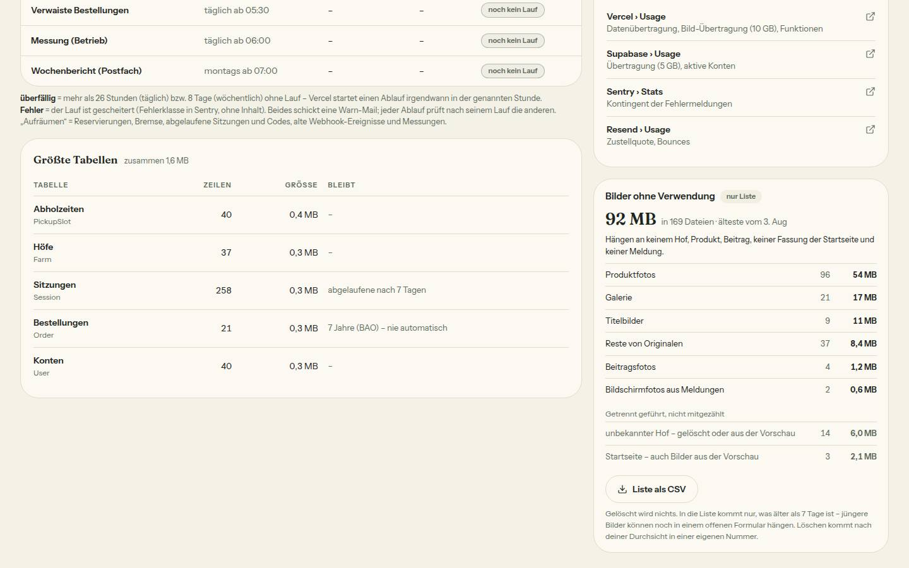

# Bericht Nr. 104 – Aufräumen und Bilder ohne Verwendung (Register N18)

## Was geändert wurde
- `src/server/aufraeumen.ts` (neu): `raeumeAltesAuf` – je ein `deleteMany` mit fester Grenze: Session 7 Tage nach Ablauf, Verification 1 Tag nach Ablauf, WebhookEvent nach 30 Tagen ohne `MELDE_VERMERK_TYP`, BetriebMessung nach 400 Tagen; nur Zahlen ins Ergebnis.
- `src/app/api/cron/cleanup-reservations/route.ts`: ruft das Aufräumen in eigenem `try` (wie die Bremse), Ergebnis `aufgeraeumt`.
- `src/lib/betrieb.ts`: Aufbewahrung (`aufraeumGrenzen` + Konstanten), 19 neue Messungs-Arten, Arten der Bilder (`ordneBildEin`, `pfadAusAdresse`, `bildUrlsAusInhalt`, `bilderOhneVerwendung`, `ohneVerwendungWerte`, `ohneVerwendungKarte`), „Was hilft“ (`hilftSatz`), Spalte „Bleibt“ (`tabellenBleibt`), Text des Ablaufs „Aufräumen“, alle Sätze der Karte.
- `src/server/betrieb-bilder.ts` (neu): je Bild-Feld eine Abfrage nur der Adresse, Hof-Kennungen dieser Datenbank, Summen für die Messung, CSV.
- `src/server/betrieb.ts`: `messeBetrieb` zählt nur in der Produktion aus derselben Auflistung die Bilder ohne Verwendung (eigenes `try`); `zaehleAuflistungen` exportiert (die CSV-Auflistung zählt als Bild-Vorgang).
- `src/app/admin/betrieb/bilder-export/route.ts` (neu): „Liste als CSV“ – `verlangeAdminAktion`, no-store, außerhalb der Produktion 404.
- `src/app/admin/betrieb/page.tsx`, `betrieb-teile.tsx`, `loading.tsx`: Karte rechts unter „Nur im Dashboard“ bzw. am Handy unter den Abläufen, Knopf in der Warnkarte, „davon … ohne Verwendung“ in der Kachel, Spalte „Bleibt“, Satz zu „Aufräumen“ unter den Abläufen.
- Tests neu: `betrieb-bilder` (rein), `betrieb-bilder-server`, `aufraeumen` (Wache am Syntaxbaum), `integration/aufraeumen.int`; angepasst `admin-seiten-wache`.
- Wiederverwendet: `listeBilder`, `KARTE`/`KNOPF_RAHMEN`, `Chip`, `EmptyState`, `csvFeld`, `formatTagKurz`. Neu, weil: keine Aufbewahrungs- und keine Bild-Zuordnungsregel vorhanden.

## Eigene Dateien (`git diff --name-only 9a41c34...HEAD`)
DEVELOPMENT.md · docs/ai/ARCHITECTURE.md · docs/ai/BAUSTEINE.md · docs/nachtlauf/berichte/104.md · docs/nachtlauf/berichte/bilder/104/betrieb-bilder-ohne-verwendung-1440-hell.jpg · src/app/admin/betrieb/betrieb-teile.tsx · src/app/admin/betrieb/bilder-export/route.ts · src/app/admin/betrieb/loading.tsx · src/app/admin/betrieb/page.tsx · src/app/api/cron/cleanup-reservations/route.ts · src/lib/betrieb.ts · src/server/aufraeumen.ts · src/server/betrieb-bilder.ts · src/server/betrieb.ts · tests/admin-seiten-wache.test.ts · tests/aufraeumen.test.ts · tests/betrieb-bilder-server.test.ts · tests/betrieb-bilder.test.ts · tests/integration/aufraeumen.int.test.ts

## Datenschutz-Hinweis (für die Datenschutzerklärung)
Sitzungen speichern IP-Adresse und Browserangabe. Sie werden jetzt 7 Tage nach ihrem Ablauf gelöscht (Anmeldecodes 1 Tag nach Ablauf); eine laufende Anmeldung bleibt.

## Annahmen
- Grenzen konservativ: genau an der Grenze bleibt eine Zeile; Messungen gehen erst, wenn ihr UTC-Tag mehr als 400 Tage zurückliegt.
- Scheitert das Aufräumen, scheitert der Ablauf nicht (eigenes `try`, Sentry nur mit Klasse) – wie die Bremse.
- Die CSV enthält nur die gezählten Arten; unbekannter Hof und Startseite stehen nur auf der Karte („nicht mitgezählt“). Pfade tragen Hof-Kennungen und bei Originalen den bereinigten Dateinamen vom Gerät – keine Namen oder Adressen werden ergänzt.
- Ein Pfad außerhalb der bekannten Ordner (`farms/<id>/<zweck>/`, `originals/<id>/`, Startseite) wird weder gezählt noch gelistet. `User.image` gilt nicht als Bild-Feld (kein Upload schreibt dorthin).
- Die CSV listet auf Klick neu (eine Auflistung je Klick, als Bild-Vorgang gezählt) – Dateien je Bild werden nicht gespeichert (keine Schema-Änderung).

## Nicht gelöst
- Die Warn-Mail nennt die Bilder ohne Verwendung noch nicht (Mockup email-betrieb-warnung): dafür müsste `pruefeGrenzen` die Größe mitgeben – außerhalb „nur die Summen“ in `src/server/betrieb.ts`.
- Kommentar an `BetriebMessung` in `prisma/schema.prisma` („das Aufräumen kommt mit Nr. 104“) ist veraltet – Schema-Zeile, darum nicht angefasst.

## Wie der Mensch es testet
- Nach dem Deploy, am Morgen nach 05:00 (Wiener Zeit): Supabase-SQL lesend `select count(*) from "Session" where "expiresAt" < now() - interval '7 days'` → 0; `… "Verification" … interval '1 day'` → 0; Melde-Vermerke (`type = 'meldung.erstattung_gescheitert'`) unverändert.
- `/admin/betrieb` (Produktion) nach der Messung: Karte „Bilder ohne Verwendung“ mit Summe, ältester Datei, Arten; „Liste als CSV“ lädt eine Datei mit Art;Pfad;Größe;hochgeladen. In der Vorschau steht stattdessen „Nur in der Produktion – …“; `/admin/betrieb/bilder-export` antwortet dort 404.
- „Größte Tabellen“: Spalte „Bleibt“ (z. B. Sitzungen „abgelaufene nach 7 Tagen“).

## Prüfung
typecheck grün; lint 0 Fehler / 5 Warnungen (wie zuvor); `pnpm test` 413 Dateien / 8204 Tests grün; Integration (Sperre) aufraeumen, betrieb, erstattung-gescheitert, verwaiste-bestellungen, bremse-datenbank: 5 Dateien / 64 Tests grün; Gegenprobe: ohne die Melde-Vermerk-Bedingung und mit 5 statt 7 Tagen wird `aufraeumen.int` rot.

## Bilder und Mockup-Abweichungen

- Lokal mit `VERCEL_ENV=production`, Test-DB; die Zahlen der Karte sind erfundene Messzeilen per psql (22 Zeilen BetriebMessung, 1 BetriebWarnung), danach gelöscht (0/0 belegt). Axe 0 Verstöße (1440 hell und dunkel, 390), Tippflächen 44 px, keine waagrechte Rolle bei 390.
- Abweichungen (im Bild): getrennt geführte Zeilen „unbekannter Hof …“ und „Startseite …“ unter „Getrennt geführt, nicht mitgezählt“ (Freigabe verlangt sie, Mockup zeigt sie nicht); Satz zu „Aufräumen“ um „und Messungen“ ergänzt (stimmt sonst nicht).

## Angepasste `.md`
`docs/ai/ARCHITECTURE.md` (§5 „Aufbewahrung und Bilder ohne Verwendung“), `DEVELOPMENT.md` (Eintrag Nr. 104), `docs/ai/BAUSTEINE.md` (erzeugt).

## Nacharbeit
- Warn-Mail um die Bilder ohne Verwendung ergänzen (s. o.); Schema-Kommentar beim nächsten Schema-PR.

## Regelvorschlag
Ursache: Bild-Felder sind über neun Spalten und ein Json verteilt; ein neues Feld ohne Eintrag in `ladeBildVerwendung` ließe seine Bilder als „ohne Verwendung“ erscheinen. Gegenmaßnahme: Wache, die jedes Schema-Feld mit `Url`/`url`/`bild` im Namen gegen die Liste in `ladeBildVerwendung` prüft. Ort: `tests/aufraeumen.test.ts` (Prüfung vor Textregel).
