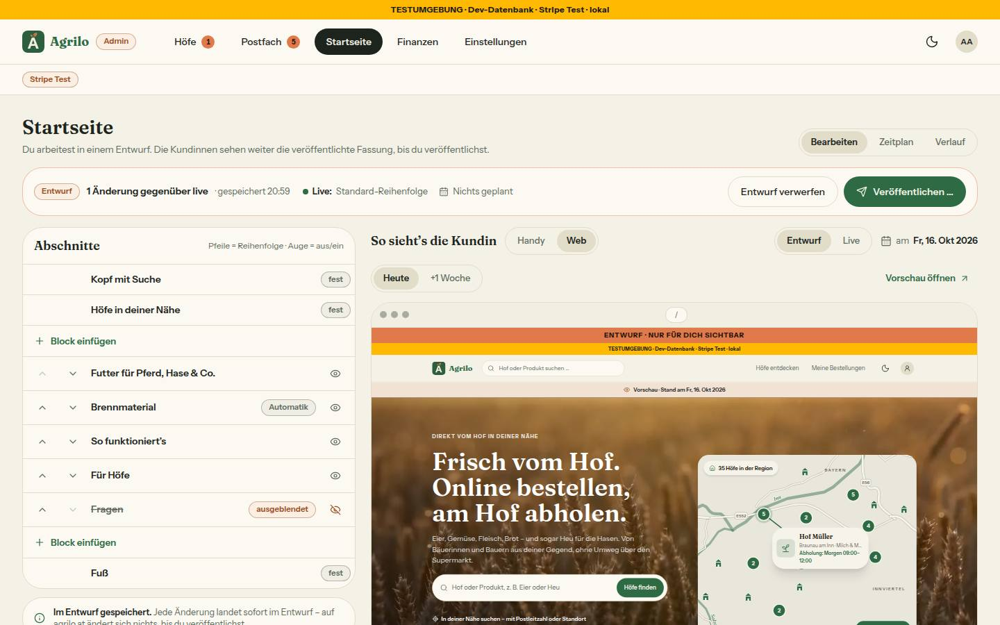
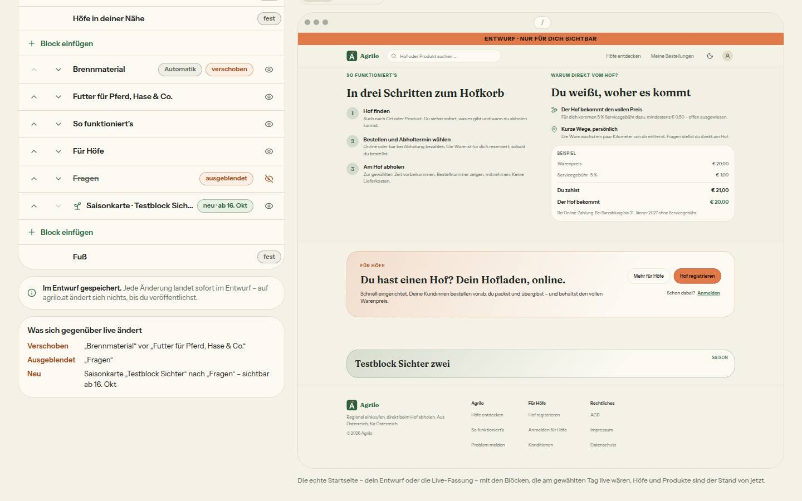
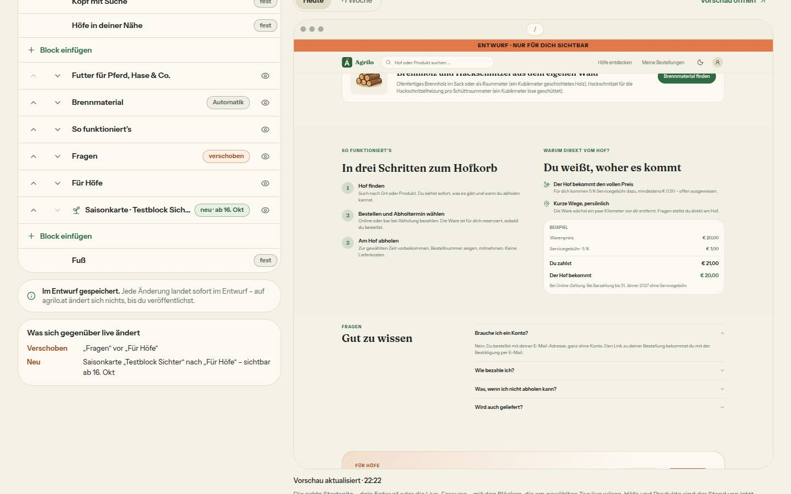
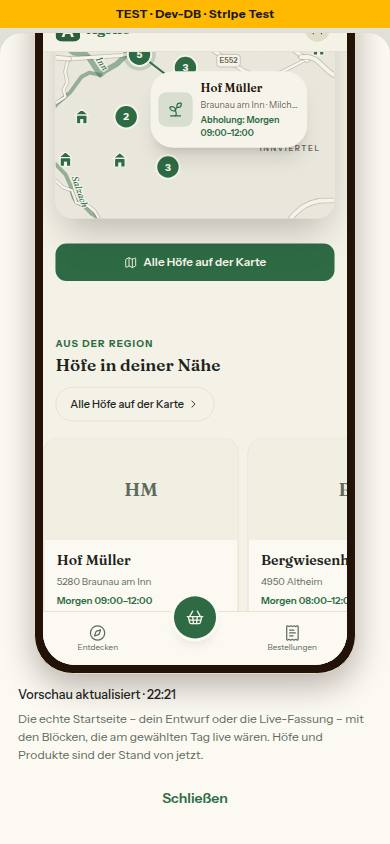

# Nr. 106 – Startseiten-Vorschau reagiert auf Änderungen; Nacharbeit 99 und 100 (Register N16, Ergänzung)

Branch `nacht/2026-10-16/106-startseite-vorschau` (von `docs/lauf16`, Basis bf57be4). Keine Migration, kein Schema, kein neues Paket, kein Netz außer localhost. Geprüft: typecheck 0, lint 0 Fehler / 5 Warnungen (keine in meinen Dateien), test 403 Dateien / 8052 Tests grün (+1 Datei, +10 Tests gegenüber docs/lauf16), test:integration (startseite-fassung, startseite-gestalten) 15 grün unter der Sperre.

## Ursache (zwei Sätze)
Ein Rahmen, der nicht neu lädt, ließ sich weder nachstellen (sichter: dev und Produktionsmodus, Auge, Pfeil, Block-Formular – jedes Mal nach 1–2 s der Entwurf) noch im Code finden: (a) jede Speicherung zählt `speicherungen` und holt eine neue, eindeutige Adresse, (b) `beendeStartseitenVorschau` läuft nur beim Aushängen und die Actions laufen nacheinander, der Draft Mode bleibt an, (c) die Antwort mit Cookie ist `private, no-cache, no-store` (sichter, Header gemessen). Gezeigt hat sich dagegen, dass jede Speicherung den Rahmen durch einen neuen ersetzte (`key={pfad}`) – er war kurz leer und begann oben, sodass eine Änderung weiter unten (Fragen, Reihenfolge) außer Sicht geschah und die Vorschau aussah wie vorher; dass die Projektleitung genau das sah, ist wahrscheinlich, aber nicht belegt.

Nebenbei an (a) gefunden und behoben: „Löschen“ zählte nicht; ein in derselben Sitzung angelegter Block steht in `zeilen` ohne Daten – nach „Löschen“ blieb seine Zeile stehen (nächste Speicherung „veraltet“), nach „Fertig“ zeigte die Liste ihn leer und zählte ihn nicht als Änderung („Veröffentlichen“ gesperrt bis zum Neuladen). Belegt mit Prüfstand-Tests, die auf dem alten Stand rot sind.

## Was geändert wurde
- `src/components/admin/startseite-vorschau.tsx`: zwei Rahmen statt `key`-Tausch – der sichtbare bleibt, der neue lädt unsichtbar, scrollt nach `load` an die Stelle des alten und tauscht dann; Ladepunkt, „Vorschau aktualisiert · hh:mm“ (Wien), Titel mit Quelle.
- `src/components/admin/startseite-entwurf.tsx`: `blockGeloescht` (zählt, entfernt auch die Zeile eines neuen Blocks); `oeffneBlock` übernimmt den Stand des Blocks, der zugeht.
- `src/components/admin/startseite-gestalten.tsx`: „Löschen“ ruft `blockGeloescht`.
- `src/lib/startseite-fassung.ts`: `vorschauQuelleText`, `vorschauBandText`, `vorschauRahmen`, `scrollNachNeuladen` (rein); `ENTWURF_TEXT.fassung`.
- `src/lib/startseite-gestalten.ts`: Texte `vorschauAktualisiert`, `vorschauLaedt`, `rahmenTitel`.
- `src/app/page.tsx`: Band „Vorschau · Entwurf · Stand am …“ (Quelle).
- `src/server/queries/startseite.ts`: Planungen ohne Obergrenze, erreichte Fassungen getrennt (höchstens 50).
- `src/lib/format.ts` / `src/lib/finanzen.ts`: `csvBetrag` nach format.ts; `testzahlungAusgelassen`, `testzahlungenHinweisImJahr`.
- `src/app/admin/finanzen/jahr-seite.tsx`, `jahr-monate.tsx`: Hinweis zum Vorjahr nur mit „vergleichen“.
- Tests: neu `startseite-vorschau-neuladen.test.ts` (Wache a–c: neue Adresse je Speicherung, kein Aus dazwischen, Tausch mit Scroll); `startseite-entwurf.test.ts` (Zähler je Änderungsart, „Fertig“); `startseite-fassung.test.ts` (Band, Rahmen); feste Uhr in `startseite-aktion.test.ts` und beiden Integrationstests; Cent-Rechnung (`csvCent`) in `finanzen-jahr*.ts`, `finanzen-export-route.test.ts`, `admin-finanzen-jahr.test.ts`. Gegenproben: `beende` im Neulade-Effekt bzw. ein Rahmen statt zwei → 3 rot; alter Lösch-Filter bzw. altes `oeffneBlock` → rot; Zeitplan mit `take: 50` über alles → Integrationstest rot.
- Doku: `DEVELOPMENT.md`, `docs/ai/BAUSTEINE.md` (erzeugt). Wiederverwendet: `uhrzeitInWien`, `standText`, Prüfstand-Muster (tests/startseite-entwurf.test.ts). Neu, weil: kein Baustein lädt einen Rahmen im Hintergrund nach.

## Eigene Dateien (`git diff --name-only bf57be4...HEAD`)
DEVELOPMENT.md · docs/ai/BAUSTEINE.md · docs/nachtlauf/berichte/106.md · docs/nachtlauf/berichte/bilder/106/vorher-vorschau-1440-hell.jpg · …/vorher-vorschau-ende-1440-hell.jpg · src/app/admin/finanzen/jahr-monate.tsx · src/app/admin/finanzen/jahr-seite.tsx · src/app/page.tsx · src/components/admin/startseite-entwurf.tsx · src/components/admin/startseite-gestalten.tsx · src/components/admin/startseite-vorschau.tsx · src/lib/finanzen.ts · src/lib/format.ts · src/lib/startseite-fassung.ts · src/lib/startseite-gestalten.ts · src/server/queries/startseite.ts · tests/admin-finanzen-jahr.test.ts · tests/finanzen-export-route.test.ts · tests/finanzen-jahr-daten.ts · tests/finanzen-jahr.test.ts · tests/integration/startseite-fassung.int.test.ts · tests/integration/startseite-gestalten.int.test.ts · tests/startseite-aktion.test.ts · tests/startseite-entwurf.test.ts · tests/startseite-fassung.test.ts · tests/startseite-vorschau-neuladen.test.ts. `src/server/startseite-vorschau.ts` und `src/server/actions/startseite.ts` unverändert (Signatur der Vorschau-Adresse wie bisher).

## Annahmen
- Scroll-Regel: Der neue Rahmen übernimmt `scrollY` des alten, wenn dieser die Startseite zeigt; sonst (andere Seite im Rahmen, fremde Herkunft) oben. `VorschauImRahmen` hängt nur an der Hofseite – kein Konflikt. Gilt auch beim Wechsel Entwurf | Live und „Stand am“.
- „Vorschau aktualisiert · hh:mm“ steht schon nach dem ersten Laden (Zeitpunkt des Ladens), nicht erst nach einer Änderung.
- Die beiden Fehler um „Löschen“/„Fertig“ habe ich behoben, weil sie im selben Weg (Prüfpunkt a, Block-Formular) liegen und die Entwurfsanzeige nicht reagieren ließen; Dateien in meinen Grenzen.
- `jahrImBereich` prüft die Obergrenze schon (`gewuenscht > laufendesJahr`, Test `finanzen-jahr.test.ts` 2027 → 2026) – keine Änderung.

## Nicht gelöst
- Axe `landmark-unique` (moderat) im Rahmen bleibt: Kopf und Hauptbereich von AdminShell stehen neben Kopf, Hauptbereich und Benachrichtigungen der eingebetteten echten Seite (KundeShell, Toaster). Keine dieser Landmarken liegt in `src/app/admin/startseite/**`; `admin-shell.tsx` gehört 103, `kunde-shell.tsx` 107. Der Rahmen hat jetzt einen eindeutigen Titel.
- Axe `aria-progressbar-name` (Finanzen › Monat): nach dem Laden 0 Verstöße (lokal gemessen); im Server-HTML fehlt `aria-labelledby`, weil Base UI die Label-Kennung erst nach der Hydrierung setzt – wer vorher misst, sieht den Fehler. **Nachtrag des Dirigenten:** `src/components/ui/progress-bar.tsx` setzt jetzt `aria-label={beschriftung}` am Balken (Grenzerweiterung; keine andere Nummer berührt die Datei), Test in `tests/bausteine.test.ts` zuerst rot, dann grün.

## Wie der Mensch es testet
Vorschau-Deployment, als Admin `/admin/startseite` (1440): Rahmen weit nach unten scrollen, Auge bei „Fragen“ aus → der Rahmen bleibt stehen, oben rechts ein Punkt, nach ≤ 2 s ohne „Fragen“ an derselben Stelle, darunter „Vorschau aktualisiert · hh:mm“. Am Handy (375): Auge bei „Fragen“ antippen, dann „Vorschau“ unten → das Blatt zeigt den Entwurf ohne Fragen und „Vorschau aktualisiert · hh:mm“. Solange das Blatt offen ist, lässt sich nichts ändern; jedes Öffnen beginnt oben (die Scroll-Position bleibt am Handy nicht über das Schließen hinweg). Finanzen › Jahr unverändert; mit „vergleichen“ erscheint der Testzahlungs-Satz nur, wenn das Vorjahr eine Testzahlung auslässt.

## Angepasste `.md`
`DEVELOPMENT.md` (Nr. 106), `docs/ai/BAUSTEINE.md` (erzeugt), dieser Bericht.

## Nacharbeit / Regelvorschlag
- Regelvorschlag – Ursache: Ein `key` aus einer Adresse, die sich bei jeder Speicherung ändert, ersetzt ein iframe ganz (leer, Scroll weg). Gegenmaßnahme: Rahmen, die nach Speicherungen neu laden, tauschen erst nach `load` (Muster `vorschauRahmen`). Ort: DESIGN_SYSTEM „Vorschau“; Prüfung vor Textregel: Quelltext-Wache „kein `key` mit Vorschau-Adresse an einem iframe“.
- Die Liste des Entwurfs übernimmt Server-Props nie still (Nr. 99, Absicht); der Stand eines Blocks kommt nur über den Hook – andere Wege (z. B. Hof-Auswahl ohne Slugs in der Zeile nach „Fertig“) prüfen.

## Bilder
Vorher (sichter, 1440, hell):  . Nachher (sichter, hell):  . Selbst geprüft ohne Bild (dev, Stand-Wechsel ohne Datenänderung): Ablauf sichtbar 700 → sichtbar 700 + unsichtbar ladend mit Punkt → sichtbar 700; Axe Admin › Startseite 1 moderat (`landmark-unique`, s. oben), Finanzen › Monat 0. Keine Daten geändert.

## Bild-Test (sichter, agent-browser, nach der Umsetzung)
- 1440: Auge/Pfeil → neuer Rahmen hinter dem sichtbaren, Tausch erst nach `load`, nie ein leerer Rahmen (19 Läufe), Ladepunkt, „Vorschau aktualisiert · hh:mm“. Zeit bis zum neuen Bild: Produktion 1,06–1,15 s, dev 1,80–2,36 s (4 von 13 knapp über 2 s; 0,8 s davon Ruhezeit des automatischen Speicherns).
- Scroll-Position: 800 → 800 (dev und Produktion), 1800 → 1800 (Produktion); in dev tief gescrollt +58 px durch Scroll-Verankerung, der Inhalt bleibt an derselben Stelle. Am Handy im Blatt (390, 375) gleich.
- Block-Formular: Bei 1440 ersetzt das Formular den Rahmen (Mockup); nach „Fertig“ steht der neue Titel nach etwa 1,5 s im frisch eingehängten Rahmen (oben).
- Axe: `/admin/startseite` 1 × `landmark-unique` (AdminShell und Toaster der eingebetteten Seite, nicht in `src/app/admin/startseite/**`); `/admin/finanzen` 0. Testdaten (Entwurf) gesichert und exakt zurückgesetzt.

