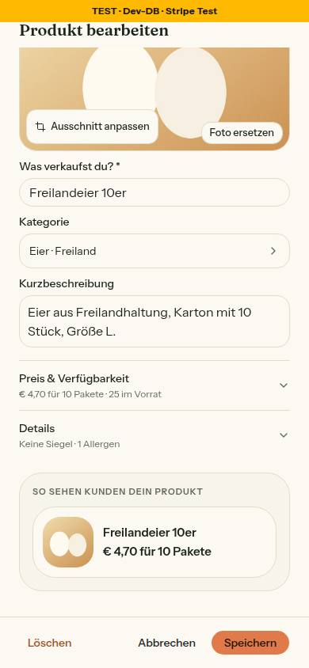
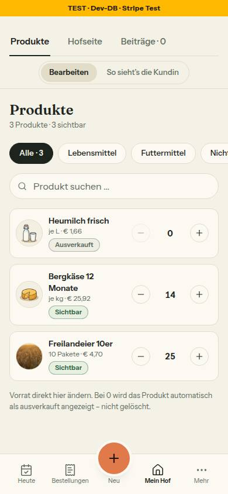

# Nr. 108 – Ersetzte Fotos bleiben liegen; Nacharbeit 97 und 98 (Register N17, Ergänzung)

## Was geändert wurde
- `src/app/api/upload/verarbeiten/route.ts`: Das Löschen von `altUrl` entfällt samt Feld; Guards (Sitzung, Rolle, Hof, E-Mail, Zweck, Pfad, Größe) und das Original-Löschen in `finally` sind Zeile für Zeile unverändert.
- `src/components/shared/image-upload.tsx`: `ladeFotoHoch` und `useImageUpload` kennen kein `altUrl`/`oldUrl` mehr; 422 `BILD_ZU_KLEIN` wirft den Satz mit der Mindestkante.
- `product-dialog.tsx`, `product-grid.tsx`, `farm-page-view.tsx` (`currentBannerUrl` weg), `status-new-client.tsx`, `teilen-client.tsx`: schicken kein altes Bild mehr mit.
- `src/lib/upload-pfade.ts`: `BILD_ZU_KLEIN_TEXT` neben `STARTSEITE_MIN_KANTE` (Zahl aus der Konstante); Kommentar zu `darfGeloeschtWerden` (bleibt).
- `src/server/actions/appearance.ts`: `updateFarmLogoAction` setzt `logoAusschnitt` im selben Update auf NULL und leert den Cache von /hoefe; `updateBannerFocusAction` gelöscht (per grep ohne Aufrufer).
- `src/components/mein-hof/bild-bausteine.tsx`: Logo ohne zweiten Aufruf; „Passt so“ nach dem Upload schließt ohne Aufruf und ohne zweiten Toast; kleines Logo der Browser-Vorschau mit Ausschnitt (`logoAusschnitt` am `TitelbildBaustein`).
- `status-new-client.tsx`: Bild-Baustein hängt am Foto (`key={photoUrl}`).
- `src/lib/bild-ausschnitt.ts` + `src/components/shared/bild-ausschnitt.tsx`: Pfeiltasten nur auf einer Achse mit Spiel (wie Ziehen); `BILD_AUSSCHNITT_TEXT.nochNicht` entfernt (ohne Verwendung).
- Neu `src/components/shared/bild-masse.ts`: `useBildmasse` aus `titelbild.tsx` herausgelöst (Titelbild, Baustein, Mein Hof importieren von dort).
- `src/schemas/bild-ausschnitt.ts`: Kommentar „alle fünf Ziele frei“.
- Tests: neu `tests/bild-ersetzen.test.ts` (Route ignoriert `altUrl`, Weg des Produktdialogs mit Speicher-Attrappe, Satz bei 422), neu `tests/logo-ersetzen.test.ts`; angepasst `bild-ausschnitt*.test.ts` (Achse mit Spiel, `key`, Listen-Zeile 132 px), `banner-focus.test.ts` (zwei Tests des gelöschten Altwegs entfernt), Mocks in fünf Dateien, Integration `bild-ausschnitt.int.test.ts` (Logo setzt NULL).

Wiederverwendet: `ladeFotoHoch`, `BildFehler` (eigener Text), `bildStil`, `ausschnittOderNull`, `bildLage`, `HOEFE_CACHE_TAG`, Prüfstand aus `use-cart.test.ts`. Neu, weil: `useBildmasse` gehörte dem Titelbild, wird aber von drei Bausteinen genutzt (BAUSTEINE: „Bildmasse“ ohne Treffer in shared).

## Eigene Dateien (`git diff --name-only bf57be4...HEAD`)
DEVELOPMENT.md · docs/ai/BAUSTEINE.md · docs/ai/DESIGN_SYSTEM.md · docs/nachtlauf/berichte/108.md · docs/nachtlauf/berichte/bilder/108/produktdialog-neues-foto-390-hell.jpg · docs/nachtlauf/berichte/bilder/108/produkte-nach-abbrechen-390-hell.jpg · src/app/(hof)/status/new/status-new-client.tsx · src/app/api/upload/verarbeiten/route.ts · src/app/teilen/teilen-client.tsx · src/components/farm/farm-page-view.tsx · src/components/farm/product-grid.tsx · src/components/hofseite/titelbild.tsx · src/components/mein-hof/bild-bausteine.tsx · src/components/products/product-dialog.tsx · src/components/shared/bild-ausschnitt.tsx · src/components/shared/bild-masse.ts · src/components/shared/image-upload.tsx · src/lib/bild-ausschnitt.ts · src/lib/upload-pfade.ts · src/schemas/bild-ausschnitt.ts · src/server/actions/appearance.ts · tests/banner-focus.test.ts · tests/bild-ausschnitt-anzeige.test.ts · tests/bild-ausschnitt-baustein.test.ts · tests/bild-ausschnitt.test.ts · tests/bild-ersetzen.test.ts · tests/hofseite-einmal.test.ts · tests/hofseite-kunde-ansicht.test.ts · tests/hofseite-metadaten.test.ts · tests/integration/bild-ausschnitt.int.test.ts · tests/logo-ersetzen.test.ts · tests/mein-hof-bearbeiten.test.ts · tests/telefon-nach-kauf.test.ts

## Annahmen
- Ein entferntes Logo (`null`) leert auch den Ausschnitt — ohne Logo gibt es keinen.
- Vor dem Laden des Fotos (Maße unbekannt) verschieben die Pfeiltasten nichts; die Taste gilt trotzdem als erkannt (kein Scrollen der Seite).
- `teilen-client.tsx`: Prop `bisherigesTitelbild` bleibt optional und ungelesen stehen, weil `teilen/page.tsx` sie reicht und außerhalb der Grenze liegt.
- Der Aufrufer-Schutz ist der Typ: `altUrl`/`oldUrl` gibt es in keiner Option mehr; der Produktdialog-Test prüft den Weg (`ladeFotoHoch` → echte Route), nicht die Zeile im Dialog.
- Ein Test, der nur den Wortlaut von `BILD_ZU_KLEIN_TEXT` wiederholte, ist entfallen (Rahmen: keine Konstanten-Tests); geprüft wird der Wurf bei 422 und die Zahl aus der Konstante.

## Nicht gelöst
- Kleines Logo der Titelbild-Vorschau: `TitelbildBaustein` nimmt `logoAusschnitt`, aber `src/components/mein-hof/abschnitt-inhalt.tsx` (außerhalb der Grenze) reicht es noch nicht — eine Zeile `logoAusschnitt={auftritt.logoAusschnitt}` (Grenzerweiterung). Bis dahin steht das Logo dort wie bisher ohne Ausschnitt. `seitenkopf.tsx` trug ihn schon, unverändert.
- „Speichern scheitert nach dem Hochladen“ lässt sich lokal nicht zeigen (kein `BLOB_READ_WRITE_TOKEN`); belegt durch `tests/bild-ersetzen.test.ts`.
- Tippflächen unter 44 px auf /products (Umschalter 32, Filter-Chips 36, Namensknöpfe 20) sind Bestand, von 108 nicht berührt.
- tester und pruefer (gezielt: Upload-Route) startet der Dirigent; diese Sitzung hat keinen Subagenten-Aufruf.

## Wie der Mensch es testet (Vorschau)
1. /products → Produkt mit Foto bearbeiten → „Foto ersetzen“, neues Foto wählen → „Abbrechen“. Erwartung: Liste zeigt das alte Foto.
2. Dasselbe mit „Speichern“. Erwartung: neues Foto; das alte bleibt im Speicher (erscheint in Nr. 104 unter „Bilder ohne Verwendung“).
3. Admin › Startseite, Block mit Bild, ein 200 × 200-px-Bild hochladen. Erwartung: „Das Bild ist zu klein – es braucht an der kürzeren Seite mindestens 320 Pixel. Nimm ein größeres Foto.“
4. Mein Hof › Logo: neues Logo → „Passt so“. Erwartung: genau ein Toast.

## Angepasste .md
DESIGN_SYSTEM (Titelbild: Kopie mit `filter: blur(28px)` und „demselben Ausschnitt“; Bild-Baustein: Tastatur mit Spiel, Logo-Vorschau, `key` am Beitrag, neuer Absatz „Ein ersetztes Foto bleibt liegen“), DEVELOPMENT.md (Eintrag Nr. 108), BAUSTEINE.md (erzeugt).

## Nacharbeit
- `abschnitt-inhalt.tsx`: `logoAusschnitt` an `TitelbildBaustein` reichen; `teilen/page.tsx`: `bisherigesTitelbild` nicht mehr übergeben, dann die Prop in `teilen-client.tsx` entfernen.

## Regelvorschlag
Ursache: Ein Löschweg lief vor dem Speichern, das ihn rechtfertigt. Gegenmaßnahme: „Ein Blob wird erst gelöscht, wenn keine Zeile mehr auf ihn zeigt — nie im Upload, nie vor dem Speichern“ als Quelltext-Wache (`del(` nur in den benannten Wegen), Ort `tests/`, ARCHITECTURE „Upload“.

## Bilder und Mockup-Abweichungen
Seed-Hof moosbauernhof, Produkt „Freilandeier 10er“ bekam für die Aufnahme lokal `imageUrl = /landing/corn-1.jpg` (Seed hat keine Fotos); danach zurückgesetzt, Zeile vorher/nachher identisch (`imageUrl` NULL, `bildAusschnitt` NULL, `updatedAt` 19:28:03.913). Das „neue Foto“ ist ein erfundenes Testbild. Gezeigt wird nur Abbrechen (ohne Upload), nicht ein gescheitertes Speichern nach dem Upload.
- Dialog mit neuem Foto vor „Abbrechen“: 
- Nach „Abbrechen“ – das alte Foto steht: 
- Axe /products: 0 Verstöße (43 bestanden). Keine Mockup-Abweichung (Mockups unverändert, keine neue Oberfläche).
