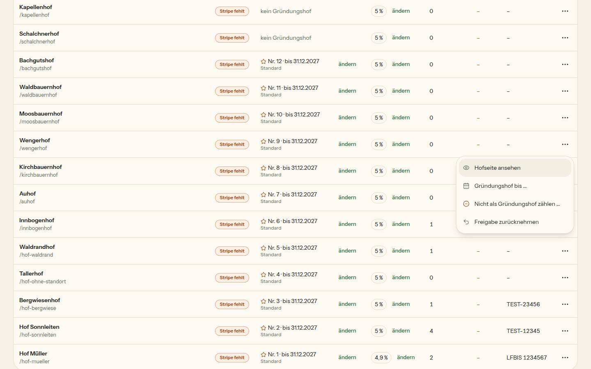
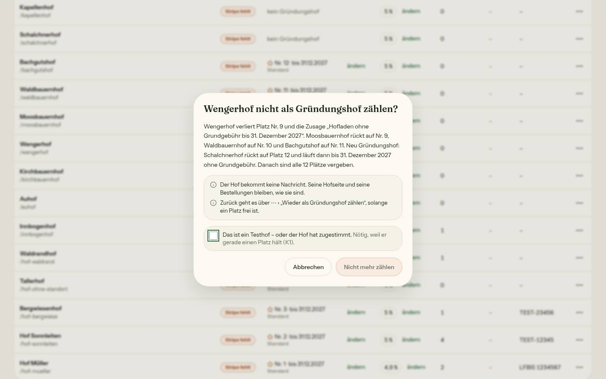
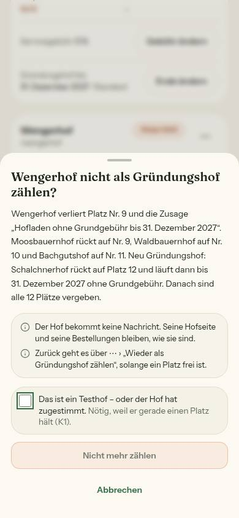
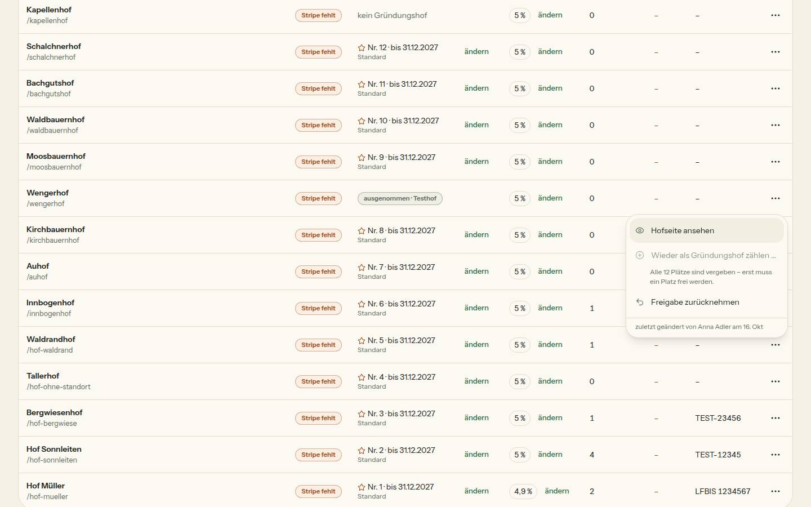
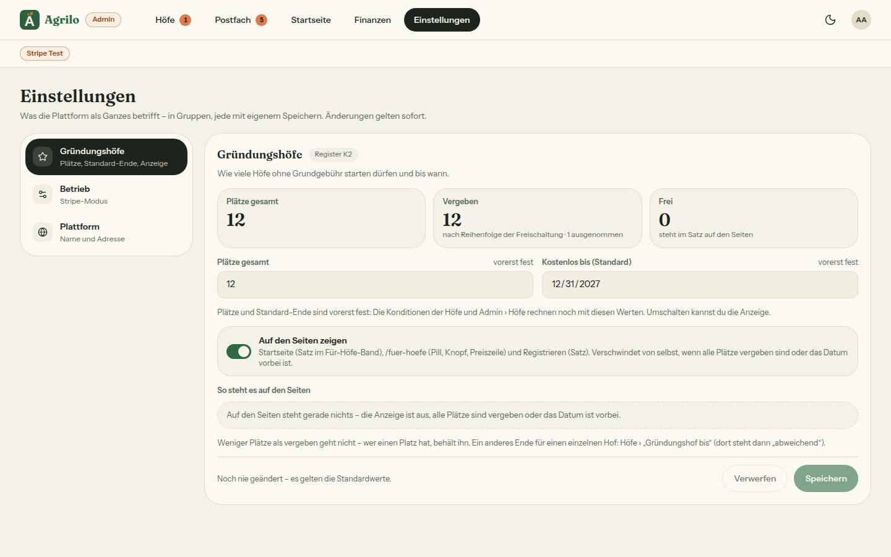

# Bericht Nr. 109 – Gründungshöfe: Testhöfe ausnehmen (Register K2, Ergänzung; K1)

## Was geändert wurde
- `prisma/schema.prisma` + Migration (unten): drei Spalten an Farm, nur Expand.
- `src/lib/gruendungshof.ts`: `HofFuerPlatz.gruendungAusgenommen` (Pflicht), `gruendungsplaetze` lässt ausgenommene weg; neu `GRUENDUNGSPLAETZE_SPERRE`, `wiederAufnahmeMoeglich`, `folgenDerAenderung`, `zaehleAusgenommene`, Marke und Satz „Alle n Plätze sind vergeben …“.
- `src/server/queries/admin.ts`: Feld in `HOF_FUER_GRUENDUNG` und im Select von `getAdminFarms` (dazu wer/wann); `ladeHoefeFuerGruendung(db = prisma)` liest in der Transaktion.
- `src/server/actions/gruendung.ts` + `src/schemas/gruendung.ts` (neu): `nimmAusGruendung`, `nimmWiederAuf` – Admin-Wache, Zod, Sperre, bedingte Updates, Haken bei Platz, Plätze aus der Einstellung.
- `src/server/actions/admin.ts`: `approveFarmAction` schaltet unter derselben Sperre in EINER Transaktion frei und bestimmt den Platz; `legeGruendungsNachrichtAn` bekommt die Zusage herein.
- `src/lib/admin-hoefe-seite.ts`: Kennzahl „n von {Plätze} · k ausgenommen“, Texte/Sätze der Bestätigung (`gruendungAenderung`, `folgenSaetze`), „zuletzt geändert …“, Warteliste kennt ausgenommene.
- `src/lib/admin-hoefe.ts`: Zeile trägt `gruendungAusgenommen`.
- `src/app/admin/page.tsx`: Plätze aus der Einstellung, Namen für „zuletzt geändert“, Änderung je Hof.
- `src/components/admin/hoefe-ansicht.tsx`: Stern und Marke in der Spalte, Menü ⋯ mit „Gründungshof bis …“, „Nicht als / Wieder als Gründungshof zählen …“ (ausgegraut mit Grund), „zuletzt geändert“; `gruendung-ausnehmen-dialog.tsx` (neu): Bestätigung, am Handy Blatt.
- `src/components/admin/einstellungen-gruendung.tsx`, `src/lib/plattform-einstellung.ts`: Kachel „Vergeben … · k ausgenommen“.
- `src/app/admin/einstellungen/page.tsx`: eine Zeile (`ausgenommen`) – **Grenzerweiterung**, siehe Nicht gelöst.
- Tests: neu `gruendung-ausgenommen`, `gruendung-ausnehmen-actions`, `gruendung-ausgenommen-wache`, `migration-gruendung-ausgenommen`, `integration/gruendung-ausgenommen.int`; angepasst 8 bestehende (Feld, Kennzahl, Transaktion im Mock).

```sql
-- prisma/migrations/20261016120000_gruendung_ausgenommen/migration.sql (Kopfkommentar gekürzt)
SET lock_timeout = '5s';
ALTER TABLE "Farm" ADD COLUMN IF NOT EXISTS "gruendungAusgenommen" BOOLEAN NOT NULL DEFAULT false,
ADD COLUMN IF NOT EXISTS "gruendungGeaendertAm" TIMESTAMP(3),
ADD COLUMN IF NOT EXISTS "gruendungGeaendertVonUserId" TEXT;
```

## Eigene Dateien (`git diff --name-only bf57be4...HEAD`)
DEVELOPMENT.md, docs/ai/ARCHITECTURE.md, docs/ai/BAUSTEINE.md, docs/nachtlauf/berichte/109.md, docs/nachtlauf/berichte/bilder/109/*.jpg (5), prisma/migrations/20261016120000_gruendung_ausgenommen/migration.sql, prisma/schema.prisma, src/app/admin/einstellungen/page.tsx, src/app/admin/page.tsx, src/components/admin/{einstellungen-gruendung,gruendung-ausnehmen-dialog,hoefe-ansicht}.tsx, src/lib/{admin-hoefe-seite,admin-hoefe,gruendungshof,plattform-einstellung}.ts, src/schemas/gruendung.ts, src/server/actions/{admin,gruendung}.ts, src/server/queries/admin.ts, tests/{admin-ansichten,admin-hoefe-seite,admin-hoefe,farm-approval,gruendung-ausgenommen-wache,gruendung-ausgenommen,gruendung-ausnehmen-actions,gruendung-bis-lader,gruendung-seiten,gruendungshof,migration-gruendung-ausgenommen,plattform-einstellung}.test.ts, tests/integration/gruendung-ausgenommen.int.test.ts

## Annahmen
- Aus- und Wiederaufnehmen nur für freigeschaltete, nicht stillgelegte Höfe (K2: „freigeschalteten Hof“); zweimal ausnehmen antwortet „hat sich inzwischen geändert“ und schreibt nichts.
- Wiederaufnahme wörtlich nach K2 nur bei freiem Platz – auch wenn der Hof hinten einsortiert würde.
- Freigabe-Zeitpunkt entsteht nach der Sperre (sonst könnte ein früherer Zeitstempel einen eben vergebenen Platz verschieben).
- Startseite: der Satz kommt aus `gruendungFuerSeiten` (frisch), nicht aus dem Cache der Fassung → `revalidatePath('/')`, kein `updateTag`.
- `ladeHoefeFuerGruendung` bekam einen optionalen Client-Parameter (eine Zeile neben `HOF_FUER_GRUENDUNG`).

## Nicht gelöst
- **Grenzerweiterung nötig:** `src/app/admin/einstellungen/page.tsx` (eine Zeile, Zahl der Ausgenommenen an die Kachel) – ohne sie kann die Kachel „· k ausgenommen“ nicht zeigen. Kein Konflikt: 103 stapelt auf 109.
- Kein tester/pruefer-Aufruf möglich (kein Agent-Werkzeug in dieser Sitzung) – der zweite Prüfdurchgang liegt beim Dirigenten.

## Wie der Mensch es testet
Vorschau `/admin?reiter=alle` als Admin: ⋯ an einem Testhof mit Platz › „Nicht als Gründungshof zählen …“ → Folgen in Zahlen, Knopf erst mit Haken → Marke „ausgenommen · Testhof“, Höfe danach rücken auf, Kennzahl „· 1 ausgenommen“; `/admin/einstellungen` Kachel „· 1 ausgenommen“; `/fuer-hoefe` nennt einen Platz mehr frei. ⋯ › „Wieder als Gründungshof zählen …“ → alter Stand. Produktion bleibt unverändert, bis jemand ausnimmt.

## Angepasste .md
ARCHITECTURE (neuer Punkt vor „Plattform-Einstellungen“: ausgenommen, Wache, Sperre), DEVELOPMENT.md (Eintrag Nr. 109), BAUSTEINE (erzeugt).

## Nacharbeit
- `speichereGruendungEinstellung` nimmt die Sperre noch nicht – wichtig, sobald die Sperre der Einstellungen (12 Plätze) fällt.
- Kennzahl am Handy: „12 von 12“ wird bei 375 px in der Kachel knapp (gemessen nur 390 px).

## Regelvorschlag
Ursache: Eine Platzvergabe aus mehreren Zeilen hatte keine Sperre (zwei Wege vergaben denselben Platz; Integrationstest ohne Sperre rot). Gegenmaßnahme: Wache „jede Action, die `approvedAt` oder `gruendungAusgenommen` auf einen Wert setzt, der einen Hof ins Rennen bringt, nimmt `GRUENDUNGSPLAETZE_SPERRE`“ (Quelltext-Test), Ort: tests/, Nr. 110.

## Bilder (hell; Axe 0 Fehler in Dialog, Blatt, Einstellungen; Liste mit offenem Menü 1 × `region` am Menü-Portal, wie vorher; Tippflächen Menü 44 px, Knöpfe 44 px, Haken-Feld 59/78 px)
    
Testdaten: Seed-Hof wengerhof über die Oberfläche ausgenommen, danach per psql `gruendungAusgenommen=false`, beide Spalten `NULL` (Prüfabfrage: 0 Höfe mit geändertem Wert).
Mockup-Abweichungen: Tabelle behält die Spalten aus Nr. 94 (Servicegebühr, Stripe …) und „ändern“ in der Zelle; Kennzahl am Handy als Kachel „Plätze“ statt Zeile; im Menü „Freigabe zurücknehmen“ statt „Stilllegen …“ (bestehende Aktion). Wiederverwendet: BestellDialog (Dialog/Blatt), StatusBadge/Marke, DropdownMenu, Kennzahlen / Neu, weil: kein Baustein für die Bestätigung mit Folgen und Haken.
