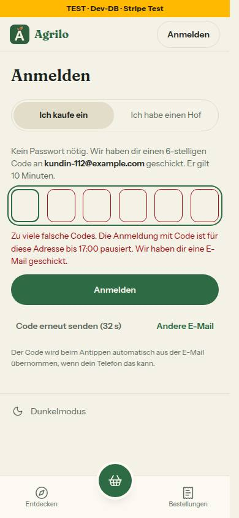

# Bericht Nr. 112 – Code- und Passwort-Raten bremsen (Register E7, Ergänzung; Nachtlauf 17)

Basis 91dea05, keine Migration, keine neuen Pakete, ein Bild. Wiederverwendet: `DB_BREMSEN`, `zaehleVersuche`, `bremsSchluessel`/`adressMerkmal`, `mitFrist` und die gedrosselte Sentry-Meldung (`meldeBremsFehler`), `nachDerAntwort`, `uhrzeitInWien`/`tagInWorten`/`zeitpunktFuerMail`, `genauesIlikeMuster`, `EmailLayout`. Neu, weil: keine Bremse zählte je Adresse über alle Codes, keine war fail-closed, keine Mail sagte „zu viele Versuche".

## Was geändert wurde
- `src/lib/anmeldecode.ts`: Grenzen (10/h, 30/Tag Codes; 10/h Passwörter), `istFehlversuch`, Sätze aus Mockup und Freigabe, `zuVieleFehlversucheAntwort` (429-Körper mit `code`, `pauseBis`, `message`), Mail-Texte, `anmeldeFehlerVon`/`passwortZuVieleText` fürs Formular.
- `src/lib/bremse-datenbank.ts`: `code-fehler-stunde`, `code-fehler-tag`, `passwort-fehler`, Mail-Drosseln `code-fehler-mail-stunde`/`-tag` und `passwort-fehler-mail` (je max 1); reine Regeln `fehlversuchSperreBis`, `pauseBeginntBis`, `warnMailDrosseln`.
- `src/server/bremse-datenbank.ts`: Helfer für Fehlversuche – `zaehleVersuchVorab` (zählt vorab atomar, fail-closed), `zaehleAlsFehlversuch` (Mail beim Vollwerden über `nachDerAntwort`, nur an Konten, durch die Drossel), `gibVersuchZurueck`, `loeschePasswortFehlversuche`.
- `src/lib/auth.ts`: `hooks.before` für `/sign-in/email-otp` (vorab zählen vor der Rollenprüfung; Hof-Ablehnung bleibt gezählt), `/sign-in/email` (vorab zählen), `/reset-password` (Adresse merken); neues `hooks.after` als Weiche nach Pfad (Fehlversuch bleibt, sonst zurückgeben; nach Zurücksetzen Zähler löschen); `sendResetPassword` über `nachDerAntwort`.
- `src/server/bestellungen-finden.ts`: `pruefeBestellCode` zählt vorab in denselben Zählern; pausiert → `ZU_VIELE` mit `bis`; ein richtiger Code gibt zurück. `src/server/actions/bestellungen-finden.ts` und `src/lib/bestellungen-finden.ts` (Grenzerweiterung, Runde 3): Satz mit Uhrzeit (`bestellCodePauseText`).
- `src/components/anmelden/kunde-code-formular.tsx`, `hof-anmeldung.tsx`: zeigen den Satz mit Uhrzeit. `src/emails/zu-viele-versuche.tsx` (neu), `src/lib/email.ts` (nur `sendZuVieleVersucheEmail`).
- Tests: `tests/code-bremse.test.ts` (29), `tests/zu-viele-versuche-email.test.ts` (3), `tests/bestellungen-finden-aktion.test.ts` (+1), `tests/integration/code-bremse.int.test.ts` (13). Doku: ARCHITECTURE §Bremse, DEVELOPMENT.md, BAUSTEINE (`pnpm bausteine`).

## Eigene Dateien (`git diff --name-only 91dea05...HEAD`)
DEVELOPMENT.md, docs/ai/ARCHITECTURE.md, docs/ai/BAUSTEINE.md, docs/nachtlauf/berichte/112.md, docs/nachtlauf/berichte/bilder/112/code-anmeldung-zu-viele-390-hell.jpg, src/components/anmelden/hof-anmeldung.tsx, src/components/anmelden/kunde-code-formular.tsx, src/emails/zu-viele-versuche.tsx, src/lib/anmeldecode.ts, src/lib/auth.ts, src/lib/bestellungen-finden.ts, src/lib/bremse-datenbank.ts, src/lib/email.ts, src/server/actions/bestellungen-finden.ts, src/server/bestellungen-finden.ts, src/server/bremse-datenbank.ts, tests/anmeldecode.test.ts, tests/bestellungen-finden-aktion.test.ts, tests/code-bremse.test.ts, tests/integration/anmeldecode.int.test.ts, tests/integration/code-bremse.int.test.ts, tests/zu-viele-versuche-email.test.ts

## Annahmen
- **Die drei Bremsen gelten in jeder Umgebung**, nicht nur in Produktion: Merkmal ist die Adresse, keine IP (wie `neuigkeitenGebremst`) – so prüft der Integrationstest die echte Bremse ohne Schalter; Vorschau und lokal verhalten sich wie die Produktion.
- „Falscher Code" = jede gescheiterte Prüfung mit Code (`INVALID_OTP`, `OTP_EXPIRED`, `TOO_MANY_ATTEMPTS`); beim Passwort `INVALID_EMAIL_OR_PASSWORD`. Ungültige Adressen zählen nicht.
- Pause = festes Fenster (UTC-Stunde bzw. UTC-Tag, wie alle Bremsen); Uhrzeit in Wiener Zeit, endet sie nicht heute: „morgen um 02:00". Mockup-Regeltext (1 h, dann 4 h; 15 min beim Passwort) weicht von der Freigabe ab – es gilt die Freigabe/E7.
- Eine Mail je Pause: Nur der Fehlversuch, der genau `max` sieht, stellt sie an; die Drossel je Fenster der vollen Bremse (Stunde bzw. Tag; Passwort 1/Tag) hält es bei einer, auch wenn derselbe Stand zweimal gesehen wird; antwortet sie nicht, keine Mail. Mail an jedes Konto der Adresse, auch an einen Hof; beide ohne Link.
- Fail-closed ohne Uhrzeit: Antwortet die Datenbank nicht, 429 „Zu viele Anfragen." – das Formular (und „Bestellungen finden") zeigt den bestehenden Satz „Das waren gerade zu viele Versuche …".
- Zurücksetzen: Der `before`-Hook merkt die Adresse je Aufruf an `ctx.context` (WeakMap); gelöscht wird nur nach Erfolg (Integrationstest: abgelehntes Zurücksetzen löscht nichts).
- Gleichzeitig zum noch laufenden 10. Versuch eintreffende Versuche werden abgelehnt, auch wenn der 10. stimmt (zur sicheren Seite; Runde 2). „Bestellungen finden" sagt bei einer Pause denselben Satz wie die Code-Anmeldung, inkl. „Wir haben dir eine E-Mail geschickt" (verrät nicht, ob es ein Konto gibt).

## Nicht gelöst
- Gleiche Antwortzeit Hof/Kundin nur angenähert (beide zählen mit einer Schreibanweisung; die Kundin läuft zusätzlich durch das Plugin), nicht gemessen.
- **Bekannte Grenze (E7):** Wer eine Adresse kennt, kann ihre Anmeldung mit Code oder Passwort jede Stunde neu pausieren (10 Fehlversuche). Keine Sperre auf Dauer; beim Passwort hilft „Passwort vergessen".
- Hinweis: Zwei frühe Läufe meines Integrationstests (Uhr 2027) ließen Better Auths Aufräumen in `farmerzone_test` kurzlebige Verification-Zeilen anderer Nummern löschen (nur Test-DB); seither steht die Uhr gestern.

## Wie der Mensch es testet (Vorschau)
1. /account/login → „Ich kaufe ein", eine Test-Adresse (mit Konto) → Code schicken → 10 × falscher Code. Erwartung: 10 × „Der Code stimmt nicht …", danach „Zu viele falsche Codes. Die Anmeldung mit Code ist für diese Adresse bis hh:00 pausiert. …" – auch mit dem richtigen Code und unter /bestellungen; genau eine Mail „Zu viele falsche Codes" (ohne Code, ohne Link; im Log-Modus eine Zeile `[E-Mail] KEIN API-KEY — würde senden: "Zu viele falsche Codes · …"`).
2. Dasselbe mit einer erfundenen Adresse: dieselbe Meldung, keine Mail.
3. /login als Hof: 10 × falsches Passwort → „Zu viele Versuche – versuch es nach hh:00 wieder oder setz dein Passwort zurück."; „Passwort vergessen" → Link → neues Passwort → Anmeldung geht sofort.
Lokal belegt (Dev-Server 3112, Test-DB): 10 × 400, dann 429 mit Satz; eine Log-Zeile nur für `kundin@example.com`, keine für die erfundene Adresse. Danach `RateLimitZaehler` der Zwecke `code-fehler-*`/`passwort-fehler*` in `farmerzone_test` gelöscht (43 Zeilen, Kontrolle 0) und die eine Code-Zeile der erfundenen Adresse.

## Bild
 – 390, hell, Axe 0 Verstöße, Tippflächen ≥ 44 px. Keine Mockup-Abweichung im Bild.

## Angepasste .md
docs/ai/ARCHITECTURE.md (Punkt „Fehlversuche je Adresse" nach „Zweistufige Bremse"), DEVELOPMENT.md, docs/ai/BAUSTEINE.md (erzeugt).

## Nachbesserung Runde 1
- **Blocker Hof erkennbar:** Das Plugin antwortete Kundin und unbekannter Adresse beim 6. falschen Versuch auf denselben Code mit 403 `TOO_MANY_ATTEMPTS`, nach Ablauf mit `OTP_EXPIRED`; ein Hof (bekommt nie einen Code) sah immer 400 `INVALID_OTP`. Jetzt gibt `hooks.after` nach dem Zählen `alsFalscherCode` zurück: 400 `INVALID_OTP`, über HTTP als fertige `Response` – ein dort geworfener Fehler ersetzte nur den Körper, den Status 403 behielte Better Auth (`dispatchAuthEndpoint` → `toResponse`, nachgelesen); bei `auth.api` geworfen. Der Satz zu `INVALID_OTP` sagt „stimmt nicht oder ist abgelaufen". Pfad im `after`-Hook als Literal.
- **Test zuerst rot, dann grün:** Integrationstest – Hof, Kundin und unbekannte Adresse: 7 falsche auf denselben Code, ein abgelaufener, bis zur Pause; Status, Statustext, Content-Type und Körper über HTTP gleich, je 10 gezählt (rot: 403/`OTP_EXPIRED` nur bei der Kundin). `anmeldecode.int.test.ts` erwartet bei zu oft probiertem bzw. abgelaufenem Code `INVALID_OTP`, `anmeldecode.test.ts` „abgelaufen". Dateien: DEVELOPMENT.md, ARCHITECTURE, Bericht, src/lib/anmeldecode.ts, src/lib/auth.ts, die drei Tests.

## Nachbesserung Runde 2
- **Blocker Prüfen und Zählen getrennt:** Gleichzeitige Versuche sahen alle einen Stand unter 10. Jetzt zählt `zaehleVersuchVorab` jeden Versuch vorab atomar; abgelehnt wird, wessen Stand VOR dem Versuch 10 erreichte. Ein Erfolg oder ein anderer Fehler gibt zurück (`gibVersuchZurueck`: `updateMany` mit `zaehler >= 1`, im Fenster der Zählung), eine Ablehnung wegen Pause sofort. Gleich für Passwort, Code-Anmeldung und „Bestellungen finden". `fehlversucheGesperrt`/`zaehleFehlversuch` entfallen.
- **Test zuerst rot, dann grün:** 20 gleichzeitige falsche Passwörter bzw. Codes (rot: 20 von 20 geprüft); richtiges Passwort und richtiger Bestellcode zählen nicht; Unit: Erfolg gibt zurück, Ablehnung füllt das Tagesfenster nicht (Gegenprobe rot), Zurückgeben scheitert → wirft nicht, Quelltext-Wache. Dateien: Doku, auth.ts, beide bremse-datenbank.ts, server/bestellungen-finden.ts, Tests.

## Nachbesserung Runde 3
- **„Bestellungen finden" in der Pause** (Grenzerweiterung durch den Dirigenten): `pruefeBestellCode` gibt `bis` mit, die Action zeigt `bestellCodePauseText` = `zuVieleCodesText` mit Uhrzeit (eine Quelle mit der Code-Anmeldung), fail-closed (`bis: null`) den Satz ohne Uhrzeit. Test zuerst rot (alter Satz „Warte eine Minute …"), Gegenprobe ohne Uhrzeit.
- **Eine Mail je Fenster auch bei Gleichzeitigkeit:** Ein zurückgegebener Versuch ließ den nächsten Fehlversuch wieder 10 sehen → zweite Mail. Jetzt zählt jede Mail vorher ihre Drossel (`warnMailDrosseln`, max 1 je Fenster der vollen Bremse; Passwort 1/Tag); scheitert die Drossel, keine Mail. Unit zuerst rot (2 Mails; Drossel kaputt → trotzdem Mail), Integration: zwei Aufrufe mit Stand 10 → eine Mail, Drossel-Stand 2.
- Integrationstest prüft gleichzeitig genau 10 statt höchstens 10 (geprüft und Stand, Code und Passwort). `ZuVieleVersucheEmail` mit `React.JSX.Element`; `fehlversuche` nimmt das Merkmal (kein doppeltes `adressMerkmal`); Kann erledigt: `FehlversuchArt` in email.ts als Typ-Import in der Signatur (Importzeilen oben unberührt, geteilte Datei), Hülle `fehlerVon` entfernt. `src/lib/auth.ts` unverändert. Dateien der Runde: DEVELOPMENT.md, ARCHITECTURE, BAUSTEINE, Bericht, kunde-code-formular.tsx, zu-viele-versuche.tsx, src/lib/bestellungen-finden.ts, src/lib/bremse-datenbank.ts, src/lib/email.ts, src/server/actions/bestellungen-finden.ts, src/server/bestellungen-finden.ts, src/server/bremse-datenbank.ts, drei Tests.

## Nacharbeit
- Keine offene aus den Runden 1–3. Hinweis für Tests: Zwei gleichzeitige dynamische Importe eines gemockten Moduls (`await import('@/lib/email')` im Nachlauf, `Promise.all`) luden in Vitest einmal das echte Modul – Nachlauf in Tests nacheinander abarbeiten.

## Regelvorschlag
Ursache: Integrationstests mit `vi.setSystemTime` in der Zukunft lösen Better Auths Aufräumen (`findVerificationValue` löscht alles mit `expiresAt < jetzt`) gegen die geteilte Test-DB aus. Gegenmaßnahme: feste Uhr in Integrationstests nur in der Vergangenheit. Ort: TESTING_GUIDELINES §1 „Zeit in der Integrationsschicht"; Prüfung vor Textregel: Wache, die `setSystemTime` in `tests/integration/` nur mit einem Zeitpunkt vor `Date.now()` erlaubt.
