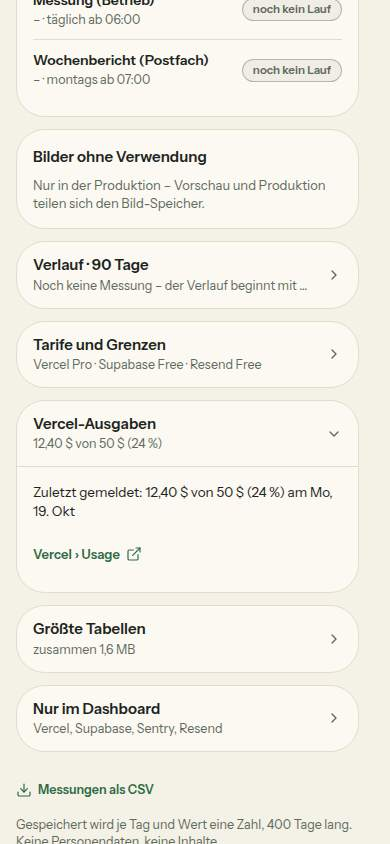

# Bericht Nr. 113 – Betrieb: Lebenszeichen von außen, Vercel Pro, Vercel-Ausgaben; Nacharbeit 103/104 (Register N18)

## Was geändert wurde
- `src/lib/betrieb.ts`: `TARIFE.vercel = 'PRO'`, Pro-Grenzen `null` (`grenzeVon`; Kacheln ohne Prozent/Balken mit „nutzungsbasiert (Pro) – zählt zum Ausgabenlimit“, keine Verlaufslinie, `grenzSchritt` mit `null` → alte Stufe still auf 0), Tarif-Zeile Pro, `fehlendeAblaeufe` (Lebenszeichen), Vercel-Ausgaben (`VERCEL_ABRECHNUNG_TAG = 19`, `abrechnungsBeginn`, `vercelStufe`, `vercelSchritt`, `vercelAusgabenKarte`, Mail, Warnkarte), `neuMessenAb` statt `darfNeuMessen`, Merker `MESS_BEGINN_ART`, Mail-Anlass mit `ohneVerwendungBytes`.
- `src/server/betrieb.ts`: `beginneMessung` (EINE Anweisung), `verbucheVercelAusgaben` (Messung, bedingte Stufe, Mail nach der Antwort), `pruefeGrenzen` mit `nachher`, Grenze `null`, Bilder ohne Verwendung in der Mail und stillem Neubeginn des Abrechnungszeitraums.
- `src/server/queries/betrieb.ts`: `letzteMessungAm(mitBeginn)`. `src/server/actions/betrieb.ts`: „Jetzt messen“ über `beginneMessung`, Mail nachher.
- `src/app/api/lebenszeichen/route.ts` (neu): Bearer, konstante Zeit, fail-closed 503, Antwort nur `{ ok: true }` bzw. `{ fehlen: [Namen] }`.
- `src/app/api/webhooks/vercel-ausgaben/route.ts` (neu): Rohtext → HMAC-SHA1 in konstanter Zeit → JSON/Zod → Cent; ohne Geheimnis 500, Signatur falsch/fehlt 400.
- `.github/workflows/lebenszeichen.yml` (neu): `schedule 17 7 * * *` + `workflow_dispatch`, `permissions: {}`, kein Checkout, Secret nur unter `env:`.
- `src/app/admin/betrieb/page.tsx`, `betrieb-teile.tsx`, `loading.tsx`: Karte „Vercel-Ausgaben“ rechts nach „Tarife und Grenzen“, am Handy Klappkarte danach; Satz statt Balken. `bilder-export/route.ts`: try/catch nur um Auflistung/Abfragen, 500 mit festem Satz, Sentry nur Klasse + `ohneAnfrage`. Anfang der Route unverändert (für 115).
- `src/schemas/betrieb-messung.ts`: `vercelAusgabenSchema`; `src/lib/env.ts`, `.env.example`: zwei optionale Variablen.
- Tests: neu `lebenszeichen.test.ts`, `vercel-ausgaben.test.ts`, `lebenszeichen-workflow.test.ts`; ergänzt `betrieb.test.ts`, `betrieb-server.test.ts`, `betrieb-seite.test.ts`, `betrieb-bilder-server.test.ts`.

## Eigene Dateien (`git diff --name-only 91dea05...HEAD`)
.env.example · .github/workflows/lebenszeichen.yml · DEVELOPMENT.md · docs/ai/ARCHITECTURE.md · docs/ai/BAUSTEINE.md · docs/nachtlauf/berichte/113.md · docs/nachtlauf/berichte/bilder/113/betrieb-1440-hell.jpg · docs/nachtlauf/berichte/bilder/113/betrieb-390-hell.jpg · src/app/admin/betrieb/{betrieb-teile.tsx, bilder-export/route.ts, loading.tsx, page.tsx} · src/app/api/lebenszeichen/route.ts · src/app/api/webhooks/vercel-ausgaben/route.ts · src/lib/betrieb.ts · src/lib/env.ts · src/schemas/betrieb-messung.ts · src/server/{actions/betrieb.ts, betrieb.ts, queries/betrieb.ts} · tests/{betrieb-bilder-server, betrieb-seite, betrieb-server, betrieb, lebenszeichen-workflow, lebenszeichen, vercel-ausgaben}.test.ts

Wiederverwendet: `geheimnisGleich`, `Karte`/`Klappkarte`, `Marke`, `nachDerAntwort`, `setzeStufe`/`setzeNull`, `ohneAnfrage`, `hilftSatz`. Neu, weil: `VercelAusgabenInhalt` (kein Baustein für Satz + Link nach außen in einer Karte), `beginneMessung` (Merker statt Lesen-dann-Schreiben).

## Nachbesserung Runde 1 (Punkte des Dirigenten; Tests zuerst rot, dann grün)
1. `src/lib/betrieb.ts` `fehlendeAblaeufe`: ein TÄGLICHER Ablauf ohne Zeile zählt als fehlend (503 mit Namen); `tests/lebenszeichen.test.ts`: eine Zeile fehlt, Tabelle leer, Gegenprobe nur Wochenlauf ohne Zeile → 200.
2. `formatDollar(cent)` neu in `src/lib/format.ts` (Grenzerweiterung durch den Dirigenten, nur diese Funktion; dieselbe Ganzzahl-Rechnung), `dollarText` aus `src/lib/betrieb.ts` entfernt; `tests/betrieb.test.ts` prüft sie unverändert.
3. Token-Länge unter „Nicht gelöst“ berichtigt (48 Hex-Zeichen).
4. `src/server/betrieb.ts` `setzeNullVorZeitraum`: stilles Zurücksetzen in EINER Anweisung mit `"gemeldetAm" < abrechnungsBeginn(jetzt)` — in `pruefeGrenzen` und an der gleichen Stelle im Webhook-Pfad (Meldung unter 50 %); `tests/vercel-ausgaben.test.ts` prüft Text und Werte der Anweisung.
5. `src/schemas/betrieb-messung.ts`: `budgetAmount`/`currentSpend` höchstens 1 000 000 $ → darüber 400, nichts gespeichert; Gegenprobe genau an der Grenze 200.
Dateien der Runde (`git diff --name-only 133c554`): DEVELOPMENT.md · docs/ai/{ARCHITECTURE, BAUSTEINE}.md · docs/nachtlauf/berichte/113.md · src/lib/{betrieb, format}.ts · src/schemas/betrieb-messung.ts · src/server/betrieb.ts · tests/{betrieb, lebenszeichen, vercel-ausgaben}.test.ts. Anfang der Export-Routen unverändert (115).

## Annahmen
- Lebenszeichen fail-closed (Runde 1, vom Dirigenten festgelegt): Ein täglicher Ablauf ohne Zeile fehlt; nur der Wochenlauf hat ohne Zeile Schonfrist (nach dem Ausfall vom 19.10. womöglich keine Zeile bis Montag).
- Abrechnungszeitraum in UTC (0 Uhr am 19.); Stufe aus `thresholdPercent` (50/75/100), `teamId` geprüft, nie gespeichert. Warnstufe und Mail nur in der Produktion, gespeichert wird immer.
- Tarif-Zeile: Marke „Pro · nutzungsbasiert“, der Satz beginnt mit „Ausgabenlimit in Spend Management.“ — die Marke kürzt lange Texte mit Auslassung (eine Zeile, G5).
- Bilder ohne Verwendung in der Mail: nur beim Bilder-Speicher („Was hilft“ wie die Seite) — unter Pro warnt der Bilder-Speicher nicht mehr; die Regel bleibt für einen Tarif mit Grenze und ist an `betriebMail` geprüft.
- Webhook-Schema in `src/schemas/betrieb-messung.ts` (die Meldung wird zur Messung; neue Schema-Datei lag außerhalb der Grenze).

## Nicht gelöst
- Bei 100 % pausiert Vercel das Projekt — dann nimmt die Seite den Aufruf womöglich nicht mehr an; es bleibt nur Vercels eigene Mail.
- Nebenläufigkeit von `beginneMessung` nur an Postgres per Hand belegt (BEGIN … ROLLBACK, drei Aufrufe: belegt / gesperrt / nach 10 min wieder frei), kein Integrationstest (keiner für 113 vorgesehen).
- `src/proxy.ts` (nur gelesen): `/api/*` liegt außerhalb des matchers, beide Routen gehen ohne Sitzung durch; eine Herkunftsprüfung für POST gibt es dort nicht — für den Webhook ersetzt die Signatur sie. Kein Rate-Limit am Lebenszeichen (Token 48 Hex-Zeichen aus `openssl rand -hex 24`, Vergleich in konstanter Zeit).
- pruefer-Lauf: Diese Sitzung kann keine Subagenten starten — die gezielte Prüfung der zwei Routen und des Workflows bleibt dem Dirigenten.

## Wie der Mensch es testet
1. Vorschau `/admin/betrieb` als Admin: Kacheln Bilder und Bild-Vorgänge ohne Prozent, mit „nutzungsbasiert (Pro) – zählt zum Ausgabenlimit“; Karte „Vercel-Ausgaben“: „Unter 50 % – Vercel meldet erst ab 50 % des Limits.“ und Link „Vercel › Usage“.
2. `curl -i https://<vorschau>/api/lebenszeichen` → 401 (mit gesetzter Variable; ohne Variable 503).
3. Nach Schritt A unten: GitHub › Actions › Lebenszeichen › „Run workflow“ → grün; Vercel › Spend Management › Webhook „Send test“ (falls angeboten) → Karte zeigt „Zuletzt gemeldet …“.

**Für die Projektleitung (Morgenbericht „Für dich zu tun“):** A) `openssl rand -hex 24` → als `LEBENSZEICHEN_TOKEN` in Vercel (Production) UND als GitHub-Secret `LEBENSZEICHEN_TOKEN` (gleicher Wert). Bis dahin scheitert der Workflow täglich (bewusst). B) In Vercel › Settings › Billing › Spend Management einen Webhook auf `https://agrilo.at/api/webhooks/vercel-ausgaben` anlegen und dessen Geheimnis als `VERCEL_AUSGABEN_SECRET` in Vercel (Production) setzen.

## Angepasste `.md`
`docs/ai/ARCHITECTURE.md` (§5 „Betrieb: Lebenszeichen von außen, Vercel Pro und Vercel-Ausgaben“), `DEVELOPMENT.md` (Eintrag Nr. 113), `docs/ai/BAUSTEINE.md` (erzeugt) — in Runde 1 alle drei nachgezogen (fail-closed, `formatDollar`, bedingter Neubeginn, Obergrenze).

## Bilder (hell; Testwerte 12,40 $ von 50 $ per psql für heute, danach genau diese zwei Zeilen gelöscht: `DELETE 2`, Rest 0)

Axe 0 Verstöße (1440 und 390; bei 390 ein „incomplete“ am Reiter Startseite der Shell, nicht von 113), Link „Vercel › Usage“ 44 px hoch. Mockup-Abweichung (begründet durch Freigabe 113.1): Verlauf ohne Linie der Bilder, Kacheln ohne Balken für Bilder/Bild-Vorgänge — beides im Bild 1440.

## Nacharbeit
- Integrationstest für `beginneMessung` (zwei gleichzeitige Klicks → ein Beginn) und `verbucheVercelAusgaben` (zwei gleichzeitige Meldungen → eine Mail).

## Regelvorschlag
Ursache: Ein Test-Token mit zehn Ziffern am Stück schlug in der Telefonnummern-Wache an (erst im vollen Lauf bemerkt). Gegenmaßnahme: Erfundene Tokens in Tests aus Buchstaben (`…-abcdefghij`). Ort: `docs/ai/TESTING_GUIDELINES.md` §5 Testdaten (Prüfung: die Wache besteht schon).
