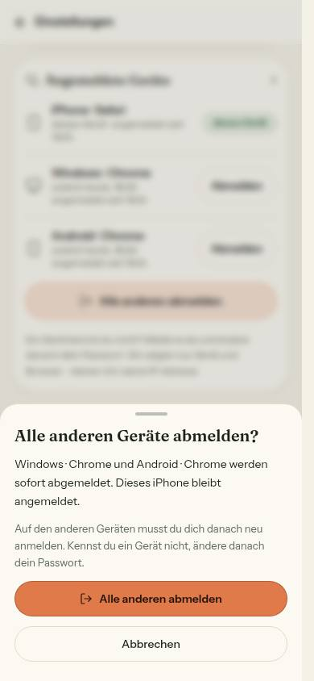

# Bericht Nr. 114 – Angemeldete Geräte, frische Sitzung, Mail bei neuem Gerät (Register E7, Ergänzung; Nachtlauf 17)

Basis 82b5936 (Endstand 112), eine Migration `20261019210000_geraete`, keine Pakete, sechs Bilder. Wiederverwendet: `hooks.after`-Weiche von 112, `nachDerAntwort`, `sendRaw` (Post-Sperre Z3), `EmailLayout`/`MAIL_FARBE`, `Card`, `Marke`, `SheetBlatt`/`Dialog`, `useMindestbreite`, `KNOPF_*` aus hof-bestellungen/stil, `KundeShellMitSitzung`, `uhrzeitInWien`/`kalendertagInWien`, `PROBLEM_MELDEN`, `createRateLimiter`, HMAC-Muster der Bremsen, Einlösen wie `bestaetigeEmpfaenger`. Neu, weil: keine Sitzungsliste, kein Gerät, kein Einmal-Link gab es; `geraetKurz` (hof-hilfe.ts) hat eine andere Form („Chrome, Windows") und liegt außerhalb der Grenzen.

## Was geändert wurde
- `prisma/schema.prisma` + Migration: `BekanntesGeraet`, `EinmalLink` (Cascade an `User`, nur Rückrelationen dort).
- `src/lib/auth.ts`: `cookieCache.enabled: false`; Geräte-Kennung im Erfolgszweig von `case '/sign-in/email'|'/sign-in/email-otp'` (Cookie über `ctx.setCookie`, Secure wie das Sitzungs-Cookie); Kommentar zu proxy.ts berichtigt. Kosten der frischen Sitzung (an pg gemessen): 2 Abfragen je Prüfung (Sitzung über Token, dann Konto), im Hofbereich 2 Prüfungen = 4 Abfragen je Seitenaufruf; vorher innerhalb von 5 Minuten 0.
- `src/lib/geraete.ts` (neu): `geraetName`, `geraetArt`, Cookie-Regeln, `geraeteZeilen`, Texte, Einmal-Link-Fristen und -Zweck. `src/server/geraete.ts` (neu): HMAC, `erkenneGeraet`, Mail im Nachlauf, `erzeugeEinmalLink`/`leseEinmalLink`/`loeseEinmalLinkEin` (`updateManyAndReturn`), `ladeNichtIch`, `ladeAngemeldeteGeraete`.
- `src/server/actions/geraete.ts` (neu): `meldeGeraetAb`, `meldeAlleAnderenAb` (Sitzung + Besitz im WHERE), `meldeAllesAbNichtIch` (Token, je IP gebremst, `requestPasswordReset` auf dem Server).
- `src/components/konto/angemeldete-geraete.tsx` (neu, Baustein) und `settings/account/page.tsx` (nach Passwort). `src/app/sicherheit/nicht-ich/` (neu: Seite, Karte, Laden). `src/emails/neue-anmeldung.tsx`, `src/lib/email.ts` (`sendNeueAnmeldungEmail`).
- `src/server/aufraeumen.ts`: löscht abgelaufene und seit 7 Tagen benutzte `EinmalLink`. `next.config.ts`/`src/lib/slug.ts`: `sicherheit` + Header-Regel `/sicherheit/:pfad*`.
- Tests: geraete (22), geraete-actions (2), neue-anmeldung-email (3), sitzung-frisch (1), integration/geraete (16); angepasst: actions-sitzung-wache (OEFFENTLICH), aufraeumen, marke-name-wache (Ausnahme gilt auch für den Namen, Gegenprobe), shells (UMGESTELLT), sicherheits-header.

## Eigene Dateien (`git diff --name-only 82b5936...HEAD`)
DEVELOPMENT.md, docs/ai/{ARCHITECTURE,BAUSTEINE,DESIGN_SYSTEM}.md, docs/nachtlauf/berichte/114.md, docs/nachtlauf/berichte/bilder/114/* (6), next.config.ts, prisma/migrations/20261019210000_geraete/migration.sql, prisma/schema.prisma, src/app/(hof)/settings/account/page.tsx, src/app/sicherheit/nicht-ich/{loading,nicht-ich-karte,page}.tsx, src/components/konto/angemeldete-geraete.tsx, src/emails/neue-anmeldung.tsx, src/lib/{auth,email,geraete,slug}.ts, src/server/actions/geraete.ts, src/server/{aufraeumen,geraete}.ts, tests/{actions-sitzung-wache,aufraeumen,geraete-actions,geraete,marke-name-wache,neue-anmeldung-email,shells,sicherheits-header,sitzung-frisch}.test.ts, tests/integration/geraete.int.test.ts

## Annahmen
- Zweck „nicht-ich:<Geräte-Kennung>" (Art + Bezug wie 115s `admin-einrichten:<sessionId>`): Die Seite zeigt so Gerät und Zeitpunkt (Mockup) ohne weitere Spalte; einlösen prüft die Art.
- Zod-Schemas in `src/lib/geraete.ts`/der Action statt `src/schemas/` (Dateigrenze). „zuletzt" = `Session.updatedAt` (auf den Tag genau, `updateAge`).
- Cookie wird bei jeder Hof-Anmeldung neu gesetzt (hält wieder 400 Tage); ungültige Form → neue Kennung. Erkennen scheitert → Anmeldung gilt, Sentry ohne Merkmal.
- Betreff für Konten ohne Hof: „Neue Anmeldung bei deinem Konto"; „Doch, das war ich" führt zur Startseite; nach dem Knopf ohne Passwort-Mail (Fehler) der Ausweg „Passwort vergessen".
- Öffentliche Action je IP 10/min (nur Produktion, Muster `bestaetigeEmail`).

## Nicht gelöst
- Gleichzeitige allererste Anmeldungen eines Kontos auf zwei Geräten: keine Mail (nur direkt nach dem Deploy).
- Datenschutz-Hinweis (für die Datenschutzerklärung): neu je Hof-/Admin-Konto Gerätename und gehashte Geräte-Kennung je Gerät mit erster/letzter Anmeldung; je Mail ein gehashter Einmal-Link (7 Tage). Kein Ort, keine IP, keine volle Browserangabe; Cookie technisch notwendig, 400 Tage.

## Wie der Mensch es testet (Vorschau)
1. Testhof in Browser A und B anmelden → /settings/account: zwei Zeilen, A „dieses Gerät". Erwartung: B bekommt die Mail „Neue Anmeldung" (A war das erste Gerät: still). 2. In A „Alle anderen abmelden" → Blatt nennt B → bestätigen → in B nächster Klick → /login. 3. Mail-Knopf öffnet `/sicherheit/nicht-ich?t=…`: nichts passiert; „Alle Geräte abmelden" → alle weg, Mail „Passwort zurücksetzen"; Link erneut → „Dieser Link gilt nicht mehr."
Lokal belegt (3114, Test-DB): 3 Anmeldungen bauer-b → 2 Log-Zeilen nur mit Betreff (kein Link); B landete nach „Alle anderen" auf /login; GET ließ Link und Sitzung stehen. Danach in `farmerzone_test` gelöscht: 3 `BekanntesGeraet`, 4 `EinmalLink`, 2 `reset-password`-Verification, 1 `RateLimitZaehler` (Kontrolle je 0); „Das war ich nicht" hatte alle Sitzungen von bauer-b gelöscht (auch 17 schon abgelaufene von früher).

## Bilder (hell; Axe 0 Verstöße auf Konto, Blatt, Seite vorher/nachher; Knöpfe ≥ 44 px, außer Augen-Knöpfe der Passwortfelder (Bestand) und Textlink „Problem melden" im Satz)
     
Mockup-Abweichungen: (1) Computer: Liste unter dem Passwort statt rechts daneben (Bild 1440) — die Seite ist einspaltig (672 px) und hat statt der Karte „Anmeldung" das volle Passwortformular; Umbau nicht beauftragt. (2) Kopf der Seite „Das war ich nicht" mit „Anmelden" statt Menü (vorher) — KundeShell ohne Sitzung. (3) „Dieses Gerät bleibt angemeldet" außer bei iPhone/iPad.

## Angepasste .md
ARCHITECTURE §5 (neuer Punkt nach „Fehlversuche je Adresse"), DESIGN_SYSTEM („Angemeldete Geräte" vor „Dialoge und Blätter"), DEVELOPMENT.md, BAUSTEINE (erzeugt).

## Nacharbeit
- Sollte (112): `code-bremse.int.test.ts` „gleichzeitig: von 20 falschen Codes …" einmal rot im Lauf mit fünf Dateien (Stand Tag 16 > 10), allein zweimal grün — Vermutung: Zeitlimit von `zaehleVersuche` unter Last → fail-closed ohne Rückgabe.
- Kann: `geraetKurz` (hof-hilfe.ts) auf die Teile von `geraetName` stellen.

## Regelvorschlag
Ursache: Eine Server-Action mit `revalidatePath` lädt die aufrufende Seite neu — eine Token-Seite fand danach den Link verbraucht und ersetzte „erledigt" durch „gilt nicht mehr". Gegenmaßnahme: Token-Actions ohne `revalidatePath`, Ergebnis in derselben Client-Komponente. Ort: ARCHITECTURE §5 „Ein Link aus einer Mail ändert nie einen Zustand" (steht jetzt im neuen Punkt); Prüfung: Integrationstest erwartet `revalidatePath` nicht gerufen.

## Migration
```sql
-- prisma/migrations/20261019210000_geraete/migration.sql (Kopfkommentar dort: Expand, kein Seed, keine IP, kein Token im Klartext)
SET lock_timeout = '5s';
CREATE TABLE IF NOT EXISTS "BekanntesGeraet" ("id" TEXT NOT NULL, "userId" TEXT NOT NULL, "kennungHash" TEXT NOT NULL, "name" TEXT NOT NULL, "erstmalsAm" TIMESTAMP(3) NOT NULL DEFAULT CURRENT_TIMESTAMP, "zuletztAm" TIMESTAMP(3) NOT NULL DEFAULT CURRENT_TIMESTAMP, CONSTRAINT "BekanntesGeraet_pkey" PRIMARY KEY ("id"));
CREATE TABLE IF NOT EXISTS "EinmalLink" ("id" TEXT NOT NULL, "zweck" TEXT NOT NULL, "userId" TEXT NOT NULL, "tokenHash" TEXT NOT NULL, "ablaufAm" TIMESTAMP(3) NOT NULL, "benutztAm" TIMESTAMP(3), CONSTRAINT "EinmalLink_pkey" PRIMARY KEY ("id"));
CREATE UNIQUE INDEX IF NOT EXISTS "BekanntesGeraet_userId_kennungHash_key" ON "BekanntesGeraet"("userId", "kennungHash");
CREATE UNIQUE INDEX IF NOT EXISTS "EinmalLink_tokenHash_key" ON "EinmalLink"("tokenHash");
CREATE INDEX IF NOT EXISTS "EinmalLink_userId_idx" ON "EinmalLink"("userId");
DO $$ BEGIN ALTER TABLE "BekanntesGeraet" ADD CONSTRAINT "BekanntesGeraet_userId_fkey" FOREIGN KEY ("userId") REFERENCES "User"("id") ON DELETE CASCADE ON UPDATE CASCADE; EXCEPTION WHEN duplicate_object THEN NULL; END $$;
DO $$ BEGIN ALTER TABLE "EinmalLink" ADD CONSTRAINT "EinmalLink_userId_fkey" FOREIGN KEY ("userId") REFERENCES "User"("id") ON DELETE CASCADE ON UPDATE CASCADE; EXCEPTION WHEN duplicate_object THEN NULL; END $$;
ALTER TABLE "public"."BekanntesGeraet" ENABLE ROW LEVEL SECURITY;
ALTER TABLE "public"."EinmalLink" ENABLE ROW LEVEL SECURITY;
```
