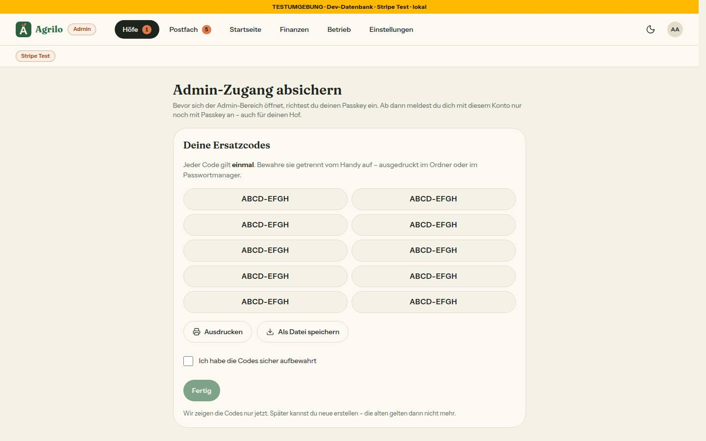
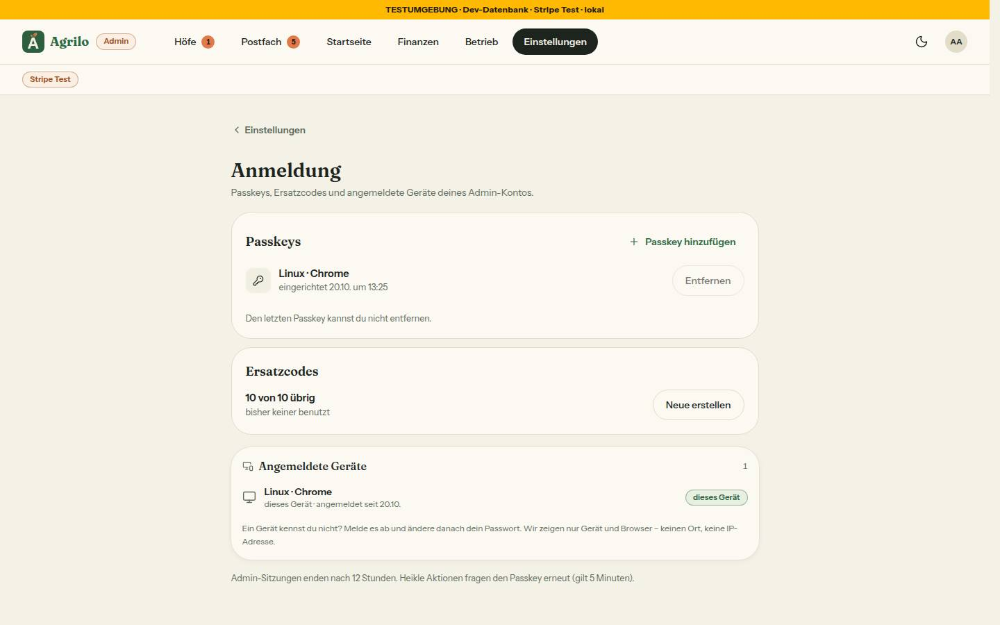

# Bericht Nr. 115 – Admin nur mit Passkey (Register N20, Ergänzung Lauf 18; Nachtlauf 18)

Basis 9f7044b (`docs/lauf18`), Migration `20261020110000_admin_passkey`, keine Pakete (`@better-auth/passkey` 1.6.23 aus dem Paket-PR), Bilder vom sichter (Pflichtseite in Runde 1 neu). Wiederverwendet: `hooks.after`-Weiche und WeakMaps an `ctx.context` (112), `erkenneGeraet`, `loeseEinmalLinkEin`/`einmalTokenHash`, `AngemeldeteGeraete` (114), `zaehleVersuche`/`DB_BREMSEN`, `BestellDialog`/`DialogFehler`, `Marke`, `Hinweiskarte`, `Seitenkopf`, `KopfLaden`, `EmailLayout`, `anmeldeZeitpunkt`, `genauesIlikeMuster`. Neu, weil: kein Passkey, keine Ersatzcodes, keine frische Bestätigung gab es; `src/lib/admin-anmeldung.ts` hält Regeln und Texte an EINER Stelle (Client und Server).

## Was geändert wurde
- `prisma/schema.prisma` + Migration: Tabellen `Passkey` (Felder des Plugins, `credentialID` eindeutig), `AdminErsatzcode`; `User.adminSeit`, `Session.passkeyAm`, `Session.anmeldeart`.
- `src/lib/auth.ts`: Plugin `passkey(…)` mit geschützter `rpID`/`origin` (503 statt Wurf), `userVerified`-Sperre in beiden `afterVerification`, Anspruch „genau ein Passkey nach Ersatzcode" per bedingtem `updateMany`; `hooks.before`: Fälle a–c auf beiden Registrierungs-Pfaden, Besitz des Passkeys vor `/passkey/verify-authentication` (frische Bestätigung), Sperre Passwort und „Passwort vergessen" für Admins mit Passkey; `hooks.after`: alte Sitzung desselben Kontos weg, `passkeyAm` nach Registrierung, Geräte-Kennung für Passkey und Ersatzcode; `databaseHooks.session.create.before` (Anmeldeart); `session.additionalFields` (`input: false`); `disabledPaths` delete-/update-passkey; Plugin `admin-ersatzcode` (`POST /admin-ersatzcode/anmelden`); lokal der eigene Port in `trustedOrigins`.
- `src/server/admin-wache.ts`: 12 Stunden (eigene Sitzung abmelden), Pflicht je Seite/Aktion (`ohnePasskey`), `verlangeFrischeBestaetigung`, `frischOderBestaetigen`, `ladeEinrichtenStand`; `src/server/adminbereich.ts` + `src/app/admin/layout.tsx`: Shell ohne Zähler im Pflicht-Zustand.
- Neu: `src/lib/admin-anmeldung.ts` (Regeln, Texte), `src/lib/ersatzcodes.ts` (Form, Zufall, HMAC über Web Crypto), `src/lib/auth-client-passkey.ts`, `src/server/actions/admin-anmeldung.ts` (E-Mail-Code, Ersatzcodes, Passkey entfernen), `src/components/admin/frisch-bestaetigen.tsx` (Dialog + `useFrischBestaetigt`), `src/emails/admin-sicherheit.tsx` + `sendAdminSicherheitEmail` (`src/lib/email.ts`).
- Seiten: `/login/admin` (Karte, Ladeansicht), `/admin/einrichten` (Schritte, `ErsatzcodesAnzeige`), `/admin/einstellungen/anmeldung`, `/admin/bestaetigen`; Eintrag „Anmeldung" in `EINSTELLUNGEN_GRUPPEN` (`plattform-einstellung.ts`, `einstellungen-gruppen.tsx`).
- Heikle Aktionen: `verlangeFrischeBestaetigung()` als erste Anweisung in `revokeFarmApprovalAction`, `rejectFarmAction`, `nimmAusGruendung`, `nimmWiederAuf`, `schreibeZusagenFest`, `markiereErstattungErledigt`; 303 in den drei CSV-Exporten; `useFrischBestaetigt` in `hof-aktion-dialog.tsx`, `gruendung-ausnehmen-dialog.tsx`, `einstellungen-gruendung.tsx`, `erstattung-erledigt.tsx` (`postfach-aufgabe-hof.tsx` ruft keine Action selbst — unverändert).
- Weg ohne Hof: `/login` leitet Admins ohne Hof nach /admin, `/account/profile` zeigt „Zum Admin-Bereich", `hof-anmeldung.tsx` den Link „Mit Passkey anmelden". „Das war ich nicht": kein Passwort-Link für Admins mit Passkey, Satz `fertigPasskey` (`geraete.ts`, Action, Karte).
- Tests: admin-anmeldung (23), admin-wache (+9), admin-seiten-wache (neue Seiten, Regel ohne `ohnePasskey`, Gegenproben), frisch-bestaetigen (Prüfstand, 5), frisch-bestaetigung-wache (5), admin-sicherheit-email (5), actions-sitzung-wache (`verlangeFrischeBestaetigung` zählt als Prüfung, Gegenprobe), 20 weitere Dateien angepasst (Attrappe `tests/admin-sitzung.ts`, Mocks der Wache); Integration: admin-passkey (24, echte Signatur über Software-Authenticator), admin-passkey-adresse (2), 10 Dateien mit `machePasskeyAdmin` (`setup/basis.ts`). Läufe: Unit 459 Dateien / 8900 Tests, Lint 0 Fehler / 5 Warnungen (Bestand), Integration GANZ 62 Dateien / 559 Tests grün.
## Eigene Dateien (`git diff --name-only 9f7044b...HEAD`)
DEVELOPMENT.md, docs/ai/ARCHITECTURE.md, docs/ai/BAUSTEINE.md, docs/ai/DESIGN_SYSTEM.md, docs/nachtlauf/berichte/115.md, prisma/migrations/20261020110000_admin_passkey/migration.sql, prisma/schema.prisma, src/app/(auth)/login/admin/admin-anmeldung-karte.tsx, src/app/(auth)/login/admin/loading.tsx, src/app/(auth)/login/admin/page.tsx, src/app/(auth)/login/page.tsx, src/app/account/profile/page.tsx, src/app/account/profile/profile-client.tsx, src/app/admin/bestaetigen/bestaetigen-karte.tsx, src/app/admin/bestaetigen/page.tsx, src/app/admin/betrieb/bilder-export/route.ts, src/app/admin/betrieb/export/route.ts, src/app/admin/einrichten/einrichten-schritte.tsx, src/app/admin/einrichten/ersatzcodes-anzeige.tsx, src/app/admin/einrichten/loading.tsx, src/app/admin/einrichten/page.tsx, src/app/admin/einstellungen/anmeldung/anmeldung-verwalten.tsx, src/app/admin/einstellungen/anmeldung/loading.tsx, src/app/admin/einstellungen/anmeldung/page.tsx, src/app/admin/finanzen/export/route.ts, src/app/admin/layout.tsx, src/app/admin/postfach/erstattung-erledigt.tsx, src/app/sicherheit/nicht-ich/nicht-ich-karte.tsx, src/components/admin/einstellungen-gruendung.tsx, src/components/admin/einstellungen-gruppen.tsx, src/components/admin/frisch-bestaetigen.tsx, src/components/admin/gruendung-ausnehmen-dialog.tsx, src/components/admin/hof-aktion-dialog.tsx, src/components/anmelden/hof-anmeldung.tsx, src/emails/admin-sicherheit.tsx, src/lib/admin-anmeldung.ts, src/lib/auth-client-passkey.ts, src/lib/auth.ts, src/lib/bremse-datenbank.ts, src/lib/email.ts, src/lib/ersatzcodes.ts, src/lib/geraete.ts, src/lib/plattform-einstellung.ts, src/server/actions/admin-anmeldung.ts, src/server/actions/admin.ts, src/server/actions/geraete.ts, src/server/actions/gruendung.ts, src/server/actions/postfach.ts, src/server/admin-wache.ts, src/server/adminbereich.ts, tests/actions-sitzung-wache.test.ts, tests/admin-anmeldung.test.ts, tests/admin-finanzen-jahr.test.ts, tests/admin-finanzen-seite.test.ts, tests/admin-reject.test.ts, tests/admin-seiten-wache.test.ts, tests/admin-sicherheit-email.test.ts, tests/admin-sitzung.ts, tests/admin-wache.test.ts, tests/betrieb-bilder-server.test.ts, tests/betrieb-seite.test.ts, tests/farm-approval.test.ts, tests/finanzen-aktionen.test.ts, tests/finanzen-export-route.test.ts, tests/frisch-bestaetigen.test.ts, tests/frisch-bestaetigung-wache.test.ts, tests/gruendung-aktion-actions.test.ts, tests/gruendung-ausnehmen-actions.test.ts, tests/gruendung-bis-admin.test.ts, tests/integration/admin-passkey-adresse.int.test.ts, tests/integration/admin-passkey.int.test.ts, tests/integration/gruendung-aktion.int.test.ts, tests/integration/gruendung-ausgenommen.int.test.ts, tests/integration/gruendung-bis.int.test.ts, tests/integration/gruendung-freischaltung.int.test.ts, tests/integration/meldungen-ablauf.int.test.ts, tests/integration/postfach-eingang.int.test.ts, tests/integration/postfach-ruhig.int.test.ts, tests/integration/postfach.int.test.ts, tests/integration/setup/basis.ts, tests/integration/startseite-fassung.int.test.ts, tests/integration/startseite-gestalten.int.test.ts, tests/meldung-admin.test.ts, tests/meldungen-nacharbeit.test.ts, tests/plattform-einstellung.test.ts, tests/postfach-erstattung-drossel.test.ts, tests/postfach-mail.test.ts, tests/postfach-ruhig.test.ts, tests/servicegebuehr-admin.test.ts, tests/startseite-aktion.test.ts, tests/testzahlungen-hinweis.test.ts
## Weg der frischen Bestätigung (gemessen in tests/integration/admin-passkey.int.test.ts)
Erneute Anmeldung mit Passkey (`signIn.passkey()` im Dialog). Fremdes Konto: 401 „Dieser Passkey gehört zu einem anderen Konto.", alte Sitzung bleibt, kein Sitzungs-Cookie, keine Sitzung beim fremden Konto — **abgewiesen: ja**. Eigener Passkey: neue Sitzung mit `passkeyAm`, alte gelöscht. Nutzerprüfung fehlt: Anmeldung 401, Einrichten 403, kein Passkey — **abgewiesen: ja** (beide). Anmeldeart entsteht in `databaseHooks.session.create.before` (der Kontext trägt `path`, belegt durch „passwort"/„passkey"/„ersatzcode" in der Datenbank).
## Annahmen
- Neue Datei `src/lib/admin-anmeldung.ts` (nicht in der Liste; Regeln/Texte gehören nicht in `ersatzcodes.ts`); Schema der Ersatzcode-Anmeldung in `src/lib/ersatzcodes.ts` statt `src/schemas/` (Dateigrenze). `nicht-ich-karte.tsx` (2 Zeilen) als Aufrufer von `fertigSatz`/`meldeAllesAbNichtIch` (Vorschlag 116); Satz: Titel „Alle Geräte sind abgemeldet" + „Melde dich mit deinem Passkey wieder an."
- 12 Stunden: Die Wache löscht die eigene, abgelaufene Sitzung („danach Abmelden"), Besitz im WHERE. Nach einem Ersatzcode gilt die Sitzung nach dem einen neuen Passkey als frisch (Ersatzcodes neu erstellen), ein zweiter Passkey aber erst nach Anmeldung mit Passkey.
- E-Mail-Code: 6 Ziffern, 10 Minuten, je Sitzung; Bremse 5 Prüfungen je Konto und Stunde (fail-closed), Versand höchstens 3 je 10 Minuten (je Instanz, nur Produktion); neuer Code lässt ältere ablaufen (kein Löschen). Mail „Admin-Sicherheit" mit vierter Art „Code für die Einrichtung". Der Code steht in keinem Log der App (Ausnahme `next dev`, siehe Nacharbeit K4). · Ersatzcode-Bremse 5 je Adresse und Stunde zählt jeden Versuch; „Neue erstellen" löscht nur unbenutzte Codes (benutzte bleiben als Zeitpunkt für die Pflicht). Lokal ist `appUrl` fest localhost:3000; `NEXT_PUBLIC_APP_URL=http://localhost:<Port>` gilt nur in `pnpm dev` zusätzlich (sonst lehnte Better Auth den Browser auf 3115 ab). Ist im Browser schon ein anderes Konto angemeldet, scheitert die Passkey-Anmeldung („gehört zu einem anderen Konto") — erst abmelden.
## Nicht gelöst / Mockup-Abweichungen
- „zuletzt" je Passkey fehlt (das Plugin speichert keinen Zeitpunkt der Nutzung; eine Spalte wäre eine zweite Schema-Änderung); Geräte-Zeilen ohne „endet um" (Baustein aus 114 unverändert); Dialog-Satz allgemein statt je Aktion; Kopf von /login/admin schlicht (Wortmarke, „Admin", Hell/Dunkel). Schritt 7 kommt später. Den Aufruf in den zwei neuen Testhof-Actions aus 119 ergänzt der Sammel-PR. Bilder:     
## Wie der Mensch es testet (Vorschau `https://farmer-zone-git-nacht-2026-10-20115-admin-passkey-bierbaron.vercel.app`)
1. In der ENTWICKLUNGSdatenbank (nur Projektleitung): `UPDATE "User" SET "adminSeit" = now() WHERE "email" = '<adresse>' AND "isAdmin" = true;`
2. Unter der Branch-Adresse mit Passwort anmelden → /admin → /admin/einrichten → „Code per E-Mail schicken", Code eingeben → „Einrichten" (Browser fragt) → „Ersatzcodes erstellen" → sichern → „Zum Admin-Bereich". Erwartung: Admin-Bereich offen, Mail „Neuer Passkey".
3. Abmelden → /login/admin → „Mit Passkey anmelden" → /admin. Passwort-Anmeldung desselben Kontos auf /login → „E-Mail oder Passwort falsch".
4. Admin ohne Hof: /login → /admin; /account/profile zeigt „Zum Admin-Bereich". Heikle Aktion (Freigabe zurücknehmen) nach 5 Minuten → Dialog „Bitte bestätige mit deinem Passkey". Notfall (alle Geräte und Codes weg): `DELETE FROM "Passkey" WHERE "userId" = '<id>';` und `adminSeit` neu setzen (Schritt 1). Unter der Adresse eines einzelnen Deployments scheitern Passkeys (gewollt).
## Für den sichter (Test-DB `farmerzone_test`, Port 3115, `start-dev-eigen.sh`)
Vorher: `SELECT "adminSeit" FROM "User" WHERE email='admin@example.com';` merken (Seed: leer), dann `UPDATE "User" SET "adminSeit" = now() WHERE email='admin@example.com';` Anmelden mit `login-hof.sh 3115 admin@example.com <session>` (Admin ohne Hof → /login führt nach /admin/einrichten). Statt des Codes aus der Mail (steht nicht im Log): `INSERT INTO "EinmalLink" (id, zweck, "userId", "tokenHash", "ablaufAm", "benutztAm") SELECT 'sichter-115', 'admin-einrichten:' || s.id, s."userId", 'sichter-115', now() + interval '10 minutes', now() FROM "Session" s JOIN "User" u ON u.id = s."userId" WHERE u.email = 'admin@example.com' ORDER BY s."createdAt" DESC LIMIT 1;` Virtueller Authenticator: `WebAuthn.addVirtualAuthenticator` mit `protocol: 'ctap2', transport: 'internal', hasResidentKey: true, hasUserVerification: true, isUserVerified: true` (für „abgewiesen" `isUserVerified: false`). Danach zurück: `DELETE FROM "Passkey"`, `"AdminErsatzcode"`, `"EinmalLink"`, `"BekanntesGeraet"`, `"Session"` je `WHERE "userId" = (SELECT id FROM "User" WHERE email='admin@example.com')`; `UPDATE "User" SET "adminSeit" = <alter Wert> WHERE email='admin@example.com';`
## Angepasste .md
ARCHITECTURE §3 (Tabelle der Wache, neuer Abschnitt „Admin-Anmeldung: nur mit Passkey"), DESIGN_SYSTEM („Admin-Anmeldung mit Passkey" vor „Dialoge und Blätter"), DEVELOPMENT.md, BAUSTEINE (erzeugt).
## Nacharbeit / Regelvorschlag
- Kann: „zuletzt benutzt" je Passkey (Spalte, eigener Auftrag); `/login/admin` könnte eine fremde Sitzung vor dem Knopf erkennen und „erst abmelden" anbieten. Regelvorschlag: Ursache — `vi.mock` eines Pakets erreicht Abhängigkeiten, die außerhalb von Vite laden, nicht (Freigabe-Hinweis `vi.mock('@simplewebauthn/server')` wäre wirkungslos geblieben). Gegenmaßnahme: Bibliotheksgrenzen mit echten Daten prüfen (hier Software-Authenticator) oder per `server.deps.inline`. Ort: TESTING_GUIDELINES §3 „Mocking"; Prüfung vor Textregel: ein Test, der zeigt, dass die Attrappe wirklich gerufen wird.
- Sollte aus Runde 1 (Dateien dieser Runde nicht angefasst): doppelte Prüfung `verlangeFrischeBestaetigung` + `verlangeAdminAktion` in admin.ts, gruendung.ts (3 Actions), postfach.ts und den drei Export-Routen → `userId` aus dem Ergebnis der frischen Bestätigung nehmen (Sammel-PR, Grenze „nur der Aufruf"); ein fail-closed-Helfer für `adminBremseVoll` (auth.ts) und `einrichtungscodeGebremst` (actions/admin-anmeldung.ts); dort `15 * MINUTE_MS` → `EINRICHTEN_SITZUNG_MINUTEN`; `emailSchema()` in `ersatzcodes.ts` (Umzug nach src/schemas/ per Grenzerweiterung); `nicht-ich-karte.tsx`: Kasten „Kommt die Mail nicht an …" im Zustand Passkey weglassen; Grenze `src/lib/admin-anmeldung.ts` bestätigt der Dirigent im Morgenbericht.
- Altlast/Kann: Tippflächen der Admin-Shell 38 px (`admin-shell.tsx`, eigener Auftrag); Abmelden eines Admins führt nach /account/login (zu entscheiden); Geräte-Karte in Einstellungen › Anmeldung mit ca. 4 px weniger Innenabstand; `weiter` per Zod-Schema.
- Sollte aus Runde 2 (Baustein aus 114, außerhalb der Grenze): `src/lib/geraete.ts:164` rät in `AngemeldeteGeraete` (Einstellungen › Anmeldung) einem Admin mit Passkey, das Passwort zu ändern, das für ihn gesperrt ist → Variante bzw. Prop ohne den Passwort-Satz.
- Kann aus der Sichtung Runde 2: K2 zweiter Einrichtversuch auf einem Gerät, das den Passkey schon hat → nur „Das hat nicht geklappt. Versuch es noch einmal.“ (Hinweis „Dieses Gerät ist schon eingerichtet“ wäre besser); K3 nach „Mit Passkey bestätigen“ für einen Export bleibt die Karte ohne „Der Download startet“; K4 `next dev` schreibt Argumente von Server-Funktionen ins Dev-Log, dort steht der E-Mail-Code der Einrichtung (nur lokal, der Produktions-Build loggt das nicht; Hinweis an die Projektleitung); Abmelden fehlt im Admin-Bereich (nur in Mein Konto, danach bleibt /account/profile stehen).
## Nachbesserung Runde 1 und 2
- **Runde 1** Blocker Testwerte: Ersatzcodes in `tests/admin-anmeldung.test.ts` nur aus Buchstaben des Alphabets, Mail-Vorlagentest mit Buchstabenwert, im Integrationstest der falsche Code zur Laufzeit aus dem echten abgeleitet; neue Wache `tests/code-testwerte-wache.test.ts` (vorher rot mit 16 Funden, Gegenprobe). Blocker Kontrast: kommende Schritte (`einrichten-schritte.tsx`) ohne `opacity-70`, gedämpft über Seitenfläche, gestrichelten Kreis und Schloss wie im Mockup; „Ersatzcodes gesichert" ohne „kommt nach dem Passkey" (Kann); Test `tests/admin-einrichten-schritte.test.ts` (rot, dann grün). Axe /admin/einrichten 390 und 1440, hell und dunkel, mit Knopf und mit Codefeld: 0 Verstöße (390: 1 „incomplete" an Links der Shell). Test-DB zurückgesetzt (`l18/115-r1-vorher.txt` = `-nachher.txt`).
- **Runde 2** Blocker Sitzung ohne Passkey: `pruefe()` (`admin-wache.ts`) verlangt ohne `ohnePasskey` nach der Pflicht auch `passkeyAm` der Sitzung (`passkeySperre`) — Seite → /login/admin ohne Löschen (Hof bleibt erreichbar), Aktion → `ADMIN_AKTION_FEHLER.ohnePasskey` „Melde dich für den Admin-Bereich mit deinem Passkey an." (auch heikle); das Layout prüft mit `verlangeAdminShell()` (eine Sitzungsabfrage, `inhaltOffen`) und lädt dann keine Zähler. Zuerst rot: admin-wache (+3, Fall „nie" der frischen Bestätigung mit `ohnePasskey`), admin-seiten-wache (Regel `verlangeAdminShell`, Shell ohne Zähler), Integration „Sitzung mit Passwort von vor dem ersten Passkey" (B: Umleitung, Satz, keine Zähler, Sitzung bleibt; Gegenprobe A). Keine Oberfläche geändert, keine neuen Bilder; die zwei nach 5471a82 neu aufgenommenen Bilder (Stand HEAD, ohne Codes) mitcommittet. Migration unverändert.
- Dateien Runde 1: tests/code-testwerte-wache.test.ts, tests/admin-einrichten-schritte.test.ts, tests/admin-anmeldung.test.ts, tests/admin-sicherheit-email.test.ts, tests/integration/admin-passkey.int.test.ts, src/app/admin/einrichten/einrichten-schritte.tsx, docs/nachtlauf/berichte/115.md, 5 Bilder unter docs/nachtlauf/berichte/bilder/115/. Läufe: Unit 461 Dateien / 8911 Tests, Lint 0 Fehler / 5 Warnungen, Integration GANZ 62 / 559 grün. — Runde 2: src/server/admin-wache.ts, src/server/adminbereich.ts, src/app/admin/layout.tsx (Kommentar), src/lib/admin-anmeldung.ts, tests/admin-wache.test.ts, tests/admin-seiten-wache.test.ts, tests/betrieb-seite.test.ts, tests/integration/admin-passkey.int.test.ts, ARCHITECTURE §3, DEVELOPMENT.md, BAUSTEINE (erzeugt), dieser Bericht, 2 Bilder. Läufe: Unit 461 / 8915, Lint 0 Fehler / 5 Warnungen, Integration GANZ 62 / 560 grün.
## Nachbesserung Runde 3
- Pflichtseite (Sollte S1 des sichters): neue Wache `verlangeEinrichtenSeite()` (`admin-wache.ts`, über `passkeySperre`) — die offene Pflicht (kein Passkey; nach Ersatzcode ohne neuen) öffnet /admin/einrichten, sonst nur eine Sitzung mit `passkeyAm` (Ersatzcodes, zweiter Passkey), sonst /login/admin ohne Löschen; gibt `pflicht` mit (eine Zählung weniger). `verlangeAdminSeite` nimmt keine Optionen mehr (keine Seite kommt um die Pflicht herum). Actions der Pflichtseite (`ohnePasskey`) und Layout (`verlangeAdminShell`, ohne Zähler) unverändert; die Umleitung der Seite greift (Integration: Passwort-Sitzung B → /login/admin, Sitzung bleibt). Zuerst rot: admin-wache (+4: B umgeleitet; Gegenproben ohne Passkey, nach Ersatzcode, mit `passkeyAm`; abgemeldet/404/12 h), admin-seiten-wache (Pflichtseite ruft `verlangeEinrichtenSeite()`, 6 Gegenproben), Integration (B umgeleitet; A und die Sitzung aus dem Ersatzcode offen).
- Text nach Ersatzcode (Kann K1): Schritt 1 zeigt bei Anmeldeart `ersatzcode`/`ersatzcode-eingeloest` den vorhandenen Titel `EINRICHTEN_TEXT.schrittErsatzcode` „Angemeldet mit Ersatzcode“ auch im Zustand „eingerichtet“ (ohne Satz: `ersatzcodeSatz` „Richte jetzt …“ gehört vor den Passkey), Prop `mitErsatzcode` — kein neuer Text. Test rot, dann grün; Gegenprobe Passwort-Weg (alter Titel samt Uhrzeit). Annahme: Nach einer Anmeldung mit Passkey bleibt dort „Bestätigt mit Passwort und Code per E-Mail“ (nicht beauftragt, kein passender Wortlaut). Keine Migration, kein Schema, kein Paket, keine Bilder.
- Dateien: src/server/admin-wache.ts, src/app/admin/einrichten/page.tsx, src/app/admin/einrichten/einrichten-schritte.tsx, tests/admin-wache.test.ts, tests/admin-seiten-wache.test.ts, tests/admin-einrichten-schritte.test.ts, tests/integration/admin-passkey.int.test.ts, ARCHITECTURE §3 (Zeile „Pflichtseite“ in der Tabelle der Wache, Abschnitt Admin-Anmeldung), DEVELOPMENT.md, BAUSTEINE (erzeugt), dieser Bericht. Läufe: Unit 461 / 8920, Lint 0 Fehler / 5 Warnungen, Integration GANZ 62 / 560 grün.
## Migration
```sql
-- prisma/migrations/20261020110000_admin_passkey/migration.sql (Kopfkommentar dort: Expand, kein Seed, keine Datenänderung, kein Geheimnis im Klartext)
SET lock_timeout = '5s';
ALTER TABLE "User" ADD COLUMN IF NOT EXISTS "adminSeit" TIMESTAMP(3); ALTER TABLE "Session" ADD COLUMN IF NOT EXISTS "anmeldeart" TEXT, ADD COLUMN IF NOT EXISTS "passkeyAm" TIMESTAMP(3);
CREATE TABLE IF NOT EXISTS "Passkey" ("id" TEXT NOT NULL, "name" TEXT, "publicKey" TEXT NOT NULL, "userId" TEXT NOT NULL, "credentialID" TEXT NOT NULL, "counter" INTEGER NOT NULL, "deviceType" TEXT NOT NULL, "backedUp" BOOLEAN NOT NULL, "transports" TEXT, "createdAt" TIMESTAMP(3) DEFAULT CURRENT_TIMESTAMP, "aaguid" TEXT, CONSTRAINT "Passkey_pkey" PRIMARY KEY ("id"));
CREATE TABLE IF NOT EXISTS "AdminErsatzcode" ("id" TEXT NOT NULL, "userId" TEXT NOT NULL, "codeHash" TEXT NOT NULL, "erstelltAm" TIMESTAMP(3) NOT NULL DEFAULT CURRENT_TIMESTAMP, "benutztAm" TIMESTAMP(3), CONSTRAINT "AdminErsatzcode_pkey" PRIMARY KEY ("id"));
CREATE UNIQUE INDEX IF NOT EXISTS "Passkey_credentialID_key" ON "Passkey"("credentialID"); CREATE INDEX IF NOT EXISTS "Passkey_userId_idx" ON "Passkey"("userId");
CREATE UNIQUE INDEX IF NOT EXISTS "AdminErsatzcode_codeHash_key" ON "AdminErsatzcode"("codeHash"); CREATE INDEX IF NOT EXISTS "AdminErsatzcode_userId_idx" ON "AdminErsatzcode"("userId");
DO $$ BEGIN ALTER TABLE "Passkey" ADD CONSTRAINT "Passkey_userId_fkey" FOREIGN KEY ("userId") REFERENCES "User"("id") ON DELETE CASCADE ON UPDATE CASCADE; EXCEPTION WHEN duplicate_object THEN NULL; END $$;
DO $$ BEGIN ALTER TABLE "AdminErsatzcode" ADD CONSTRAINT "AdminErsatzcode_userId_fkey" FOREIGN KEY ("userId") REFERENCES "User"("id") ON DELETE CASCADE ON UPDATE CASCADE; EXCEPTION WHEN duplicate_object THEN NULL; END $$;
ALTER TABLE "public"."Passkey" ENABLE ROW LEVEL SECURITY; ALTER TABLE "public"."AdminErsatzcode" ENABLE ROW LEVEL SECURITY;
```
