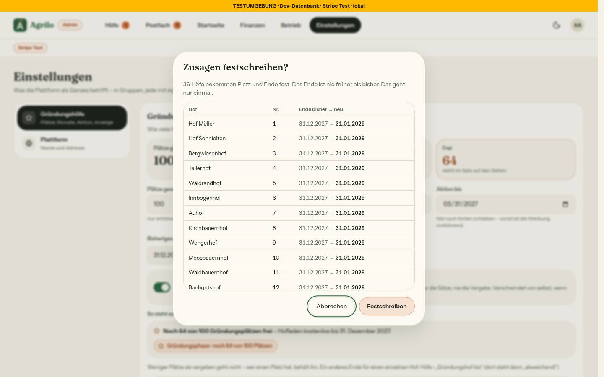
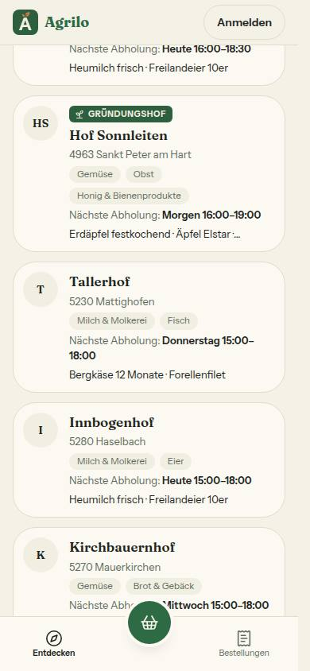
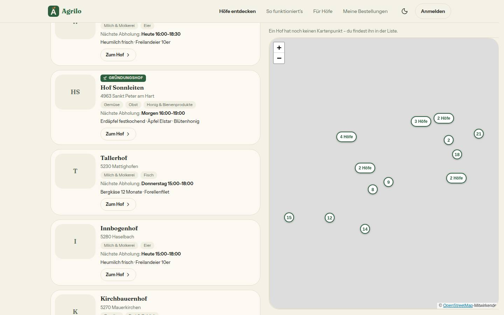
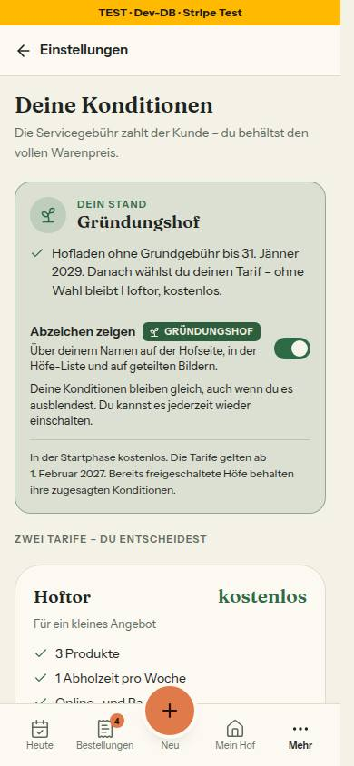

# Bericht Nr. 116 — Aktion „100 Gründungshöfe“ und Abzeichen (Register K2 geändert, K1)

**Was geändert wurde:** `schema.prisma` + Migration: festgeschriebener Platz, Abzeichen-Schalter, Monate/Stichtag/Festschreib-Zeitpunkt (Expand). `gruendungshof.ts`: `zusageEnde`, `aktionLaeuft`, kleinste freie Nummer, festgeschriebene Vergabe (`gruendungFest` an jeder Zeile), `festschreibenListe`, Sätze der Aktion, `ABZEICHEN_TEXT`. `plattform-einstellung.ts`/Schema/Action: Plätze nur erhöhen, Monate nur erhöhen, Stichtag nur früher, Sperre statt `pruefeGruendungSperre`. `admin.ts`/`admin-hoefe.ts`: Freischalten mit Produkt im Shop, Platz unter der Sperre (P2002 → Satz). `gruendung.ts`: Ausnehmen gibt Platz frei, Wiederaufnahme nur mit laufender Aktion, neu „Zusagen festschreiben“. `farm-archive.ts`: `reactivateFarm` unter der Sperre. Queries (`admin.ts`, `farm.ts`, `plattform-einstellung.ts`, `postfach.ts`): Einstellung statt Konstanten, nur Ja/Nein ans Browser. UI: `Abzeichen`/`AbzeichenKnopf` (Blatt am Handy, Sprechblase am Computer), HofKarte, Startseiten-Karten, Hofseite, Schalter unter Konditionen, Admin-Formular mit Dialog, Abschnitt Aktion auf /konditionen, zwei Tokens.

**Eigene Dateien** (`git diff --name-only 91dea05...HEAD`): DEVELOPMENT.md, docs/ai/{ARCHITECTURE,BAUSTEINE,DESIGN_SYSTEM}.md, docs/nachtlauf/berichte/116.md + bilder/116/*, prisma/schema.prisma, prisma/migrations/20261019200000_gruendung_aktion/migration.sql, src/app/(hof)/settings/konditionen/{page,abzeichen-schalter}.tsx, src/app/(public)/konditionen/page.tsx, src/app/admin/{einstellungen/page,page}.tsx, src/app/admin/postfach/eingang-reiter.tsx, src/app/globals.css, src/components/admin/{einstellungen-gruendung,gruendung-bis-dialog,hof-aktion-dialog}.tsx, src/components/fuer-hoefe/fuer-hoefe-abschnitte.tsx, src/components/gruendung/{pill,preiszeile,registrieren-satz,satz}.tsx, src/components/hoefe/entdecken-teile.tsx, src/components/hof-einstellungen/konditionen-ansicht.tsx, src/components/hofseite/hofseite-kunde.tsx, src/components/startseite/hoefe-in-der-naehe.tsx, src/components/ui/abzeichen.tsx, src/lib/{admin-hoefe-seite,admin-hoefe,gruendungshof,plattform-einstellung,startseite}.ts, src/schemas/{gruendung,plattform-einstellung}.ts, src/server/actions/{abzeichen,admin,farm-archive,gruendung,plattform-einstellung}.ts, src/server/hofseite-vorschau.ts, src/server/queries/{admin,einstellungen,farm,plattform-einstellung,postfach}.ts, 38 Testdateien (davon 6 neu: abzeichen, gruendung-aktion, gruendung-aktion-actions, gruendung-sperre-wache, migration-gruendung-aktion, integration/gruendung-aktion).

**Annahmen:** (1) Vor dem Festschreiben bleiben die bisherigen Sätze („kostenlos bis 31. Dezember 2027“) — sonst änderte der Deploy Sichtbares. (2) Welche Vergabe gilt, steht als `gruendungFest` an jeder Zeile der Lader — so rechnen Admin › Höfe und Finanzen ohne Änderung ihrer Seiten richtig. (3) Euro im Hausformat „€ 456“ statt „456 €“ (CODING_STANDARDS: nur `format.ts`). (4) Monate: mehr nur, solange die Aktion nicht vorbei ist; nie weniger. (5) Stichtag nie vor heute, einmal gesetzt nie leer. (6) Festschreiben bricht ab, wenn ein Hof mit heutigem Platz keinen bekäme (stillgelegte davor, zu wenig Plätze) — K1 vor Reihenfolge. (7) /konditionen zeigt den Abschnitt, solange die Aktion läuft, auch bei Anzeige aus (Konditionen sind keine Werbung). (8) Freischalten nach Entzug behält ein früheres Ende; ein neuer Platz nimmt das spätere von gespeichertem Ende und `zusageEnde`.

**Nicht gelöst:** Heute-Karte „Baustein 5“ gibt es im Code nicht (Nr. 93 hat sie nicht gebaut) — Neubau unter `src/components/heute` außerhalb der Grenzen. Das Menü ⋯ in Admin › Höfe kennt den Stichtag nicht (Seite außerhalb der Grenzen; die Warteliste seit Runde 3); die Actions prüfen ihn unter der Sperre. Seit Runde 3 schreibt der Integrationstest einmal wirklich fest (Seed-Höfe gesichert und zurückgesetzt).

**Grenzerweiterung (bitte bestätigen):** `src/app/admin/einstellungen/page.tsx` (lädt Liste und Felder), `src/schemas/{plattform-einstellung,gruendung}.ts` (Zod der Actions), `src/components/hof-einstellungen/konditionen-ansicht.tsx` (Platz für den Schalter im Block „Dein Stand“), `src/lib/admin-hoefe.ts` über `freischaltSperre` hinaus (Felder der Hofzeile), `src/components/fuer-hoefe/fuer-hoefe-abschnitte.tsx` (Aufrufer /fuer-hoefe). Keine davon berührt eine andere Nummer.

**Wie der Mensch es testet (Vorschau):** /admin/einstellungen › Gründungshöfe: Plätze 100, Monate 24, Aktion bis 31.03.2027 speichern → „Zusagen festschreiben …“ → Liste prüfen → Festschreiben. Startseite und /fuer-hoefe: „Die ersten 100 Höfe bekommen den Hofladen 24 Monate kostenlos – im Wert von € 456.“ Testhof ohne Produkt freischalten → „Noch kein Produkt im Shop …“; mit Produkt → Nachricht „Du bist Gründungshof Nr. k – … bis 31. Jänner 2029“. Hofseite: Etikett über dem Namen, Tipp → Blatt/Sprechblase. /settings/konditionen › „Abzeichen zeigen“ aus → Etikett auf Hofseite und /hoefe sofort weg.

**Angepasste .md:** ARCHITECTURE (Gründungsplätze festgeschrieben, Sperre auch beim Wieder-Aktivieren), DESIGN_SYSTEM (Tokens `--abzeichen`, Baustein Abzeichen), BAUSTEINE (erzeugt), DEVELOPMENT.md. **Nacharbeit:** Heute-Karte (oben). `ladeHoefeFuerGruendung` liest jetzt zusätzlich die Zeile der Einstellung (eine kleine Abfrage je Seite des Hofbereichs).

**Regelvorschlag:** Ursache: Die Freigabe nannte Dateien nach Funktion, Schalter und Liste lagen aber in Nachbardateien (Ansicht, Seite, Schema). Gegenmaßnahme: Dateigrenzen je Nummer aus `git grep` der genannten Funktionen ableiten (Aufrufer + Schema). Ort: docs/nachtlauf.md, Abschnitt Freigabe.

**Wiederverwendet:** BestellDialog, Sheet/SheetBlatt, Base UI Popover, Schalter-Muster von TeilenMomenteSchalter, SatzTeile, EmptyState-Regeln. **Neu, weil:** `Abzeichen` ist laut Register eine eigene Gestalt (nicht Marke/Chip).

**Prüfung:** typecheck grün, lint 0 Fehler/5 Warnungen (Grundstand), test 437 Dateien grün (eine Zeitüberschreitung unter Last einzeln grün), test:integration (gruendung-aktion, -freischaltung, -bis, -ausgenommen, einstellungen, bargebuehr, testzahlungen) grün. Axe: /hoefe, /admin/einstellungen, /settings/konditionen 0 Verstöße; Hofseite 0 Verstöße, 1 „incomplete“ (Titelbild-Verlauf, auch ohne Abzeichen). Tippflächen: Abzeichen 26 px + 2 × 9 px = 44 px, Schalter 57 px. **Testdaten:** nur `farmerzone_test`, Einstellung und `hof-sonnleiten`; vorher/nachher identisch (`116-vorher.txt` = `116-nachher.txt`), danach 0 Höfe mit Platz.

**Bilder** (hell):        . Abweichungen vom Mockup: kein „Du hast selbst einen Hof?“ im Blatt (unter 10 vergeben, Regel des Zählers); Schalter ohne „Gründungshof Nr. 5“ im Titel (Dein Stand bleibt „wie heute“).

## Nachbesserung Runde 1
**Blocker 1 (Plätze vor dem Festschreiben):** Die Lader (`ladeHoefeFuerGruendung`, `getAdminFarms`) schreiben die Plätze der Einstellung an jede Zeile (`gruendungPlaetze`, wie `gruendungFest`); `istGruendungshof`, `vergebeneGruendungsplaetze`, `bekaemePlatzBeiFreigabe` und damit `bestimmeGruendungBis`/`baueGruendungAnzeige` nehmen sie als Standard (`plaetzeDerVergabe`). So rechnen Nachricht, Tarif-Zeile, „Dein Stand“, Admin › Höfe, Finanzen und `setzeGruendungBisAction` mit derselben Zahl, ohne dass `admin.ts` sich ändert. Tests rot → grün: tests/gruendung-aktion.test.ts (Hof Nr. 13 bei 100 Plätzen, mit Gegenprobe ohne Plätze an der Zeile = 12), tests/gruendung-bis-lader.test.ts (`ladeGruendungBis` mit Einstellung 100 Plätze).
**Blocker 2 (Teilen-Bild):** Bis zur Grenzerweiterung steht „auf geteilten Bildern“ nicht mehr im Schalter-Satz; ein Test (tests/abzeichen.test.ts) bindet den Satz an den Code: „geteilt“ steht genau dann darin, wenn Route, Grafik oder Lader des Teilen-Bilds das Etikett kennen. **Grenzerweiterung erbeten:** src/components/teilen/teilen-bild-grafik.tsx, src/lib/teilen-bild.ts, src/server/queries/teilen-bild.ts — dann Etikett, Test und den Satz zurück.
**Kann:** Escape-Folge `\u00a0` wiederhergestellt. **Eigene Dateien der Runde** (`git diff --name-only d29d74c`): DEVELOPMENT.md, docs/ai/{ARCHITECTURE,BAUSTEINE}.md, docs/nachtlauf/berichte/116.md + bilder/116/konditionen-schalter-390-hell.jpg, src/lib/gruendungshof.ts, src/server/queries/admin.ts, tests/{abzeichen,gruendung-aktion,gruendung-bis-lader}.test.ts.
**Nacharbeit aus Runde 1** ((1), (2), (4) in Runde 3 erledigt; (3) siehe Runde 3): (1) `approveFarmAction`: `updateTag(HOEFE_CACHE_TAG)` nach `revalidateAll` (Sollte; admin.ts in dieser Runde nicht angefasst — der frisch freigeschaltete Hof erscheint ohnehin erst mit dem Cache, das Etikett mit ihm). (2) `platzBeiFreischaltung` (admin-hoefe-seite.ts) bekommt die ganze Einstellung und prüft `aktionLaeuft`; Aufrufer queries/postfach.ts und src/app/admin/page.tsx (außerhalb der Grenze). (3) Prop `vergebenePlaetze` in hof-aktion-dialog.tsx mit dem Aufrufer admin/page.tsx entfernen (Sammel-PR). (4) Zahlen fürs Erklär-Blatt in hofseite-vorschau.ts cachen oder erst beim Öffnen laden.
**Bild neu** (Schalter-Satz ohne Teilen-Bild, Abweichung vom Mockup bis zur Grenzerweiterung): . Axe 0 Verstöße, Schalter 309 × 57 px. Testdaten wie in Runde 0 gesetzt und zurück (`116-r1-vorher.txt` = `116-r1-nachher.txt`, 0 Höfe mit Platz). **Prüfung Runde 1:** typecheck grün, lint 0 Fehler/5 Warnungen (Grundstand), test 437 Dateien/8497 Tests grün, test:integration (gruendung-aktion, -bis, -freischaltung, -ausgenommen, einstellungen) 31 Tests grün.

## Nachbesserung Runde 2
**Blocker (Etikett im Teilen-Bild):** Grenze nach dem Auftrag („Behebe alle Blocker“) um `src/components/teilen/teilen-bild-grafik.tsx`, `src/lib/teilen-bild.ts`, `src/server/queries/teilen-bild.ts` erweitert (keine andere Nummer fasst sie an; bitte im Morgenbericht nennen). `ladeTeilenBildQuelle` liest `ABZEICHEN_SELECT` (jetzt exportiert) und gibt nur `gruendungshof` weiter; `teilenBildDaten` setzt `gruendungshof: true` nur bei Gründungshöfen — die Prüfsumme der anderen Höfe bleibt, der Schalter ändert die Bildadresse (`?v=`). Die Grafik zeichnet `Etikett` oben im Block mit dem Namen (Marktkarte Grün/Creme, Foto Creme/Grün, nur Farben aus `TEILEN_BILD_FARBE`), in der Marktkarte eine Produktzeile weniger. Route unverändert. Schalter-Satz wieder „… und auf geteilten Bildern.“ (Mockup; die Abweichung aus Runde 1 entfällt). Tests rot → grün: tests/teilen-bild.test.ts (Lader nur Ja/Nein, ausgeblendet/ausgenommen/ohne Platz ohne Etikett; Prüfsumme; Grafik 1:1/Story × mit/ohne Foto × mit/ohne Beitrag: Etikett vor dem Namen, Großbuchstaben per CSS, keine Nummer), tests/abzeichen.test.ts verlangt den Satz jetzt.
**Annahme:** Das Etikett steht über der Vorzeile (Marktkarte: über „Frisch diese Woche“ und dem Namen; Foto: direkt über „Hofname · Ort“) — eine Stelle in beiden Varianten; das Mockup zeigt nur das Foto-Bild ohne Vorzeile. Kein Bild des Teilen-Bilds im Bericht (Freigabe §0 nennt keins); lokal geprüft: 1:1 und Story der Marktkarte, Etikett über dem Namen, nichts abgeschnitten.
**Sollte:** ARCHITECTURE (Gründungs-Ende, Sperre, Plattform-Einstellungen: `pruefeGruendungSperre`/„≤ 12“ durch `plaetzeDerVergabe` und `pruefeGruendungEingabe` ersetzt) und DESIGN_SYSTEM (Einstellungen-Felder) an Nr. 116 angepasst. `platzBeiFreischaltung` bleibt Nacharbeit (2): admin-hoefe-seite.ts in dieser Runde nicht angefasst, Aufrufer src/app/admin/page.tsx außerhalb der Grenze.
**Bild neu:**  — Axe 0 Verstöße, Schalter 309 × 57 px. Testdaten wie Runde 1 gesetzt und zurück (`116-r2-vorher.txt` = `116-r2-nachher.txt`, 0 Höfe mit Platz). **Prüfung Runde 2:** typecheck grün, lint 0 Fehler/5 Warnungen (Grundstand), test 437 Dateien/8500 Tests grün, test:integration (gruendung-aktion, gruendung-bis, einstellungen) 16 Tests grün.
**Eigene Dateien der Runde** (`git diff --name-only 41707cc`): DEVELOPMENT.md, docs/ai/{ARCHITECTURE,BAUSTEINE,DESIGN_SYSTEM}.md, docs/nachtlauf/berichte/116.md + bilder/116/konditionen-schalter-390-hell.jpg, src/components/teilen/teilen-bild-grafik.tsx, src/lib/{gruendungshof,teilen-bild}.ts, src/server/queries/{farm,teilen-bild}.ts, tests/teilen-bild.test.ts.

## Nachbesserung Runde 3
**Muss (K1 – Nachricht = Konditionen):** Hat ein Hof einen Platz, aber kein gespeichertes Ende, nannte die Nachricht bei erneuter Freigabe `zusageEnde(heute)`, „Dein Stand“ aber den Standard. `zusageBeiFreischaltung` nimmt im Behalten-Zweig jetzt dasselbe Ende wie `bestimmeGruendungBis` (gemeinsame Regel `wirksamesGruendungBis` in gruendungshof.ts); geschrieben wird nichts, das Ende wird also nie kürzer. Tests rot → grün: tests/gruendung-aktion.test.ts (ohne Ende = Konditionen, Gegenprobe mit Ende 2030-01-31), tests/gruendung-aktion-actions.test.ts (Nachricht „bis 31. Dezember 2027“, nicht 2029, kein zweites Update).
**Caches:** `approveFarmAction` ruft nach `revalidateAll` `updateTag(HOEFE_CACHE_TAG)` und `revalidatePath('/konditionen')` (Aufruf-Test; Mock in tests/farm-approval.test.ts um `updateTag` ergänzt). Erklär-Blatt: neuer Lader `ladeAbzeichenBlatt` (queries/plattform-einstellung.ts) hinter `unstable_cache` mit `HOEFE_CACHE_TAG` und `PLATTFORM_EINSTELLUNG_TAG`, 300 s (Stichtag), ein Ladefehler wird nicht gecacht; hofseite-vorschau.ts ruft nur ihn (Quelltext-Test in tests/abzeichen.test.ts).
**Warteliste nach dem Stichtag:** `platzBeiFreischaltung(…, einstellung)` bekommt die ganze Einstellung und prüft festgeschrieben `aktionLaeuft`; ein eigener Platz (Entzug) bleibt wie in der Action. Aufrufer queries/postfach.ts und src/app/admin/page.tsx (Grenzerweiterung des Dirigenten, nur dieser Aufruf). Tests: Stichtag vorbei bzw. alle vergeben → kein Platz, Gegenprobe am Stichtag → Nr. 3; die alten Aufrufe in tests/admin-hoefe-seite.test.ts und tests/gruendung-ausgenommen.test.ts geben die Einstellung mit.
**Integrationstest:** „Zusagen festschreiben“ läuft einmal wirklich (tests/integration/gruendung-aktion.int.test.ts): Platz, Ende und Änderungszeit aller Höfe sowie die Einstellung gesichert, im finally exakt zurück; geprüft Nummern 1…n eindeutig, Ende ≥ bisher bzw. Standard, stillgelegter Hof mit Platz, ausgenommener ohne, langes Ende bleibt. Platz und Ende vorher = nachher (`116-r3-vorher.txt`/`116-r3-nachher.txt`, 0 Höfe mit Platz); `updatedAt` der Seed-Höfe erneuert der Seed im global-setup bei jedem Lauf.
**Kann:** `AktionAbschnitt` auf /konditionen über den alten Kommentarblock verschoben (nur verschoben). Nicht gemacht: die zwei Sätze im Freischalt-Hinweis aus `GRUENDUNG_AKTION_VORBEI`/`gruendungAlleVergeben` ableiten — die Wortlaute weichen ab („Alle n Plätze …“ vs. „Alle n Gründungsplätze …“, beide in Tests festgehalten); Nacharbeit.
**Nicht gelöst – Grenzerweiterung erbeten:** Die tote Prop `vergebenePlaetze` an `HofAktionDialog` reichen `src/components/admin/hoefe-ansicht.tsx` (Z. 268) und `src/components/admin/postfach-aufgabe-hof.tsx` (Z. 18/33) durch, nicht admin/page.tsx; Entfernen braucht diese zwei Dateien (keine andere Nummer fasst sie an) — Prop bleibt bis dahin. Heute-Karte nicht gebaut (offene Entscheidung, Morgenbericht).
**Eigene Dateien der Runde** (`git diff --name-only d955616`): DEVELOPMENT.md, docs/ai/{ARCHITECTURE,BAUSTEINE}.md, docs/nachtlauf/berichte/116.md, src/app/(public)/konditionen/page.tsx, src/app/admin/page.tsx, src/lib/{admin-hoefe-seite,gruendungshof}.ts, src/server/actions/admin.ts, src/server/hofseite-vorschau.ts, src/server/queries/{plattform-einstellung,postfach}.ts, tests/{abzeichen,admin-hoefe-seite,farm-approval,gruendung-aktion-actions,gruendung-aktion,gruendung-ausgenommen}.test.ts, tests/integration/gruendung-aktion.int.test.ts.
**Prüfung Runde 3:** typecheck grün, lint 0 Fehler/5 Warnungen (Grundstand), test 437 Dateien/8505 Tests grün, test:integration (gruendung-aktion, gruendung-freischaltung, gruendung-ausgenommen) 21 Tests grün.

```sql
SET lock_timeout = '5s';
ALTER TABLE "Farm" ADD COLUMN IF NOT EXISTS "gruendungAbzeichenZeigen" BOOLEAN NOT NULL DEFAULT true,
ADD COLUMN IF NOT EXISTS "gruendungPlatz" INTEGER;
ALTER TABLE "PlattformEinstellung" ADD COLUMN IF NOT EXISTS "gruendungAktionBis" DATE,
ADD COLUMN IF NOT EXISTS "gruendungFestAm" TIMESTAMP(3),
ADD COLUMN IF NOT EXISTS "gruendungMonate" INTEGER NOT NULL DEFAULT 24;
CREATE UNIQUE INDEX IF NOT EXISTS "Farm_gruendungPlatz_key" ON "Farm"("gruendungPlatz");
```
