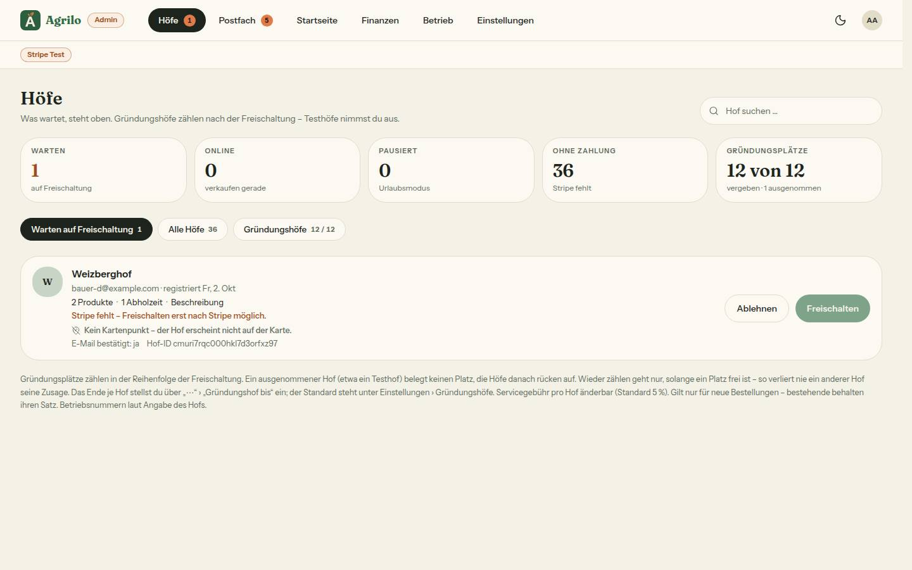

# Bericht Nr. 119 — Testhof, Kartenpunkt-Hinweis, Satz beim Festschreiben (Register N21 neu, K2 ergänzt)

**Was geändert wurde:** `schema.prisma` + Migration: Farm `istTesthof` (Default false), `testhofGeaendertAm`, `testhofGeaendertVonUserId` (Expand). `queries/farm.ts`: neu `IN_LISTEN_SICHTBAR` (= `OEFFENTLICH_SICHTBAR` + `istTesthof: false`), beide Listen-Abfragen von `getOeffentlicheHoefe` damit, `istTesthof` im Select von `getPublicFarm`/`getOwnerFarm` und in `PublicFarm`. `queries/{startseite,umfeld,futter-kaufen}.ts`, `actions/startseite.ts`: Listen und Auswahl mit `IN_LISTEN_SICHTBAR`. `queries/seo.ts`: noindex und `SITEMAP_HOF` nur über `istTesthof`. `queries/plattform-einstellung.ts`: Zahl der wartenden Höfe ohne Testhof. `actions/gruendung.ts`: neu `markiereAlsTesthof`/`nimmTesthofZurueck` (EINE Transaktion unter `GRUENDUNGSPLAETZE_SPERRE`, bedingt), `nimmWiederAuf` lehnt einen Testhof ab und schreibt bedingt auf `istTesthof: false`. `schemas/gruendung.ts`: zwei Schemas, zwei Sätze. `lib/gruendungshof.ts`: `GRUENDUNG_AUSGENOMMEN_MARKE` = „ausgenommen“, neu `TESTHOF_MARKE`, `TESTHOF_ZAEHLT_NIE`, `TESTHOF_HINWEIS`. `lib/admin-hoefe.ts`: `istTesthof`, `hatKartenpunkt`, `kartenpunktZeile`. `lib/admin-hoefe-seite.ts`: `TESTHOF_TEXT`, `testhofAenderung`, Wiederaufnahme bei Testhof ausgegraut. `queries/admin.ts` (`getAdminFarms`): `istTesthof`, `hatKartenpunkt` (nur Ja/Nein). `app/admin/page.tsx`: `testhofAenderung` je Zeile. `hoefe-ansicht.tsx`: Marke „Testhof“, Menüeintrag, Dialog, Kartenpunkt-Zeile; neu `testhof-dialog.tsx`. `hofseite-kunde.tsx`: Hinweis oben. `lib/plattform-einstellung.ts` + `einstellungen-gruendung.tsx`: `festschreibenAlleAusgenommen`. `[farmSlug]/page.tsx`, `produkt/[id]/page.tsx`: nur der Kommentar zu noindex (Testhof statt ausgenommen).

**Eigene Dateien** (`git diff --name-only 9f7044b...HEAD`): DEVELOPMENT.md, docs/ai/{ARCHITECTURE,BAUSTEINE,DESIGN_SYSTEM}.md, docs/nachtlauf/berichte/119.md + bilder/119/{admin-hoefe-testhof-1440-hell,admin-warteliste-kartenpunkt-1440-hell,hofseite-testhof-390-hell}.jpg, prisma/schema.prisma, prisma/migrations/20261020100000_testhof/migration.sql, src/app/(public)/[farmSlug]/page.tsx, src/app/(public)/[farmSlug]/produkt/[id]/page.tsx, src/app/admin/page.tsx, src/components/admin/{einstellungen-gruendung,hoefe-ansicht,testhof-dialog}.tsx, src/components/hofseite/hofseite-kunde.tsx, src/lib/{admin-hoefe-seite,admin-hoefe,gruendungshof,plattform-einstellung}.ts, src/schemas/gruendung.ts, src/server/actions/{gruendung,startseite}.ts, src/server/queries/{admin,farm,futter-kaufen,plattform-einstellung,seo,startseite,umfeld}.ts, 22 Testdateien (neu: testhof-actions, testhof-anzeige, testhof-sichtbarkeit-wache, integration/testhof; angepasst: admin-ansichten, admin-hoefe-seite, admin-hoefe, bild-ausschnitt-anzeige, gruendung-aktion-actions, gruendung-ausgenommen-wache, gruendung-ausnehmen-actions, gruendung-sperre-wache, hofseite-404, hofseite-einmal, hofseite-kunde-ansicht, hofuebersicht, kasse-formular, produktdetail-seite, sitemap, telefon-nach-kauf, umfeld-query, umfeld-seed).

**Abfragen mit `IN_LISTEN_SICHTBAR`:** farm.ts:getOeffentlicheHoefe (Produktzeilen und Höfe — /hoefe, Produktsuche, Startseite, Karte) · startseite.ts:hofSlugs (Startseiten-Blöcke) · startseite.ts:ladeStartseiteAdmin (Auswahl) · actions/startseite.ts:speichereEntwurf (Speichern der Auswahl) · umfeld.ts:getUmfeld · futter-kaufen.ts:getFutterKaufen · seo.ts:SITEMAP_HOF. Dazu `istTesthof: false` in plattform-einstellung.ts:zaehleGruendungSeiten. `OEFFENTLICH_SICHTBAR` allein nur: getPublicFarm, hofIstOeffentlich, produktIstOeffentlich, ladeTeilenBildQuelle, getPlakatDaten, zaehleBesuchFuerSlug (Wache `tests/testhof-sichtbarkeit-wache.test.ts`, Gegenprobe mit Attrappe; gegen den Basis-Stand rot).

**Annahmen:** (1) Hinweis auf der Hofseite: `Hinweiskarte` kennt nur grün und orange, `ui/hinweiskarte.tsx` liegt außerhalb der Grenze — „ton neutral, nicht Orange“ als grün umgesetzt (Kundensache). (2) `TESTHOF_HINWEIS` steht neben `TESTHOF_MARKE` in `gruendungshof.ts` (einzige erlaubte lib-Datei mit Testhof-Texten für die Hofseite). (3) Markieren setzt „geändert am/von“ für Testhof UND Gründung, auch wenn der Hof schon ausgenommen war. (4) „Kein Testhof mehr …“ steht bei jedem Testhof, gleich welcher Status; Dialogtitel „{Hof} nicht mehr als Testhof führen?“, Satz mit dem Weg zurück in die Gründung (nicht in der Freigabe, sinngemäß aus Punkt 4). (5) Kartenpunkt-Zeile nicht bei stillgelegten Höfen und Testhöfen. (6) Die Prüfung, ob ein Hof Testhof ist, liest `nimmWiederAuf` mit `findUnique` (keine Änderung an `HOF_FUER_GRUENDUNG`, das auch die Tarif-Zeile füttert).

**Nicht gelöst:** Kommentare in `src/app/sitemap.ts` („nicht ausgenommen“) und `src/lib/umfeld.ts` (nennt `OEFFENTLICH_SICHTBAR`) sind veraltet — außerhalb der Grenze, nur Text. Der Satz „Wähle nur freigeschaltete Höfe.“ (Speichern der Startseite) nennt den Testhof nicht; er erscheint nur bei veralteter Auswahl. Der Aufruf `verlangeFrischeBestaetigung` (115) in den zwei neuen Actions und `useFrischBestaetigt` in `testhof-dialog.tsx` kommen mit dem Sammel-PR.

**Wie der Mensch es testet (Vorschau):** /admin?reiter=alle › Seed-Hof › ⋯ › „Als Testhof markieren …“ (bei Platz Haken setzen) → Marke „Testhof“, Menü zeigt „Wieder als Gründungshof zählen“ ausgegraut mit „Ein Testhof zählt nie als Gründungshof.“ /hoefe, Startseite, /region (anderer Hof) und /sitemap.xml ohne den Hof; /<slug> zeigt oben den Hinweis, Quelltext `<meta name="robots" content="noindex, follow">`. ⋯ › „Kein Testhof mehr …“ → wieder da, Spalte „ausgenommen“. Ein nur ausgenommener Hof steht in /sitemap.xml ohne noindex. Warteliste: Hof ohne Breite/Länge zeigt „Kein Kartenpunkt – …“, Freischalten hängt nur an den bisherigen Gründen.

**SQL als Ersatz fürs Markieren** (nur die Projektleitung; Haken-Regel vorher in Admin › Höfe prüfen, Caches: /hoefe ≤ 5 min, Sitemap ≤ 1 h):
```sql
BEGIN;
SELECT pg_advisory_xact_lock(1261568265); -- GRUENDUNGSPLAETZE_SPERRE (0x4B320109)
UPDATE "Farm" SET "istTesthof" = true, "testhofGeaendertAm" = now() AT TIME ZONE 'UTC', "testhofGeaendertVonUserId" = '<admin-id>',
  "gruendungAusgenommen" = true, "gruendungPlatz" = NULL, "gruendungGeaendertAm" = now() AT TIME ZONE 'UTC',
  "gruendungGeaendertVonUserId" = '<admin-id>', "updatedAt" = now() AT TIME ZONE 'UTC'
WHERE "slug" = '<slug>' AND "istTesthof" = false AND "approvedAt" IS NOT NULL AND "archivedAt" IS NULL;
COMMIT;
```

**Migration** (`prisma/migrations/20261020100000_testhof/migration.sql`, Regel 3 mit `--from-schema` = Schema von 9f7044b; Kopfkommentar dort):
```sql
SET lock_timeout = '5s';
ALTER TABLE "Farm" ADD COLUMN IF NOT EXISTS "istTesthof" BOOLEAN NOT NULL DEFAULT false,
ADD COLUMN IF NOT EXISTS "testhofGeaendertAm" TIMESTAMP(3),
ADD COLUMN IF NOT EXISTS "testhofGeaendertVonUserId" TEXT;
```

**Angepasste .md:** ARCHITECTURE (zwei Stufen der Sichtbarkeit; Sitemap/noindex über `istTesthof`; Absatz Testhof), DESIGN_SYSTEM (Marke „Testhof“, Menü und Dialog, Kartenpunkt-Zeile, Hinweis auf der Hofseite), BAUSTEINE (erzeugt), DEVELOPMENT.md. **Nacharbeit:** Die zwei veralteten Kommentare (oben); `Hinweiskarte` um einen neutralen Ton erweitern, falls die Projektleitung grau statt grün will.

**Regelvorschlag:** Ursache: `PublicFarm` und `HofRohdaten` als Pflichtfelder erweitert — elf Testdateien bauen eigene Fixtures dieser Typen und mussten je eine Zeile bekommen (Konfliktfläche mit parallelen Nummern). Gegenmaßnahme: je Typ EINE Fixture-Fabrik in `tests/` (z. B. `oeffentlicher-hof.ts`), die Testdateien überschreiben nur, was sie prüfen. Ort: TESTING_GUIDELINES §5 („Faktoren lokal“ um diese Ausnahme ergänzen).

**Wiederverwendet:** BestellDialog (Muster gruendung-ausnehmen-dialog), StatusBadge/Marke, Hinweiskarte, DropdownMenu, Platz-Zeile der Warteliste, `istGruendungshof`, `revalidiereGruendung`. **Neu, weil:** `testhof-dialog.tsx` (eigene Texte und Haken, freigegebene Datei); `kartenpunktZeile`/`testhofAenderung` als reine Regeln.

**Prüfung:** typecheck grün, lint 0 Fehler/5 Warnungen (Grundstand), test 458 Dateien/8879 Tests grün; Gegenprobe: alle neuen bzw. geänderten Fälle gegen den Basis-Stand rot (39 Fälle). test:integration: testhof.int 8 Tests grün; GANZ unter der Sperre 61 Dateien/541 Tests grün. Axe: Admin › Höfe mit offenem Menü 1 Verstoß „region“ (Menü-Portal von Base UI, wie jedes Menü ⋯), Warteliste 0, Hofseite 0; Menüeinträge 44 px. **Testdaten:** nur `farmerzone_test`, `kapellenhof` (Testhof) und `hof-wartend` (Kartenpunkt) — `119-vorher.txt` = `119-nachher.txt`.

**Bilder** (hell):   . Mockup-Abweichung: keine neuen Mockups; Hinweis grün statt neutral (Annahme 1, drittes Bild). In der Warteliste ist Freischalten wegen „Stripe fehlt“ (Seed) gesperrt, nicht wegen des Kartenpunkts (Test `admin-ansichten`: bedienbar).
