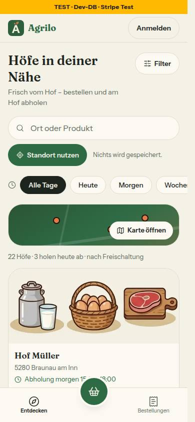
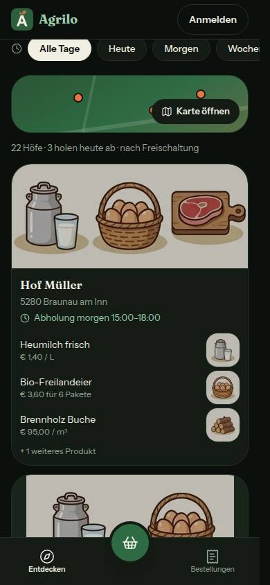
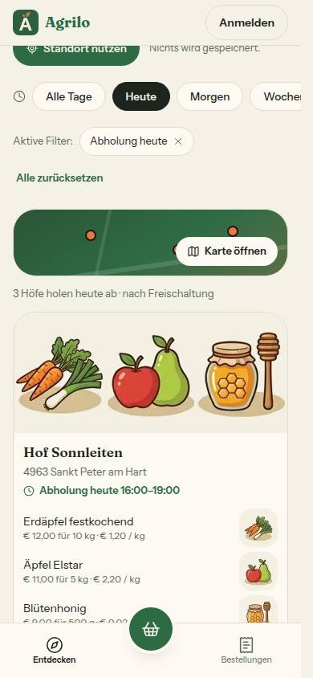
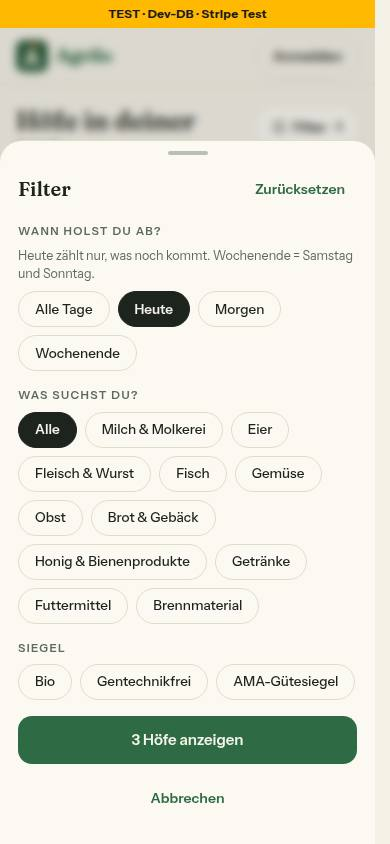
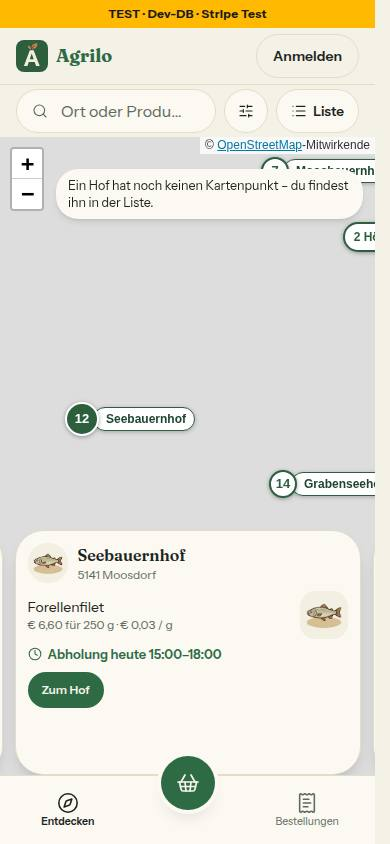
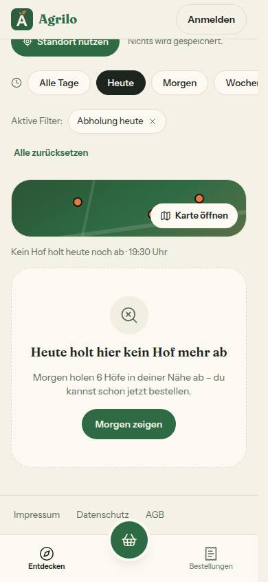
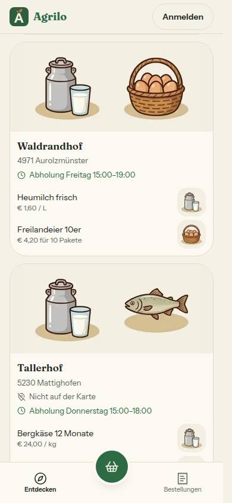
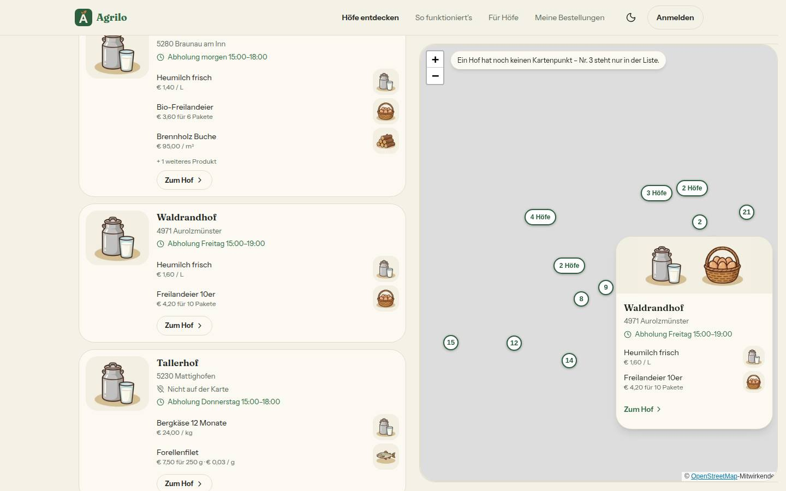
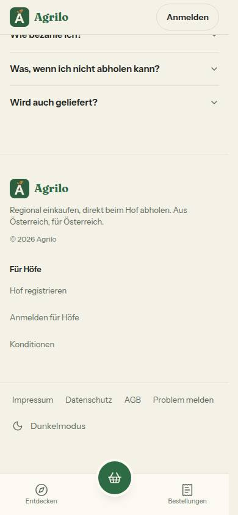
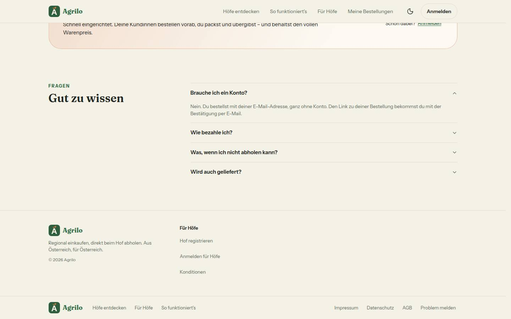

# Bericht Nr. 120 — Entdecken v2: Abholzeile, Hofkarte A, Filter „Abholung", Pins mit Namen, Seitenfuß (Register N22, N19)

**Was geändert wurde** (je Datei ein Satz):
- `lib/abholfenster.ts`: neu `istFensterBestellbar` – EINE Regel „bestellbar bis zum Fensterbeginn", die auch `angeboteneAbholfenster` nutzt. `lib/bereiche-anzeige.ts`: neu `istBestellbar` (kaufbares Produkt und Abholzeit).
- `lib/hofuebersicht.ts`: `naechsteAbholung` zählt nur bestellbare Fenster (über `istFensterBestellbar`), neu `abholLage`, `abholzeileText`, `holtAbAnTagen`; `berechneHofAuswahl` filtert Bereich → Umkreis → Abholung → Suche und braucht `jetzt`.
- `lib/hoefe-entdecken.ts`: Texte und Reihe „Abholung", Zahlzeile, Leerzustand „Heute holt hier kein Hof mehr ab" mit Ausweg. `lib/hoefe-anzeige.ts`: Illustrationen der Hofkarte, Pin-Namen (18 Zeichen, ab Zoom 12 oder ≤ 12 Pins), Pillenbreite in `gruppierePins`, Kartenpunkt-Hinweis.
- `lib/kunden-navigation.ts`: `SEITENFUSS` (Ziele und Wörter). `schemas/hoefe-filter.ts`: `?abholung=heute|morgen|wochenende`, Unbekanntes wird verworfen.
- `queries/farm.ts`: `HofUebersichtEintrag.abholfenster` aus den schon gelesenen Abholzeiten (Abfrage unverändert). `queries/oeffentliche-hoefe.ts`: Cache-Schlüssel `'v2'`. `hoefe/page.tsx`: gibt die Zeit des Renderns als `jetzt` mit, bleibt statisch.
- `hoefe/use-uhr.ts`: Uhr im Browser (`useSyncExternalStore`, Minute, beim Hydrieren die Server-Zeit). `hoefe/abholzeile.tsx`: Baustein `Abholzeile` (grün, Pause orange, „Noch nicht bestellbar" grau).
- `hoefe/hof-bildflaeche.tsx`: Baustein `HofBildflaeche` (1–3 Illustrationen, im Dunkeln gedämpft). `hoefe/hof-kurzkarte.tsx`: Baustein `HofKurzkarte` (Pin-Vorschau am Computer, `role=tooltip`).
- `hoefe/entdecken-teile.tsx`: Hofkarte A (Foto 150 px oder Bildfläche, Abholzeile, 3 Produktzeilen, ein Link, ohne Chips und Initialen), Splitscreen 116×100. `hoefe/hoefe-karussell.tsx`: Karte 346 px, rundes Bild 40 px, 2 Produktzeilen, Abholzeile.
- `hoefe/hoefe-karte.tsx`: Pins mit Namen, Tab und Enter/Leertaste, Vorschau bei Zeiger und Fokus (300 ms, Escape), Hinweis „ohne Kartenpunkt" auf der Karte. `hoefe/hoefe-client.tsx`: Uhr, Reihe „Abholung" (Handy, Computer, Blatt), Zahlzeile `role=status`, Leerzustand, Kurzkarte, Kartenvorschau 84 px.
- `hoefe/hoefe-produktzeilen.tsx`: Bildkante 48/40, Illustration statt leerem Feld. `hoefe/hoefe-fotostreifen.tsx`: 150 px hoch statt 3:2.
- `shells/kunde-fuss.tsx` (neu): Seitenfuß. `shells/kunde-shell.tsx`: Seitenfuß nach `main` (Fokus-Seiten ohne). `startseite-abschnitte.tsx`: `StartseiteFuss` ohne Rechtliches und „Problem melden". `datenschutz/page.tsx`: Seitenfuß im eigenen Gerüst (Text unverändert).
- Tests: neu `abholzeile` (15), `hoefe-abholung` (12); angepasst 14 Dateien (Fixtures `jetzt`/`abholfenster`, Wachen `leerzustaende`/`karte-wache`, Cache `'v2'`, Fuß in `shells`/`agb-einbindung`/`startseite`).

**Eigene Dateien** (`git diff --name-only 3e6e7a9...HEAD`, 45 + 10 Bilder): DEVELOPMENT.md, docs/ai/{ARCHITECTURE,BAUSTEINE,DESIGN_SYSTEM}.md, docs/nachtlauf/berichte/120.md + bilder/120/*.jpg, src/app/(public)/{datenschutz,hoefe}/page.tsx, src/components/hoefe/{abholzeile,entdecken-teile,hoefe-client,hoefe-fotostreifen,hoefe-karte,hoefe-karussell,hoefe-produktzeilen,hof-bildflaeche,hof-kurzkarte}.tsx, src/components/hoefe/use-uhr.ts, src/components/shells/{kunde-fuss,kunde-shell}.tsx, src/components/startseite/startseite-abschnitte.tsx, src/lib/{abholfenster,bereiche-anzeige,hoefe-anzeige,hoefe-entdecken,hofuebersicht,kunden-navigation}.ts, src/schemas/hoefe-filter.ts, src/server/queries/{farm,oeffentliche-hoefe}.ts, tests/{abholzeile,abzeichen,agb-einbindung,bereiche-anzeige,hoefe-abholung,hoefe-anzeige,hoefe-entdecken,hoefe-produktsuche,hoefe-seite,hoefe-vorschlaege,hofuebersicht,karte-wache,leerzustaende-wache,oeffentliche-hoefe-cache,shells,startseite}.test.ts.

**Annahmen:** (1) `naechsteAbholung` behält ihre Signatur (Ortszeit) und rechnet über `istFensterBestellbar` mit einer festen Bezugswoche ohne Zeitumstellung – so zählt auch die Abholzeit der Startseite und von Futter kaufen nur bestellbare Fenster, ohne Änderung dort (N22, letzter Satz). (2) „Wochenende" = kommender Samstag und Sonntag, am Sonntag nur der Sonntag; „heute" nur Fenster mit Beginn nach jetzt. (3) Zahlzeile nach dem Board („n Höfe · k holen heute ab · nach Entfernung"), ohne Bezugspunkt „nach Freischaltung"; mit gewählter Abholung „n Höfe holen heute ab · …". (4) Pause schlägt Abholzeit; ohne Abholzeit oder ohne kaufbares Produkt „Noch nicht bestellbar", der Hof bleibt an seinem Platz. (5) Die Vorschau gibt es nur im Splitscreen (ab 1024 px); am Handy bleibt Antippen wie heute.

**Nicht gelöst:** Bild „Noch nicht bestellbar" fehlt (10 statt 11 Bilder): Im Seed hat jeder freigeschaltete Hof ein kaufbares Produkt und eine aktive Abholzeit (psql nur lesend), Daten nicht geändert; der Zustand ist in `abholzeile.test.ts` und `hoefe-seite.test.ts` belegt. **Bekannte Grenze:** Volle Fenster (`maxOrders`) zählt die Übersicht weiter nicht – die Abholzeile kann ein ausgebuchtes Fenster nennen; Hofseite und Kasse prüfen es. Freigegeben entfallen: „Noch nicht bestellbar · n Höfe" eingeklappt (erst nach AGB §3, O4), Lage „jetzt", Ausnahmen.

**Wie der Mensch es testet (Vorschau):** /hoefe am Handy: Reihe „Abholung" unter „Standort nutzen", „Heute" → Adresse `?abholung=heute`, Zahl und Liste ändern sich; zweimal laden zeigt `x-vercel-cache: HIT` oder `STALE`. Abends nach dem letzten Fenster: „Heute holt hier kein Hof mehr ab" mit „Morgen zeigen". Filter-Blatt: „Wann holst du ab?" zwischen Umkreis und Kategorie. „Karte öffnen", zweimal „+": Namen an den Pins; oben „Ein Hof hat noch keinen Kartenpunkt …"; Tallerhof in der Liste mit „Nicht auf der Karte". Am Computer (1440): Zeiger auf einen Pin → Vorschau, bleibt auf der Vorschau, schließt 300 ms nach dem Verlassen oder mit Escape; Tab erreicht die Pins, Enter wählt wie ein Klick. Seitenfuß mit Impressum, Datenschutz, AGB, „Problem melden" auf /hoefe, /hof-mueller, /bestellungen, /fuer-hoefe, /datenschutz und / (dort einmal); nicht in Kasse und Bestätigung.

**Angepasste .md:** DESIGN_SYSTEM (Entdecken: Hofkarte A, Abholzeile, Filter, Zahlzeile, Leer; Karte: Namen, Tastatur, Pin-Vorschau, Hinweis, Karussell; Shells: Seitenfuß; Illustrationen: Bildfläche), ARCHITECTURE (Uhr im Browser, Abholung-Filter nach N19, eine Regel, `'v2'`), BAUSTEINE (erzeugt), DEVELOPMENT.md.

**Nacharbeit:** (1) Startseite am Computer: doppelte Wege erledigt in Runde 1, die zweite Wortmarke ist offen (siehe dort). (2) Produktsuche: Status von `HoefeSuche` und Zahlzeile sind beide Live-Regionen, eine reicht. (3) Volle Fenster in der Abholzeile, sobald die Übersicht `maxOrders` kennt.

**Regelvorschlag:** Ursache: Eine Zeitangabe auf einer statischen Seite (5 min Cache, N19) ist mit der Server-Uhr bis zum nächsten Rendern falsch. Gegenmaßnahme: Wache – in `src/components/hoefe/**` kein `new Date()`/`Date.now()` außer in `use-uhr.ts`; Zeitlogik nur über `useUhr`. Ort: `tests/karte-wache.test.ts` bzw. eine neue `uhr-wache` (Prüfung vor Textregel).

**Wiederverwendet:** ChipReihe, FilterGruppe, BlattGruppe, EmptyState, AktiveFilterZeile, HoefeProduktzeilen, HoefeFotostreifen, `kategorieBildPfad`/`illustrationPfad`, ThemeUmschalterZeile, Wortmarke, `AGB_PFAD`, `PROBLEM_MELDEN`, `wienerZeitpunkt`, `formatTagKurz`, `gruppierePins`, `FOKUS_RAHMEN`. **Neu, weil:** `Abholzeile`, `HofBildflaeche`, `HofKurzkarte` und `kunde-fuss.tsx` benennen Register und Grenze; `use-uhr.ts`, weil es keine Browser-Uhr gab.

**Prüfung:** typecheck grün, lint 0 Fehler/5 Warnungen (Grundstand), test 460 Dateien/8936 Tests grün (`--maxWorkers=2`). Gegenprobe: 7 geänderte Fälle gegen den Basis-Stand rot (alte Regel von `naechsteAbholung`, alter Fuß, alter Schlüssel), die neuen Dateien ohne die Bausteine rot. test:integration (Typ erweitert, Abfrage gleich): testhof.int + oeffentlich-lesen.int 2 Dateien/11 Tests grün unter der Sperre. Build: `├ ○ /hoefe   5m   1y`, `/datenschutz` ○. Axe 0 Verstöße auf /hoefe bei 390 und 1440, hell und dunkel. Tastatur (1440, im Browser): alle 13 Pins mit `tabindex=0` und `role=button`, Tab geht von Pin zu Pin, Fokus öffnet die Vorschau (`aria-describedby`), Escape schließt sie und der Fokus bleibt am Pin, Enter wählt wie ein Klick (Pin größer, Liste rollt zum Hof). Tippflächen: Chips „Abholung" 44 px, Seitenfuß-Links 32 px + unsichtbarer Rand 2 × 6 px = 44 px. Testdaten nur gelesen; den Abend für den Leerzustand stellt ein Init-Skript nur im Browser (19:30).

**Mockup-Abweichungen** (über die freigegebenen hinaus, je mit Bild): (a) Reihe „Abholung" am Handy wischt waagrecht, „Wochenende" angeschnitten – 44-px-Chips mit Uhr passen bei 390 nicht in eine Zeile, Muster wie die Kategorie-Reihe. (b) Kartenmodus am Handy: Die Werkzeugzeile bleibt Suche · Filter · Liste (Nr. 52); eine gewählte Abholung steht als entfernbare Marke in der zweiten Zeile statt als „Heute" in der Leiste. (c) Seitenfuß am Handy: zweite Zeile ist der bestehende Umschalter „Dunkelmodus" statt „Darstellung: Dunkel". (d) Seitenfuß am Computer ohne „Darstellung" (der Umschalter steht schon im Kopf); auf der Startseite bleibt `StartseiteFuss` (ohne Spalte Marke, Runde 1) darüber.

         

## Nachbesserung Runde 1 (auf 3ba85d3, Punkte des Dirigenten)
- `startseite-abschnitte.tsx` (nur `StartseiteFuss`/`FUSS_SPALTEN`): Spalte `MARKE` mit „Höfe entdecken" und „So funktioniert's" entfällt (stehen am Computer in `SEITENFUSS.wege` direkt darunter, am Handy in der Unterleiste bzw. auf der Startseite); es bleiben Wortmarke, Satz, ©-Zeile und „Für Höfe"; Raster `flex` statt `grid-cols-2`, Kommentar nachgezogen. Test zuerst rot (`startseite.test.ts`: kein `/hoefe`, kein `/#so-funktionierts`, Gegenprobe am Seitenfuß; Hof registrieren, Anmelden für Höfe, Konditionen bleiben). `DESIGN_SYSTEM` (Seitenfuß-Satz) nachgezogen. Bilder `seitenfuss-390/1440-hell` neu (Startseite; Links „Für Höfe" 44 px, Axe auf / bei 390 und 1440: 0 Verstöße).
- `karte-wache.test.ts`: Abgleiche in `pruefeKarteTastatur(text)`; leer auf dem echten `hoefe-karte.tsx`, je ≥ 1 Fehler auf 5 Abwandlungen genau dieses Inhalts (`keyboard: true`→`false`, Escape-Zweig weg, 300→500 ms, `addEventListener('focus'` weg, `element.focus({ preventScroll: true })` weg); Abwandlung muss den Text ändern. Gegenprobe der Gegenprobe: Mit stillgelegter Funktion werden alle 5 rot. Kein Produktcode geändert.
- **Annahme:** `StartseiteFuss` steht auch auf Hofseite, Produktseite und /fuer-hoefe – die Spalte entfällt dort mit (dieselbe Komponente, Seitenfuß darunter).
- **Bekannte Grenze:** `illustrationPfad(produkt.category)` in `hoefe-produktzeilen.tsx` ohne Unterkategorie – `VorschauProdukt` kennt sie nicht, `farm.ts` bleibt bei „nur `abholfenster`"; kein Schema, keine Abfrage.
- **Offen für die Projektleitung:** Am Computer stehen auf der Startseite (und den anderen Seiten mit `StartseiteFuss`) zwei Wortmarken übereinander – im Fuß der Startseite und im Seitenfuß (Bild `seitenfuss-1440-hell`). Nicht geändert.
- Prüfung Runde 1: typecheck grün, lint 0 Fehler/5 Warnungen (Grundstand), test 462 Dateien/8944 Tests grün (`--maxWorkers=2`); keine Abfrage geändert, daher kein test:integration.
- Eigene Dateien der Runde (`git diff --name-only 3ba85d3..HEAD`): docs/ai/DESIGN_SYSTEM.md, docs/nachtlauf/berichte/120.md, docs/nachtlauf/berichte/bilder/120/seitenfuss-{390,1440}-hell.jpg, src/components/startseite/startseite-abschnitte.tsx, tests/{karte-wache,startseite}.test.ts.
