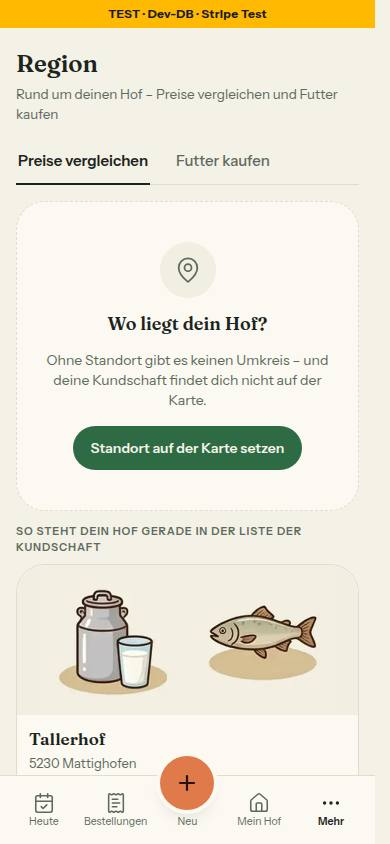
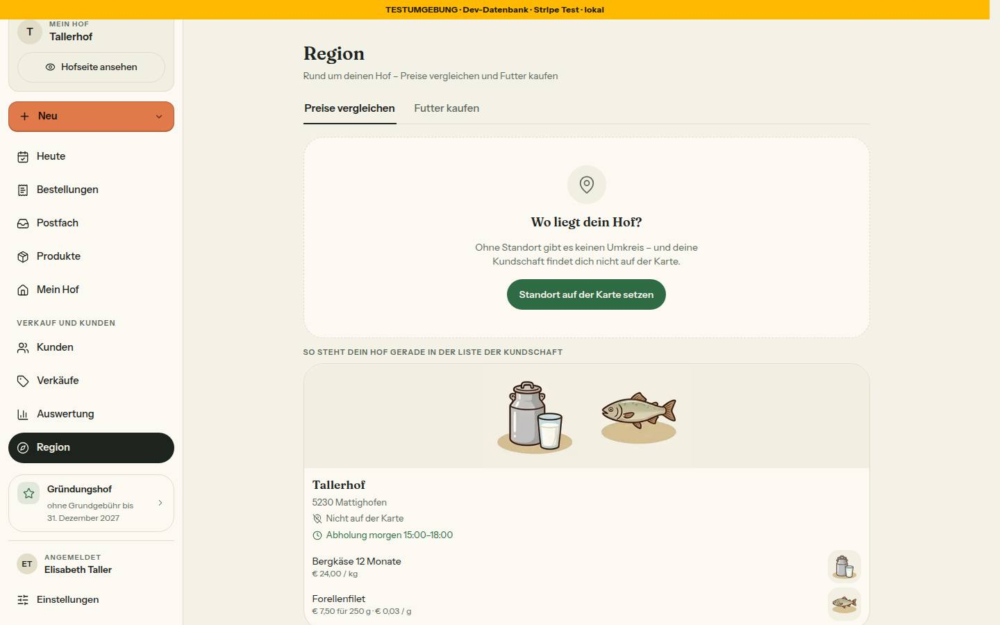
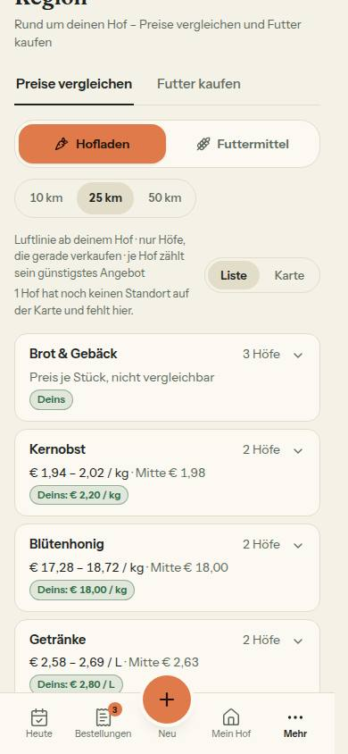
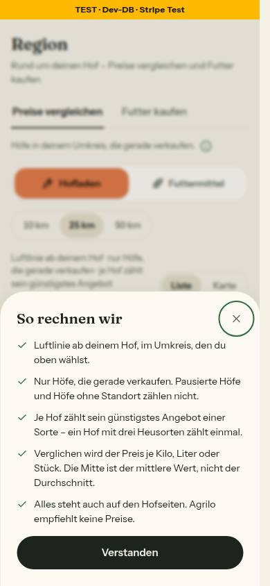
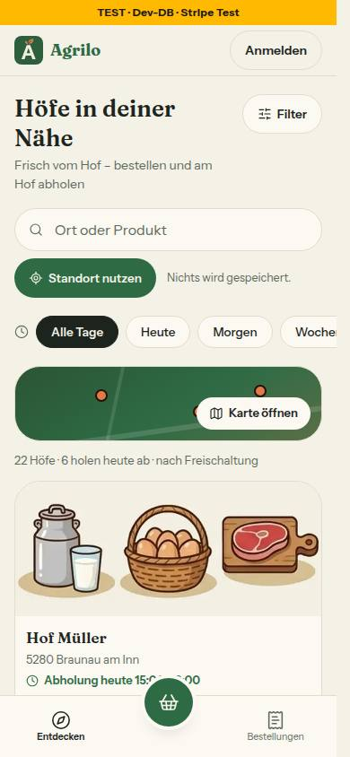
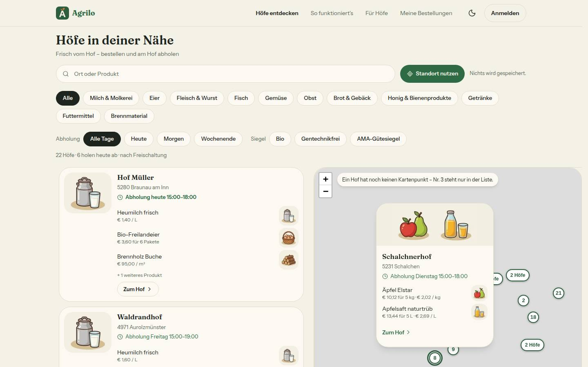

# Bericht Nr. 122 – Region · gemeinsame Bausteine und die Seite in zwei Teilen (Register N23)

## Was geändert wurde
- `region/page.tsx` prüft nur Sitzung, Hof, Reiter und legt den `LadeRahmen`; `preise-reiter.tsx`/`futter-reiter.tsx` tragen die beiden Zweige 1:1 (samt `redirect('/login')` bei `daten === null`) mit `LadeInhalt`; `ohne-standort.tsx` lädt die eigene Hofkarte; `region/loading.tsx` entfällt (Ladepunkt statt Skelett).
- `hof-kopf.tsx` (neu): `HofKopf`; `hof-vorschaubild.tsx` (neu): `Vorschaubild` aus `entdecken-teile.tsx` gelöst; dort nutzt `HofKarte` jetzt `HofKopf`, `OhneKartenpunkt` ist exportiert.
- `hof-kurzkarte.tsx`: Rahmen mit `art: 'tooltip' | 'region'`, Inhalt als `children`, `KurzkartenInhalt` (das, was /hoefe übergibt); `hoefe-client.tsx` übergibt ihn als Kinder.
- `km-wahl.tsx`: 36 px, `zahlen`/`zahlLabel`, Ladepunkt je Stufe; `region-kopf.tsx`: Prop `ladePunkt` am Reiter; `erklaer-knopf.tsx` (neu): „So rechnen wir"; `region-zustaende.tsx`: `StandortFehlt` nach Board v2 §4 mit eigener `HofKarte` bzw. Satz.
- `src/lib/region.ts` (neu): `zaehleJeStufe`, `ohneStandortHinweis`, `eigeneListenkarte`, `OHNE_STANDORT_TEXT`, `STANDORT_ANKER`/`STANDORT_SETZEN_HREF`; `umfeld.ts` und `futter-kaufen.ts` nutzen nur den Hinweis.
- `src/server/queries/region.ts` (neu): `ladeEigenenListeneintrag`; `farm.ts`: Selects und Zusammenbau von `getOeffentlicheHoefe` unverändert als `UEBERSICHT_ZEILEN_SELECT`, `UEBERSICHT_HOF_SELECT`, `baueHofUebersicht` benannt und exportiert.
- `profile-form.tsx`: nur `id="standort"` mit `scroll-mt-6` an der Karte; `hoefe-anzeige.ts`: nur der Kommentar zu Pin-Namen (N23).
- Tests: neu `region.test.ts`, `region-bausteine.test.ts`, `hof-kurzkarte-bereich.test.ts`, `integration/region.int.test.ts`; angepasst Wachen (`ladeansichten`, `loading-filter-wache` – Bestand gestrichen, `umfeld-karte`, `leerzustaende-wache` – Ausnahme Art C für den Hinweis) und die drei Hinweis-Texte, `region-auswertung-seiten` (Dateiliste, `useLinkStatus`).

## Eigene Dateien (`git diff --name-only 0cc8b20...HEAD`)
```
DEVELOPMENT.md docs/ai/BAUSTEINE.md docs/ai/DESIGN_SYSTEM.md docs/nachtlauf/berichte/122.md docs/nachtlauf/berichte/bilder/122/* (6)
src/app/(hof)/region/{futter-reiter,loading,ohne-standort,page,preise-reiter}.tsx src/components/hoefe/{entdecken-teile,hoefe-client,hof-kopf,hof-kurzkarte,hof-vorschaubild}.tsx
src/components/region/{erklaer-knopf,km-wahl,region-kopf,region-zustaende}.tsx src/components/settings/profile-form.tsx src/lib/{futter-kaufen,hoefe-anzeige,region,umfeld}.ts src/server/queries/{farm,region}.ts
tests/{futter-kaufen,hof-kurzkarte-bereich,ladeansichten,leerzustaende-wache,loading-filter-wache,region-auswertung-seiten,region-bausteine,region,umfeld-karte,umfeld-seed,umfeld}.test.ts tests/integration/region.int.test.ts
```

## Neue Bausteine für 123 und 124 (Props)
- `HofKopf({ hof: { name, postalCode, city, entfernungKm }, als?: 'h2'|'h3'|'p' = 'p', gedaempft?, bild?: { foto, illustration, kante: 40|48 } })` – ohne `bild` zwei Geschwister (in eine Spalte stellen).
- `HofKurzkarte({ art: 'region', hof: KurzkartenHof, bereich, id, children, onSchliessen, findePin?: () => HTMLElement|null })` – Breite gibt der Aufrufer vor; `art: 'tooltip'` wie /hoefe.
- `KmWahl({ stufen, zahlen?: Partial<Record<UmfeldKm, number>>, zahlLabel })` – `zahlen` aus `zaehleJeStufe(entfernungenKm)`; `ErklaerKnopf({ titel, punkte: string[] })`.
- `ohneStandortHinweis(anzahl, { kurz? })`, `OhneKartenpunkt`, `Vorschaubild`, `StandortFehlt({ eigeneKarte?, jetzt })` über `<OhneStandort farmId />` (schon in beiden Reitern).
- Wiederverwendet: HofKarte, HoefeProduktzeilen, Abholzeile, HofBildflaeche, EmptyState, Dialog, LadeRahmen/LadeInhalt/LadePunkt, berechneHofAuswahl, hofPasst. Neu, weil: kein Kopf-, Erklär- oder Zahl-Baustein existierte.

## Beleg /hoefe unverändert
- Markup von `HofKarte` (7 Varianten: schmal, split, pausiert, ohne Punkt, Foto, Gründungshof, Futter) und `HofKurzkarte` (3 Varianten) per `renderToStaticMarkup` vorher (`$SP/l19/122-markup-vorher.html`) und nachher (`art: 'tooltip'` + `KurzkartenInhalt`): `diff` leer (35 484 Bytes). Vorübergehender Test gelöscht.
- `tests/hoefe-*.test.ts`, `hofuebersicht`, `karte-wache`, `abholzeile` ohne Änderung grün: 13 Dateien / 365 Tests. Bilder: gleicher Aufbau wie Lauf 18 (Daten anders).

## Annahmen
- `farm.ts`: „nur Exporte" hieß hier, die inline stehenden Selects und den Zusammenbau unverändert zu benennen – sonst ginge „genau so wie /hoefe" nur als Kopie. SQL gleich; Integrationstest vergleicht den Eintrag Feld für Feld mit `getOeffentlicheHoefe`.
- Die alte Kurzform von `HofKurzkarte` (`schaufenster`, `jetzt`) bleibt gültig, damit `tests/hoefe-seite.test.ts` unverändert läuft; sie rendert denselben `KurzkartenInhalt`.
- Eigene Hofkarte im Hofladen, ein reiner Futterhof im Futter (`hofPasst`). Ladefehler der Karte: Leerzustand bleibt, Abschnitt fehlt, Sentry.
- „Umkreis mit Zahl (390)" zeigt den Umkreis ohne Zahl (Zahlen liefern 123/124). Das Bild „So rechnen wir" entstand mit einem vorübergehend eingebauten Knopf (Texte aus Board v3), nicht im Commit.

## Mockup-Abweichungen (mit Bild)
- Region-Karte am Pin: „Zum Hof ›" als Textlink wie /hoefe statt grüner Pille (Freigabe §1.2, „gemeinsam bleibt der Link"); `region-ohne-standort-*.jpg`: Leerzustand mit gestricheltem Rand (`EmptyState`, N9), ohne 0,92-Deckkraft der Karte (Kontrast).
- `region-so-rechnen-wir-390-hell.jpg`: Dialog unten wie im Board, ohne Griffleiste (kein Ziehen).

## Wie der Mensch es testet
- /region als `bauer-c@example.com`: „Wo liegt dein Hof?", Knopf → /settings/profile#standort springt zur Karte; darunter die eigene Hofkarte (`hof-ohne-standort`) mit „Nicht auf der Karte". Beide Reiter gleich.
- /region als `bauer-a@example.com`: Umkreis 36 px; Klick auf 10 km → alte Liste bleibt, Punkt an der Stufe, kein Skelett. Reiterwechsel ebenso.
- /hoefe am Computer: Pin per Tab → Vorschau wie bisher; Liste unverändert.

## Prüfungen, Bilder
- typecheck 0, lint 0 Fehler / 5 Warnungen (Grundstand), test 480 / 9153 grün (nach der Nachrunde 480 / 9156). Integration (unter Sperre): region, auswertung-region, testhof, auftritt-abschnitte – 4 / 45 grün; Gegenprobe ohne `id: farmId` rot (2 von 3).
- Axe 0 Verstöße: /region ohne Standort 390 hell+dunkel, 1440; Preise 390; Dialog 390 hell+dunkel (2× „incomplete" Kontrast unter dem Schleier); /hoefe 390, 1440. Tippflächen 44 px (Reiter, Knopf, Umkreis 36 + 2×4, (i) 44×44). Dialog per Tastatur: Fokus auf „Schließen", Escape → zurück auf „So rechnen wir".
- Bilder:      

## Angepasste .md
- `docs/ai/BAUSTEINE.md` (per `pnpm bausteine`), `docs/ai/DESIGN_SYSTEM.md` Abschnitt Region, `DEVELOPMENT.md` (Eintrag Nr. 122).

## Nicht gelöst / Nacharbeit
- Produkttreffer und Karussell rechnen den Kopf noch selbst (Bestand mit Grund in `tests/region-bausteine.test.ts`, Lauf 20); kein Laden der Zahlen für den Umkreis (123/124). `next dev` 16.4 legt im Worktree eine `AGENTS.md` an (ungetrackt, gelöscht) – Vorschlag: in `.gitignore`.
- Nachrunde des Dirigenten: Die `HofKurzkarte` der Art „region“ holt den Fokus auch beim Wechsel auf einen zweiten Pin (Effekt hängt an `hof.slug`), „Schließen“ geht an diesen Pin; steht der Fokus schon in der Karte (Strict Mode), bleibt der öffnende Pin gemerkt (Verhaltenstests, drei Gegenproben rot). `umfeld-karte.test.ts` prüft auch `ohne-standort.tsx`. Offen für 123/124: `ladePunkt` an den Futter-Chips (123) und am Bereich-Umschalter (124). Vorschlag für Lauf 20: die alte Kurzform der `HofKurzkarte` entfernen.

## Regelvorschlag
- Ursache: „nur Exporte" passte nicht zu inline stehenden Teilen einer Abfrage. Gegenmaßnahme: Dateigrenze „Teile exportieren" heißt „unverändert benennen und exportieren", Beleg ist ein Integrationstest, der beide Wege gleichsetzt. Ort: docs/nachtlauf.md, Regeln zu Dateigrenzen (Vorschlag 116).
