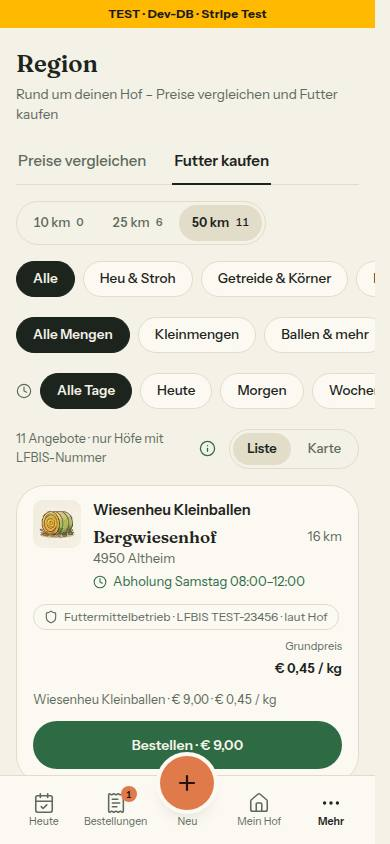
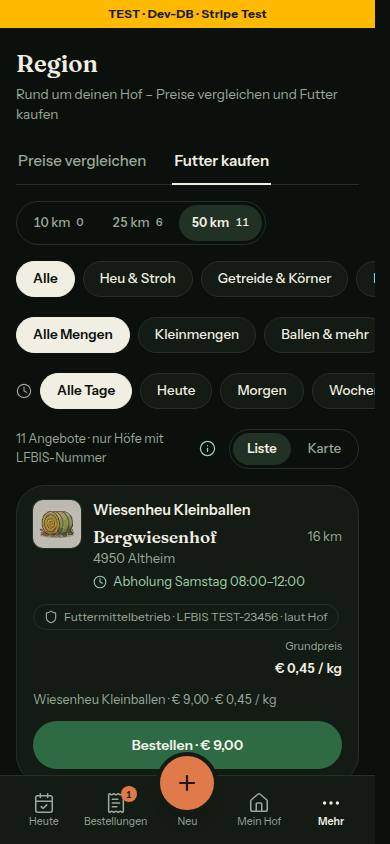
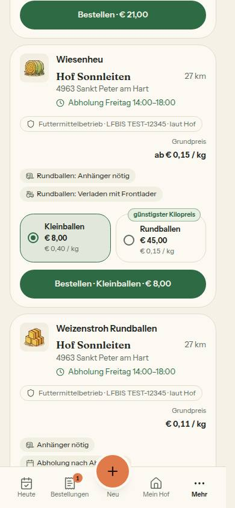
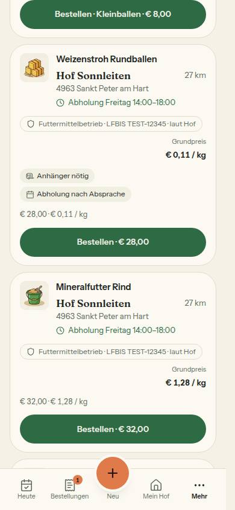
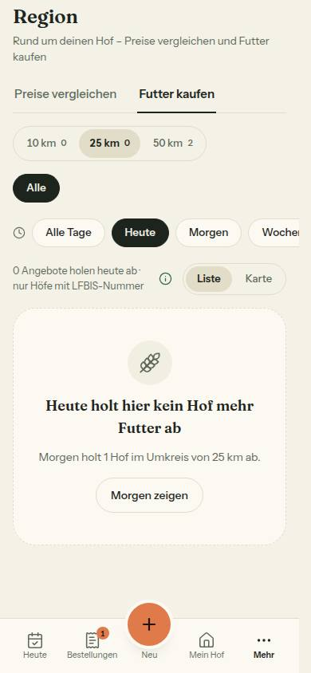
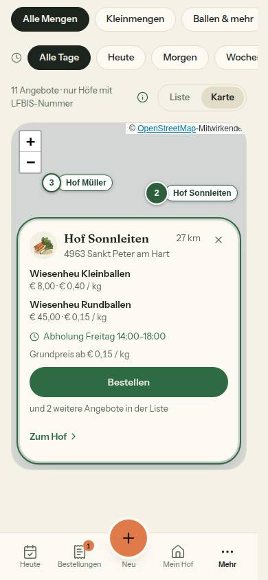
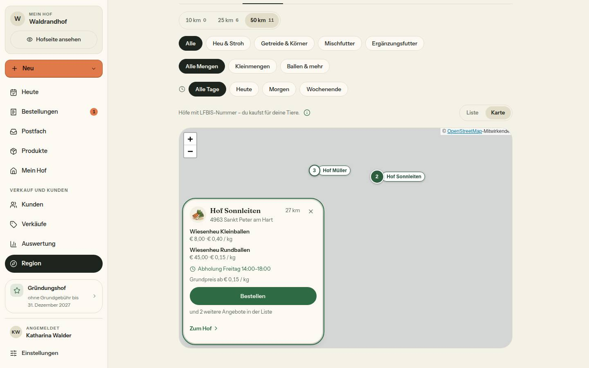
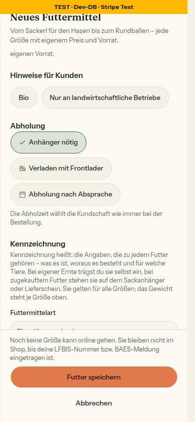
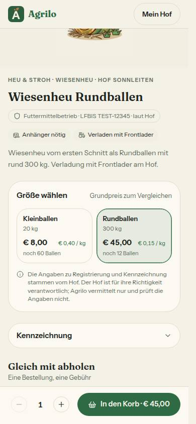

# Bericht Nr. 123 – Region · Futter kaufen (Register N23, E9-Ergänzung)

## Was geändert wurde
- `prisma/schema.prisma` + `migrations/20261021100000_abholhinweise`: Aufzählung `Abholhinweis`, Spalte `Product.abholhinweise` (nur Expand); `seed-daten.ts` Hinweise an `prod-a-heu-rund` und `prod-a-stroh`, `seed-lauf.ts` schreibt das Feld (eine Zeile, siehe Annahmen). `src/lib/abholhinweise.ts` (neu): Werte, Wörter, Symbole, `ordneAbholhinweise`, `schalteAbholhinweis`; `schemas/product.ts` `abholhinweiseSchema`; `schemas/produktfamilie.ts` das Feld an der Familie.
- `produkte-schreiben.ts` `abholhinweiseDaten` (nur Futtermittel, sonst leer); `actions/products.ts` und `actions/produktfamilie.ts` reichen es durch; `queries/products.ts` und `queries/farm.ts` (Select der Produktseite) lesen es. `familien-teile.tsx` `AbholhinweisWahl` (fieldset/legend, drei Ankreuzfelder als Chips, 44 px, Satz zur Abholzeit) im Futter-Formular und im Produktdialog.
- `lib/futter-kaufen.ts` neu gefasst: 50 km einmal, Zahl je Stufe, Abholung, Größen in Reihenfolge des Hofs, Vorwahl, „derzeit aus", Marke (> 5 %, ganzzahlig), Kennzeichen, Leerzustand, Texte E9, Karte, „Selbst verkaufen"; `queries/futter-kaufen.ts` lädt dafür (UEBERSICHT_*_SELECT, baueHofUebersicht, PRODUCT_ORDER_BY). `schemas/region.ts`: `abholung`, `ansicht` (`leseFutterAnsicht`), Links nehmen beides mit; `hoefe-entdecken.ts`: `abholungLeerSaetze` exportiert und parametrisiert, /hoefe gleich.
- `futter-kaufen-ansicht.tsx` (Client), neu `futter-karte.tsx`, `futter-karte-ansicht.tsx` (dynamic), `futter-abholhinweise.tsx`, `produkte/futter-schild.tsx`; `futter-reiter.tsx` reicht Zeitpunkt und Ansicht. `produktdetail.ts` `futterSchild` „· laut Hof"; `produktdetail-kunde.tsx` `FutterSchild` und Abholhinweise; `futter-formular.tsx` Vorschau mit `FutterSchild`.
- Tests: neu `abholhinweise`, `futter-schild`, `futter-karte-import`, `integration/abholhinweise`; angepasst `futter-kaufen` (neu gefasst), `region-auswertung-seiten`, `products-action`, `produktfamilie-aktion`, `kaeufer-vorbelegung`, `produktdetail(-seite)`, Wachen `leerzustaende`, `region-bausteine`, zwei Integrationsdateien, Fixtures (`abholhinweise: []`) in 10 Dateien.

## Eigene Dateien (`git diff --name-only 3d6d425...HEAD`)
```
DEVELOPMENT.md docs/ai/{ARCHITECTURE,BAUSTEINE,DESIGN_SYSTEM}.md docs/nachtlauf/berichte/123.md docs/nachtlauf/berichte/bilder/123/* (9) prisma/{schema.prisma,seed-daten.ts,seed-lauf.ts} prisma/migrations/20261021100000_abholhinweise/migration.sql src/app/(hof)/region/futter-reiter.tsx
src/components/products/product-dialog.tsx src/components/produktdetail/produktdetail-kunde.tsx src/components/produkte/{familien-teile,futter-formular,futter-schild}.tsx src/components/region/{futter-abholhinweise,futter-karte-ansicht,futter-karte,futter-kaufen-ansicht}.tsx src/lib/{abholhinweise,futter-kaufen,hoefe-entdecken,produktdetail}.ts
src/schemas/{product,produktfamilie,region}.ts src/server/actions/{products,produktfamilie}.ts src/server/produkte-schreiben.ts src/server/queries/{farm,futter-kaufen,products}.ts
tests/{abholhinweise,alt-texte-hofseite,bild-ausschnitt-anzeige,futter-karte-import,futter-kaufen,futter-schild,hofseite-404,hofseite-einmal,hofseite-kunde-ansicht,kaeufer-vorbelegung,leerzustaende-wache,products-action,produktdetail-seite,produktdetail,produkte-seite,produktfamilie-aktion,region-auswertung-seiten,region-bausteine,telefon-nach-kauf,use-cart}.test.ts tests/integration/{abholhinweise,auswertung-region,testhof}.int.test.ts
```

## Einstiege mit dem Feld
- Neues Futter: `FutterFormular` → `legeFutterFamilieAn` (jede Größe übernimmt die Hinweise der Familie). Bearbeiten: `ProductDialog` (`toFormDefaults`, `name="abholhinweise"`) → `updateProduct` (`futterKennzeichnungBearbeitenSchema` bleibt die Kennzeichnung; das Feld steht in `produktFelder`). Neues Produkt aus dem Hofladen: `createProduct` → immer leer. Weitere Wege laut `git grep` (brennmaterial-formular, bild-ausschnitt, farm, manual-sales) schreiben die Spalte nicht.

## Migration (Regel 3, frisch angewendet im Integrationslauf; ohne den Kopfkommentar der Datei)
```sql
SET lock_timeout = '5s';
DO $$ BEGIN
  CREATE TYPE "Abholhinweis" AS ENUM ('ANHAENGER_NOETIG', 'FRONTLADER', 'NACH_ABSPRACHE');
EXCEPTION WHEN duplicate_object THEN NULL; END $$;
ALTER TABLE "Product" ADD COLUMN IF NOT EXISTS "abholhinweise" "Abholhinweis"[] NOT NULL DEFAULT ARRAY[]::"Abholhinweis"[];
```

## Annahmen
- Eine geänderte Wahl verlangt beim Bearbeiten den Haken neu (E10a gilt für jede Produktangabe außer Preis, Vorrat, Foto, Sichtbarkeit); dieselbe Wahl in anderer Folge nicht. „Neue Größe kopieren": Einen Weg, einer bestehenden Familie eine Größe hinzuzufügen, gibt es nicht; jede Größe einer neuen Familie übernimmt die Hinweise. Kein neuer Weg gebaut.
- `seed-lauf.ts` (eine Zeile) als Aufrufer der Seed-Daten nach Vorschlag 116, sonst blieben die Hinweise im Seed wirkungslos. Reihe „Abholung" wie /hoefe als Links mit `aria-current` (keine Radiogruppe, hoefe-client.tsx); Abholhinweise auf der Produktseite unter dem Schild (die Abholzeiten stehen in der geteilten Seitenspalte außerhalb der Grenze). Ein Angebot steht nur mit mindestens einer kaufbaren Größe da; Pins tragen Koordinaten wie /hoefe.

## Nicht gelöst
- `RegionKopf` (Baustein von 122) reicht Ansicht und Abholung beim Reiterwechsel noch nicht weiter; `regionReiterLink` kann es (optional). Lauf 20 / Sammel-PR. `prisma migrate status` der Entwicklungsdatenbank prüft der Dirigent nach dem Push.

## Wie der Mensch es testet (Vorschau)
- /region?reiter=futter als Hof mit Standort: Umkreis mit Zahl je Stufe, Futterart, Menge, Abholung (Alle Tage · Heute · Morgen · Wochenende) — jeder Klick zeigt den Ladepunkt am Chip, die Liste folgt. Größe wählen (Pfeiltasten in der Gruppe „Größe"), „Bestellen · … · €" führt zur Produktseite genau dieser Größe mit `?kaeufer=betrieb`.
- „Karte": Pins mit Namen, „Du", Umkreis; Pin antippen bzw. Tab + Enter → Karte am Pin, „Schließen" bzw. Escape gibt den Fokus an den Pin zurück. /products → Futtermittel anlegen: Abschnitt „Abholung" setzen, speichern → Futterkarte und Produktseite zeigen die Kennzeichen. Schild „Futtermittelbetrieb · LFBIS … · laut Hof" ohne Haken in Futter kaufen, auf der Produktseite und in der Vorschau des Formulars.

## Angepasste .md
- `docs/ai/ARCHITECTURE.md` (Datenmodell Produkt: Abholhinweise), `docs/ai/DESIGN_SYSTEM.md` (Region › Futter kaufen, Produktseite › Schild), `docs/ai/BAUSTEINE.md` (`pnpm bausteine`), `DEVELOPMENT.md` (Eintrag Nr. 123).

## Prüfungen, Bilder
- typecheck 0, lint 0 Fehler / 5 Warnungen (Grundstand), test 483 Dateien / 9199 Tests grün (Grundstand 122: 480 / 9156). Integration GANZ unter Sperre: 66 Dateien / 582 Tests grün; Migration dabei frisch in `farmerzone_test` eingespielt; danach `migrate diff --from-config-datasource` (Test-DB) → `--to-schema`: leer (NOT NULL an der Liste macht keinen Unterschied).
- Gegenproben rot: Schreiben ohne Futter-Regel (4 Tests), Sortierung nach Preis / `<=` an der 5-%-Grenze / „Selbst verkaufen" immer (7 Tests), `ShieldCheck` in produktdetail-kunde (Schild-Wache).
- Axe 0 Verstöße: Liste 390 hell + dunkel, Karte mit Karte am Pin 390 und 1440, Formular 390, Produktseite 390, Leerzustand 390. Tippflächen: Größenfelder 73 px, Chips 36 + 8 (::before), Abholung-Chips 44, Bestellen 48, (i) 44; nur `Segment` Liste | Karte 40 px (Baustein, wie Preise vergleichen). Tastatur: Pin mit Tab + Enter → Karte am Pin mit Fokus, Escape → Fokus zurück auf den Pin; Größen mit Pfeiltasten (Radiogruppe).
- Testdaten: Hinweise an zwei Seed-Futtern kommen aus dem Seed (Integrations-Setup). Für die Bilder vorübergehend `familieId` an `prod-a-heu-klein/-rund` (Größenwahl) und das Samstagsfenster von hof-bergwiese auf Donnerstag (Leerzustand „Morgen zeigen"), danach zurück: `$SP/l19/123-vorher.txt` = `123-nachher.txt`.
- Bilder (Kacheln ohne Netz grau):         
- Wiederverwendet: HofKopf, Abholzeile, Vorschaubild, HofKurzkarte (region), HoefeKarte, KmWahl (zahlen), ErklaerKnopf, EmptyState, FilterChip, Segment, Marke, zaehleJeStufe, ohneStandortHinweis, holtAbAnTagen, naechsterAbholtag, baueHofUebersicht. Neu, weil: kein Schild-, Kennzeichen-, Abholhinweis- und Futterkarten-Baustein existierte; Größenfelder siehe Abweichungen.

## Mockup-Abweichungen (mit Bild)
- Größen als eigene Radiofelder statt `Groessenkachel` (Bild Größenwahl): Die Kachel hat keinen Platz für die Marke, ist 88 statt 58 px hoch, streicht bei „derzeit aus" den Preis, ihre Gruppe trägt aria-label statt fieldset/legend; sie liegt außerhalb der Grenze.
- `HofKopf` zeigt PLZ und Ort unter dem Hofnamen (Board v2: „Hof · 11 km"); der Baustein von 122 bleibt unverändert (N23). Einzelprodukt: Zeile ohne doppelten Namen (Bild eine Größe). Marke als `Marke art="laeuft"` (Grün des Boards). Futterart-Chips nur mit Angebot (wie bisher); Karte am Pin am Computer unten links statt Vorschau (Freigabe §1, 7). „staubarm"/„für Kleintiere" entfallen (§1, 6).

## Regelvorschlag
- Ursache: Die Dateigrenze nannte `seed-daten.ts`, nicht den Schreiber `seed-lauf.ts`. Gegenmaßnahme: Bei Seed-Feldern nennt die Grenze beide Dateien (Daten und `produkt()` in `seed-lauf.ts`). Ort: docs/nachtlauf.md, Regeln zu Dateigrenzen.
