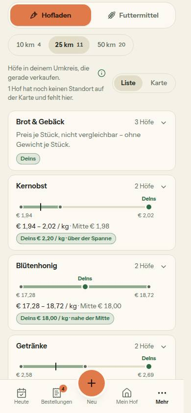
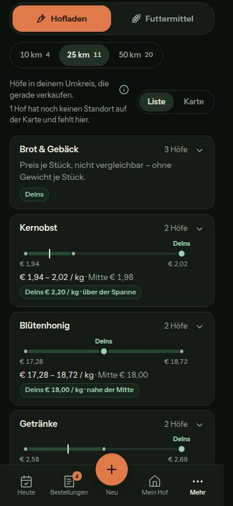
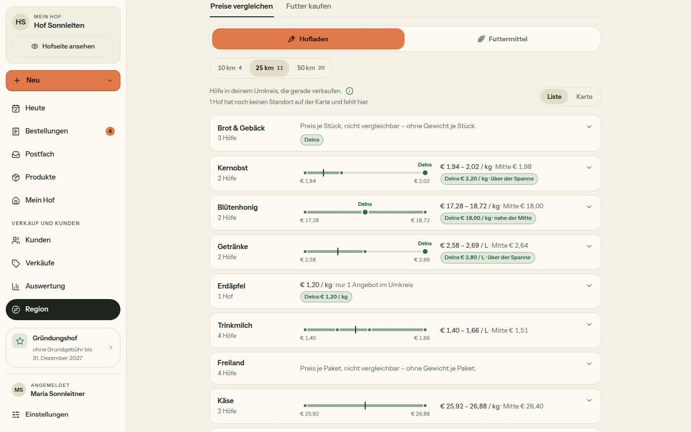
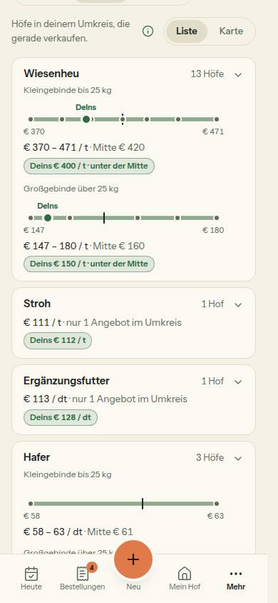
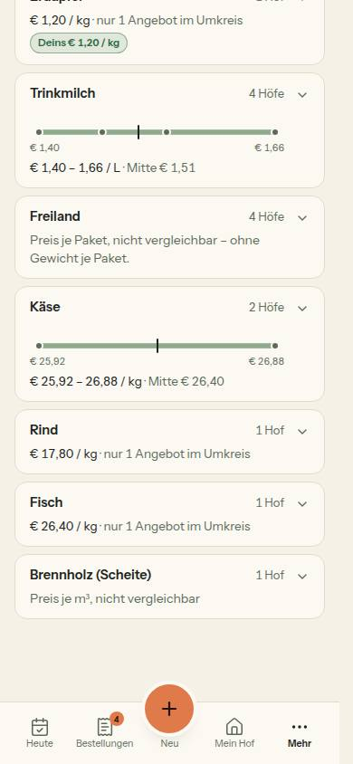
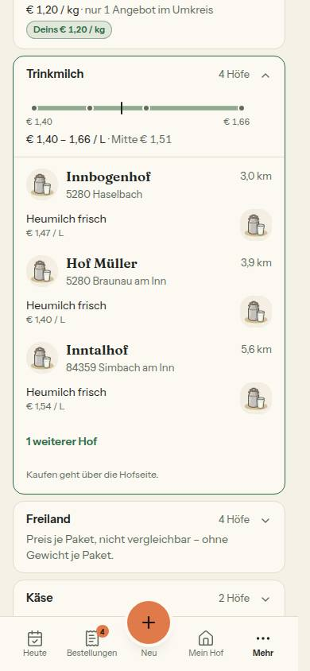
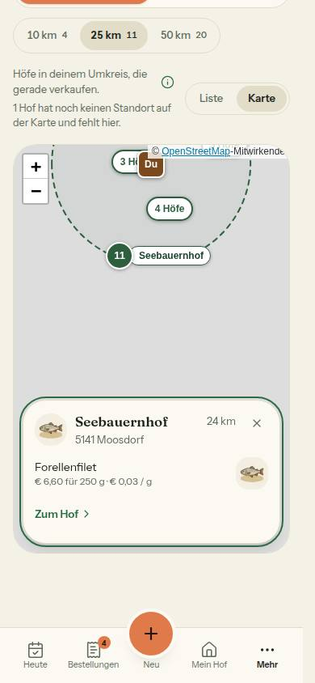
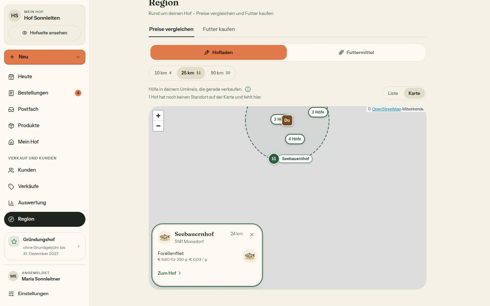
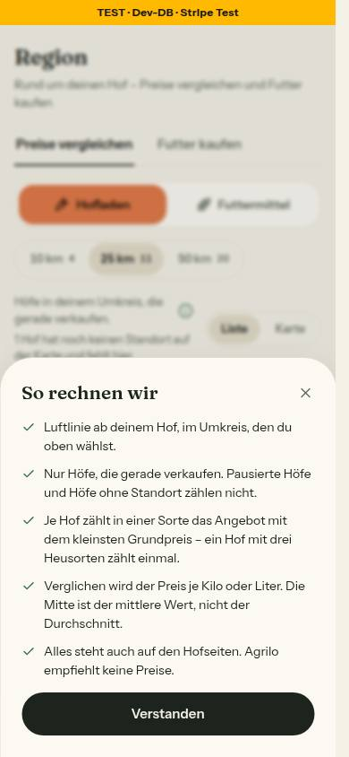

# Bericht Nr. 124 – Region · Preise vergleichen (Register N23, Konzept Umfeld §3/§4/§6)

**Nicht mergen, bevor die Projektleitung die Spanne rechtlich geprüft hat (N23).** Seit Lauf 20 auf main nachgezogen (`d6fad97`), Basis des PR ist main.

## Was geändert wurde
- `src/lib/umfeld.ts`: Umkreis bis 50 km mit `zahlenJeStufe` (über `zaehleJeStufe`, `gezaehlteHoefe` jetzt mit Umkreis); Grundpreis, Spanne, Mitte (`median`) und Lage (`preisLage`) in ganzen Zahlen der kleinsten gezeigten Einheit; `PreisStreifenDaten` mit Satz; Gründe-Tabelle `NICHT_VERGLEICHBAR_TEXT`; Pins mit den ersten zwei kaufbaren Produkten (`waehleVorschauImBereich`), `guenstigsterGrundpreis`/`guenstigster` entfallen; Texte `UMFELD_TEXT`; Kommentar `IN_LISTEN_SICHTBAR` berichtigt.
- `src/server/queries/umfeld.ts`: `getUmfeld(farmId)` lädt einmal 50 km; je Hof PLZ, Ort, Fotos (`baueFotostreifen`), Kategorien; je Produkt ID, Bild samt Ausschnitt, `unitSize`, `kaufbar`, `preisCents` (`alsCents`), Reihenfolge über `PRODUCT_ORDER_BY`; `abgeschnittenAbKm` statt `abgeschnitten`.
- `src/components/region/preis-streifen.tsx` (neu): `PreisStreifen`, 270 × 48 bzw. volle Breite, `role="img"` mit Satz.
- `umfeld-liste.tsx`: Streifen, Spanne, „Deins … · Lage“; aufgeklappt `HofKopf` (Bild 40, als Link) + `HoefeProduktzeilen` (40). `umfeld-karte.tsx`: Pins mit Namen, `HofKurzkarte` „region“ (`findePin`). `umfeld-kopf.tsx`: `KmWahl` mit Zahl, Ladepunkt am Bereich. `umfeld-anzeige.tsx`: Satz + `ErklaerKnopf`, `aria-busy`. `preise-reiter.tsx`: `getUmfeld(farm.id)`.
- Tests: neu `preis-streifen`, `umfeld-leitplanken`, `integration/umfeld.int`; angepasst `umfeld`, `umfeld-query`, `umfeld-karte`, `umfeld-seed`, `region-bausteine` (eine Zeile), `integration/testhof.int` (Aufruf).
- **Lauf 20 (Leitplanken schließen):** `tests/umfeld-leitplanken.test.ts` (Verbotsliste „günstig“ am Wortanfang; Wache auf den gerenderten Text von Liste, aufgeklappter Zeile, Karte am Pin und geöffnetem „So rechnen wir“; Leitplanke 2 umbenannt und auf die Darstellung geprüft), `src/lib/umfeld.ts` (nur „So rechnen wir“ Punkt 3 und der Kommentar dazu), `bilder/124/so-rechnen-wir-390-hell.jpg` neu aufgenommen.
## Eigene Dateien
- Lauf 19 (`git diff --name-only 3d6d425...HEAD`, Stand 5f31341):
  DEVELOPMENT.md docs/ai/BAUSTEINE.md docs/ai/DESIGN_SYSTEM.md docs/nachtlauf/berichte/124.md docs/nachtlauf/berichte/bilder/124/* (9)  
  src/app/(hof)/region/preise-reiter.tsx src/components/analytics/umfeld-{anzeige,karte,kopf,liste}.tsx src/components/region/preis-streifen.tsx src/lib/umfeld.ts src/server/queries/umfeld.ts  
  tests/{preis-streifen,region-bausteine,umfeld-karte,umfeld-leitplanken,umfeld-query,umfeld-seed,umfeld}.test.ts tests/integration/{testhof,umfeld}.int.test.ts  
- Lauf 20 (`git diff --name-only d6fad97...HEAD`): `docs/nachtlauf/berichte/124.md`, `docs/nachtlauf/berichte/bilder/124/so-rechnen-wir-390-hell.jpg`, `src/lib/umfeld.ts`, `tests/umfeld-leitplanken.test.ts`.
## Leitplanken geschlossen (Lauf 20) – die Leitplanken als Prüfungen, für die rechtliche Prüfung (N23)
Alle in `tests/umfeld-leitplanken.test.ts`, wo nichts anderes steht. Gegenproben, die anschlagen, sind für 1 und 2 belegt (auch von Hand, siehe die drei Lücken unten); 3 und 6 sind Tests, eine eigene Gegenprobe lief in diesem Lauf nicht; zu 4 und 5 siehe „Nicht gelöst“.
1. Kein Text empfiehlt oder wertet einen Preis. (a) Quelltext-Wache über alle String-Literale und JSX-Texte von `umfeld.ts`, `umfeld-*.tsx`, `preis-streifen.tsx`; (b) **neu:** dieselbe Verbotsliste auf den gerenderten Text (`renderToStaticMarkup`) von Liste, aufgeklappter Zeile, Karte am Pin und geöffnetem „So rechnen wir“, samt der wiederverwendeten Bausteine (`HofKopf`, `HoefeProduktzeilen`, `HofKurzkarte`, `ErklaerKnopf`). Verboten am Wortanfang: „empfehl/empfiehl“ (außer „empfiehlt keine“), „solltest“, „zu teuer/billig“, **„günstig“** (statt „zu günstig“, „günstiger als“), „erhöh“, „senk“, „teurer als“, „Rang“. Gegenprobe: „Du solltest erhöhen“ rot; ein verbotenes Wort in jedem der vier gerenderten Texte rot; „empfiehlt keine Preise.“ steht im HTML des Dialogs.
2. **Vor dem Antippen zeigt die Karte keinen Preis** (vorher „Kein Preis an den Pins“). Die Daten der Karte tragen die Preise der zwei Produkte als Zahl (`price` aus `alsVorschau`), wie die Hofseite; geprüft wird die Darstellung: gerendert wird die Karte vor dem Antippen (Pins mit Nummer und Name, eigener Hof) samt allen Eigenschaften, die die Kartenkomponente bekommt – ohne „€“ und ohne eine Schreibweise der Preise (Cent, 15.8, 15.80, 15,80). Gegenprobe: ein Preis im Pin-Namen macht den Test rot; nach dem Antippen steht der Preis in der Karte am Pin. Unverändert dazu: `baueUmfeldKarte` ohne „€“ (Gegenprobe Zeilen) und `KartenHof` nur mit Kennung, Nummer, Lage, Namen (`umfeld-karte.test.ts`).
3. Keine Sortierung nach Preis: aufgeklappte Zeile, Zeilen und Karte am Pin mit vertauschten Preisen unverändert; Query behält `PRODUCT_ORDER_BY`.
4. Testhof, pausierter und eigener Hof fehlen in Zählung, Streifen und Karte: je ein Test (Unit + `integration/umfeld.int.test.ts`); die Gegenprobe „ohne `isPaused: false` rot“ ist nur behauptet (siehe „Nicht gelöst“).
5. Keine Namen an Punkten: `PreisStreifen` ohne `title`, `tabindex`, Knopf oder Link (Render-Test); Werte ohne Namen und IDs.
6. Nur öffentliche Daten: keine Hof-ID, kein Bestand, keine Bestellungen, kein Umsatz (`umfeld-query.test.ts`).
Die drei Lücken (Morgenbericht 19 §3), geschlossen:
- **Wache zu eng:** Prüfung 1b. Von Hand ausprobiert und zurückgenommen: „Günstig zum Hof“ in `HofKurzkarte` und „Wir empfehlen:“ in `ErklaerKnopf` machen nur die neuen Tests rot, die Quelltext-Wache blieb grün.
- **„günstigstes Angebot“:** Punkt 3 lautet jetzt „Je Hof zählt in einer Sorte das Angebot mit dem kleinsten Grundpreis – ein Hof mit drei Heusorten zählt einmal.“ Der Satz von vorher schlägt an der neuen Verbotsliste an (Gegenprobe im Test); Punkt 4 bleibt ohne „oder Stück“. Bild: `so-rechnen-wir-390-hell.jpg`.
- **Preis als Zahl:** Prüfung 2. Von Hand ausprobiert und zurückgenommen: die Preiszahl im Pin-Namen von `umfeld-karte.tsx` macht „Pin, Name am Pin und alles vor dem Antippen …“ rot.
## Annahmen
- Lage nur mit Streifen und genau einem eigenen Wert; ein Hof oder gleiche Werte: „Deins € …“ ohne Lage (Board: „ein Punkt allein wäre kein Vergleich“).
- Mitte bei gerader Zahl kaufmännisch auf die ganze Einheit gerundet, Lage mit dieser gezeigten Mitte. Futter ohne Kennzeichnung: „Preis je …, nicht vergleichbar“ bzw. „Preise nicht vergleichbar“.
- Aufgeklappt je Hof das zählende Produkt je Klasse (zählt ein Hof in beiden Klassen: zwei Zeilen), ohne vergleichbares das erste der Zeile. Der ganze `HofKopf` ist der Link (`HofKopf` hat keinen Link-Namen, Baustein von 122 unverändert).
- Bereich-Umschalter wechselt per `router.push` (kein Link) → Ladepunkt selbst über `useTransition` an der gewählten Hälfte.
- Lauf 20: Der Dialog (Base UI) zeichnet auf dem Server kein Fenster – der Test ersetzt nur `@/components/ui/dialog` durch schlichte Rahmen, der Inhalt von `ErklaerKnopf` ist echt. Die Karte (Leaflet) ist ein Stellvertreter, der die Pins wie `hoefe-karte.tsx` beschriftet (Nummer, `pinName`, `pinBeschriftung`) und seine Eigenschaften festhält; das Pin-Symbol selbst (`divIcon`) bekommt nur Nummer, Zustand und Namen. „Aufgeklappt“ und „angetippt“ gehen über den Startwert von `useState`, nicht über einen Klick. Gelesen wird Text, `aria-label`, `title` und `alt`, nie Klassen.
## Nicht gelöst
- **Punkt 3 Eier je Stück: STOPP.** Im Produkt-Formular ist `unitSize` bei Paket die Zahl der Pakete („Preis für 10 Pakete“, `preisFeldLabel`), nicht die Stückzahl. `taxonomie.ts` unverändert; Eier im Paket: „Preis je Paket, nicht vergleichbar – ohne Gewicht je Paket.“ Vorschlag: Seed-Eier als Stück mit Gebinde 10, oder ein Feld „Stück je Paket“ (Schema, Lauf 20). Deshalb in „So rechnen wir“ „je Kilo oder Liter“ statt „je Kilo, Liter oder Stück“.
- Lauf 20: Das Pin-Symbol der echten Leaflet-Karte wird im Test nicht gezeichnet (Node); das Bild `karte-pin-390-hell.jpg` aus Lauf 19 zeigt die Pins ohne Preis. Nicht Teil der drei Lücken, nicht angefasst: Leitplanke 5 hat keinen Fall, der die Verbotsliste (`title=`, `tabindex`, `<button`, `<a `) rot sieht; bei Leitplanke 4 ist „ohne `isPaused: false` rot“ nur behauptet.
## Wie der Mensch es testet (Vorschau, `bauer-a@example.com`)
- `/region?km=25&bereich=hofladen`: Umkreis „10 km 4 · 25 km 11 · 50 km 20“; Kernobst/Getränke „Deins … · über der Spanne“, Blütenhonig „nahe der Mitte“; Freiland „Preis je Paket, nicht vergleichbar …“ (Eier gestoppt).
- `?bereich=futter`: Wiesenheu mit zwei Streifen „Kleingebinde bis 25 kg“ / „Großgebinde über 25 kg“, „Deins … · unter der Mitte“.
- Zeile Trinkmilch antippen: drei Höfe mit Kopf und Produktzeile, „1 weiterer Hof“, „Kaufen geht über die Hofseite.“
- „Karte“: Pins mit Namen, „Du“, Kreis; Tab auf einen Pin, Enter → Karte am Pin mit Produkten und „Zum Hof“; Escape bzw. „Schließen“ → Fokus zurück auf den Pin.
- (i) „So rechnen wir“: fünf Punkte, Punkt 3 mit „kleinsten Grundpreis“, „Verstanden“; Escape → Fokus auf (i). Test: `pnpm vitest run tests/umfeld-leitplanken.test.ts`.
## Angepasste .md
- `docs/ai/DESIGN_SYSTEM.md` (Region: Preise vergleichen, `PreisStreifen` mit Maßen), `docs/ai/BAUSTEINE.md` (`pnpm bausteine`), `DEVELOPMENT.md` (Eintrag Nr. 124). Lauf 20: nur dieser Bericht (keine Regel- und Planungsdatei).
## Prüfungen, Bilder
- typecheck 0, lint 0 Fehler / 5 Warnungen (Grundstand), test 482 / 9198 grün (vor jedem Commit). Integration unter Sperre: umfeld, testhof, region, auswertung-region – 4 / 23 grün. Lauf 20: typecheck 0, lint 0 Fehler / 5 Warnungen (Grundstand, keine neue in meinen Dateien), test 508 Dateien / 9592 Tests grün. Keine Integrationsdatei geändert, darum kein Integrationslauf. Bild `so-rechnen-wir-390-hell.jpg` (390, hell, Dialog offen) neu; Axe und Tippflächen nicht neu gemessen (nur der Text von Punkt 3 änderte sich).
- Axe 0 Verstöße: Liste 390 hell + dunkel, 1440; Karte mit Karte am Pin 390. Kontrast Punkte/Strich/„Deins“ zur Karte: hell 5,4 / 15,1 / 6,0, dunkel 7,1 / 15,1 / 10,1. Tippflächen: (i) 44, Umkreis 36 + 2 × 4, Zeile ≥ 44, Kopf-Link 45, „weitere Höfe“ 44, Schließen 44.
-         
- Lücke der Seed-Daten: „Deins unter der Spanne“ kommt nicht vor (Lage im Test). Kacheln ohne Netz grau. Nachrunde des Dirigenten: Leitplanke 2 genau benannt; ein Test hält die Enden wie im Board fest. Vorschlag an die Projektleitung (nicht umgesetzt, Board v3 §2 ist bindend): Liegt „Deins“ außerhalb der Spanne, steht der Höchst- bzw. Kleinstwert der Höfe unter „Deins“ und lässt sich als eigener Preis lesen – besser unter dem Ende der Spanne. Mengen als Tausendstel bleiben in `umfeld.ts` (Decimal(10,3) exakt, Muster `grundpreisCents`; Geld in ganzen Cent).
## Mockup-Abweichungen (mit Bild)
- Eier je Stück fehlt (STOPP) – `eier-390-hell.jpg`; „So rechnen wir“ Punkt 4 ohne „oder Stück“ – `so-rechnen-wir-390-hell.jpg`.
- Karte am Pin am Computer links unten, 320 px (Abweichung 7 freigegeben, Ort gewählt) – `karte-pin-1440-hell.jpg`.
- Aufgeklappt je Hof nur das zählende Produkt statt aller der Sorte (Board v2 zeigt zwei) – `aufgeklappt-390-hell.jpg`.
- Wiederverwendet: HofKopf, HofKurzkarte „region“, HoefeProduktzeilen, HoefeKarte, KmWahl, ErklaerKnopf, waehleVorschauImBereich, zaehleJeStufe, baueFotostreifen, PRODUCT_ORDER_BY. Neu, weil: kein Baustein zeigt eine Spanne als Bild (`PreisStreifen`). Lauf 20: keine neue Abweichung. Wiederverwendet: `renderToStaticMarkup`-Muster aus TESTING_GUIDELINES §1, `funde`/`wortAnfang` der bestehenden Wache. Neu, weil: kein Baustein rendert Text samt Dialog ohne Browser (Stellvertreter in der Testdatei).
## Regelvorschlag
- Ursache: Die Freigabe setzte für Eier „Preis ÷ unitSize“ voraus; das Formular meint bei Paket die Zahl der Pakete. Gegenmaßnahme: Vor einer Fachregel über ein Feld dessen Bedeutung im Formular als Test festhalten (`preisFeldLabel`), Ort: docs/nachtlauf.md, Vorbereitung der Freigabe.
- Lauf 20: Ursache: Die Wache las Quelltext, nicht den Text, den man sieht – wiederverwendete Bausteine und der geschlossene Dialog blieben außen vor. Gegenmaßnahme: Wachen über Nutzertext rendern ihn (`renderToStaticMarkup`, Gegenprobe mit einem Wort in einem Baustein). Ort: TESTING_GUIDELINES §2 (Wachen). Nur Vorschlag, nicht eingetragen.
