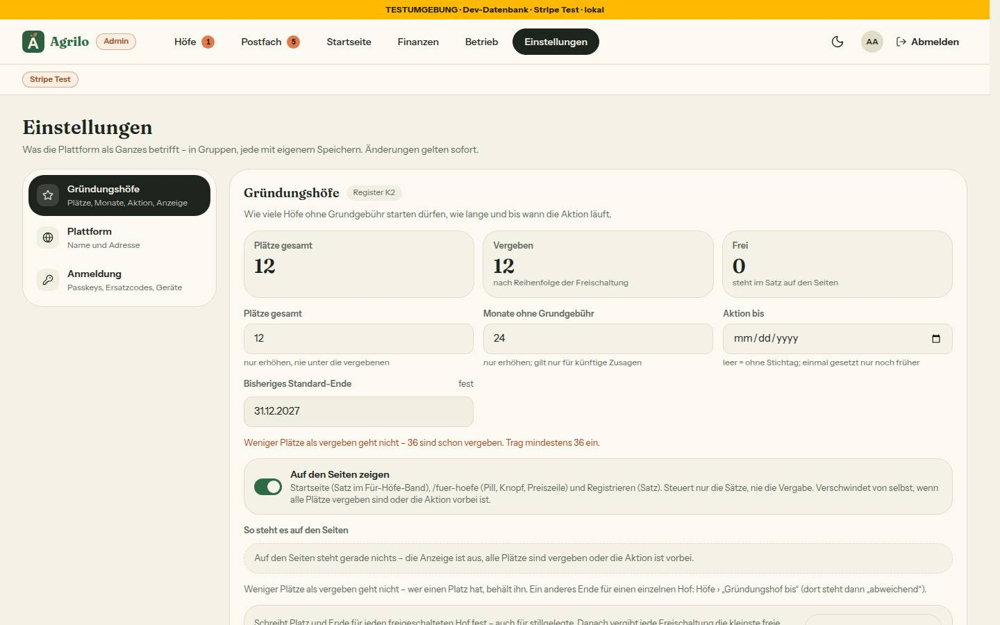
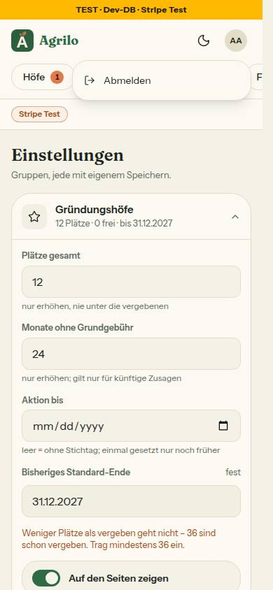

# Bericht Nr. 126 – Admin-Nacharbeit aus 115 (Register N20, Lauf 19)

Basis b3720ce, Branch `nacht/2026-10-20/126-admin-nacharbeit`. Alle acht Punkte erledigt. Keine Migration, kein Paket.
Prüfung: typecheck grün, lint 0 Fehler / 5 Warnungen (Bestand, keine in meinen Dateien), `pnpm test` 482 Dateien / 9210 Tests grün; Integrationstest `admin-passkey.int.test.ts` (26 Tests) grün. Runde 1 (nur Bilder und Bericht) erneut grün mit denselben Zahlen.

## Was geändert wurde
- `src/server/actions/{admin,gruendung,postfach}.ts`: Die acht heiklen Actions rufen nur noch `verlangeFrischeBestaetigung`; `userId` kommt aus deren Ergebnis (Punkt 1).
- `src/server/admin-wache.ts`: nur der Doku-Satz zur einen Wache; das Ergebnis lieferte `userId` und `sitzungId` schon.
- `src/server/admin-bremse.ts` (neu), `src/lib/auth.ts`, `src/server/actions/admin-anmeldung.ts`: ein fail-closed-Helfer `adminBremseVoll` statt zwei wörtlicher Kopien (2); dort `EINRICHTEN_SITZUNG_MINUTEN` statt `15 * MINUTE_MS` (3).
- `src/lib/ersatzcodes.ts`: Adresse über `emailSchema()` (3).
- `src/lib/geraete.ts`, `src/components/konto/angemeldete-geraete.tsx`, `src/app/admin/einstellungen/anmeldung/page.tsx`: Admin-Fassung von Hinweis und Zusatz (`GERAETE_TEXT.admin`, `geraeteHinweise`, Eigenschaft `fuerAdmin`) (4).
- `src/components/shells/admin-konto.tsx` (neu), `admin-shell.tsx`, `src/lib/admin-navigation.ts` (`ADMIN_ABMELDEN`), `src/app/intern/.../shell-vorschau.tsx`: Abmelden, Trefferfläche der Reiter 44 px (5, 6).
- `src/lib/admin-anmeldung.ts`: Satz `schonRegistriert` und Fall `ERROR_AUTHENTICATOR_PREVIOUSLY_REGISTERED` (7); `DOWNLOAD_SPERRE_MS`, `FRISCH_TEXT.downloadStartet` (8). `bestaetigen-karte.tsx`: Hinweis `role="status"`, Knopf 3 s gesperrt (8).
- Tests: neu `admin-heikel-eine-wache`, `admin-bremse`, `admin-abmelden`, `bestaetigen-karte`, `angemeldete-geraete-text`; erweitert `frisch-bestaetigung-wache`, `admin-anmeldung`, `geraete`, `abmelden`, `admin-passkey.int`; angepasst `betrieb-seite`, `testumgebung-anzeige` (Mock um `useRouter` ergänzt), `zustellung-bestaetigen` (Wache akzeptiert `verlangeFrischeBestaetigung` als Obermenge). Nichts abgeschwächt oder gelöscht.

## Eigene Dateien
`git diff --name-only b3720ce...HEAD`: DEVELOPMENT.md · docs/ai/{BAUSTEINE,DESIGN_SYSTEM}.md · docs/nachtlauf/berichte/126.md · 2 Bilder unter bilder/126/ · src/app/admin/{bestaetigen/bestaetigen-karte.tsx, einstellungen/anmeldung/page.tsx} · src/app/intern/bausteine/shell/[variante]/shell-vorschau.tsx · src/components/{konto/angemeldete-geraete.tsx, shells/admin-konto.tsx, shells/admin-shell.tsx} · src/lib/{admin-anmeldung,admin-navigation,auth,ersatzcodes,geraete}.ts · src/server/{admin-bremse,admin-wache}.ts · src/server/actions/{admin,admin-anmeldung,gruendung,postfach}.ts · 13 Testdateien (5 neu, 8 geändert). `auth.ts`: nur `adminBremseVoll` und die zwei Importe darüber.

## Annahmen
- „Am Handy im Menü": Die AdminShell hatte kein Menü. Bis 767 px öffnet die Plakette eines (`DropdownMenu`: „Konto und Sicherheit" nur mit Hof, „Abmelden"); ab 768 px steht der Knopf neben der Plakette (768 bis 1023 px nur das Symbol, die Reiter brauchen den Platz).
- Punkt 3: Eine Adresse mit falschem Format wird nicht mit 400 abgewiesen (`.catch`), sondern bleibt eine unbekannte Adresse: gleiche Antwort, eigene Bremse je Eingabe wie vorher (Integrationstest). Zu lange Eingaben antworten damit auch wie unbekannt statt 400.
- Aufrufer-Regel (Vorschlag 116): `angemeldete-geraete.tsx` und die Admin-Seite (Verbraucher der Texte) sowie `shell-vorschau.tsx` (Aufrufer der AdminShell, eine Zeile, damit der Admin vor der Vorschau nicht wirklich abgemeldet wird) mitgeändert. Der Dirigent kann sie als Grenzerweiterung bestätigen oder zurücknehmen.
- **Grenzerweiterung (Dirigent bestätigt oder nimmt zurück):** neue Datei `src/components/shells/admin-konto.tsx` neben der AdminShell, nur für Punkt 5 (Plakette, Menü, Abmelden); keine andere Nummer berührt sie. Alternativ gehören beide Teile in `admin-shell.tsx`.
- Reiter: Das Pseudo-Element misst vom Innenrand; darum `-inset-y-[4px]` und ein unsichtbarer 1-px-Rahmen am aktiven Reiter (sonst 42 statt 44 px). Gemessen mit `elementFromPoint`: alle sechs Reiter treffen 3 px über und unter sich.
- Der Admin-Text zum Passwort stammt wörtlich aus der Freigabe, obwohl das Passwort eines Admin-Kontos mit Passkey gesperrt ist.

## Nicht gelöst
- Klick auf „Abmelden" bis /login/admin nur über Test und Server geprüft: Lokal vertraut Better Auth nur der Herkunft localhost:3000, der Browser auf Port 3126 bekommt 403 (Fehlerweg bestätigt: Satz, kein Weiterleiten). Per curl mit erlaubter Herkunft: 200, Sitzung gelöscht. Die Weiterleitung prüft die Vorschau.
- Axe bei geöffnetem Menü: ein „region"-Fund am Portal des Menüs (Baustein `DropdownMenu`, gilt auch für das Neu-Menü der HofShell). Geschlossen und bei 1440: 0 Verstöße.
- Bei 768 px scrollt die Reiterzeile etwas früher (der Knopf nimmt 44 px); sie scrollte dort schon vorher.

## Wie der Mensch es testet (Vorschau unter der Branch-Adresse)
Dafür braucht die Projektleitung ein Testkonto in der ENTWICKLUNGSdatenbank mit Admin-Recht und eingerichtetem Passkey.
1. /admin ab 768 px: „Abmelden" neben der Plakette; Klick führt nach /login/admin, danach /admin gesperrt.
2. Handy (bis 767 px): Plakette antippen, Menü mit „Abmelden" (mit Hof auch „Konto und Sicherheit"); Klick führt nach /login/admin.
3. Export (/admin/finanzen/export): Karte „Bitte bestätige mit deinem Passkey", nach der Bestätigung „Der Download startet …", Knopf 3 s gesperrt.
4. Heikle Aktion (Testhof markieren, Ersatzcodes erstellen) nach über 5 Minuten: Dialog zur frischen Bestätigung bleibt.
5. /admin/einstellungen/anmeldung: Hinweis nennt „prüf deine Passkeys"; die Kontoseite des Hofs ist unverändert.
6. „Passkey hinzufügen" auf einem Gerät, das ihn schon hat: Satz „Dieses Gerät hat schon einen Passkey für dein Konto …".

## Angepasste .md
DESIGN_SYSTEM.md (Navigation Admin, AdminShell, Angemeldete Geräte, Bestätigungskarte), BAUSTEINE.md (`pnpm bausteine`), DEVELOPMENT.md (Eintrag vor „Nützliche Befehle").

## Wiederverwendet / Neu, weil
Wiederverwendet: `fuehreAbmeldenAus`, `DropdownMenu`, `FOKUS_RAHMEN`, `emailSchema`, `zaehleVersuche`, `verlangeFrischeBestaetigung`. Neu, weil: `admin-bremse.ts` verlangt Punkt 2; `admin-konto.tsx` – die HofShell hat keinen teilbaren Abmelden-Baustein (`hof-shell.tsx` nur lesen), der Ablauf selbst bleibt der gemeinsame.

## Nacharbeit / Regelvorschlag
Nacharbeit: `hof-shell.tsx` könnte den kleinen Hook für den Ablauf von `admin-konto.tsx` übernehmen (eine Fassung statt zwei Zeilen Klebstoff; `hof-shell.tsx` durfte nur gelesen werden).
Nacharbeit aus Runde 1 (Dateien in dieser Runde nicht angefasst, Lauf 20 oder Sammel-PR): (a) `bestaetigen-karte.tsx:68` `empty:hidden` durch `empty:sr-only` ersetzen, damit der Statusbereich vor dem Text im Zugänglichkeitsbaum steht; (b) Parametertyp von `passkeyFehlerText` (`src/lib/admin-anmeldung.ts`) um `code?: unknown` erweitern, dann entfallen die zwei Casts (dort und `tests/admin-anmeldung.test.ts:175`); (c) am Test mit `client.mjs` (`:182`) kommentieren: Bruch heißt Plugin-Code nachlesen, nicht Test löschen. Regelvorschlag: keiner; die Ursache (zweite Wache nach der frischen) hält jetzt eine Quelltext-Wache mit Gegenprobe fest.

## Nachbesserung Runde 1
- Blocker (Bilder zeigten in der Höfe-Liste einen Seed-Hofnamen, der nicht auf der Liste der Freigabe steht): beide Bilder neu aufgenommen auf `/admin/einstellungen` (390 mit Menü offen, 1440; hell; ein Durchgang). Sie zeigen den Kopf der Shell und die Einstellungen, keinen Hofnamen. Kein Code geändert.
- Gegenprobe statt Test (ein Bild lässt sich nicht per Test prüfen): Der Seitentext wurde gegen alle 37 Hofnamen der Test-DB geprüft. Das alte Bild (`/admin`): 1 Treffer (rot), `/admin/einstellungen`: 0 (grün).
- Testzeilen nur mit eigener Passkey-Kennung und eigener Sitzung, danach gelöscht: `126-vorher.txt` = `126-r1-nachher.txt`.
- Sollte und Kann: nur die Annahme zu `admin-konto.tsx` (Bericht ohnehin angefasst); der Rest steht unter Nacharbeit.

## Bilder (hell, Seed-Daten, nur Admin-Konto der Test-DB; Zeilen danach zurückgesetzt, `126-vorher.txt` = `126-nachher.txt`; Runde 1 neu auf /admin/einstellungen)

Mockup-Abweichungen: keine (kein Mockup; neue Teile nach DESIGN_SYSTEM). Tippflächen gemessen: Abmelden 44x44 bzw. 115x44, Menü-Auslöser 44x44, Menüzeile 44 px, Reiter 44 px Trefferfläche.
