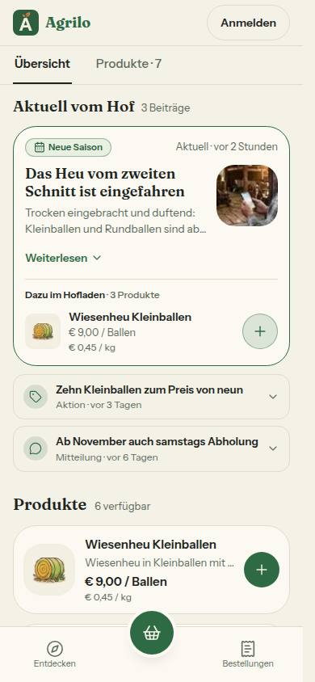
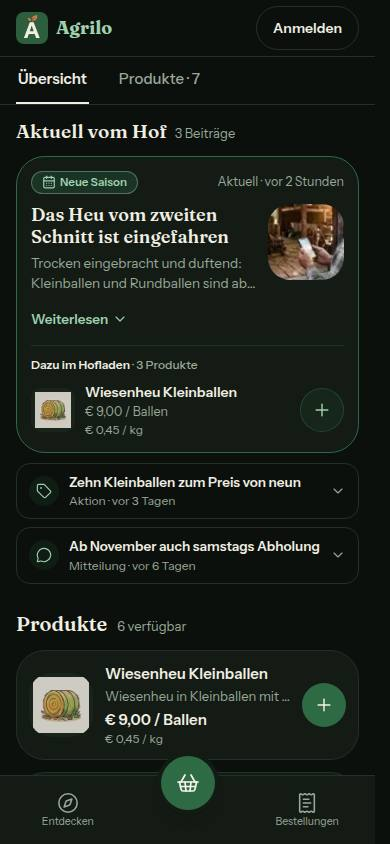
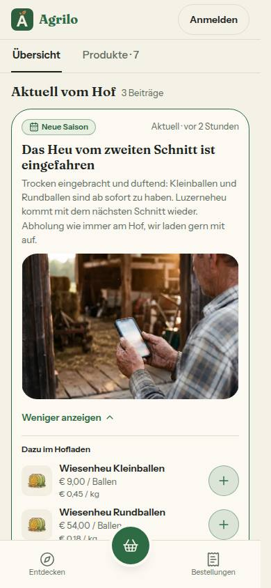
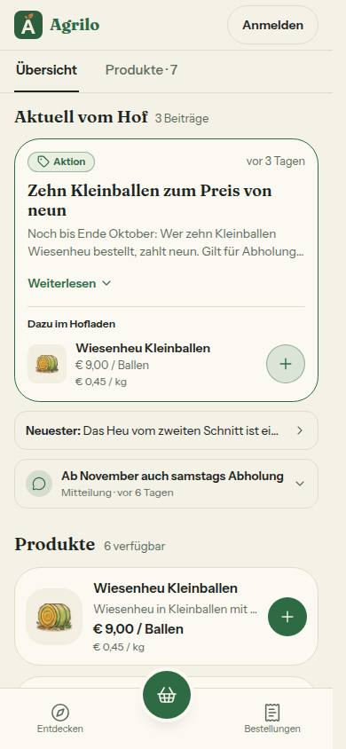
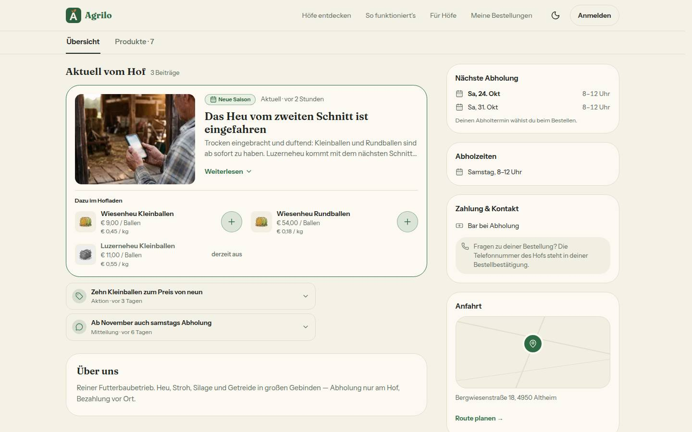
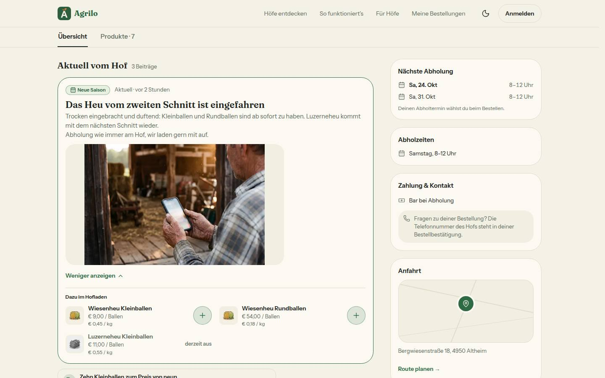
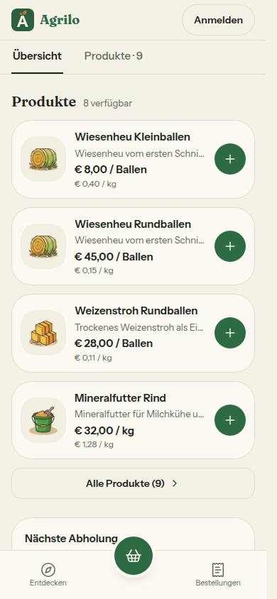

# Bericht Nr. 128 · Beiträge v2: „Aktuell vom Hof“ auf der Hofseite (F8, N5, T5)

## Was geändert wurde
- `src/lib/beitrag-anlass.ts` (neu): Anlass mit Wort und Symbol (`BEITRAG_ANLASS`) und die Werte (`BEITRAG_ANLAESSE` = `STATUS_POST_ANLASS_VALUES`, keine zweite Liste).
- `src/server/queries/status-posts.ts`: `AKTIVER_BEITRAG(jetzt)` als EINE Bedingung; `getActiveStatusPosts` nimmt sie; neu `ladeAktivenBeitrag(farmId, id)` (Hof + Kennung + Bedingung in einer Abfrage).
- `src/schemas/hofseite-reiter.ts`: Reiter nur noch Übersicht · Produkte; `ALTER_REITER_BEITRAEGE`, `BEITRAG_PARAMETER`, `beitragKennungSchema` (a–z, 0–9, ≤ 40).
- `src/lib/hofseite-kunde.ts`: `hofseiteReiter` ohne Beiträge; `ordneBeitraege`, `beitragProdukte`, `springeZuAktuell`, `scrollVerhalten`, `adresseOhneBeitrag`, `AKTUELL_VOM_HOF_TEXT`.
- `src/components/hofseite/aktuell-vom-hof.tsx` (neu): `AktuellVomHof` — Karte mit „Weiterlesen“, „Dazu im Hofladen“ mit „+“, ältere Beiträge als aufklappbare Zeilen, „Neuester: …“.
- `src/components/hofseite/hofseite-kunde.tsx`: Abschnitt an der richtigen Stelle (Raster ab lg mit eigener Zeile), Satz „nicht mehr aktuell“, Sprung für `?reiter=beitraege`, Reiter „Beiträge“ und Komponenten `Beitraege`/`Beitrag` entfernt.
- `src/components/farm/product-grid.tsx`: NUR exportiert — Ref `inDenKorb` (`useImperativeHandle` auf das bestehende `handleAddToCart`), Verhalten unverändert.
- `src/app/(public)/[farmSlug]/page.tsx`: `?beitrag=` (Zod), lädt den Beitrag nur, wenn er nicht unter den fünf ist.
- `src/lib/teilen-fenster.ts` (`beitragLink(hof, id)` → `?beitrag=`), `src/server/queries/teilen-bild.ts` (Aufruf), `src/lib/teilen-besuch.ts` (nur Kommentar: `beitrag` bleibt).
- `src/emails/status-update.tsx`, `src/lib/email.ts`, `src/server/actions/status-posts.ts`: Kennung an die Mail (nur mit „Auf der Hofseite zeigen“).
- Tests: neu `aktuell-vom-hof{,-regeln,-korb}.test.ts`; angepasst `hofseite-kunde(-ansicht)`, `beitrag-teilen`, `hofseite-beitraege-grenze`, `status-posts`, `abo-bestaetigung-mail`, `use-cart` (Prüfstand kennt `useImperativeHandle`), `wortliste` (Ausnahme „Mitteilung“ zog mit), `integration/hofseite-beitraege.int.test.ts`.
- Doku: DESIGN_SYSTEM (Hofseite), BAUSTEINE (`pnpm bausteine`), DEVELOPMENT.md; Bilder unter `bilder/128/`.

## Eigene Dateien (`git diff --name-only 0cc8b20...HEAD`)
DEVELOPMENT.md · docs/ai/BAUSTEINE.md · docs/ai/DESIGN_SYSTEM.md · docs/nachtlauf/berichte/128.md · docs/nachtlauf/berichte/bilder/128/*.jpg (6) · src/app/(public)/[farmSlug]/page.tsx · src/components/farm/product-grid.tsx · src/components/hofseite/{aktuell-vom-hof,hofseite-kunde}.tsx · src/emails/status-update.tsx · src/lib/{beitrag-anlass,email,hofseite-kunde,teilen-besuch,teilen-fenster}.ts · src/schemas/hofseite-reiter.ts · src/server/actions/status-posts.ts · src/server/queries/{status-posts,teilen-bild}.ts · tests/{abo-bestaetigung-mail,aktuell-vom-hof,aktuell-vom-hof-korb,aktuell-vom-hof-regeln,beitrag-teilen,hofseite-beitraege-grenze,hofseite-kunde,hofseite-kunde-ansicht,status-posts,use-cart,wortliste}.test.ts · tests/integration/hofseite-beitraege.int.test.ts

Wiederverwendet: `StatusBadge`/`Marke`, `Hinweiskarte`, `beitragZeitText`, `stripStatusVariables`, `bildStil`, `zweitePreiszeile`/`formatGrundpreis`, `produktLink`, `zeigeKaufknopf`, `handleAddToCart` von `ProductGrid`. Neu, weil: kein Baustein für einen aufklappbaren Beitrag mit Produktzeilen existierte.

## Annahmen
- **Verknüpfte Produkte ohne zweite Abfrage:** Die Hofseite lädt alle Produkte des Hofs schon in EINER Abfrage (`getPublicFarm`). „Dazu im Hofladen“ nimmt sie aus der Produktliste (im Shop) — sonst stünde die Regel „im Shop“ doppelt (gegen „dieselbe Regel, keine zweite“), und das „+“ braucht ohnehin das `PublicProduct` der Karte. Der Integrationstest prüft fremd/gelöscht/nicht im Shop/ausverkauft an `getPublicFarm` + `beitragProdukte`.
- `HofReiterId` behält `beitraege` als Ziel einer Adresse: `src/lib/mein-hof-ansicht.ts` (Grenze 129) mappt Mein Hof › Beiträge darauf und landet so bei „Aktuell vom Hof“ — ohne Änderung dort.
- `?beitrag=` mit falscher Form wird still verworfen (kein Satz); der Satz erscheint nur bei passender Form ohne Treffer. Mit ausgeblendetem Abschnitt „Status“ gilt eine Kennung als „nicht mehr aktuell“.
- Mail: nur mit „Auf der Hofseite zeigen“ `?beitrag=`, sonst `/<slug>` (die Seite sagte sonst „nicht mehr aktuell“).
- „Weiterlesen“ steht immer (auch bei kurzem Text), damit nichts im Browser gemessen wird.

## Nicht gelöst
- WhatsApp-Tipp-Liste (`status/[id]/send-whatsapp/whatsapp-tap-client.tsx`) verlinkt weiter `/<slug>?k=wa` ohne `?beitrag=` — außerhalb der Grenze.
- DESIGN_SYSTEM Abschnitt „Teilen“ nennt noch `?reiter=beitraege&k=…` — nur der Abschnitt Hofseite war freigegeben.

## Wie der Mensch es testet (Vorschau)
- `/<hof>` mit aktivem Beitrag mit verknüpftem Produkt: „Aktuell vom Hof“ steht oben in der Übersicht, das Produkt unter „Dazu im Hofladen“.
- „+“ am Produkt: Toast „… hinzugefügt“, der Korb öffnet sich mit dem Produkt.
- Mein Hof › Beiträge › „Teilen“: Link kopieren (`…?beitrag=<id>`) und öffnen → genau dieser Beitrag oben, bei einem älteren darunter „Neuester: …“.
- `/<hof>?reiter=beitraege` → Übersicht, die Seite springt zu „Aktuell vom Hof“; `/<hof>?beitrag=quatsch1` → Satz „Dieser Beitrag ist nicht mehr aktuell.“
- Einstiege mit Beitrags-Link (alle über `beitragLink`): Teilen-Fenster nach dem Veröffentlichen; „Teilen“ je Beitrag in Mein Hof › Beiträge; WhatsApp-, Facebook-, Mail-Kanal des Fensters (`linkMitKanal`, `&k=`); Mail an Abonnentinnen. Mails wurden nicht gesendet (Unit-Test mit gemocktem Resend).

## Angepasste `.md`
docs/ai/DESIGN_SYSTEM.md (Hofseite), docs/ai/BAUSTEINE.md (erzeugt), DEVELOPMENT.md.

## Nacharbeit
- Weitere Kopien der Anlass-Wörter: `status-new-client.tsx:34`, `emails/status-update.tsx:7`, `lib/teilen-bild.ts:182`, `api/status-image/[id]/route.tsx:15` → `BEITRAG_ANLASS`.
- Wortliste-Zeile „Beiträge“ nennt noch den Reiter auf der Hofseite („Beiträge · 2“).
- Tipp-Liste und Abschnitt „Teilen“ (siehe oben); `mein-hof-ansicht.ts` könnte `beitraege` direkt auf `uebersicht` + `#aktuell` stellen (Nr. 129).
- Prüfer Runde 1, Dateien dieser Runde nicht angefasst: Sollte `tests/aktuell-vom-hof-regeln.test.ts:170–175` Markenname als Host → neutraler Host (`example.com`) bzw. aus `PRODUKTION_HOST`. Kann: `page.tsx:156` Satz „nicht mehr aktuell“ bei Ladefehler unterdrücken (Merker aus `ladeBeitraege`); `aktuell-vom-hof-korb.test.ts:78` „Testhof A“; `hofseite-kunde-ansicht.test.ts:279` Kommentar „Verdrahtungswache ohne jsdom“; doppelte Leerzeile `product-grid.tsx:87`.

## Regelvorschlag
Ursache: Ein zweiter `useCart` hätte still einen zweiten Korb geführt. Gegenmaßnahme: Quelltext-Wache „`useCart(` nur in `product-grid.tsx`, `kasse`, Kopfzeile“ mit Gegenprobe. Ort: `tests/`, Regel in ARCHITECTURE §4.

## Bilder (390/1440, Daten: drei erfundene Beiträge auf `hof-bergwiese`, danach gelöscht)
      
Axe: 0 Verstöße (390 hell/dunkel, 1440; „incomplete“ nur Titelbild/Anfahrt, Bestand). Tippflächen im Abschnitt ≥ 44 px. Tastatur: Zeile mit Enter auf/zu, „Neuester:“ setzt den Fokus auf die Überschrift.
Mockup-Abweichungen: Abweichungen 1, 3, 4 der Freigabe; „Weiterlesen“ auch beim geteilten Beitrag (Bild `?beitrag=`; das Board lässt ihn dort weg); am Computer stehen die Produkte unter Foto und Text über die ganze Kartenbreite (Bild 1440; Board-Text „darunter“, sonst kürzten die Namen); Testdaten: `128-vorher.txt` ≈ `128-nachher.txt` (Vorrat +1 durch die bestehende Fristfreigabe einer fremden Reservierung auf `hof-sonnleiten`, nicht zurückgesetzt).

## Nachbesserung Runde 1
- Blocker (Freigabe Punkt 3, „aufgeklappt … das Foto groß“): `aktuell-vom-hof.tsx` blendet das 250-px-Foto bei `offen` aus, `FotoGross` steht auch ab lg (dort ≤ 520 px). Gemessen 1440 aufgeklappt: 520 × 288 px statt 250 × 188 (Bild „Computer aufgeklappt“). Test zuerst rot: `tests/aktuell-vom-hof.test.ts` „das Foto: zugeklappt klein …, aufgeklappt groß“ (welches Foto unter bzw. ab lg sichtbar ist). DESIGN_SYSTEM Hofseite nachgezogen.
- Dateien der Runde (`git diff --name-only d1ecda7..HEAD`): docs/ai/DESIGN_SYSTEM.md · docs/nachtlauf/berichte/128.md · docs/nachtlauf/berichte/bilder/128/hofseite-aufgeklappt-1440-hell.jpg · src/components/hofseite/aktuell-vom-hof.tsx · tests/aktuell-vom-hof.test.ts
- Testdaten: dieselben drei erfundenen Beiträge, danach gelöscht; `128-r1-vorher.txt`/`-nachher.txt`: StatusPost 0 = 0, Produkte und Vorrat gleich (Farm +5 aus dem Integrationstest einer anderen Nummer, feste Uhr). Lauf: typecheck grün, lint 0 Fehler/5 Warnungen, 480 Dateien/9162 Tests grün; `hofseite-beitraege.int.test.ts` unter der Sperre 8/8.
