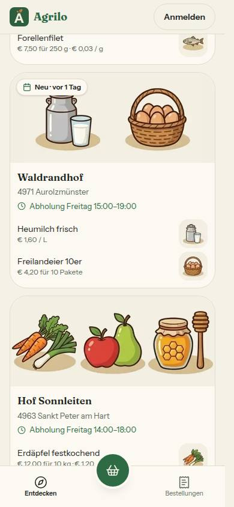
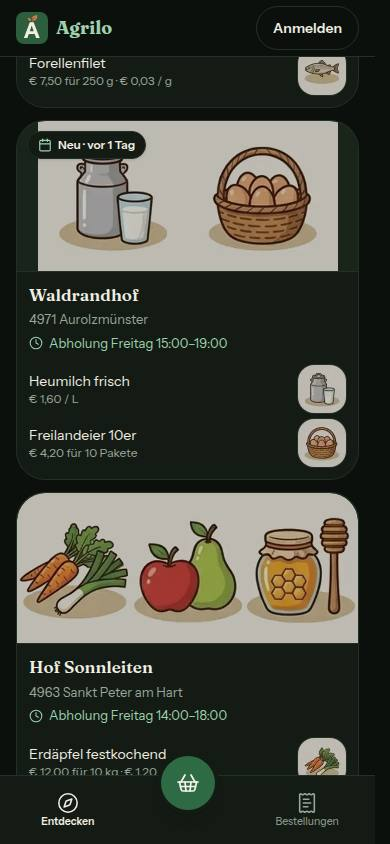
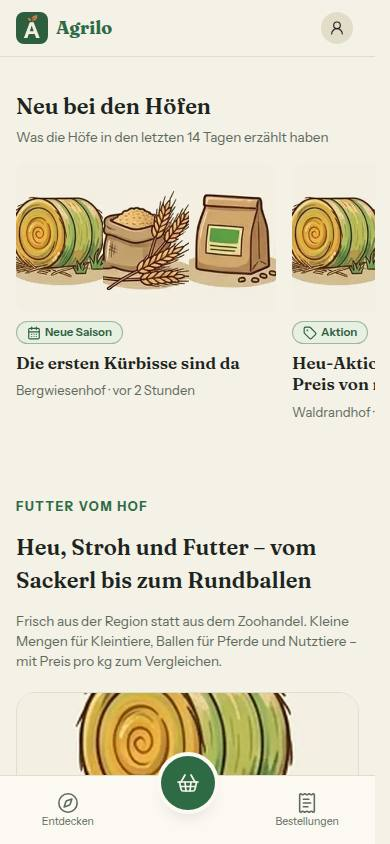
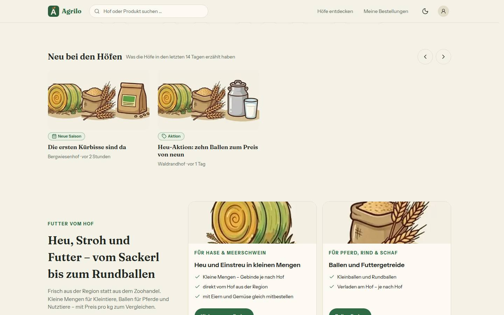
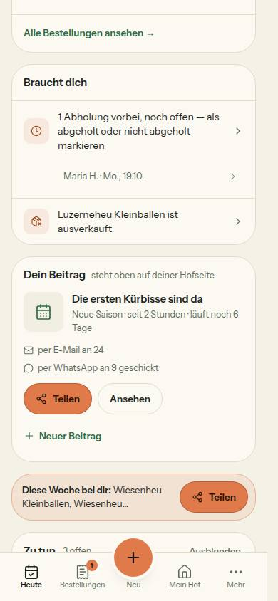
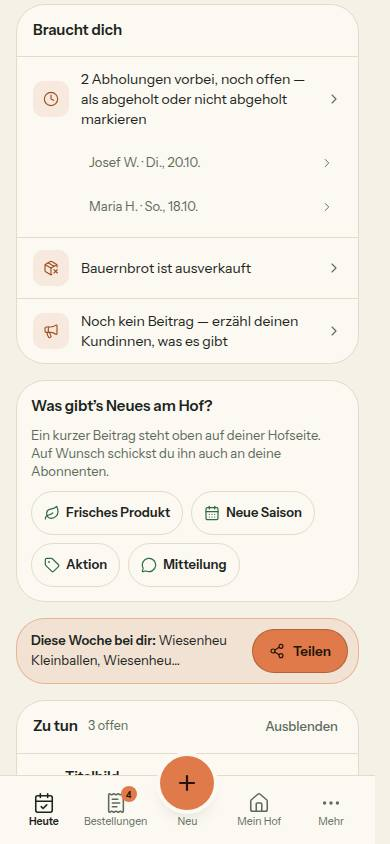
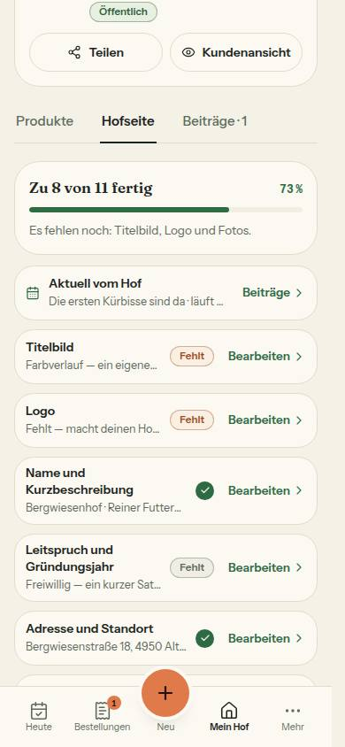

# Bericht Nr. 129 · Beiträge v2: Marke auf der Hofkarte, „Neu bei den Höfen“, „Dein Beitrag“ (N22, N16, E12)

## Was geändert wurde
- `prisma/schema.prisma` + Migration `20261021110000_startseite_neuigkeiten`: `NEUIGKEITEN` in `StartseiteArt` (SQL unten).
- `lib/startseite-gestalten.ts`: `ZUSATZ_ARTEN`, `NEUER_ABSCHNITT`, `pruefeReihenfolge` (Zusatz höchstens einmal, nach HOEFE), `ABSCHNITT_TEXT.NEUIGKEITEN`, Regeln/Texte der Reihe (`waehleNeuigkeiten`, `sichtbareNeuigkeiten`); `schemas/startseite-fassung.ts` lässt den Zusatz zu; `actions/startseite.ts` legt ihn beim Speichern an (Weg wie `NEUER_BLOCK`, Zeilensperre); `admin/startseite-gestalten.tsx` Menü „„Neu bei den Höfen“ einfügen“, `admin/startseite-entwurf.tsx` übernimmt die Kennung.
- `queries/neuigkeiten.ts` (neu, `unstable_cache`, Etiketten eigenes + `HOEFE_CACHE_TAG`), `startseite/neu-bei-den-hoefen.tsx` (neu), Eintrag samt Lader in `startseite-abschnitte.tsx`.
- `queries/farm.ts`: `neuerBeitrag` in `HofUebersichtEintrag`; `lib/hofuebersicht.ts`: `NeuerBeitrag`, `beitragMarke`; `oeffentliche-hoefe.ts`: Schlüssel `'v3'`; `hoefe/beitrag-marke.tsx` (neu) in `HofKarte`, `HoefeKarussell` und (Runde 1) `HofKarten` der Startseite über `lib/startseite.ts` und `app/page.tsx` (`jetzt`).
- `actions/status-posts.ts`: `updateTag(HOEFE_CACHE_TAG)` und `updateTag(NEUIGKEITEN_CACHE_TAG)` in Veröffentlichen, Deaktivieren, Löschen.
- `lib/heute.ts` (Block `beitrag`, Texte, `beitragBlock`), `queries/dashboard.ts` (`ladeLaufendenBeitrag`, `ladeDeinenBeitrag`), `heute/dein-beitrag.tsx` (neu), `dashboard/page.tsx`; `status/new/page.tsx` + `status-new-client.tsx` (`?anlass=`).
- Mein Hof: `lib/mein-hof-ansicht.ts` (`aktuellZeile`, `AktuellZeile`), `mein-hof/abschnitte-liste.tsx`, `farmer/hofseite-editor.tsx`, `farm-page/page.tsx`; Markierung (Runde 2): `schemas/hofseite-vorschau.ts` (`aktuell`), `lib/hofseite-fortschritt.ts` (drei Einträge).
- Tests neu: `aktuell-markierung`, `beitrag-marke`, `dein-beitrag`, `mein-hof-aktuell`, `neu-bei-den-hoefen`, `startseite-zusatz-menue`, `status-new-anlass`, `status-new-vorwahl`, `integration/{neuigkeiten,dein-beitrag}`; erweitert: übrige im Diff.
## Eigene Dateien (`git diff --name-only origin/integration/lauf19...HEAD`, Stand Runde 2: 69)
DEVELOPMENT.md · docs/ai/{ARCHITECTURE,BAUSTEINE,DESIGN_SYSTEM}.md · docs/nachtlauf/berichte/129.md · docs/nachtlauf/berichte/bilder/129/*.jpg (7) · prisma/schema.prisma · prisma/migrations/20261021110000_startseite_neuigkeiten/migration.sql · src/app/page.tsx · src/app/(hof)/{dashboard/page,farm-page/page,status/new/page,status/new/status-new-client}.tsx · src/components/admin/startseite-{entwurf,gestalten}.tsx · src/components/farmer/hofseite-editor.tsx · src/components/heute/dein-beitrag.tsx · src/components/hoefe/{beitrag-marke,entdecken-teile,hoefe-karussell}.tsx · src/components/mein-hof/abschnitte-liste.tsx · src/components/startseite/{hoefe-in-der-naehe,neu-bei-den-hoefen,startseite-abschnitte}.tsx · src/lib/{heute,hofseite-fortschritt,hofuebersicht,mein-hof-ansicht,startseite-gestalten,startseite}.ts · src/schemas/{hofseite-vorschau,startseite-fassung}.ts · src/server/actions/{startseite,status-posts}.ts · src/server/queries/{dashboard,farm,neuigkeiten,oeffentliche-hoefe}.ts · tests/{agb-einbindung,aktuell-markierung,beitrag-marke,dein-beitrag,hoefe-seite,hofseite-editor-breite,hofseite-editor,hofseite-fortschritt,mein-hof-aktuell,mein-hof-bearbeiten,mein-hof-seite,neu-bei-den-hoefen,oeffentlich-lesen,oeffentliche-hoefe-cache,startseite-entwurf,startseite-fassung,startseite-gestalten,startseite-zusatz-menue,startseite,status-new-anlass,status-new-vorwahl,status-posts}.test.ts · tests/integration/{dein-beitrag,neuigkeiten,startseite-gestalten}.int.test.ts

Wiederverwendet: `AKTIVER_BEITRAG`, `BEITRAG_ANLASS`/`BEITRAG_ANLAESSE`, `beitragLink`, `AKTUELL_ANKER`, `useUhr`, `vorWieLange`, `mitAnzahl`, `HofBildflaeche`, `StatusBadge`, `BeitragTeilenKnopf`, `leseOeffentlichMitWiederholung`, `NEUER_BLOCK`-Weg, Markierung über `useVorschauMarkierung`/`VorschauImRahmen`. Neu, weil: keine Marke am Bild, keine Beitragsreihe, keine Heute-Karte zum Beitrag existierte.
## Migration (Regel 3, `--from-schema` = `daa0228`; Ausgabe: `ALTER TYPE "StartseiteArt" ADD VALUE 'NEUIGKEITEN';`)
```sql
SET lock_timeout = '5s';
-- AlterEnum
ALTER TYPE "StartseiteArt" ADD VALUE IF NOT EXISTS 'NEUIGKEITEN';
```
(Kopfkommentar wie die bestehenden; keine Zeile in `StartseiteAbschnitt`, keine Datenänderung. Seit dem Push unverändert.)
## Annahmen
- `IF NOT EXISTS` und `SET lock_timeout` gesetzt (wie `20260924190000_meldung_vermutlich_wunsch`).
- „Karussell der Startseite“ = die Hofkarten „Höfe in deiner Nähe“ (aus `ladeOeffentlicheHoefe`, keine zweite Abfrage), dazu `HoefeKarussell` auf /hoefe. Ohne Marke: die eigene Hofkarte in Region (`region.ts`, Grenze) und der Block „Höfe-Auswahl“ der Startseite (er bräuchte `jetzt`).
- „Dein Beitrag“ nach Packliste UND „Braucht dich“ (N11). Anstoß: kein veröffentlichter Beitrag in 14 Tagen (auch nur per Mail zählt, ein Entwurf nie), „Produkte im Shop“ = ein `isAvailable`. `?anlass=` sticht den Anlass der Vorlage `?from=`. „vor 1 Tag“ statt „gestern“ (`vorWieLange`), „läuft noch“ abgerundet.
- Markierung (Runde 2 richtiggestellt): Die Freigabe verlangt sie; `aktuell` steht in `hofseiteZeileIdSchema`, weil die Aufzählung die Nachricht an die Vorschau prüft. Die Kennung ist keine Zeile des Fortschritts: `ZEILE_TITEL`/`ZIEL_ABSCHNITT`/`EINSTELLUNG_FUER_ZEILE` (`hofseite-fortschritt.ts`, Grenzerweiterung „Stelle, die empfängt“ — der Empfänger liest `ZIEL_ABSCHNITT`, die zwei anderen verlangt der Typ) haben je einen Eintrag; drei Tests, die Kennungen und Fortschritt gleichsetzen, nehmen `aktuell` ausdrücklich aus. Unter lg markiert keine Zeile von selbst (nur „Gespeichert · Ansehen“) — dort bleibt die Zeile ein Link.
- Außerhalb des Wortlauts, nötig für denselben Weg: `admin/startseite-entwurf.tsx`, Lader in `startseite-abschnitte.tsx`; Zod für `?anlass=` in `status/new/page.tsx`. Grenzerweiterungen Runde 1 (vom Dirigenten bestätigt): `farm-page/page.tsx`, `hofseite-editor.tsx` (Zeile), `lib/startseite.ts` (Feld), `hoefe-in-der-naehe.tsx` (Marke), `app/page.tsx` (`jetzt`).
## Nicht gelöst
- Die „Sollte“- und „Kann“-Befunde unter Nacharbeit.
## Nachbesserung Runde 1
- Mein Hof: `farm-page/page.tsx` reicht `aktuell` an `AbschnitteListe` und `HofseiteEditor` (ab lg erste Zeile vor den Gruppen); Ladefehler → Sentry, nur die Zeile fehlt. Startseite: `StartseitenHof.neuerBeitrag` aus derselben Liste, `BeitragMarke` oben links am Bild. Abgelaufene Marke lässt keinen Verweis ins Leere. Tests vorher rot (`mein-hof-aktuell`, `beitrag-marke`).
- Dateien der Runde (`git diff --name-only 67d6871 f5d2f8b`): DEVELOPMENT.md · docs/ai/{BAUSTEINE,DESIGN_SYSTEM}.md · 129.md · src/app/page.tsx · farm-page/page.tsx · farmer/hofseite-editor.tsx · hoefe/beitrag-marke.tsx · startseite/hoefe-in-der-naehe.tsx · lib/startseite.ts · tests/{beitrag-marke,hofseite-editor,hofseite-editor-breite,mein-hof-aktuell,mein-hof-bearbeiten,startseite}.test.ts. Das Bild Mein Hof ist byteweise gleich geblieben und steht deshalb nicht im Diff.
## Nachbesserung Runde 2
- Markierung „Aktuell vom Hof“: Kennung `aktuell` (`schemas/hofseite-vorschau.ts`), Ziel `AKTUELL_ANKER`; ab lg ist die Zeile ein Knopf (`aria-pressed`) über `offen` wie jede Zeile, der Link „Beiträge ›“ daneben. Ohne Beitrag kein Ziel: nichts markiert, nichts bricht. Test `aktuell-markierung` (vorher 6 rot): Aufzählung, Zeile schickt `aktuell`, Hofseite markiert `[data-abschnitt="aktuell"]`, Gegenprobe ohne Beitrag.
- `mitEinheit` gelöscht, `seitWannText`/`laeuftNochText` mit `mitAnzahl`; Texte gleich (Einzahl/Mehrzahl in `dein-beitrag`).
- `ladeLaufendenBeitrag` (`queries/dashboard.ts`): eine Regel, `ladeDeinenBeitrag` nutzt sie; Mein Hof ruft nur sie (`ladeAktivenBeitrag` aus 128 sucht eine bestimmte Kennung, passt nicht). Test `mein-hof-aktuell` vorher rot.
- `integration/dein-beitrag.int.test.ts`: eigener Hof, `AKTIVER_BEITRAG`, „Auf der Hofseite zeigen“, 14 Tage (auch nur per Mail), Entwurf, `isAvailable` — je mit Gegenprobe, fester Zeitpunkt 02.03.2026 als Argument, nur `int-`-Zeilen.
- `startseite-fassung`: Entwurf mit und ohne Block durch `fassungAusEntwurf` → `zeilenAusFassung` → `zuRendern` gegen die Reihenfolge. Mock in `mein-hof-aktuell` typisiert (`vi.fn<…>()`), Anlass aus `BEITRAG_ANLAESSE`; `AktuellZeile` exportiert und in Liste und Editor importiert.
## Rückweg (Freigabe 129.2)
PostgreSQL kennt kein `DROP VALUE`: Wird der Code nach dem Veröffentlichen einer Fassung MIT „Neu bei den Höfen“ zurückgesetzt, ist diese Fassung für den alten Code unlesbar (Live fällt auf den Standard), eine Entwurfszeile `NEUIGKEITEN` wirft beim Lesen. Darum blendet die Projektleitung den Abschnitt erst ein, wenn der Lauf stabil in der Produktion ist.
## Wie der Mensch es testet (Vorschau)
- Neuer Beitrag (Auf der Hofseite zeigen) → /hoefe zeigt sofort „Neu · vor …“ am Bild dieses Hofs; Mein Hof › Beiträge › Deaktivieren → /hoefe ohne Marke.
- Die Live-Startseite bleibt unverändert, bis der Abschnitt in Admin › Startseite eingefügt, eingeblendet und veröffentlicht ist (Beleg: `startseite-fassung`, Integrationstests zu Fassung/Entwurf).
- Heute mit laufendem Beitrag: Karte „Dein Beitrag“; ohne Beitrag seit 14 Tagen, mit Produkten: Anstoß, „Aktion“ → „Neuer Beitrag“ mit Aktion gewählt.
- Mein Hof › Hofseite ab 1024 px mit laufendem Beitrag: Tipp auf „Aktuell vom Hof“ → die Vorschau springt zum Abschnitt und umrandet ihn; „Beiträge ›“ führt zu Mein Hof › Beiträge.
## Prüfungen
Umsetzung: lint 0 Fehler / 5 Warnungen · test 489 Dateien / 9263 Tests · test:integration ganz 66 / 591 · Axe 0 Verstöße (/hoefe 390 hell+dunkel, Heute ×2, Mein Hof, Startseite 390/1440) · Tippflächen ≥ 44 px · Testdaten `129-vorher.txt` = `129-nachher.txt`. Runde 1: test 490 / 9273 · Integration 66 / 591 · Axe 0 · `129-r1-vorher.txt` = `129-r1-nachher.txt`. **Runde 2:** typecheck 0 · lint 0 Fehler / 5 Warnungen (Grundstand) · test 503 Dateien / 9474 Tests · test:integration ganz 69 / 608 grün (unter der Sperre) · kein neues Bild, keine Testdaten per `psql`, keine Zeile `NEUIGKEITEN` zurückgelassen.
## Angepasste .md
DESIGN_SYSTEM (Entdecken: Marke; Heute: Dein Beitrag, Mein Hof samt Markierung; Startseite gestalten), ARCHITECTURE (Zwischenspeicher und Etiketten), BAUSTEINE (`pnpm bausteine`), DEVELOPMENT.md.
## Nacharbeit / Regelvorschlag
- `neuigkeiten.ts` liest ohne Obergrenze und lädt je Beitrag alle Produkte des Hofs (für die Kategorien) — Auswahl in die Datenbank legen (`take`, je Hof der neueste per `distinct`).
- Heute: Überschriftenebene von Karte und Anstoß angleichen; `bildStil` am 56-px-Bild. Region liefert `neuerBeitrag: null` (eigene Hofkarte ohne Marke). `anlass`-Schema aus `status/new/page.tsx` nach `src/schemas/`.
- „Braucht dich“ erinnert schon ab sechs Tagen („Noch kein Beitrag …“) neben dem Anstoß (Bild) — Entscheidung, ob eine Erinnerung entfällt.
- Regelvorschlag: Ursache — die Grenze nannte Komponenten, nicht die Seite, die ihnen Daten gibt. Gegenmaßnahme: beim Ableiten der Grenzen (Vorschlag 116) auch die rendernde Seite jeder genannten Komponente aufnehmen. Ort: docs/nachtlauf.md, Lesemappe 4a.
## Bilder und Mockup-Abweichungen
      
Abweichungen: Abschnitt als Zusatz (Freigabe §1.5); kein „Nicht jetzt“ (§1.2, Bild Anstoß); Marke auf deckender Kartenfläche statt dunklem Schleier (beide Themes, Bild /hoefe); „vor 1 Tag“ statt „gestern“ (Bild Startseite 1440); „Neuer Beitrag“ bricht am Handy in eine eigene Zeile (Bild Dein Beitrag); im Karussell auf /hoefe steht die Marke rechts in der Zeile von Bild und Name statt am runden 40-px-Bild (dort kein Platz für eine lesbare Fläche; kein eigenes Bild, Runde 2 nimmt keine neuen auf); der Block „Höfe-Auswahl“ zeigt keine Marke (Annahmen). Die Startseiten-Bilder zeigen die Vorschau des Entwurfs mit der Zeile, die nur für das Bild bestand.
