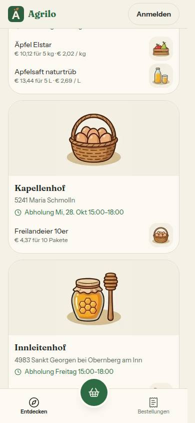
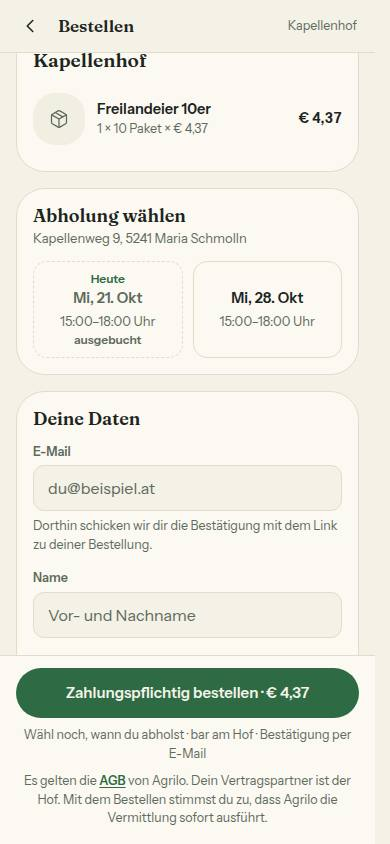
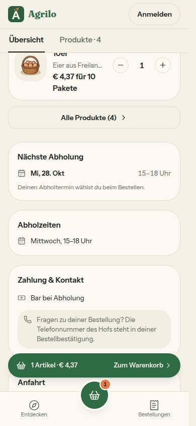

# Bericht Nr. 131 – Volle Abholfenster in Hofliste und Hofseite (Register N19, Ergänzung 21.10.2026)

## Was geändert wurde
- `src/server/abholfenster.ts`: neue Zählung `ausgebuchteTage(farmIds, jetzt)` (zwei Abfragen für alle Höfe, filtert keine Sichtbarkeit), `fensterSchluessel`, `alsAbholFenster`; `ausgebuchteAbholfenster` der Kasse baut darauf auf (Ergebnis gleich).
- `src/lib/hofuebersicht.ts`: `AbholFenster.ausgebuchtAm?`, `OrtsZeit.kalendertag`, `NaechsteAbholung.kalendertag`; `naechsteAbholung` rechnet mit dem echten Wiener Kalendertag im Vorlauf (`BEZUGS_SONNTAG`/`bezugstag` entfallen) und überspringt volle Termine wie `abholLage` und `holtAbAn`; `formatiereAbholung` nennt ab 8 Tagen Wochentag und Datum.
- `src/lib/pickup-days.ts`: `WeeklySlot.ausgebuchtAm?`; `nextPickupDays` lässt volle Fenster und volle Tage weg.
- `src/server/queries/farm.ts`: `PublicPickupSlot.ausgebuchtAm?`; `baueHofUebersicht` baut `abholfenster` ausdrücklich und nimmt die vollen Tage; `getOeffentlicheHoefe` zählt nur die Höfe ihrer `IN_LISTEN_SICHTBAR`-Abfrage.
- `src/server/queries/futter-kaufen.ts`, `src/server/queries/region.ts`: füllen die vollen Tage über `baueHofUebersicht`; der Rückfall `?? h.pickupSlots` entfällt. `src/server/queries/oeffentliche-hoefe.ts`: Schlüssel `'v5'`, Kommentar.
- `src/server/hofseite-vorschau.ts`: `ladeHofseite` füllt `ausgebuchtAm` nach `gibVerwaisteFreiFuerSlug` (für `getPublicFarm` und `getOwnerFarm`); die Produktseite bekommt es über `ladeHofseiteGeteilt`.
- `src/server/hofliste-erneuern.ts` (neu): `erneuereHoflisteNachBestellung(maxOrders)` und `erneuereHoflisteNachStorno(orderId)` – nur bei Höchstzahl, `revalidateTag(HOEFE_CACHE_TAG, { expire: 0 })` über `nachDerAntwort`, Fehler als Meldung mit `bereich: 'hofliste'` und Klasse; aufgerufen in `src/app/api/checkout/route.ts`, `src/server/actions/orders.ts`, `src/server/unbezahlte-bestellung.ts`, je nach dem Commit.
- Tests: neu `tests/hofliste-erneuern.test.ts`, `tests/hofliste-erneuern-wache.test.ts` (30 000 ms, Gegenprobe), `tests/integration/volle-abholfenster.int.test.ts`; nachgezogen `hofuebersicht`, `abholzeile`, `pickup-days`, `startseite`, `hofseite-vorschau-laden`, `oeffentliche-hoefe-cache`, `storno-atomar`.

## Eigene Dateien (`git diff --name-only d9c0c2b...HEAD`)
`DEVELOPMENT.md` · `docs/ai/ARCHITECTURE.md` · `docs/ai/BAUSTEINE.md` · `docs/ai/TECH_STACK.md` · `docs/nachtlauf/berichte/131.md` · `docs/nachtlauf/berichte/bilder/131/hoefe-390-hell.jpg` · `docs/nachtlauf/berichte/bilder/131/hofseite-390-hell.jpg` · `docs/nachtlauf/berichte/bilder/131/kasse-390-hell.jpg` · `src/app/api/checkout/route.ts` · `src/lib/hofuebersicht.ts` · `src/lib/pickup-days.ts` · `src/server/abholfenster.ts` · `src/server/actions/orders.ts` · `src/server/hofliste-erneuern.ts` · `src/server/hofseite-vorschau.ts` · `src/server/queries/farm.ts` · `src/server/queries/futter-kaufen.ts` · `src/server/queries/oeffentliche-hoefe.ts` · `src/server/queries/region.ts` · `src/server/unbezahlte-bestellung.ts` · `tests/abholzeile.test.ts` · `tests/hofliste-erneuern-wache.test.ts` · `tests/hofliste-erneuern.test.ts` · `tests/hofseite-vorschau-laden.test.ts` · `tests/hofuebersicht.test.ts` · `tests/integration/volle-abholfenster.int.test.ts` · `tests/oeffentliche-hoefe-cache.test.ts` · `tests/pickup-days.test.ts` · `tests/startseite.test.ts` · `tests/storno-atomar.test.ts`

## Wege, die eine Bestellung anlegen oder stornieren (`git grep` über src/)
- Anlegen: nur `src/app/api/checkout/route.ts` (`imAbholfenster` → `db.order.create`) → `erneuereHoflisteNachBestellung(abholung.fenster.slot.maxOrders)`.
- Auf CANCELLED: `src/server/actions/orders.ts` `storniere` (Stornieren und „Artikel fehlt“ ohne Rest) → `erneuereHoflisteNachStorno(orderId)`; `src/server/unbezahlte-bestellung.ts` `storniereUnbezahlteBestellung` → `erneuereHoflisteNachStorno(orderId)`. Letzteres deckt checkout `route.ts:196`, Stripe-Webhook `:227`, `bar-bestaetigung.ts:167`, `verwaiste-bestellungen.ts:113` und `:119` (Cron und `gibVerwaisteFreiOhneRisiko` beim Rendern). Die übrigen `'CANCELLED'`-Treffer lesen nur (`where`). Wache: `tests/hofliste-erneuern-wache.test.ts`.
- `{ expire: 0 }`: `node_modules/next/dist/docs/01-app/03-api-reference/04-functions/revalidateTag.md`, „Revalidation Behavior“ und Beispiel für Route Handler; Wurf beim Rendern `node_modules/next/dist/server/web/spec-extension/revalidate.js` (`phase === 'render'`), next 16.4.2 – im Kommentar von `hofliste-erneuern.ts`.

## Annahmen
- Die vollen Tage stehen je Hof als Map nach `fensterSchluessel` (Wochentag|Beginn|Ende); `ausgebuchteAbholfenster` setzt die Schlüssel der Kasse daraus zusammen (sortiert nach Tag und Beginn wie bisher).
- Beim Storno prüft der Nachlauf die Höchstzahl am Hof der Bestellung (eine Abfrage nach dem Commit); beim Anlegen genügt die Höchstzahl des eigenen Fensters.
- `naechsteAbholung` sucht nur im Vorlauf (14 Tage); ohne volle Tage ändert sich nichts (höchstens 7 Tage voraus). Ein Zählfehler auf der Hofseite wird nicht abgefangen (wie `getPublicFarm`).

## Nicht gelöst / Grenzen
- Punkt 6: Verbindlich bleibt die Kasse (`imAbholfenster` mit `FOR UPDATE`); ohne Erneuern altert die Liste höchstens 300 s, ebenso wenn das Erneuern nach dem Rendern nicht wirkt.
- `nextPickupDays` zeigt heute ein laufendes Fenster bis zu seinem Ende, die Kasse nimmt nur bis zum Beginn an (unverändert, Kommentar dort).

## Wie der Mensch es testet (Vorschau)
1. Hof der Entwicklungsdatenbank, NICHT als Testhof markiert, mit einer Abholzeit heute (vor ihrem Beginn) und Höchstzahl 1.
2. Testbestellung für dieses Fenster (Stripe-Testkarte oder bar).
3. /hoefe und die Hofseite zeigen sofort das nächste Fenster; die Kasse zeigt das Fenster „ausgebucht“.
4. Bestellung im Hofbereich stornieren: /hoefe, Hofseite und Kasse zeigen das Fenster wieder.

## Angepasste `.md`
`docs/ai/ARCHITECTURE.md` (Absatz Abholzeile), `docs/ai/TECH_STACK.md` (ein Satz in „Next 16“), `DEVELOPMENT.md` (Z. 5478 als überholt markiert, Eintrag am Ende), `docs/ai/BAUSTEINE.md` (erzeugt).

## Bilder (390, hell; Seed-Hof nach G9, Daten nur in `farmerzone_test`, zurückgesetzt: `131-vorher.txt` = `131-nachher.txt`)
  
Vorbereitung: Höchstzahl 1 am einzigen Mittwochsfenster, eine Barbestellung über `/api/reserve` und `/api/checkout`, danach Storno im Hofbereich – danach zeigten /hoefe und Hofseite „heute“ wieder (Erneuern wirkte). Axe: 0 Verstöße auf allen drei Seiten. Keine Mockup-Abweichung (kein neues Bauteil).

Wiederverwendet: `istVoll`, `BELEGT`, `angeboteneAbholfenster`, `abholSchluessel`, `nachDerAntwort`, `HOEFE_CACHE_TAG`, `formatTagKurz`, `fehlerKlasse` / Neu, weil: die Zählung für viele Höfe und der Helfer zum Erneuern fehlten.

## Nacharbeit
- Keine offene. Der Kopfkommentar von `hofuebersicht.ts` („Wochentag + Uhrzeit“) liegt außerhalb der Grenze und blieb.

## Regelvorschlag
- Ursache: Bilder mit „heute“ hängen an der Uhrzeit des Laufs (Fenster beginnt 15:00). Gegenmaßnahme: Die Lesemappe nennt bei zeitabhängigen Bildern die späteste Uhrzeit. Ort: `docs/nachtlauf.md` 4a Punkt 6 b. Prüfung vor Textregel: keine sinnvolle.

## Nachbesserung Runde 1 (`git diff --name-only 186bdbd..HEAD`)
- Punkt 1: `tests/integration/volle-abholfenster.int.test.ts` – neuer Fall mit vier vollen Terminen: drei Abholzeiten mit Höchstzahl 1, absichtlich umgekehrt angelegt (übermorgen 08:00, morgen 14:00, morgen 09:00); das Fenster um 09:00 ist morgen und in acht Tagen voll, steht also in der Map vor den anderen. Die Kasse wird gegen ein festes Array (Tag, dann Beginn) geprüft, Liste und Hofseite dagegen; `bestelle` nimmt dafür einen Termin, `alsSchluessel` steht oben. Gegenprobe: vertauschte Sortierung (Beginn vor Tag) rot, ganz ohne Sortierung rot, danach zurück (`git diff` der Quelle leer). Keine feste Uhr nötig (nur morgen und später).
- Punkt 2: `tests/hofliste-erneuern-wache.test.ts` – Kommentar und Titel sagen nur noch „nicht im Rückruf der Transaktion“; ein Aufruf vor `await prisma.$transaction(…)` ginge durch, das bleibt Sache der Aufrufer.
- Punkt 3: `src/server/hofliste-erneuern.ts` – Dateikopf-Satz; `docs/ai/BAUSTEINE.md` (erzeugt) nennt jetzt beide Wege.
- Punkt 4: Sentry-Meldung neutral „Hofliste nicht erneuert“, weiter nur `bereich: 'hofliste'` und Fehlerklasse; `tests/hofliste-erneuern.test.ts` prüft den Satz (zuerst rot).
- Dateien: `docs/ai/BAUSTEINE.md` · `docs/nachtlauf/berichte/131.md` · `src/server/hofliste-erneuern.ts` · `tests/hofliste-erneuern-wache.test.ts` · `tests/hofliste-erneuern.test.ts` · `tests/integration/volle-abholfenster.int.test.ts`. Keine Bilder neu (nichts Sichtbares geändert).
