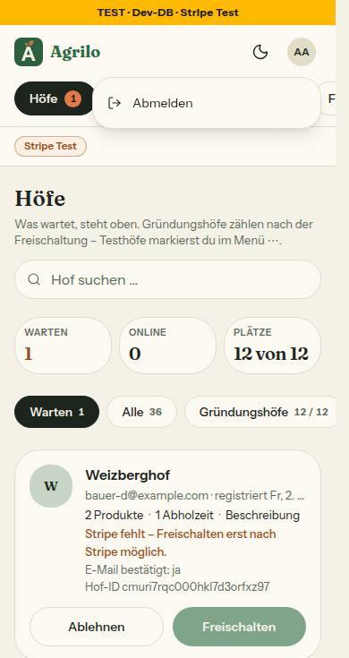

# Bericht Nr. 132 – Sicherheit und Admin, Nacharbeit aus 125 und 126 (G8-Ergänzung, N20, Lauf 20)

Basis d9c0c2b, Branch `nacht/2026-10-21/132-sicherheit-admin`. Alle neun Punkte erledigt. Keine Migration, kein Paket, der Header bleibt `Content-Security-Policy-Report-Only`.

## Was geändert wurde
- `src/lib/csp.ts`: `api.stripe.com` in connect-src, `js.stripe.com` und `*.js.stripe.com` in script-src und frame-src, `hooks.stripe.com` in frame-src; Quelle je Host im Kommentar, der Satz „… war beim Bau nicht erreichbar …" ist weg. `tests/csp.test.ts`: die vier Hosts genau dort, in keiner anderen Anweisung (auch mit Meldungen, Toolbar, Sentry), Link, Maps und `*.stripe.com` fehlen, Gegenprobe. `docs/betrieb/stripe-live.md`: Punkt zu den Link-Hosts in „0. Vorher" (1).
- `tests/meldungen-fremdtext-wache.test.ts`: `roh` in `FREMDTEXT`, Gegenprobe mit Log und Sentry; die Route las die Wache schon (3).
- `tests/integration/auth-bremse.int.test.ts`: Fälle „Verbindung abgewiesen" und „Datenbank stumm über 1,5 s", echt über einen eigenen Prisma-Client auf eine tote Adresse (2).
- `docs/ai/TESTING_GUIDELINES.md`: der Satz zur Login-Bremse am Ende von „Die Integrationsschicht", wörtlich (4).
- `src/lib/admin-anmeldung.ts`: Parameter von `passkeyFehlerText` mit `code?: unknown`, Cast weg; Aufrufer und Texte unverändert (5).
- `src/components/shells/admin-konto.tsx`, `hof-shell.tsx`: `useAbmelden(ziel, ersatz)` exportiert, die HofShell nutzt ihn mit `/login` (6); `tests/abmelden-hook.test.ts` neu.
- `src/lib/geraete.ts`, `tests/geraete.test.ts`: die zwei Admin-Sätze wörtlich, ohne Passwort (F10); Hof-Fassung unverändert (7).
- `src/app/admin/betrieb/jetzt-messen.tsx`: `empty:sr-only` statt `empty:hidden`; `tests/jetzt-messen.test.ts` neu (8).
- `src/components/ui/dropdown-menu.tsx`: optional `container` an `DropdownMenuContent`; `admin-shell.tsx` (Ziel im `header`), `admin-konto.tsx` (`menueZiel`), `hof-shell.tsx` (Ziel als letztes Kind der `aside`, außerhalb des scrollenden Kastens); `tests/menue-ziel.test.ts` neu (9).
- `docs/ai/BAUSTEINE.md`: mit `pnpm bausteine` erzeugt (neuer Export `useAbmelden`).
- Wiederverwendet: `fuehreAbmeldenAus`, `DropdownMenu`, `findeElement`-Muster, Prüfstand-Muster aus `admin-abmelden.test.ts` / Neu, weil: kein Baustein für den Zielort eines Portals (nur eine Eigenschaft), drei Testdateien je eigenes Thema.

## Eigene Dateien
`git diff --name-only d9c0c2b...HEAD`: docs/ai/{BAUSTEINE,TESTING_GUIDELINES}.md · docs/betrieb/stripe-live.md · docs/nachtlauf/berichte/132.md · docs/nachtlauf/berichte/bilder/132/admin-shell-390-hell.jpg · src/app/admin/betrieb/jetzt-messen.tsx · src/components/shells/{admin-konto,admin-shell,hof-shell}.tsx · src/components/ui/dropdown-menu.tsx · src/lib/{admin-anmeldung,csp,geraete}.ts · tests/{abmelden-hook,csp,geraete,jetzt-messen,meldungen-fremdtext-wache,menue-ziel}.test.ts · tests/integration/auth-bremse.int.test.ts (20 Dateien).

## Allowlist der CSP (Report-Only, Stand nach 132)
| Direktive | Host | Quelle |
|---|---|---|
| script-src, frame-src | `https://js.stripe.com`, `https://*.js.stripe.com` | Stripe-Doku „Integration security guide › Content Security Policy › Stripe.js", docs.stripe.com/security/guide, abgerufen 21.10.2026 (G8-Ergänzung); `csp.ts:44-45`, Z. 107/112 |
| connect-src | `https://api.stripe.com` | dieselbe Stelle; `csp.ts:46`, Z. 111 |
| frame-src | `https://hooks.stripe.com` (3-D-Secure) | dieselbe Stelle; `csp.ts:47`, Z. 112 |
| img-src | `https://tile.openstreetmap.org` | `KARTEN_KACHELN.url` (`src/lib/hoefe-anzeige.ts`); `csp.ts:56` |
| img-src | `https://*.public.blob.vercel-storage.com` | `images.remotePatterns` (next.config.ts), `constructBlobUrl` (@vercel/blob); `csp.ts:48` |
| connect-src | `https://vercel.com` | `defaultVercelBlobApiUrl` (Ziel von `upload()`); `csp.ts:49` |
| connect-src | Sentry-Host | nur der Host aus `NEXT_PUBLIC_SENTRY_DSN` |
| alle sechs Quell-Direktiven | `https://vercel.live` | nur bei `VERCEL_ENV=preview`; `csp.ts:50` |
Nicht dabei: `maps.googleapis.com`, die Hosts von Link, `*.stripe.com` in img-src (G8).

## Annahmen
- Die Stripe-Doku war aus der Sandbox nicht erreichbar (Proxy 403). Quelle ist der Wortlaut der G8-Ergänzung samt Abrufdatum; so steht es im Kommentar.
- Punkt 2 ohne Änderung an der Bremse: Der Ausfall entsteht über `DATABASE_URL` auf einen freigegebenen Port bzw. einen Server, der nie antwortet; `globalThis.prisma` wird dafür kurz beiseitegelegt und sofort zurückgesetzt. Die Bremse zählte in beiden Fällen je Instanz (kein Fehler im Code).
- Punkt 6: Der Hook bleibt in `admin-konto.tsx` (beide Dateien sind Client-Module), keine `use-abmelden.ts`.
- Punkt 9, HofShell: Das Menü „Neu" liegt in der Seitenleiste (`aside` „Hofbereich", Landmarke), nicht in der `nav` — die steckt im scrollenden Kasten und schnitte das 288 px breite Menü ab.
- Das Bild ist unten auf 735 px gekürzt (Zeile „Neu im Postfach" mit einem Seed-Meldungstext weggelassen).

## Nicht gelöst
- Kasse bis zur Stripe-Testkarte nicht lokal geprüft (Platzhalter-Schlüssel, kein Netz zu Stripe): steht in der Abnahme. `DEVELOPMENT.md` und `DESIGN_SYSTEM.md` liegen außerhalb der Grenze: Nacharbeit.

## Wie der Mensch es testet (Abnahme)
1. Vorschau, Kasse eines Hofs mit Online-Zahlung, Browser-Konsole offen: bis zur Stripe-Testkarte für eine normale Zahlung, danach ein zweites Mal mit der 3-D-Secure-Testkarte (Stripe-Doku „Testing“) bis zur Bestätigung im Rahmen. Erwartet: keine „[Report Only]"-Meldung zu einem Stripe-Host.
2. Entwicklungsdatenbank: ein Testkonto mit Admin-Recht und Passkey anlegen (nur dort), /admin am Handy (390 px) öffnen, die Plakette antippen: Menü unter dem Kopf, Esc schließt, der Fokus steht wieder auf der Plakette; /admin/einstellungen/anmeldung zeigt die neuen Sätze ohne Passwort; /admin/betrieb „Jetzt messen" wie vorher.
3. Hofkonto am Computer: Knopf „Neu" in der Seitenleiste öffnet das Menü vollständig, Abmelden führt auf /login.

## Prüfung und Bilder
typecheck grün, lint 0 Fehler / 5 Warnungen (Bestand), `pnpm test` grün (Zahlen in der Rückgabe), `pnpm test:integration` ganz 69 Dateien / 611 Tests grün. Gegenproben: alter Stand rot (csp 3, Fremdtext 1, Geräte 1, jetzt-messen 1, Hook 3, Menü-Ziel 2); Bremse ohne Rückfall rot (beide Fälle). Axe am offenen Menü, Regel „region" nicht ausgenommen: Admin 390 hell/dunkel 0, Hof 1280 hell/dunkel 0; Gegenprobe Portal in den `<body>` verschoben → „region" 1. Tastatur (Enter, Pfeil, Esc, Fokus zurück) in beiden Shells gleich; Menüeinträge 44 bzw. 55 px; nicht abgeschnitten (alle Ecken oben per `elementFromPoint`). Test-DB: `132-vorher.txt` = `132-nachher.txt`.

## Angepasste `.md`
`docs/ai/TESTING_GUIDELINES.md` (ein Satz), `docs/betrieb/stripe-live.md` (ein Punkt), `docs/ai/BAUSTEINE.md` (erzeugt).

## Nacharbeit
- Dieselbe Lücke („region") in `src/components/admin/hoefe-ansicht.tsx:685` und `src/components/admin/meldungen-werkzeug.tsx:352`: dort `container` auf ein Element in einer Landmarke setzen (eigener Auftrag). DESIGN_SYSTEM: Satz zum Zielort des Menü-Portals; DEVELOPMENT.md: Eintrag zu 132.

## Regelvorschlag
Ursache: Ein Portal an den `<body>` liegt außerhalb jeder Landmarke; der Fund kam erst im Bild-Durchgang (126). Gegenmaßnahme: Quelltext-Wache „jedes `DropdownMenuContent` unter `src/components/shells` und `src/app/admin` gibt `container` mit" (mit Gegenprobe), danach die Textregel in DESIGN_SYSTEM. Ort: `tests/menue-ziel.test.ts` erweitern.
