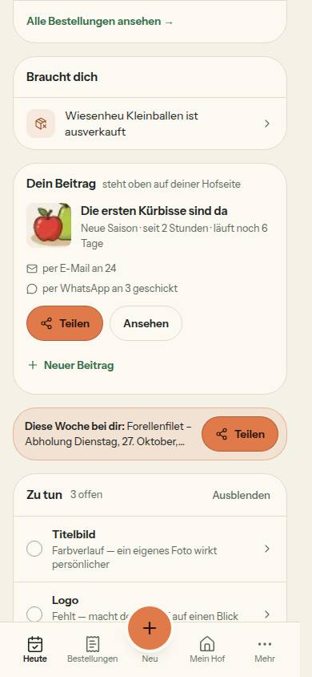
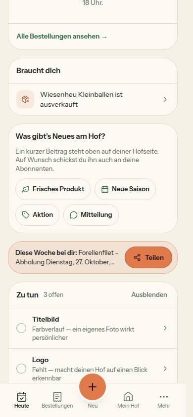

# Bericht Nr. 134 · Beiträge-Nacharbeit aus 128 und 129 (T5, F8, N11-Ergänzung, G4)

## Was geändert wurde
- `src/lib/teilen-fenster.ts`: neben `beitragLink` die Regel `beitragIdImLink` (Kennung nur, wenn der Beitrag auf der Hofseite steht) und `beitragLinkMitKanal` (`?beitrag=<id>&k=wa`).
- `src/server/actions/status-posts.ts`: die Mail nimmt `beitragIdImLink`. `send-whatsapp/page.tsx` fragt `showOnFarmPage` (Besitz in der WHERE-Klausel), `whatsapp-tap-client.tsx` baut den Link mit `beitragLinkMitKanal`.
- `status-new-client.tsx`, `emails/status-update.tsx`, `lib/teilen-bild.ts`, `api/status-image/[id]/route.tsx`: Anlass-Wort und Symbol aus `BEITRAG_ANLASS`, die vier Kopien und die Rückfälle auf „Mitteilung“ sind weg; `lib/beitrag-anlass.ts` nur der Kommentar.
- `src/schemas/beitrag-anlass.ts` (neu): `anlassParameterSchema`; `status/new/page.tsx` nimmt es.
- `src/lib/mein-hof-ansicht.ts`: Ziel `beitraege` = Übersicht mit `#aktuell` (alte `?reiter=beitraege` bleiben gültig).
- `(public)/[farmSlug]/page.tsx`, `components/farm/farm-page-view.tsx`, `hofseite-kunde.tsx`, `lib/hofseite-kunde.ts`: Merker `beitraegeFehler` (`ladeBeitraege` → Seite → `ordneBeitraege`): kein „nicht mehr aktuell“ nach einem Ladefehler.
- `server/queries/neuigkeiten.ts`: `take: 200` (`LESE_MAX`, Grund im Kommentar) und `distinct: ['category']`.
- `lib/heute.ts`: `DeinBeitrag.fotoAusschnitt`, neue `entferneBeitragErinnerung`; `queries/dashboard.ts` liest den Ausschnitt; `dashboard/page.tsx` ruft die Funktion; `dein-beitrag.tsx`: „Dein Beitrag“ als `h2`, Foto mit `bildStil`.
- Tests: neu `anlass-woerter-wache`, `use-cart-wache` (je Gegenprobe, `30_000`), `beitrag-anlass-schema`, `hofseite-beitraege-fehler`; erweitert `teilen-fenster`, `whatsapp-tippen-fehler`, `dein-beitrag`, `aktuell-vom-hof-regeln`, `hofseite-kunde-ansicht`, `mein-hof-ansicht`, `abo-bestaetigung-mail`, Integration `neuigkeiten` und `dein-beitrag`; angepasst Fixtures und die vier Ausnahmen in `wortliste.test.ts`.
- Doku: ARCHITECTURE Z. 168 (Satz zu `useCart`), DESIGN_SYSTEM Z. 654 (`?beitrag=<id>&k=…`), DEVELOPMENT.md, BAUSTEINE (erzeugt).

## Eigene Dateien (`git diff --name-only d9c0c2b...HEAD`, dazu die Dateien der Bericht-Runde)
src: app/(hof)/dashboard/page.tsx · app/(hof)/status/[id]/send-whatsapp/{page,whatsapp-tap-client}.tsx · app/(hof)/status/new/{page,status-new-client}.tsx · app/(public)/[farmSlug]/page.tsx · app/api/status-image/[id]/route.tsx · components/farm/farm-page-view.tsx · components/heute/dein-beitrag.tsx · components/hofseite/hofseite-kunde.tsx · emails/status-update.tsx · lib/{beitrag-anlass,heute,hofseite-kunde,mein-hof-ansicht,teilen-bild,teilen-fenster}.ts · schemas/beitrag-anlass.ts · server/actions/status-posts.ts · server/queries/{dashboard,neuigkeiten}.ts
tests: abo-bestaetigung-mail · aktuell-vom-hof-regeln · anlass-woerter-wache · beitrag-anlass-schema · dein-beitrag · hofseite-beitraege-fehler · hofseite-kunde-ansicht · integration/{dein-beitrag,neuigkeiten}.int · leerzustaende · mein-hof-aktuell · mein-hof-ansicht · teilen-fenster · telefon-nach-kauf · use-cart-wache · whatsapp-tippen-fehler · wortliste (alle `.test.ts`)
Doku: DEVELOPMENT.md · docs/ai/{ARCHITECTURE,BAUSTEINE,DESIGN_SYSTEM}.md · dieser Bericht · bilder/134/*.jpg (2)
Wiederverwendet: `BEITRAG_ANLASS`, `beitragLink`/`linkMitKanal`, `AKTIVER_BEITRAG`, `bildStil`/`leseAusschnitt`, `ordneBeitraege`, `brauchtDich`/`beitragBlock`, Fabriken der Integrationsschicht. Neu, weil: keine Funktion kannte die eine Regel für Link und Kennung (`beitragIdImLink`) und keine hielt „Braucht dich“ und Anstoß auseinander (`entferneBeitragErinnerung`).

## Alle Einstiege: Links auf einen Beitrag (`?beitrag=`) und ihre Regel
- Mail an Abonnentinnen (`emails/status-update.tsx`): Kennung über `beitragIdImLink` (Action). · WhatsApp je Person (`whatsapp-tap-client.tsx`): `beitragLinkMitKanal` (dieselbe Regel).
- Teilen-Fenster und alle seine Kanäle (`server/queries/teilen-bild.ts`, `beitragLink`): nur nach `beitragDarfInsBild`, das `showOnFarmPage` verlangt. · „Ansehen“ in „Dein Beitrag“ (`dein-beitrag.tsx`) und „Neu bei den Höfen“ (`neu-bei-den-hoefen.tsx`): nur Beiträge aus `AKTIVER_BEITRAG` (`showOnFarmPage: true`).
- Kein Beitragslink: „Neuester: …“ (`adresseOhneBeitrag`), Mein Hof › Beiträge (`#aktuell`), Bild `/api/status-image/<id>`, die QR-Links auf den Hof (`[farmSlug]/opengraph-image/route.tsx:123`, `server/queries/teilen-bild.ts:305`, je `teilenLink(…, 'qr')`).

## Annahmen
- Die Tipp-Seite bekommt `showOnFarmPage` per eigener Abfrage in `page.tsx`, denn `getStatusPostForWhatsApp` (queries/status-posts.ts) liegt außerhalb der Grenze.
- **Grenzerweiterung genommen:** `components/farm/farm-page-view.tsx` reicht den Merker durch (nur eine Prop, kein anderer Lauf berührt die Datei); ohne sie kommt `beitraegeFehler` nie bei `HofseiteKunde` an. Rückbau: `git checkout d9c0c2b -- <Datei>` samt Merker.
- `LESE_MAX = 200`: der sechste Hof fehlte erst, wenn die fünf neueren Höfe zusammen über 200 Beiträge in 14 Tagen veröffentlichten. Die Mail nimmt einen unbekannten Anlass wie bisher als „Mitteilung“ (`ANNOUNCEMENT`). Neben der Karte „Dein Beitrag“ bleibt die Erinnerung, nur der Anstoß ersetzt sie (so die Freigabe).
- Zwei Commits: Umsetzung (grüner Lauf) und Bericht mit Bildern (die Bilder brauchen den Stand der Umsetzung).
- Bild-Daten (Nachtrag des Dirigenten): Der Seed-Hof hatte keinen Beitrag, zum Zurückdatieren gab es also nichts. Der erfundene Beitrag wurde nur in der lokalen Test-DB über die App angelegt (ohne `RESEND_API_KEY`, Mails nur ins Log, Z3) und danach über den bestehenden Weg „Löschen“ in Mein Hof › Beiträge entfernt (Freigabe §2); `134-vorher.txt` = `134-nachher.txt`. Abweichung vom Hinweis „ohne Zeilen zu löschen“ – vom Dirigenten bestätigt.

## Nicht gelöst
- `teilen-bild.ts` (queries) baut `beitragLink` direkt (gleiche Bedingung, nicht dieselbe Funktion); `getStatusPostForWhatsApp` liefert `showOnFarmPage` nicht — beides außerhalb der Grenze (Nacharbeit).
- `keine-emojis`, `blob-loeschen-wache`, `ladeansichten` laufen unter Last in die 5 s (einzeln grün); die Zeitgrenzen gehören zu 136.

## Wie der Mensch es testet (Abnahme-Liste, Vorschau)
- Heute mit laufendem Beitrag: „Dein Beitrag“ ist wie die Karten daneben eine Überschrift, das kleine Foto zeigt denselben Ausschnitt wie die Hofseite. Ohne Beitrag seit 15 Tagen (oder nie) und mit Produkten im Shop: der Anstoß steht, in „Braucht dich“ fehlt „Seit n Tagen kein neuer Beitrag“; nach 6 bis 14 Tagen steht die Zeile noch.
- Beitrag veröffentlichen, in der Tipp-Liste „Tippen“: die WhatsApp-Nachricht endet auf `…/<hof>?beitrag=<id>&k=wa` und öffnet genau diesen Beitrag; ohne „Auf der Hofseite zeigen“ auf `…/<hof>?k=wa`. Die Mail führt mit `?beitrag=<id>` zum Beitrag.
- „Neuer Beitrag“ zeigt die vier Anlässe wie zuvor, `/status/new?anlass=PROMOTION` wählt „Aktion“. Mein Hof › Beiträge › Kundenansicht öffnet die Hofseite bei „Aktuell vom Hof“; `/<hof>?reiter=beitraege` springt weiter dorthin. Startseite „Neu bei den Höfen“ unverändert.

## Angepasste `.md`
docs/ai/ARCHITECTURE.md (Z. 168), docs/ai/DESIGN_SYSTEM.md (Z. 654), docs/ai/BAUSTEINE.md (erzeugt), DEVELOPMENT.md.

## Nacharbeit
- `showOnFarmPage` in `getStatusPostForWhatsApp` aufnehmen, dann entfällt die Abfrage in `page.tsx`; `queries/teilen-bild.ts` auf `beitragIdImLink` stellen; Zeitgrenzen der drei Wachen (136).

## Regelvorschlag
Ursache: Die Freigabe nannte „page.tsx gibt es mit“, aber nicht die Dateien dazwischen (`farm-page-view.tsx`, die Abfrage): zwei Wege brauchten eine Grenzerweiterung. Gegenmaßnahme: Die Lesemappe zählt bei jedem durchgereichten Feld den Weg von der Abfrage bis zur Komponente mit `git grep` auf; jede Datei darauf gehört zur Grenze (Prüfung vor Textregel). Ort: Lesemappen-Vorlage (Dirigent), danach `docs/nachtlauf.md`.

## Bilder (390, hell; Seed-Hof mit einem erfundenen Beitrag, danach über „Löschen“ in Mein Hof › Beiträge entfernt)
 
Axe 0 Verstöße (mit Beitrag: 1 „incomplete“ Kontrast der Überschrift, von Hand > 15:1; Anstoß: 0/0). Tippflächen ≥ 44 px (12 und 13 Elemente). Testdaten: `134-vorher.txt` = `134-nachher.txt` (0 Beiträge, Produkte unverändert). Mockup-Abweichungen: keine (kein Mockup).
