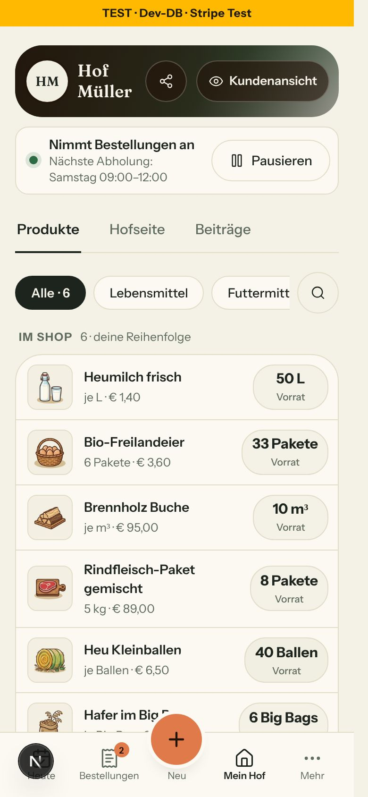
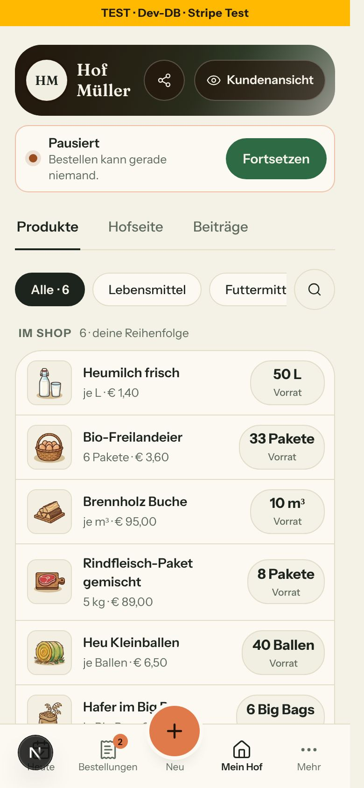
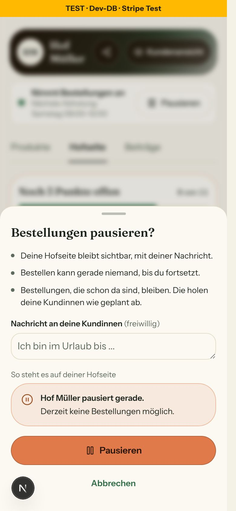
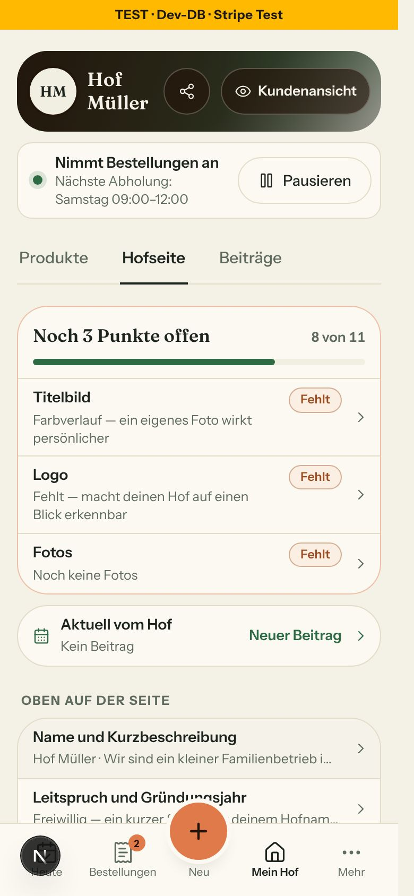
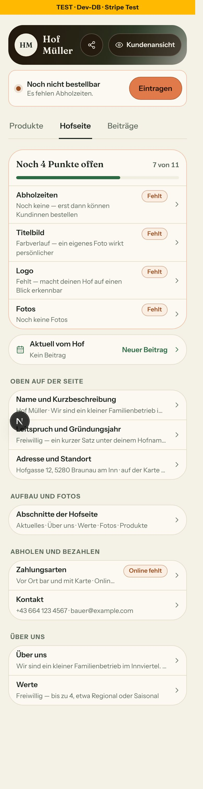
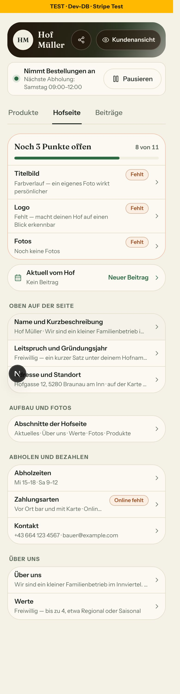
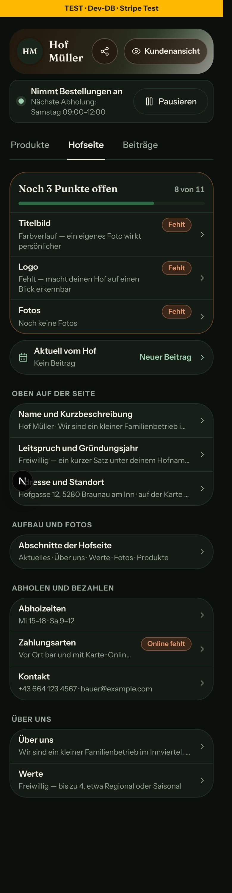
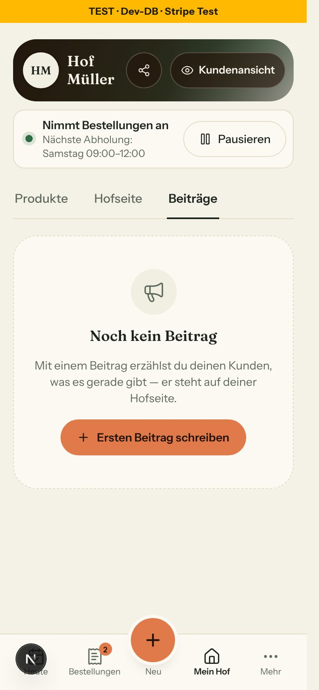

# Bericht Nr. 143 – Mein Hof v3: ein Kopf für alle Reiter, Pause im Kopf, Hofseite in Gruppen (N3, N4, E12)

## Was geändert wurde
- `src/server/mein-hof-zustand.ts` (neu): `ladeMeinHofZustand` – Pause, Nachricht, aktive Abholzeiten mit `ausgebuchteTage`, Produkte; rechnet `kaufSperre`, `naechsteAbholung`, `istKaufbar`; Zustand mit der Bedingung des Balkens.
- `src/lib/mein-hof.ts`: `zustandsZeile`, `ZUSTANDSZEILE_TEXT` (Titel aus `ABHOLZEILE_TEXT`, Vorlauf aus `vorlaufInWochen`). `bereiche-anzeige.ts`: nur `vorlaufInWochen` exportiert; `shop-pause.ts`: nur `PAUSE_MELDUNG`; `hofseite-fortschritt.ts`: `ORTS_GRUPPEN`, `zeilenNachOrt` (offene Zeilen, Abholzeiten zuerst).
- `src/components/mein-hof/mein-hof-kopf.tsx` (neu): Kopf am Handy (Streifen 76 px, Schleier aus Tokens, Teilen, Kundenansicht, Zustandszeile, Reiter) und `MEIN_HOF_KOPF_HUELLE`.
- `src/components/mein-hof/pausieren-blatt.tsx` (neu): EIN Knopf Pausieren/Fortsetzen, Blatt „Bestellungen pausieren?“ mit Nachricht, Zähler und echter `KaufSperreHinweis` als Vorschau.
- `src/components/mein-hof/seitenkopf.tsx`: unter lg `MeinHofKopf` statt der Karte, `Hofbild` exportiert, `zustand` statt `beitraegeZahl`; ab lg unverändert (nur ohne Zahl am Reiter).
- `src/components/mein-hof/reiter-leiste.tsx`: Zahl am Reiter „Beiträge“ und `beitraegeZahl` entfallen.
- `src/components/mein-hof/abschnitte-liste.tsx`: Stand als Zeile bzw. Karte „Noch n Punkte offen“, „Aktuell vom Hof“, vier Gruppen; Zeile = ein Knopf, „Bearbeiten“ nur für den Screenreader; ohne „Bestellungen“.
- `src/components/mein-hof/mein-hof-laden.tsx`: `MeinHofKopfLaden` und Skelett der neuen Liste. `src/app/(hof)/products/loading.tsx`: ganz nach Bildschirm A.
- `hof-teilen-knopf.tsx`: nur Variante `nurSymbol` (`aria-label`). `pause-client.tsx`: nur Meldungen aus `PAUSE_MELDUNG` und Zähler `message.trim().length`.
- `src/app/(hof)/farm-page/page.tsx`: beide Reiter geben erst Verwaistes frei, dann `ladeMeinHofZustand`; gemeinsame Hülle. `src/app/(hof)/products/page.tsx`: nur Kopf und die zwei neuen Abfragen. `src/server/queries/mein-hof-zahl.ts` gelöscht (kein Aufrufer).
- Tests: neu `mein-hof-zustand`, `mein-hof-kopf`; angepasst `hofseite-fortschritt`, `mein-hof-bearbeiten`, `mein-hof-seite`, `mein-hof-umschalter`, `bauern-navigation`, `hofseite-editor`, `mein-hof-aktuell`, `produkte-seite` (nur Kopf-Fall).

## Abweichungen vom Board (je mit Grund)
- Blatt: kein Kreuz, „Pausieren“ volle Breite, „Abbrechen“ als Textknopf (DESIGN_SYSTEM „Dialoge und Blätter“).
- Zeitformat „Morgen 15:00–18:00“ statt „Fr 15–18“ (Hausformat `formatiereAbholung`); Satz bricht um statt Auslassung, Zeile darum 70 statt 60 px.
- „Eintragen“/„Abholzeiten“ führen nach /settings/pickup-slots (kein Blatt dafür). „Noch nicht freigegeben“ nur bei freigeschaltet, aber nicht aktiv; „wartet“/stillgelegt zeigt nur der Balken.
- Zeilen der Liste 56 statt 58 px (Wache der Knöpfe kennt `min-h-14`), keine Vorschaubilder in den Zeilen.

## Bilder und sichter (390 px, `bilder/143/`)
       
- Gemessen: Reiter-Oberkante 219,8 px auf /products, /farm-page und Beiträge, hell und dunkel gleich (375 px effektive Breite wegen Scrollbalken); Streifen 76 px, Zustandszeile 71,8 px, Knöpfe ≥ 44 px.
- Kontrast: Name 14,7:1 (weißes Foto 8,7:1), Teilen 14,4:1 (weißes Foto ≥ 5,9:1), Zustandssatz hell 5,4:1 / dunkel 7,1:1, „Pausieren“ 14,0:1 / 13,7:1.
- Tastatur Kopf/Blatt/Liste: Fokus auf dem Titel beim Öffnen; Escape und „Abbrechen“ geben ihn an „Pausieren“ zurück.
- hof-mueller ist im Seed nicht 100 % fertig: „fertig“ zeigt „Noch 3 Punkte offen · 8 von 11“; „Hofseite vollständig“ belegt nur der Test.
- Werkzeug: vorinstalliertes Playwright statt agent-browser (nicht installiert), kein Axe (axe-core fehlt). DB nur hof-mueller unter integration.lock: beide Abholzeiten kurz aus, isPaused kurz an, alles zurückgesetzt und geprüft.

## Nachbesserung Runde 1
- Blocker: /farm-page scrollte waagerecht (scrollWidth 1158 statt 375): das absolute `sr-only` „. Bearbeiten“ stand ohne positionierten Vorfahren am Ende langer Werte, außerhalb des `truncate`. Fix: `relative` am Wert- und am Titel-Span in `abschnitte-liste.tsx`, Optik und Screenreader-Text gleich. Test in `mein-hof-bearbeiten` (rot → grün, Gegenprobe ohne `relative`: 12 Treffer); Browser nachher 375 px hell und dunkel, mit entferntem `relative` wieder 1158. Bilder nicht neu (Scroll darauf nicht sichtbar).
- `mein-hof-kopf`: Gegenprobe der Hülle am echten Quelltext statt festem Text; Zähler an der 80-%-Schwelle gerendert statt `trim()` nachgerechnet (Gegenprobe ohne `trim()` rot).

## Annahmen
- Signatur `zustandsZeile({ zustand, sperre, naechste, kaufbar })`; `zustand` liefert `ladeMeinHofZustand` schon mit Balken-Vorrang. Der Knopf ist `{ art, text }`, die Adresse wählt der Kopf.
- `PausierenBlatt` ist ein Knopf für beide Fälle, damit der Fokus nach dem Pausieren auf „Fortsetzen“ bleibt.

## Nicht gelöst / bekannt
- `PauseClient` (ab lg, /settings/pause) schaltet weiter ohne Bestätigung (Freigabe).
- Der Moment „Ware wieder da“ auf /products rechnet mit `naechstesAbholfenster`: bei vollem Fenster können zwei „nächste Abholung“ verschieden sein.
- Keine Integrationsdatei geändert, darum kein Integrationslauf.

## Wie der Mensch es testet (Vorschau, Hof der Entwicklungsdatenbank, nicht Testhof, 390 px)
1. /products: Kopf „Nimmt Bestellungen an · Nächste Abholung: …“; auf Hofseite und Beiträge stehen die Reiter an derselben Stelle.
2. „Pausieren“ → Blatt, Nachricht tippen, Vorschau zeigt sie; „Pausieren“ → Meldung, Kopf „Pausiert“, Fokus auf „Fortsetzen“; Hofseite zeigt die Karte mit der Nachricht. „Fortsetzen“ → „Nimmt Bestellungen an“.
3. Alle Abholzeiten abschalten → „Noch nicht bestellbar · Es fehlen Abholzeiten.“ mit „Eintragen“; Hofseite-Liste zeigt „Abholzeiten“ zuerst in „Noch n Punkte offen“.

## Angepasste .md
DESIGN_SYSTEM (Mein Hof, Heute-Satz zu `ChecklisteKompakt`, Wortliste „Beiträge“, Produkte unter md), ARCHITECTURE (Z. ~230–233), DEVELOPMENT.md, BAUSTEINE (über `pnpm bausteine`).

## Nacharbeit / Regelvorschlag
- ARCHITECTURE Z. ~300 („Der Kopf zeigt die Adresse …“) gilt nur noch ab lg – außerhalb meiner Grenze, nicht angefasst.
- Filter-Chips auf /products 36 px, „… bearbeiten“-Knöpfe in Produktzeilen 20–40 px hoch (Altlast, nicht von 143; Datei außerhalb der Grenze).
- Regelvorschlag: Die Wache der Knöpfe (`mein-auftritt-knoepfe`) erkennt beliebige `min-h-[NNpx]` ≥ 44 – sonst weichen Maße des Boards auf die Tailwind-Stufen aus.

Wiederverwendet: `kaufSperre`, `naechsteAbholung`, `istKaufbar`, `alsAbholFenster`/`ausgebuchteTage`, `formatiereAbholung`, `ABHOLZEILE_TEXT`, `ABHOLZEITEN_FEHLEN`, `KaufSperreHinweis`, `SheetBlatt`, `ZeichenZaehler`, `KNOPF_*`, `Hofbild`, `KundenansichtKnopf`, `HofTeilenKnopf`. Neu, weil: kein Kopf mit Zustand und kein Bestätigungsblatt für die Pause existierte.

## Eigene Dateien (`git diff --name-only a0fa7fc2..HEAD`)
DEVELOPMENT.md · docs/ai/{ARCHITECTURE,BAUSTEINE,DESIGN_SYSTEM}.md · docs/nachtlauf/berichte/143.md · src/app/(hof)/farm-page/page.tsx · src/app/(hof)/products/{loading,page}.tsx · src/components/farmer/hof-teilen-knopf.tsx · src/components/mein-hof/{abschnitte-liste,mein-hof-kopf,mein-hof-laden,pausieren-blatt,reiter-leiste,seitenkopf}.tsx · src/components/settings/pause-client.tsx · src/lib/{bereiche-anzeige,hofseite-fortschritt,mein-hof,shop-pause}.ts · src/server/mein-hof-zustand.ts · src/server/queries/mein-hof-zahl.ts (gelöscht) · tests/{bauern-navigation,hofseite-editor,hofseite-fortschritt,mein-hof-aktuell,mein-hof-bearbeiten,mein-hof-kopf,mein-hof-seite,mein-hof-umschalter,mein-hof-zustand,produkte-seite}.test.ts
