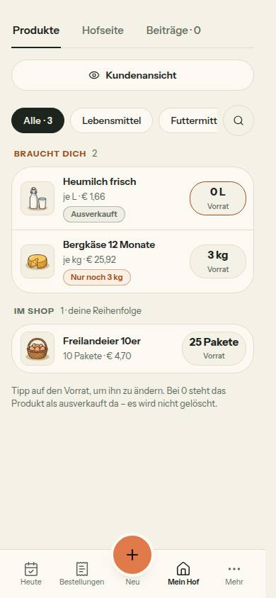
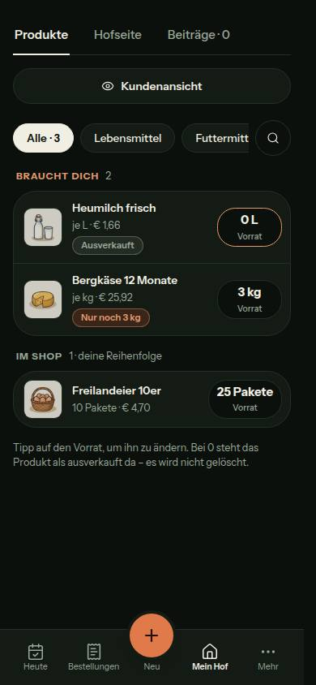
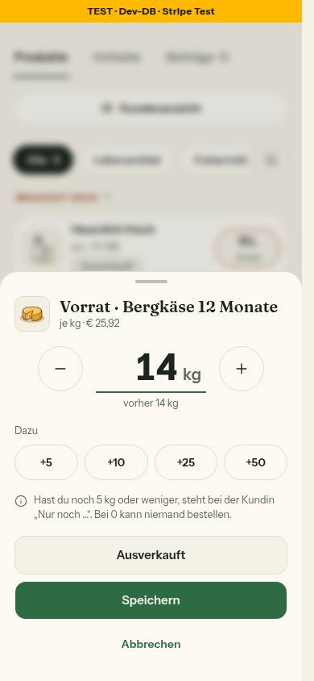
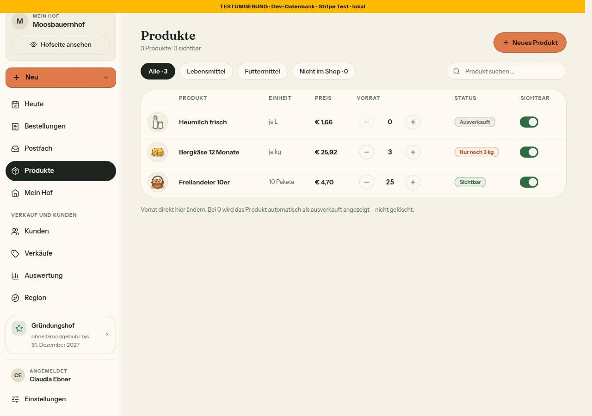

# Bericht Nr. 144 – Produkte am Handy: „Braucht dich“ zuerst, Vorrat im Blatt (N25)

## Was geändert wurde
- `src/lib/format.ts`: neu `hofVorratText` – zählt wie `bestandLabel` („53 kg“, „14 Pakete“, „1 Paket“, „6 Ballen“).
- `src/lib/produkte-hof.ts`: `produktStatus` schreibt „Nur noch {hofVorratText}“ (auch Tabelle); neu `produkteAbschnitte` und `VORRAT_HINWEIS_ZEILEN`.
- `src/components/produkte/use-vorrat-setzen.ts` (neu): reine Schleife `erzeugeVorratSchleife` und Hook `useVorratSetzen` – eine Logik für Tabelle und Blatt.
- `src/components/produkte/vorrat-feld.tsx`: nur noch Darstellung, Senden über den Hook.
- `src/components/produkte/vorrat-blatt.tsx` (neu): Vorrat-Blatt mit großem Stepper, „Dazu“, Satz zur Grenze, „Ausverkauft“, „Speichern“, „Abbrechen“.
- `src/components/produkte/produkte-ansicht.tsx`: Abschnitte, Zeile mit Vorrat-Knopf (Schild nur bei Ausnahmen), Blatt EINMAL in der Ansicht, h1 und Kopfzeile unter md, Lupe, zwei Hinweissätze.
- `src/components/ui/stepper.tsx`: `inputMode` (nur wenn gesetzt) und große Darstellung mit Einheit.
- `tests/produkte-seite.test.ts`: hofVorratText, produktStatus mit Einheit, produkteAbschnitte, Zeilen gegen Tabelle, Lupe (Kopf-Fälle von 143 unberührt). `tests/vorrat-setzen.test.ts` (neu): Schleife, `VorratFeld` (zwei Aufrufe aus einem Render), Blatt im Hook-Prüfstand.
- Doku: `docs/ai/DESIGN_SYSTEM.md` (nur Produkte), `DEVELOPMENT.md`, `docs/ai/BAUSTEINE.md` (über `pnpm bausteine`); vier Bilder.

## Eigene Dateien (`git diff --name-only 0dd060c...HEAD`)
DEVELOPMENT.md · docs/ai/BAUSTEINE.md · docs/ai/DESIGN_SYSTEM.md · docs/nachtlauf/berichte/144.md · docs/nachtlauf/berichte/bilder/144/{produkte-390-hell,produkte-390-dunkel,vorrat-blatt-390-hell,tabelle-1280-hell}.jpg · src/components/produkte/{produkte-ansicht.tsx,use-vorrat-setzen.ts,vorrat-blatt.tsx,vorrat-feld.tsx} · src/components/ui/stepper.tsx · src/lib/format.ts · src/lib/produkte-hof.ts · tests/produkte-seite.test.ts · tests/vorrat-setzen.test.ts

## Annahmen
- `wieder-da-moment.tsx` bleibt unverändert: Die Reihenfolge der Blätter regelt das Vorrat-Blatt (Moment erst in `onOpenChangeComplete(false)`).
- Lupe: Ein zweiter Tipp schließt das Feld und leert die Suche – sonst filterte ein Wort, das niemand mehr sieht.
- `vorratGrenzSatz` steht in `vorrat-blatt.tsx` (einziger Nutzer; die Grenze in produkte-hof.ts nennt nur den Satz neben `VORRAT_HINWEIS`).
- Feld im Blatt heißt für den Screenreader `bestandLabel` („Vorrat (kg)“); der Titel nennt das Produkt.
- „Speichert …“ steht auf „Speichern“; „Ausverkauft“, „Abbrechen“ und „Dazu“ sind gesperrt.
- Nach GEAENDERT oder Fehler geht der Fokus auf den Titel des Blatts: Der gedrückte Knopf war gesperrt, der Fokus stand sonst auf `body` (im Browser gefunden und behoben).
- „Unterkategorie ergänzen“ zählt nicht als Hinweis mit Handlung (Freigabe nennt nur die drei anderen). Jedes Öffnen beginnt frisch (Runde im Schlüssel).

## Nicht gelöst
- Zeile „4 Größen“ des Boards bewusst nicht gebaut (Freigabe Punkt 1).
- Der Fokus nach GEAENDERT hat keinen Unit-Test (Prüfstand ohne DOM); im Browser geprüft.

## Wie der Mensch es testet (Vorschau, /products, 390 px)
1. Produkt mit Vorrat 3 kg: steht unter „Braucht dich“ mit „Nur noch 3 kg“, rechts der Knopf „3 kg · Vorrat“.
2. Tipp auf „3 kg“ → Blatt „Vorrat · …“; „+25“ → 28 kg, darunter „vorher 3 kg“; „Speichern“ → Blatt zu, das Produkt steht unter „Im Shop“ mit „28 kg“, der Fokus auf seinem Vorrat-Knopf.
3. „Ausverkauft“ im Blatt → 0; das Produkt steht unter „Braucht dich“, Schild „Ausverkauft“, Rahmen orange.
4. Lupe → Feld über den Filtern, Fokus darin; Tippen → einfache Liste ohne Abschnitte.
5. Ab 1024 px: Tabelle wie vorher, nur „Nur noch 3 kg“ statt „Nur noch 3“.

## Angepasste .md
`docs/ai/DESIGN_SYSTEM.md` (Abschnitt Produkte, veralteter Umschalter entfernt), `DEVELOPMENT.md`, `docs/ai/BAUSTEINE.md` (erzeugt).

## Nacharbeit
- Größen zu einer Zeile zusammenfassen braucht eine eigene Ansicht der Größen (eigener Auftrag).
- Der Stepper gibt keinen Ref auf sein Feld heraus; nach GEAENDERT wäre der Fokus im Feld noch näher am Satz.

## Regelvorschlag
- Ursache: Während der Bilder wurde der Seed in `farmerzone_test` neu eingespielt (alle Produkte des Hofs um 09:48:38 gleichzeitig zurück); mein Speichern lief dadurch in GEAENDERT. Gegenmaßnahme: Wer den Seed der geteilten Test-DB neu einspielt, nimmt dieselbe Sperre wie die Bilder bzw. `integration.lock`. Ort: docs/nachtlauf.md 4a Punkt 6 b; Prüfung vor Textregel: Das Seed-Skript des Laufs nimmt die Sperre selbst.

## Bilder und Mockup-Abweichungen
Wiederverwendet: `SheetBlatt`, `SheetClose`, `SheetTitle`, `Stepper`, `Button`, `StatusBadge`, `FilterChip`, `NamenKnopf`, `Hinweise`, `ProduktBild`, `WiederDaMoment`, `bestandLabel`, `formatMenge`, `produktZustand`. Neu, weil: Hook und Blatt verlangt die Freigabe; `hofVorratText` zählt Pakete statt „2 × 500 g“.

   

- Größen je eine Zeile statt „4 Größen“ (Freigabe). Blatt ohne Kreuz, „Ausverkauft“ als Umriss über „Speichern“ (volle Breite), „Abbrechen“ als Textknopf (DESIGN_SYSTEM „Dialoge und Blätter“; Bild Vorrat-Blatt). `inputMode="numeric"` statt `decimal` (ganze Zahl).
- Axe: 390 und 1280, hell und dunkel, 0 Verstöße; offenes Blatt hell und dunkel 0 Verstöße. Tippflächen: Vorrat-Knopf 80 × 48, Lupe 44 × 44, im Blatt −/+ 56, „Dazu“ 79 × 44, Knöpfe 48 hoch. Tastatur: Lupe (Enter öffnet, Fokus im Feld), Vorrat-Knopf (Enter öffnet, Fokus auf dem Titel), Escape schließt mit Fokus zurück, 3 → 28 kg mit Wechsel nach „Im Shop“ und Fokus auf dem Knopf.
- Testdaten nur `bauer-05` (`144-vorher.txt` = `144-nachher.txt`).

## Nachbesserung Runde 1
- `vorrat-blatt.tsx`: „Speichern“ grün wie im Board (`bg-accent text-accent-foreground`, wie die Bestellungen); Bild Vorrat-Blatt neu, Axe offenes Blatt hell und dunkel 0. `produkte-ansicht.tsx`: Suche im DOM wieder hinter den Filtern, unter md nur sichtbar oben (`max-md:order-first`) – ab md Tab-Reihenfolge wie vorher, am Handy Lupe → Feld (Shift+Tab aus dem Feld auf die Lupe, im Browser geprüft). Beide Tests zuerst rot (`144-runde1-rot.log`); `afterEach` setzt den Filter der Tests zurück. Doku: DESIGN_SYSTEM Produkte, DEVELOPMENT.md.
- Gegenprobe `tests/vorrat-setzen.test.ts`, je Fall ein Eingriff, alle rot (`144-runde1-gegenprobe.log`): Schleife 1 `bestaetigt = ergebnis.vorrat` entfernt · 2 `wartend = null` bei Abweisung entfernt · 3 Stand nach Fehler `?? neu` statt `?? bestaetigt` · 4 `neu !== vorher` immer wahr · VorratFeld `??=` → `=` (neue Schleife je Senden) · Blatt 1 „Dazu“ speichert · 2 schließt auch nach Abweisung · 3 „Speichern“ ohne `bg-accent` · 4 „Ausverkauft“ speichert das Feld · 5 Moment sofort statt nach dem Schließen · 6 Schließen ohne `!laeuft`.
- Eigene Dateien der Runde: DEVELOPMENT.md · docs/ai/DESIGN_SYSTEM.md · docs/nachtlauf/berichte/144.md · docs/nachtlauf/berichte/bilder/144/vorrat-blatt-390-hell.jpg · src/components/produkte/{produkte-ansicht,vorrat-blatt}.tsx · tests/{produkte-seite,vorrat-setzen}.test.ts. Integration `vorrat-setzen.int.test.ts` 10/10 (`144-integration-runde1.log`). Keine Testdaten geschrieben.
