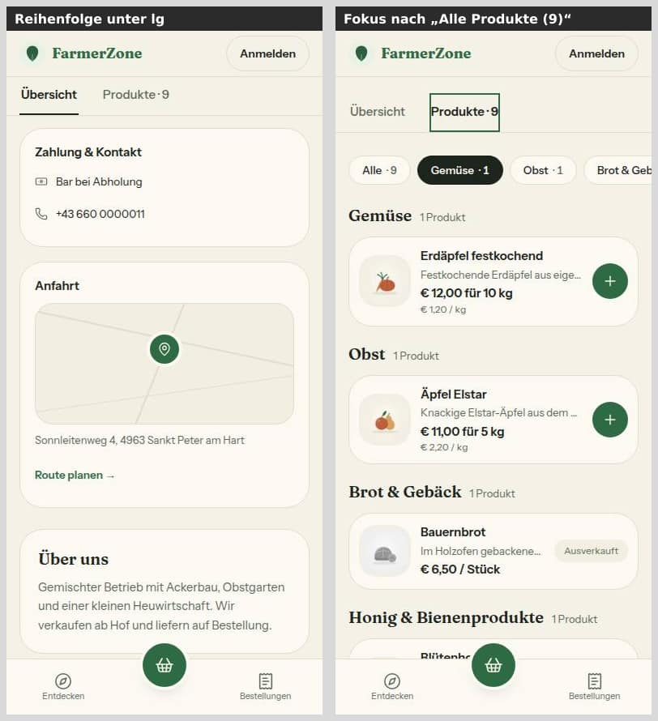
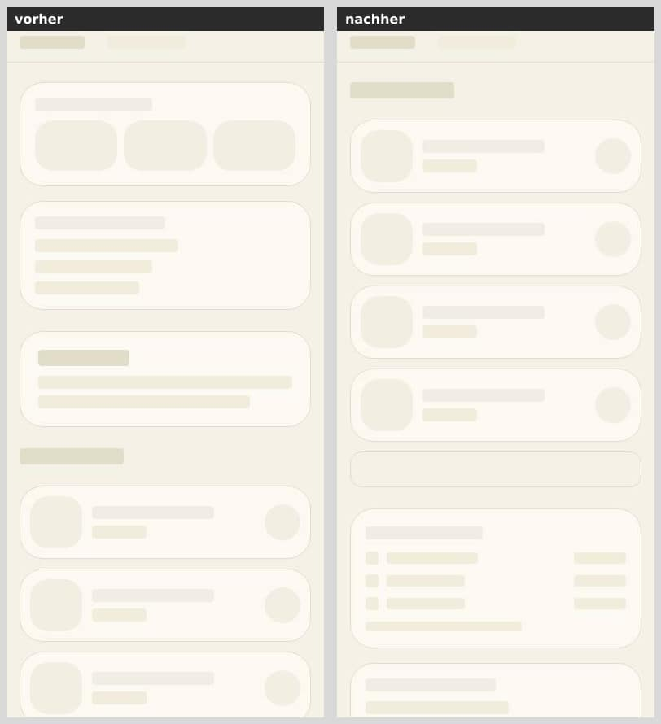
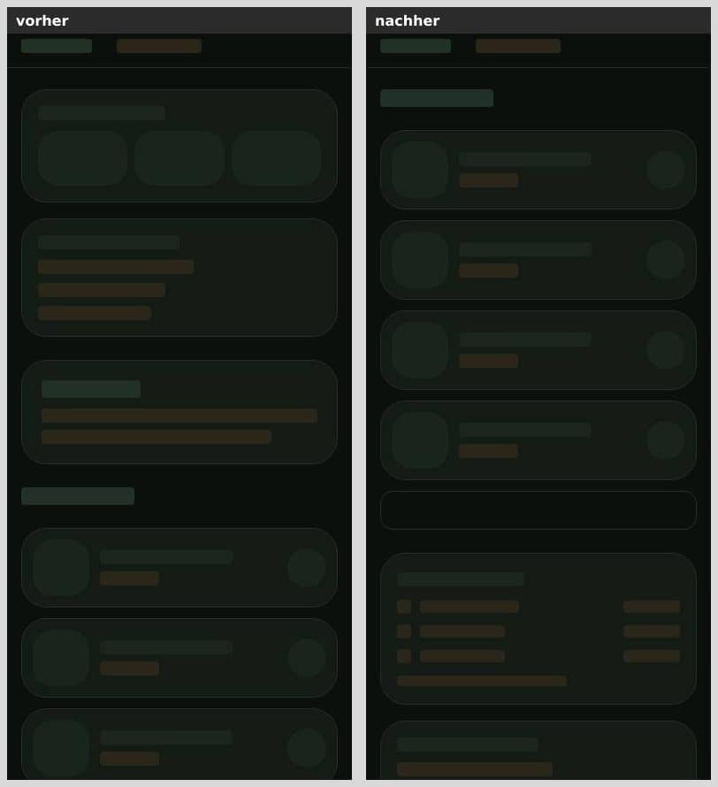
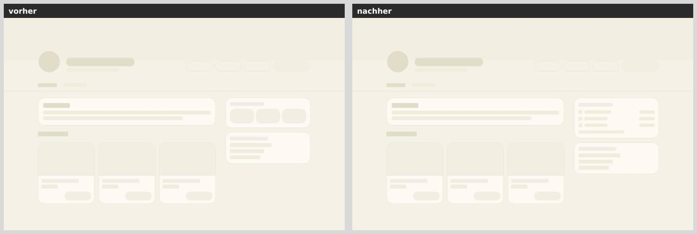
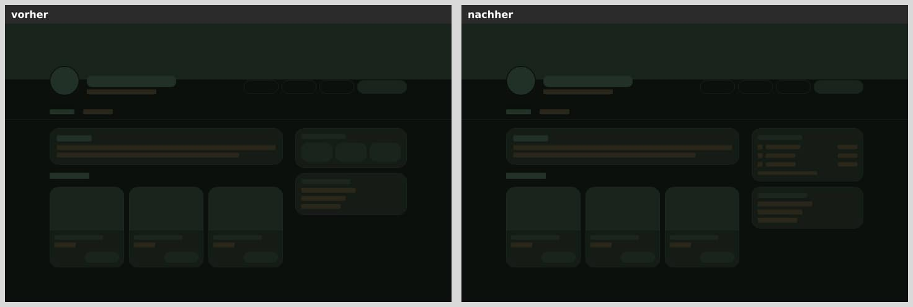
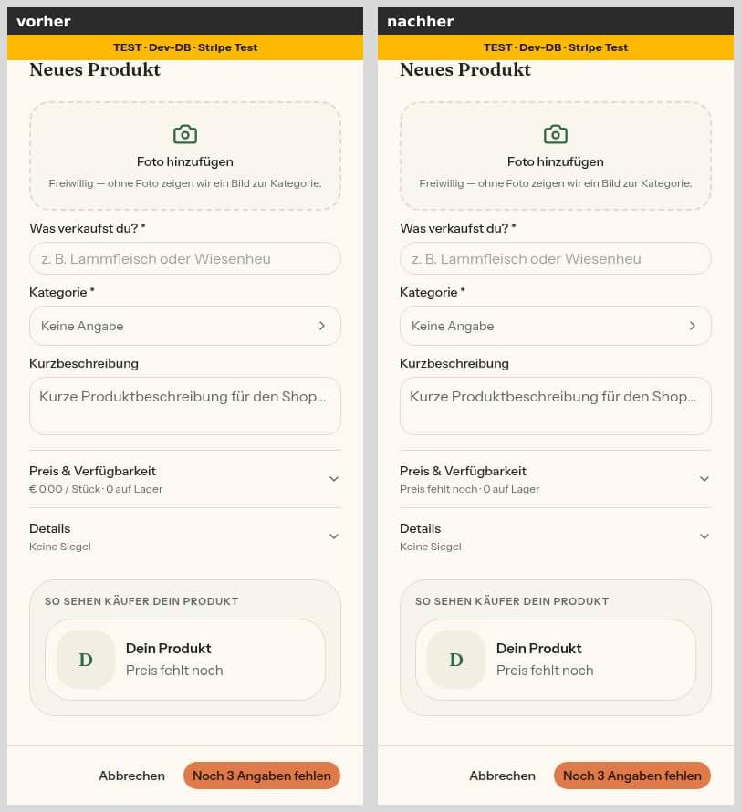

# Nr. 51 — Hofseite: Schaufenster zuerst (N5) und Käufer-Vorschau Lebensmittel

Enthält Migration: **nein** (keine Schema-Änderung, kein neues Paket, kein externer Dienst).

- Branch: `nacht/2026-10-10/51-hofseite-schaufenster` von `origin/main` (90cff24).
- Freigabe: `freigabe.md` §13 „51", Register N5. E9 und E10 (Futter) bleiben unberührt.
- **Beträge, Preislogik und Server-Prüfung unverändert.** Der Preis der Käufer-Vorschau wird nur mit den vorhandenen Helfern geprüft (`preisZahl`) und formatiert (`formatGrundpreis`, `zweitePreiszeile`). Den getippten Text zerlegt wie bisher das Preisfeld (`DezimalFeld` → `parseDezimal`).
- Für die Bilder lagen 7 erfundene Testfotos (Dateien aus `public/landing/`) bei einem Seed-Hof, nur in der lokalen Test-DB. Danach sind sie gelöscht. Der Korb für die Messung stand nur im Browser-Speicher, ohne Reservierung.
- **Nachbesserung Runde 1** (Befunde der Prüfung): Abschnitt am Ende. Die Abschnitte davor sind auf den neuen Stand berichtigt; was aus Runde 1 kommt, trägt „(Runde 1)".

## Was geändert wurde (je Datei ein Satz)

**Hofseite (N5)**

- `src/components/hofseite/hofseite-kunde.tsx`: Unter lg steht in der Übersicht zuerst das Schaufenster, danach rechte Spalte und Über uns, im Quelltext in genau dieser Reihenfolge (Runde 1).
  - Das Schaufenster besteht aus Fotostreifen, Produkten und „Alle Produkte (n)".
  - Ab lg stellt ein Raster aus zwei Zeilen die Teile an ihren alten Ort: Über uns oben links, das Schaufenster darunter, die Spalte rechts über beide Zeilen (Runde 1; die erste Fassung drehte nur die Sicht mit `contents` und `order`).
  - Über uns (`ueberUnsKarte`) und die Spalte (`seitenspalte`) stehen je an genau einer Stelle. Die Zeile `const ueberUns`, die Nr. 49 ändert, ist unverändert.
  - Nach „Alle ansehen" und „Alle Produkte (n)" geht der Fokus auf den Reiter „Produkte" (Runde 1).
  - Ohne Produkte (und in den anderen Reitern) bleibt alles wie bisher.
- `src/components/hofseite/hofseite-fotos.tsx`: Die Streifen-Variante `streifenUnterLg` nutzt dieselbe Liste und EINE Bildansicht.
  - Unter lg ist sie eine Reihe, die nur im eigenen Kasten seitlich scrollt (bis an die Bildschirmkante, Platz für den Fokusrahmen).
  - Ab lg bleibt das Raster bis 6.
- `src/components/farm/product-grid.tsx`: Die Auswahl der Übersicht zeigt bis zu vier Karten (die vierte nur am Handy, `md:hidden`). Neu ist `platzUnten`: Im Schaufenster steht kein Platz für die Korb-Leiste mitten auf der Seite.
- `src/lib/hofseite-kunde.ts`: neu `SCHAUFENSTER_PRODUKTE`, `stehtNurAmHandy`, `zeigeSchaufenster`, `alleProdukteText`, dazu der Typ `KartenVorschau` und die Texte `KAEUFER_VORSCHAU`.
- `src/app/(public)/[farmSlug]/loading.tsx`: Die Ladeansicht ist gebaut wie die Seite: unter lg im Quelltext Produkte, „Alle Produkte", Spalte, Über uns, ab lg dasselbe Raster.
  - „Nächste Abholung" steht als Textzeilen da wie auf der Seite seit Nr. 46 (Runde 1).
  - Einen Platzhalter für den Fotostreifen hat sie nicht, siehe „Was nicht gelöst wurde".

**Produktkarte und Produktdialog**

- `src/components/hofseite/produkt-karte.tsx`: EIN Aufbau für zwei Varianten. Die Kaufkarte bleibt unverändert. Die Vorschau-Variante `variante="muster"` hat keinen Link, keinen Korb, keine Beschreibung und keinen Zustand. Ohne gültigen Preis zeigt sie „Preis fehlt noch".
- `src/components/products/lebensmittel-vorschau.tsx` (neu): der Kasten „So sehen Käufer dein Produkt" mit der echten Karte, ab 768 px als Kachel bis 260 px.
- `src/components/products/produkt-preis.ts`: neu `kaeuferVorschau`. Sie macht aus Foto, Name, Preis und Einheit die Karte, ohne Foto mit der Illustration der Kategorie. Der Preis gilt nur, wenn er `preisZahl` besteht; das prüft seit Runde 1 `gueltigerPreis`, den Vorschau und Zusammenfassung teilen.
- `src/components/products/product-dialog.tsx`: Die Vorschau steht unter den Abschnitten, nur wenn `produktBereich(category)` Lebensmittel ergibt. Die Zusammenfassung des zugeklappten Abschnitts „Preis" zeigt ohne gültigen Preis „Preis fehlt noch" statt „€ 0,00" (Runde 1).
- `src/components/ui/accordion.tsx`: Der Kopf eines Abschnitts trägt `FOKUS_RAHMEN` statt eines Rings direkt am Text.

**Eine Zuordnung für die Illustration der Kategorie**

- `src/lib/taxonomie.ts`: neu `KATEGORIE_BILD_SLUG` und `kategorieBildPfad`, rein, damit auch der Browser sie kennt.
- `src/lib/product-image.ts`: nimmt die Zuordnung von dort (`CATEGORY_SLUGS` bleibt als Name) und prüft weiter, ob die Datei liegt.

**Tests**

- `tests/hofseite-kunde.test.ts`: Diese Datei prüft die Regeln des Schaufensters.
  - Es zeigt bis zu vier Produkte aus `uebersichtProdukte`.
  - `stehtNurAmHandy` ergibt die Anzahl je Breite.
  - „Alle Produkte (n)" nennt dieselbe Zahl wie der Reiter.
  - Ohne Produkte gibt es kein Schaufenster.
- `tests/hofseite-kunde-ansicht.test.ts`: Sie rendert Hofseite und Karte.
  - Fotos, Produkte, „Alle Produkte (5)", Spalte und Über uns stehen im Quelltext in dieser Reihenfolge, `id="ueber-uns"` nach `</aside>` (Runde 1).
  - Über uns, Spalte, „Zahlung & Kontakt" und Fotos stehen je genau einmal da (Runde 1).
  - Es zeigt vier Produkte, „Alle Produkte (5)" führt zu `?reiter=produkte`.
  - Nach „Alle ansehen" und „Alle Produkte (n)" geht der Fokus auf den Reiter (Runde 1).
  - Kein Foto liegt in einem Link, es gibt EINE Fotokomponente.
  - Ohne Produkte und in den anderen Reitern ist alles wie bisher.
  - Die Vorschau-Variante hat keinen Link, keinen Korb und einen Platzhalter; die Kaufkarte als Gegenprobe hat beides.
- `tests/lebensmittel-vorschau.test.ts` (neu): Die Vorschau ändert sich mit den Formularwerten, ohne Link und Korb, mit ruhigen Platzhaltern. Der Dialog bindet sie nur für Lebensmittel ein, Futter- und Holz-Formular bleiben ohne Produktkarte. Die Zusammenfassung „Preis" nimmt ohne gültigen Preis denselben Satz (Runde 1).
- `tests/produkt-preis.test.ts`: `kaeuferVorschau` mit leerem Namen, mit leerem, 0, negativem oder dreistelligem Preis und mit Illustration statt Foto; `gueltigerPreis`, und die Vorschau nimmt genau diesen Preis (Runde 1).
- `tests/product-image.test.ts`: Server und Browser haben dieselbe Zuordnung, es gibt EINE Liste.
- `tests/fokus-sichtbar.test.ts`: Der gerenderte Akkordeon-Kopf trägt jede Klasse von `FOKUS_RAHMEN` und keinen `focus-visible:ring`, mit Gegenprobe.
- `tests/kategorie-fisch.test.ts`: nur der Kommentar, wo die Zuordnung steht.

**Doku**

- `docs/ai/DESIGN_SYSTEM.md`: Schaufenster unter lg, Reihenfolge (Quelltext = Sicht unter lg, Raster ab lg) und Fokus nach dem Wechsel, Ladeansicht, Vorschau-Variante der Produktkarte, Käufer-Vorschau im Produktdialog samt Zusammenfassung „Preis", Fokus am Akkordeon.
- `DEVELOPMENT.md`: Eintrag „Hofseite: Schaufenster zuerst und Käufer-Vorschau Lebensmittel" mit Gründen und Grenzen, in Runde 1 berichtigt und ergänzt.

## Was nicht gelöst wurde und warum

- **Platzhalter für den Fotostreifen in der Ladeansicht** (Hinweis 6 der Prüfung): nicht gebaut, weil er einer Regel widerspricht.
  - Die Regel „Ladeansicht" in `docs/ai/DESIGN_SYSTEM.md` sagt: „Bedingte Teile (Filter-Chips, Fotostreifen, Hinweisbänder) weglassen". Ob ein Hof Fotos hat, steht erst mit den Daten fest.
  - Ein Sprung bleibt so oder so. Mit Platzhalter springt bei einem Hof ohne Fotos der Inhalt um rund 146 px nach oben. Ohne Platzhalter rückt er bei einem Hof mit Fotos um diesen Betrag nach unten.
  - Zur Entscheidung unter „Zur Freigabe" 2.
- **Gefunden, nicht Teil von Nr. 51 (alter Stand, Code unverändert):**
  - Bei 360 px ragt „Bestellen" im Kopf der Hofseite 9 px über den Rand, weil drei Knöpfe mit `shrink-0` nicht passen. Bei 375 und 390 px ist alles in Ordnung.
  - Bei 768–1023 px kürzt der Kopf einen kurzen Hofnamen auf „So…", weil Adresse und Knöpfe den Platz nehmen.
  - Bei offener Korb-Leiste deckt sie ganz unten die letzte Zeile des Seitenfußes ab (Hell/Dunkel). Der frühere Platzhalter stand vor dem Fuß und hat ihn nie freigehalten.
- **Integrationstests:** nicht gelaufen. Datenbank und Geld sind nicht berührt (nur Anzeige), die Checkliste verlangt sie dann nicht.

## Annahmen

1. **Ohne Produkte kein Schaufenster** („ohne Produkte das Schaufenster [fällt weg]"). Die Übersicht bleibt dann, wie sie war: rechte Spalte zuerst, Fotos als Raster nach Über uns. Die Fotos verschwinden also nicht, nur weil kein Produkt im Shop ist.
2. **Reihenfolge nach dem Schaufenster:** wie heute, Anfahrt vor Über uns. Steht jetzt unter „Zur Freigabe" 1.
3. **Anzahl je Breite:** Am Handy (unter 768 px) sind es vier Zeilen, bis 1023 px drei Kacheln in einer Reihe, ab 1024 px wie bisher drei. Vier Kacheln in einer Reihe wären bei 768 px zu schmal für Preis und „In den Korb".
4. **Fotostreifen:** Die Überschrift „Fotos" ist nur für Screenreader da, der Streifen wirkt als Auftakt. Dieselbe Grenze von 6 Kacheln mit „+N" wie im Raster, keine eigene Logik. Kacheln 160 × 120 px, ab 640 px 192 × 144.
5. **„Alle Produkte (n)"** ist ein Umriss-Knopf über die volle Breite unter den Produkten. „Alle ansehen →" in der Überschrift steht erst ab lg, unter lg wäre es doppelt.
6. **Käufer-Vorschau zeigt Foto, Name, Preis, Einheit** — wie beauftragt. Beschreibung und Zustand (knapp, ausverkauft) kommen erst mit dem gespeicherten Angebot. Ohne Foto zeigt sie die Illustration der Kategorie wie die Hofseite; ohne Kategorie das Initial wie die Hofseite.
7. **Ort der Vorschau:** unter den Abschnitten, wie im Futter-Formular am Ende. Sie erscheint nur im Bereich Lebensmittel (dieselbe Regel `produktBereich` wie die Filter auf /products). Beim Bearbeiten eines Futtermittels oder Brennmaterials im Produktdialog erscheint keine.
8. **Name der Variante „muster" statt „vorschau":** Das Wort „vorschau" ist als Text für den Adress-Parameter der Hof-Vorschau reserviert (`?vorschau=1`, Wache `tests/hofseite-einmal.test.ts`). Zwei Bedeutungen in derselben Karte wären ohnehin verwirrend.
9. **Tastatur und Screenreader ab lg:** steht jetzt unter „Mockup-Abweichungen — bitte freigeben" 5.
10. **Zuordnung Kategorie → Illustration nach `taxonomie.ts` verschoben,** damit der Browser sie kennt (vorher nur über das Dateisystem des Servers). Es bleibt eine Liste. Kein Verhalten des Servers ändert sich.

## Bilder (vorher/nachher)

Je Paar links vorher (`main` 90cff24), rechts nachher. Bei 375 px genügt laut Rahmen für eng verwandte Bildschirme ein Theme: „Hofseite ohne Fotos" nur hell, „Fokusrahmen" nur dunkel. Die 1440er-Paare der Hofseite sind pixelgleich (mittlere Abweichung 0,00 von 255 — ab lg unverändert). Die 1440er-Paare von Dialog und Fokus sind auf den Dialog zugeschnitten (volle Auflösung).

Die Hofseiten-Bilder stammen aus Runde 0 und zeigen auch den Stand nach Runde 1: In Runde 1 neu aufgenommen, sind sie unter lg und bei 1440 px pixelgleich (siehe „Nachbesserung Runde 1"). Die Bilder der Nachbesserung stehen dort.

**Hofseite oben, mit Fotos** (Mockup mobil-k2-hofseite bzw. web-k2-hofseite)

**Schaufenster gescrollt: Anzahl je Breite und „Alle Produkte (n)"** (nur nachher, hell)

Bei 390 px vier Zeilen, bei 800 px drei Kacheln, darunter jeweils „Alle Produkte (9)" und dann „Nächste Abholung".

**Ab lg unverändert — Fotos-Raster und Produkte bei 1440 px** (gescrollt)

**Hofseite oben, ohne Fotos** (Seed-Hof ohne Fotos)

**Produkt-Dialog Lebensmittel mit Vorschau** (Produkt bearbeiten, alle Abschnitte zu)

**Neues Produkt: Vorschau leer und live ausgefüllt** (nur nachher, 390 px)

Leer zeigt sie „Dein Produkt" und „Preis fehlt noch". Nach Eingabe von Name und Preis aktualisiert sie sich ohne Speichern. Ohne Kategorie steht das Initial da, mit Kategorie die Illustration.

**Fokusrahmen am Akkordeon** (Tab auf „Preis & Verfügbarkeit")

## Mockup-Abweichungen — bitte freigeben

1. **Hofseite am Handy** (mobil-k2-hofseite): Unter dem Kopf steht zuerst das Schaufenster statt „Nächste Abholung". Freigegeben durch N5 und §13. Bilder: „Hofseite oben, mit Fotos 390/375", „ohne Fotos 390/375".
2. **Fotostreifen statt Raster unter lg** (das Handy-Mockup zeigt keine Fotos, web-k2-hofseite das Raster): Freigegeben durch N5 („ein Fotostreifen"). Bild: „Hofseite oben, mit Fotos 390".
3. **„Alle Produkte (n)" als Knopf unter den Produkten** (beide Hofseiten-Mockups zeigen „Alle ansehen →" in der Überschrift): unter lg statt „Alle ansehen →", ab lg unverändert. Freigegeben durch N5. Bild: „Schaufenster gescrollt".
4. **Produkt-Dialog Lebensmittel mit „So sehen Käufer dein Produkt"** (mobil-h2-neues-produkt zeigt keine Vorschau): beauftragt in §13; Gestalt wie die Futter-Vorschau aus web-h2-neues-futter. Bilder: „Produkt-Dialog Lebensmittel mit Vorschau", „Neues Produkt".
5. **Reihenfolge für Tastatur und Screenreader ab lg** (web-k2-hofseite legt sie nicht fest; N5: „Ab lg unverändert", „der Mini-Korb bleibt, wo er ist"; Hinweis 3 der Prüfung):
   - Sichtbar ist ab lg alles wie vorher, auch der Mini-Korb (1440er-Bilder pixelgleich).
   - In der Übersicht mit Produkten gehen Tastatur und Screenreader jetzt zuerst durch Fotos und Produkte, dann durch die Spalte samt Mini-Korb. Über uns, sichtbar oben links, liest der Screenreader zuletzt; es hat keine Bedienelemente. Vorher war es: Spalte, Über uns, Fotos, Produkte.
   - In den Reitern Produkte und Beiträge und ohne Produkte steht die Spalte weiter zuerst.
   - Grund: Unter lg muss die Spalte im Quelltext nach den Produkten stehen (Sollte 1), für die alte Reihenfolge ab lg müsste sie davor stehen. Beides zugleich geht nur mit einer zweiten, versteckten Spalte (Mini-Korb, Links und Kennungen doppelt, gegen die Vorgaben c und d) oder mit Messen der Breite im Browser (anderer Quelltext als vom Server, Sprung nach dem Laden).
   - Bilder: „Ab lg unverändert" (1440), „Reihenfolge und Fokus" (Runde 1).

Der Fokusrahmen am Akkordeon ist keine Mockup-Abweichung (DESIGN_SYSTEM „Sichtbarer Fokus").

## Zur Freigabe

1. **Anfahrt vor Über uns** (Hinweis 4 der Prüfung). N5 zählt nach dem Schaufenster auf: „Nächste Abholung mit Abholzeiten, Zahlung & Kontakt, Über uns, Anfahrt", sagt aber davor „Danach unverändert".
   - Gebaut ist die heutige Reihenfolge: Nächste Abholung, Abholzeiten, Zahlung & Kontakt, Anfahrt, Über uns.
   - Grund: Anfahrt gehört zur rechten Spalte, EINEM Bereich „Abholung, Zahlung und Anfahrt", der ab lg rechts steht. Über uns vor Anfahrt hieße, diesen Bereich unter lg zu teilen.
   - Falls die Aufzählung wörtlich gilt, wäre das ein eigener kleiner Auftrag: Anfahrt aus der Spalte lösen und ab lg wieder rechts unter die Spalte stellen.
   - Bild: „Reihenfolge und Fokus", links (Zahlung & Kontakt, Anfahrt, Über uns).
2. **Ladeansicht der Hofseite ohne Platzhalter für den Fotostreifen** (Hinweis 6 der Prüfung, siehe „Was nicht gelöst wurde").
   - Entweder gilt die Regel „Ladeansicht" (so gebaut): Bei Höfen mit Fotos rückt der Inhalt beim Übergang um rund 146 px nach unten.
   - Oder die Hofseite bekommt eine Ausnahme mit Platzhalter: Dann springt der Inhalt bei Höfen ohne Fotos um diesen Betrag nach oben, und die Regel in DESIGN_SYSTEM.md braucht einen Zusatz.
   - Bild: „Ladeansicht" (Runde 1).

## Wie der Mensch es testet

Vorschau-Adresse des PR, Browser-Werkzeuge auf Handy-Breite (390 × 844) stellen.

1. **Hofseite mit Fotos:** Einen Hof mit Galerie-Fotos öffnen (Fotos hinzufügen unter Einstellungen → Mein Auftritt → Galerie, nach Nr. 50 in Mein Hof), z. B. `/<hof>`.
   - Erwartung unter dem Reiter „Übersicht": zuerst eine Fotoreihe, die nur seitlich in ihrem Kasten wischt (die Seite selbst wackelt nicht seitlich).
   - Darunter „Produkte · N verfügbar", vier Produkte (Kaufbares zuerst) und „Alle Produkte (n)".
   - Danach Nächste Abholung, Abholzeiten, Zahlung & Kontakt, Anfahrt, Über uns.
2. **Foto antippen:** Die Bildansicht öffnet sich, die Adresse bleibt gleich. Escape (bzw. Schließen) führt zurück zur Kachel.
3. **„Alle Produkte (n)"** antippen: Der Reiter „Produkte · n" ist offen (dieselbe Zahl), die Adresse endet auf `?reiter=produkte`.
   - Mit der Tastatur (Tab bis „Alle Produkte (n)", dann Enter): Danach trägt der Reiter „Produkte · n" den Fokusrahmen.
4. **Hof ohne Fotos:** Die Fotoreihe fehlt, die Produkte stehen direkt unter den Reitern.
5. **Breite 800 px:** Die Fotoreihe ist größer, die Produkte stehen als drei Kacheln nebeneinander, darunter „Alle Produkte (n)".
6. **Breite 1440 px:** Die Seite sieht aus wie vorher: Über uns, Fotos als Raster, Produkte mit „Alle ansehen →", rechts die Spalte.
   - Mit Tab zu „Alle ansehen →", dann Enter: Der Reiter „Produkte · n" ist offen und trägt den Fokusrahmen.
7. **Tastatur (Handy-Breite):** Mit Tab durch die Fotos gehen. Die fokussierte Kachel rückt ins Bild, der Rahmen ist sichtbar, dann geht es weiter zu den Produkten.
8. **Screenreader am Handy** (VoiceOver am iPhone oder TalkBack): In der Übersicht von oben nach unten wischen. Die Reihenfolge ist Fotos, Produkte, „Alle Produkte (n)", Nächste Abholung, Abholzeiten, Zahlung & Kontakt, Anfahrt, zuletzt Über uns — so, wie es auf dem Bildschirm steht.
9. **Produkt-Dialog:** `/products` öffnen, ein Lebensmittel bearbeiten (z. B. Äpfel). Unten steht „So sehen Käufer dein Produkt" mit der Karte wie auf der Hofseite, ohne Plus-Knopf und ohne Link.
   - Name oder Preis ändern: Die Karte ändert sich sofort.
   - Preis leeren oder „abc" tippen: Dort steht „Preis fehlt noch". Auch die Zeile unter „Preis & Verfügbarkeit" (Abschnitt zugeklappt) sagt „Preis fehlt noch", nicht mehr „€ 0,00".
   - „+ Neues Produkt" → Lebensmittel: leer „Dein Produkt / Preis fehlt noch".
   - Ein Futtermittel oder Brennmaterial bearbeiten: keine Lebensmittel-Vorschau. Die Formulare für neues Futter und Holz zeigen ihre eigene Vorschau wie bisher.
10. **Fokus im Dialog:** Im Dialog Tab drücken. Der Rahmen um „Preis & Verfügbarkeit" hat Abstand zum Text, die Buchstaben liegen nicht mehr auf dem Rand.
11. **Ladeansicht (wenn sie zu sehen ist):** Im Browser das Netz drosseln (Werkzeuge → Netzwerk → „Slow 4G") und von `/hoefe` aus einen Hof antippen. Erwartung: Produkte als graue Flächen, darunter „Nächste Abholung" als graue Zeilen (keine Kacheln).

## Angepasste `.md`

- `docs/ai/DESIGN_SYSTEM.md`: Hofseite (Schaufenster unter lg, Reihenfolge, Fokus nach dem Wechsel, Ladeansicht), Produktkarte (Vorschau-Variante `muster`), Produktdialog (Käufer-Vorschau Lebensmittel samt Zusammenfassung „Preis"), Sichtbarer Fokus (Akkordeon).
- `DEVELOPMENT.md`: Eintrag Nr. 51, in Runde 1 berichtigt und ergänzt.
- `docs/nachtlauf/berichte/51.md`: dieser Bericht.

## Messungen

- **Kein seitliches Überlaufen** (`scrollWidth` gleich der Breite) bei 375, 390, 800 und 1024 px, mit und ohne Fotos. Der Fotostreifen ist 375 bzw. 390 px breit (sein Kasten), sein Inhalt 1052 px. Bei 360 px ragt die Seite 9 px über, das kommt vom Kopf (siehe „Was nicht gelöst wurde").
- **Sichtbare Reihenfolge bei 390 px** (Oberkante der Überschriften): Fotos 503, Produkte 650, Nächste Abholung 1269, Abholzeiten 1460, Zahlung & Kontakt 1597, Anfahrt 1762, Über uns 2096. In Runde 1 dieselben Werte, der Quelltext in derselben Reihenfolge. Bei 1024 px wie vorher zweispaltig.
- **Karten je Breite:** 390 und 375 px vier, 800 und 1024 px drei (die vierte `display: none`).
- **Tastatur im Streifen:** Die fokussierte Kachel liegt nach dem Scrollen ganz im Kasten, die Seite bleibt bei `scrollX = 0`, `:focus-visible` mit Rahmen „solid 2px".
- **Touch-Ziele:** Fotokacheln 160 × 120, Produktzeilen 276 × 85, „In den Korb" 44 × 44, „Alle Produkte (9)" 358 × 44; Akkordeon-Köpfe 48 px hoch.
- **Axe:**
  - Hofseite bei 390 und 800 px, hell und dunkel: 0 Verstöße. Einziger unvollständiger Fund ist der Kontrast der h1 auf dem Titelbild-Verlauf, unverändert.
  - Produktdialog mit Vorschau bei 390 und 1440 px, hell und dunkel: 0 Verstöße.
  - Runde 1: Hofseite bei 390 und 1440 px, siehe dort.

## Checkliste §3 (freigabe.md §13)

- [x] Register und Freigabe decken den Inhalt ab (N5, §13 „51"); zwei Punkte zur Freigabe (Reihenfolge Anfahrt/Über uns, Ladeansicht) und eine Abweichung (Reihenfolge ab lg) stehen oben
- [x] origin/main vor dem Push hineingeholt — `origin/main` steht beim Push auf 90cff24, der Basis dieses Branches
- [x] pnpm typecheck, pnpm lint (kein neuer Befund: 13 Fehler / 7 Warnungen wie `main`), pnpm test grün — Zahlen der Runde 1 unten
- [x] pnpm test:integration grün, wenn Datenbank oder Geld berührt — nicht berührt (nur Anzeige); der tester ließ sie trotzdem laufen: 40 / 350 grün
- [x] Migration: nein
- [x] Geld nur als Int-Cent bzw. Decimal, Beträge nur serverseitig — keine Rechnung; der Preis der Vorschau und der Zusammenfassung nur geprüft (`preisZahl` über `gueltigerPreis`) und formatiert (`formatGrundpreis`, `zweitePreiszeile`)
- [x] Keine Personendaten oder Secrets in Code, Logs, Tests (Testdaten erfunden, Bilder nur aus der lokalen Test-DB mit Seed-Daten)
- [x] Bilder 390, 375 und 1440 px vorher/nachher, beide Themes, im Bericht (375 px für die eng verwandten Bildschirme „ohne Fotos" und „Fokus" mit einem Theme)
- [x] Axe ohne Fehler, Touch-Ziele ≥ 44 px, neue Seiten mit loading.tsx — keine neue Seite, die Ladeansicht der Hofseite folgt der neuen Bauweise
- [x] Texte aus einer Quelle (`alleProdukteText`, `KAEUFER_VORSCHAU` — seit Runde 1 auch in der Zusammenfassung „Preis"), Deutsch, per Du
- [x] tester und pruefer gelaufen (tester grün; pruefer kein Blocker), Befunde in Runde 1 erledigt oder begründet; danach selbst wiederholt: Typecheck grün, `pnpm test` 312 / 6148 (`keine-emojis` nur unter Last über 5 s, einzeln grün)
- [x] Entwurf, wenn eine Vorbedingung offen ist — keine Vorbedingung offen, kein Entwurf

## Nachbesserung Runde 1

Anlass: Prüfung nach Runde 0 (tester grün; pruefer kein Blocker, zwei „Sollte", Hinweise 3–8). Neuer Commit `fix:` auf a25ae1d, nichts amendet, nicht gepusht. Keine Migration; Preislogik und Server unverändert.

### Was geändert wurde

| Befund | Datei | Änderung |
|---|---|---|
| Sollte 1, Hinweis 5 | `src/components/hofseite/hofseite-kunde.tsx` | Unter lg Quelltext = Sicht: Inhaltsspalte (Fotos, Produkte, „Alle Produkte (n)"), dann Spalte, dann Über uns; `contents`, `order` und `SCHAUFENSTER_TEIL` sind weg. Ab lg ein Raster aus zwei Zeilen (`lg:grid-rows-[auto_1fr]`, Zeilenabstand 26 px): Über uns oben links, Schaufenster darunter, Spalte über beide Zeilen; ohne Über uns bleibt es eine Zeile. Über uns ist EINE Karte (`ueberUnsKarte`), die je nach Fall an genau einer Stelle steht. `zeigeReiter(id, { fokusAufReiter })` setzt nach „Alle ansehen" und „Alle Produkte (n)" den Fokus auf den Reiter (Merkmal `data-reiter`, ohne Scrollen); Reiterleiste und „Bestellen" bleiben ohne, ihr Link steht nach dem Wechsel ja noch da. |
| Hinweis 6 | `src/app/(public)/[farmSlug]/loading.tsx` | Dieselbe Bauweise wie die Seite. „Nächste Abholung" als drei Textzeilen, 172 px hoch (die echte Karte 173 px). Kein Platzhalter für den Fotostreifen (Regel, „Zur Freigabe" 2). |
| Hinweis 7, 8 | `src/components/products/produkt-preis.ts` | Neu `gueltigerPreis`: der Preis, wenn er `preisZahl` besteht, sonst null; `kaeuferVorschau` nimmt ihn. Der Kommentar sagt jetzt richtig, dass das Preisfeld den Text zerlegt (`DezimalFeld` → `parseDezimal`) und hier eine Zahl, NaN oder null ankommt. |
| Hinweis 8 | `src/components/products/product-dialog.tsx` | Die Zusammenfassung „Preis" zeigt ohne gültigen Preis `KAEUFER_VORSCHAU.preisFehlt` („Preis fehlt noch") — derselbe Maßstab und derselbe Text wie die Vorschau. |
| Sollte 2 | `docs/ai/DESIGN_SYSTEM.md`, `DEVELOPMENT.md`, `tests/hofseite-kunde-ansicht.test.ts` (Kopf, Testtitel), dieser Bericht | Die falschen Sätze sind berichtigt (Screenreader folge dem Schaufenster; Nr. 49 ändere genau diese Stelle; `kaeuferVorschau` zerlege Text). Neu beschrieben: Raster ab lg, Folge ab lg, Fokus nach dem Wechsel, Ladeansicht, Zusammenfassung „Preis". |

**Tests** (alle grün):

| Datei | vorher → jetzt | Neu |
|---|---|---|
| `tests/hofseite-kunde-ansicht.test.ts` | 46 → 48 | Reihenfolge im Quelltext: Fotos < Produkte < „Alle Produkte (5)" < `<aside` < `id="ueber-uns"`, dazu `id="ueber-uns"` nach `</aside>` (ersetzt „Karte vor `<aside`"). Über uns, Spalte, Kontakt und Fotos je genau einmal, mit und ohne Produkte. Ohne Produkte: Spalte < Über uns < Fotos. Fokus nach dem Wechsel: beide Links über dieselbe Funktion mit Fokus, Reiterleiste und „Bestellen" ohne, `data-reiter` gerendert. |
| `tests/produkt-preis.test.ts` | 21 → 23 | `gueltigerPreis`: 4,50 und 0,01 gelten; NaN, 0, −2, 4,505, unendlich und null nicht. Die Vorschau nimmt genau diesen Preis. |
| `tests/lebensmittel-vorschau.test.ts` | 7 → 8 | Zusammenfassung „Preis": `gueltigerPreis` und `KAEUFER_VORSCHAU.preisFehlt`, der Rückfall auf 0 ist weg. |

**Gegenprobe:** Mit den Quelltexten aus Runde 0 (a25ae1d) sind alle 5 neuen Tests rot, die übrigen 74 der drei Dateien grün. Danach die Dateien zurückgelegt (Prüfsummen gleich).

### Messungen Runde 1

- **Reihenfolge unter lg:** Bei 390 und 375 px stehen die Überschriften im Quelltext in derselben Reihenfolge wie auf dem Bildschirm: Fotos, Produkte, Nächste Abholung, Abholzeiten, Zahlung & Kontakt, Anfahrt, Über uns. `scrollWidth` gleich der Breite.
- **Unter lg sichtbar gleich wie Runde 0:** 10 neue Aufnahmen gegen die erste Fassung — Hofseite oben bei 390 und 375 px, hell und dunkel, mit und ohne Fotos, dazu das gescrollte Schaufenster bei 390 und 800 px. Ergebnis: mittlere Abweichung 0,00 von 255, 0,000 % der Kanäle über 40. Deshalb keine neuen Bilder dafür.
- **Ab lg pixelgleich wie `main`:** 6 Aufnahmen bei 1440 px (mit Fotos oben und gescrollt, ohne Fotos; je hell und dunkel): mittlere Abweichung 0,00, 0,000 % über 40. Raster: Zeilen 131 und 700 px hoch, Abstand 26 px (Zeilen) und 40 px (Spalten); Inhalt und Spalte enden wie vorher bei 1463 px.
- **Fokus nach dem Wechsel:** „Alle Produkte (9)" bei 390 px und „Alle ansehen" bei 1440 px. Danach steht der Fokus auf dem Reiter „Produkte · 9" mit sichtbarem Rahmen (`:focus-visible`), die Adresse endet auf `?reiter=produkte`, die Seite springt nicht.
- **Axe Hofseite** bei 390 und 1440 px, hell und dunkel: 0 Verstöße. Unvollständig sind nur Kontraste, die Axe nicht bestimmen kann (kein Verstoß): h1 und Adresse auf dem Verlauf des Titelbilds (390 px), „+N" auf dem Foto, die Pfeile „→" (für Screenreader verborgen), die Adresse unter dem Kartenbild.
- **Ladeansicht:** Karte „Nächste Abholung" 172 px hoch, die echte 173 px.

### Bilder Runde 1

**Reihenfolge und Fokus** (390 px, hell): links das Ende der Übersicht (Zahlung & Kontakt, Anfahrt, zuletzt Über uns), rechts der Fokusrahmen auf „Produkte · 9" nach „Alle Produkte (9)".

**Ladeansicht** (links `main`, rechts Runde 1): unter lg Produkte zuerst, „Nächste Abholung" als Zeilen statt Kacheln; bei 1440 px dieselbe Aufteilung wie vorher.

**Zusammenfassung „Preis"** (Neues Produkt, leer; links Runde 0, rechts Runde 1): „€ 0,00 / Stück · 0 auf Lager" wird zu „Preis fehlt noch · 0 auf Lager", wie in der Vorschau darunter.

### Prüfläufe Runde 1

- pnpm typecheck: grün.
- eslint über die sieben geänderten Code- und Testdateien: kein neuer Befund. Gemeldet werden nur drei Fehler und eine Warnung in `product-dialog.tsx`, alle auf Zeilen, die auf `main` gleich stehen (Anführungszeichen in zwei Futter-Hinweisen, `form.watch()`).
- pnpm lint: 13 Fehler / 7 Warnungen wie `main`, kein neuer Befund.
- pnpm test: 312 Dateien / 6148 Tests grün (Runde 0: 6143, dazu die 5 neuen), ohne Zeitüberschreitung.
- Axe und Bildvergleiche: siehe „Messungen Runde 1".
