# Nr. 52 — Karte (/hoefe, Standortkarte im Hof-Profil, Region)

Enthält Migration: **nein** (keine Schema-Änderung, kein neues Paket, keine andere Kachelquelle).

> Nachgezogen nach Runde 1: Die Abschnitte unten beschreiben den Stand nach der Nachbesserung; was sich geändert hat und die neuen Messwerte stehen unter [Nachbesserung Runde 1](#nachbesserung-runde-1).

- Branch: `nacht/2026-10-10/52-karte` von `origin/main` (90cff24).
- Freigabe: `freigabe.md` §13 „52". Register O6 bleibt offen: Kachelquelle, helle Kacheln im Dunkelmodus und Pin-Farben sind unverändert; der Vorschlag steht unten.
- Kein Aufruf an externe Dienste. Die Sitzung ließ nur localhost zu, deshalb luden keine Kacheln; die Bilder zeigen die graue Kartenfläche. Gemessen wurde über Containergrößen und `getBoundingClientRect` der Pins, nie gegen tile.openstreetmap.org.

## Was geändert wurde (je Datei ein Satz)

**Reine Kartenlogik**

- `src/lib/hoefe-anzeige.ts`: Neu sind `KARTEN_KACHELN`, `KARTE_LAEDT`, `weltPixel`/`ausWeltPixel`, `gruppierePins`, `zoomZumAufloesen`, `zoomBisEinzeln`, `gruppenZustand`, `gruppenBeschriftung`, `gruppenPinMasse` und `erstelleAusschnittMerker`.
  - `KARTEN_KACHELN` und `KARTE_LAEDT` sind die eine Quelle für Kacheln, Attribution und den Ladetext.
  - `weltPixel`/`ausWeltPixel` rechnen wie Leaflet in Weltpixeln.
  - `gruppierePins` macht aus Pins, deren Trefferflächen sich bei der Zoomstufe überdecken, Gruppen-Pins; bei maximaler Zoomstufe fächert sie auf. Seit Runde 1 mit `TREFFERFLAECHE`/`trefferMasse` als einer Zahl für Fläche und Gruppierung.
  - `zoomZumAufloesen` und `zoomBisEinzeln` sagen, wie weit gezoomt wird; `gruppenZustand`, `gruppenBeschriftung` („3 Höfe") und `gruppenPinMasse` beschreiben den Gruppen-Pin.
  - `erstelleAusschnittMerker` merkt sich, ob die Nutzerin den Ausschnitt bewegt hat.

**Gemeinsame Kartenbausteine (neu)**

- `src/components/karte/use-karten-groesse.ts`: der eine Hook für beide Leaflet-Stellen. Ein ResizeObserver am Kartencontainer ruft `invalidateSize()`, danach entscheidet die Karte über den Ausschnitt, still (zählt nicht als Bewegung der Nutzerin).
- `src/components/karte/karte-laedt.tsx`: der Platzhalter „Karte lädt …" (Fläche `bg-muted`, Puls nur auf der Fläche, `aria-busy`) in der Größe der Karte.
- `src/components/karte/karten-masse.ts`: `STANDORT_KARTE_RAHMEN` (280 px hoch, runde Ecken) für Standortkarte und Platzhalter, ohne Leaflet-Import.

**KundeShell**

- `src/lib/kunde-shell-masse.ts` (neu; in Runde 1 aus `components/shells/` verlegt): die Maße der Shell als CSS-Variablen `--kunde-kopf`, `--kunde-unterleiste` und `--kunde-ueberstand`, dazu `KUNDE_KOPF_ZEILE` und `KUNDE_PLATZ_HOEHE`.
- `src/components/shells/kunde-shell.tsx`: setzt die Variablen an ihren Rahmen; die Kopfzeile nimmt ihre Höhe aus `KUNDE_KOPF_ZEILE` (Import seit Runde 1 aus `@/lib/kunde-shell-masse`). Sonst ändert sich nichts.

**/hoefe**

- `src/components/hoefe/hoefe-client.tsx`: Der Kartenmodus unter lg ist neu gebaut.
  - Die h1 bleibt nur für Vorleser; oben steht eine Zeile Suche · Filter · Liste, Aktive Filter nur, wenn gesetzt (seit Runde 1 mit „Rund um …", ohne den getippten Text).
  - Die Karte reicht über die volle Breite bis zur Unterleiste (`KUNDE_PLATZ_HOEHE`); Karussell und Hinweis halten den Warenkorb-Knopf frei, die Leermeldung liegt über der Karte.
  - Beim Öffnen rollt die Seite den Kartenmodus unter die Kopfzeile. Die Karte lädt mit Platzhalter; im Splitscreen bleibt sie, wie sie war (mit eigenem Rahmen).
- `src/components/hoefe/hoefe-karte.tsx`: Gruppen-Pins (Pille „3 Höfe", Tipp zoomt hinein) und Größenwechsel über den Hook.
  - Leaflet entsteht mit `trackResize: false`; die Übersicht wird neu eingepasst, solange die Nutzerin nichts bewegt hat.
  - Attribution mit `setPrefix(false)` und Polster an ihrer Seite.
  - Das Band unten zählt nur bei gewähltem Hof, ein gewählter Pin rückt darüber; jede Marke hat eine runde 44-px-Trefferfläche; Prop `randlos`.
  - Runde 1: gruppiert für `map.getZoom()` nach jedem `zoomend`; ohne Auswahl hält die Übersicht den Hinweis frei (Prop `polsterOhneAuswahl`).
- `src/components/hoefe/hoefe-suche.tsx`: Prop `kompakt` — nur das Feld (44 px), ohne „Standort nutzen" und ohne die Karte „Wir zeigen Höfe rund um …"; die Ansagen bleiben, die Vorschlagsliste liegt über der Karte.
- `src/components/hoefe/entdecken-teile.tsx` (Runde 1): `AktiveFilterZeile` zeigt auf Wunsch den Bezugspunkt als Knopf-Eintrag „Rund um …" (`ort`, `onOrtAufheben`) und lässt den getippten Text weg (`suchtextImFeld`).
- `src/lib/hoefe-entdecken.ts` (Runde 1): `aktiveFilter` nimmt den Bezugspunkt als dritten Wert, Text aus `ortFilterText`.
- `src/components/hoefe/entdecken-filterblatt.tsx`: Prop `kompakt` — runder 44-px-Knopf, das Wort „Filter" ab 640 px, die Zahl als grüner Zähler.
- `src/components/hoefe/hoefe-karussell.tsx`: Abstand unten aus `--kunde-ueberstand`. In Fenstern bis 500 px Höhe bleiben Kategorien und Produktzeilen weg.

**Hof-Profil**

- `src/components/settings/standort-karte.tsx`: Größenwechsel über den Hook. Danach steht genau der Punkt von vorher unter dem festen Pin, still: Ein Drehen füllt weder das Formular noch die Adresse.
  - Attribution ohne Präfix; Kacheln aus `KARTEN_KACHELN`; Größe aus `STANDORT_KARTE_RAHMEN`.
  - Die Hinweiszeile ist ins Formular gewandert.
- `src/components/settings/profile-form.tsx`: Die Karte lädt mit Platzhalter; die Hinweiszeile steht über ihr, damit nach dem Laden nichts mehr schiebt.

**Vorschau**

- `src/app/intern/bausteine/bausteine-vorschau.tsx`: Abschnitt „Karte lädt".

**Tests**

- `tests/hoefe-anzeige.test.ts`: Gruppen-Pins mit Grenzen (36 px, schräg, breite Gruppe, Reihenfolge, Auffächern), Projektion (Kachel Wien), Zoom zum Auflösen bzw. Anfahren, Zustand, Name und Maße.
  - Dazu der Ausschnitt-Merker und die Seed-Daten: keine Überdeckung in Zoomstufe 5–19, jeder Hof genau einmal, mit Gegenprobe.
- `tests/kunde-shell-masse.test.ts` (neu): Die Zahlen der Variablen passen zu Kopfzeile und Unterleiste, die Shell setzt sie, der Kartenmodus rechnet nur damit.
- `tests/karte-wache.test.ts` (neu): Genau zwei Leaflet-Karten, beide am Hook, mit `trackResize: false`, `setPrefix(false)` und Kacheln aus einer Quelle. Platzhalter beim Nachladen, Render-Test von `KarteLaedt`.
- `tests/hoefe-seite.test.ts`: kompakte Suche (kein „Standort nutzen", Ansagen bleiben), kompakter Filter mit Zähler, h1 nur für Vorleser.
- `tests/shells.test.ts`: unverändert gegenüber main — die Ausnahme für die Maße der Shell aus Runde 0 ist zurückgenommen (die Datei liegt jetzt unter `src/lib/`).

**Doku**

- `docs/ai/DESIGN_SYSTEM.md`: Neu sind „Kartenmodus am Handy" (Entdecken), „Karten (Leaflet)" und „Maße der KundeShell".
- `docs/ai/CODING_STANDARDS.md`: „Gruppen-Pins" ergänzt, sie folgen dem Dunkelmodus nicht.
- `DEVELOPMENT.md`: Eintrag Nr. 52 mit den Begründungen.

## Abnahme: Messwerte vorher | nachher

Stand Runde 0 — die Werte nach der Nachbesserung stehen unter [Nachbesserung Runde 1](#nachbesserung-runde-1). Gemessen mit agent-browser auf dem lokalen Dev-Server, Seed-Daten der Test-DB (22 Höfe, 21 mit Kartenpunkt). „Vorher" ist 90cff24, gemessen vor der ersten Änderung. Der Testumgebungs-Balken (28 px, nur lokal und in der Vorschau) rollt nachher beim Öffnen weg; die Werte entsprechen damit der Produktion. Vorher stand er bei Seite oben noch darüber.

| Messung | vorher | nachher |
|---|---|---|
| 390 × 844: Karte oben–unten (Unterleiste ab 775) | 373,5–877,9 px, 103 px unter der Leiste | 109–775 px (666 px) |
| 390 × 844: Unterkante Karussell-Karte / „Tippe einen Hof an" | 866,9 / 862,9 px (hinter der Leiste) | 747 / 747 px (Warenkorb-Knopf ab 756) |
| 375 × 667: Karte; Karussell / Hinweis (Leiste ab 598) | 406–804 px; 793,2 / 789,2 px | 109–598 px; 570 / 570 px |
| 360 × 740: Karte; Karussell / Hinweis (Leiste ab 671) | 406–848 px; 837 / 833 px | 109–671 px; 643 / 643 px |
| Querformat 844 × 390: sichtbare Karte | 72,5 px = 18,6 % (Karte 317,5–635,5) | 273 px = 70,0 % (117–390) |
| Querformat: Höfe im Bild, direkt geöffnet / nach Drehen aus 390 × 844 | 0 / 6 von 21, kein Neu-Einpassen | 21 / 21 von 21 (8 Marken) |
| Querformat, Hof gewählt: Karussell-Karte | — (unter dem Fensterrand) | 246–378 px, kompakt; der Pin steht darüber (Unterkante 199 px) |
| Seitenhöhe 390 × 844: Liste → gleich nach dem Tipp → Karte geladen | 4199 → **872** → **1138** px (Fläche fällt zusammen, Karte springt nach 209 ms herein) | 4199 → **1038** → **1038** px (Platzhalter, Karte nach 180 ms) |
| Seitenhöhe 375 × 667 / 360 × 740 beim Öffnen (nach dem Tipp → Karte geladen) | 695 → **1065** / 768 → **1109** px (in Runde 1 auf 90cff24 nachgemessen) | 861 → 861 / 934 → 934 px |
| Überlappende Pin-Paare in der Übersicht: 390 × 844 / 375 × 667 / 360 × 740 | 18 / 114 / 46 | 0 / 0 / 0 (je 8 Marken für 21 Höfe) |
| Überlappende Pin-Paare: 1440 / 1100 (frisch) | 5 / 18 | 0 / 0 (14 bzw. 8 Marken) |
| 1440 → 1100: Höfe im Kartenausschnitt | 19 von 21 | 21 von 21 (neu eingepasst) |
| 1100 → 1440 | 21 von 21, Ausschnitt bleibt beim 1100-Zoom (18 Überlappungen) | 21 von 21, neu eingepasst (14 Marken) |
| 1440 nach Zoomen mit „+", dann 1100 und zurück | — | kein Neu-Einpassen, Zoom und Mitte bleiben (wie verlangt) |
| Standortkarte 1440 → 390 → 1439: Punkt unter dem festen Pin | — | unverändert auf 6 Nachkommastellen, keine Adress-Anfrage |
| 800 × 1280 (md bis lg): Karte unten | — | 1280 px = Fensterrand |

Die Höfe im Bild zählen Pins und die Höfe in Gruppen-Pins (eine Gruppe „3 Höfe" zählt 3). Gemessen wird das sichtbare Bild der Marke, nicht die unsichtbare 44-px-Trefferfläche um sie. Axe: 0 Verstöße auf /hoefe im Kartenmodus (390 und 1440, hell und dunkel) und auf dem Hof-Profil (390, hell und dunkel). Offen („incomplete") bleibt nur das „−" von Leaflets Zoom-Knopf (kein Text). Trefferflächen: Suchfeld 185 × 44, Filter 44 × 44, „Liste" 83 × 44, jede Marke mindestens 44 × 44.

## Vorschlag zu O6 (Kachelquelle)

Zur Orientierung, keine Rechtsberatung. Bedingungen und Preise ändern sich; vor der Entscheidung beim jeweiligen Betreiber nachlesen. Für alle drei Wege gilt: Die Kacheln lädt der Browser der Besucherin, dabei geht ihre IP-Adresse an den Kachel-Server. Im Gerät wird dabei nichts gespeichert, keine Cookies. Der Code ändert sich nur in `KARTEN_KACHELN` (Adresse, Attribution, höchste Zoomstufe).

1. **OSM direkt (heute).** Die Kachelserver der OpenStreetMap Foundation sind Spenden-Infrastruktur ohne Zusage. Die Kachelrichtlinie verlangt:
   - sichtbare Attribution mit Link (erfüllt);
   - einen Referer bzw. eine kennzeichnende Anwendung (Browser senden ihn);
   - kein Vorab-Laden und kein Massenabruf.
   Bei Problemen kann der Zugang ohne Vorwarnung gesperrt werden; für Seiten mit viel Verkehr ist sie ausdrücklich nicht gedacht. Für die Pilotphase passt das (Kacheln erst beim Öffnen der Karte).
   - **Datenschutzerklärung:** Sie nennt heute die Minikarte und die Hofübersicht. Es fehlen die Karte unter „Region" (Hofbereich), der Empfänger mit Sitz (OpenStreetMap Foundation, Vereinigtes Königreich) samt Grundlage der Übermittlung (Angemessenheitsbeschluss, aktuellen Stand prüfen) und die Rechtsgrundlage. Das gehört zu Nr. 57.
2. **basemap.at.** Österreichische Verwaltungsgrundkarte, laut Betreiber kostenlos auch kommerziell, Lizenz CC BY 4.0. Attribution „Datenquelle: basemap.at" statt OSM.
   - Haken: Sie deckt nur Österreich ab. Die Seed-Daten haben zwei Höfe in Bayern, und das Innviertel liegt an der Grenze — jenseits davon stünde eine leere Fläche. Das ließe sich nur mit einer zweiten Quelle für das Ausland lösen (dann zwei Empfänger in der Erklärung).
   - **Datenschutzerklärung:** Empfänger ist der Betreiber in Österreich (öffentliche Hand, keine Übermittlung in ein Drittland); Zweck und Rechtsgrundlage wie oben; die OSM-Nennung für die Kacheln entfällt, für Nominatim bleibt sie.
3. **Anbieter mit Schlüssel.** Beispiele: MapTiler (Schweiz), Jawg (Frankreich), Stadia, Thunderforest, Mapbox. Mit Zusage und Kontingent; kommerziell meist ab einem Monatsbetrag, die freien Stufen sind oft nur für nicht kommerzielle Nutzung.
   - Der Schlüssel steht im Browser und wird auf die eigene Domain beschränkt.
   - **Datenschutzerklärung:** der Anbieter als Empfänger mit Sitz, meist ein Auftragsverarbeitungsvertrag. Bei Sitz außerhalb der EU die Grundlage der Übermittlung: Schweiz mit Angemessenheitsbeschluss, USA über das Data Privacy Framework oder Standardvertragsklauseln.
   - Eine vierte Möglichkeit wären selbst gehostete Kacheln (eine Kartendatei auf dem eigenen Speicher): kein neuer Empfänger, aber ein neues Paket für die Darstellung, also Regel 4.

**Mein Vorschlag:** In der Pilotphase bei OSM bleiben und die Datenschutzerklärung in Nr. 57 vervollständigen (Region-Karte, Empfänger mit Sitz). Vor einer Werbung, die die öffentliche Karte spürbar füllt, auf einen EU-Anbieter mit Schlüssel und Vertrag wechseln. basemap.at nur, wenn die Höfe jenseits der Grenze anders gelöst sind.

## Was nicht gelöst wurde und warum

- **Region (Umfeld):** Gruppen direkt am eigenen Hof liegen unter dem „Du"-Pin. Der ist nicht antippbar, ein Tipp geht auf die Gruppe darunter. §13 verlangt keine Überdeckungsfreiheit für den eigenen Pin; ihn mitzurechnen hieße, fremde Höfe von ihrem Platz zu schieben.
- **Leaflets Zoom-Knöpfe** sind 30 × 30 px und heißen für Vorleser „Zoom in"/„Zoom out", vorher wie nachher. Nicht Teil von §13; Vorschlag für später: `L.control.zoom` mit deutschen Namen und 44-px-Knöpfen.
- **Ladezustand der Standortkarte:** kein Bild, weder vorher noch nachher. Die Route lädt die Karte gleich mit; wer sie im Browser zurückhält, hält die ganze Seite in ihrer Ladeansicht. Derselbe Baustein steht im Ladebild von /hoefe; dass Karte und Platzhalter dieselbe Größe haben, prüft `tests/karte-wache.test.ts` (`STANDORT_KARTE_RAHMEN` an beiden Stellen).
- **Querformat unter 768 px** (740 × 360, 667 × 375): 70 % sind mit Kopf, Werkzeugzeile und Unterleiste nicht erreichbar (50,6 bzw. 52,5 %), und ein gewählter Pin liegt dort zum Teil hinter der Karussell-Karte (über ihr bleiben 6 bzw. 21 px). Vorschlag: in so niedrigen Fenstern „Zum Hof" weglassen — die Karte ist selbst ein Link; das wäre eine neue Abweichung und braucht Freigabe.
- **Ortssuche mit mehreren Treffern im Kartenmodus:** Die Liste „Welchen Ort meinst du?" und ihre Meldezeile stehen weiter im Fluss unter dem Feld und verkleinern die Karte, bis ein Ort gewählt ist. Sie erscheinen nur nach einer ausdrücklichen Ortssuche, nicht beim Tippen; prüfen ließe sich das nur mit der echten Ortssuche (Nominatim, heute kein Netz nach außen).
- **Vorschlagsliste über der Attribution:** Solange getippt wird, verdeckt die Liste links einen Teil von „© OpenStreetMap-Mitwirkende"; danach ist die Attribution wieder frei.
- **Karte unter dem Pin im Umfeld** ist unverändert. Sie zählt jetzt wie das Karussell nur bei Auswahl (siehe Annahmen); dadurch füllt der Umkreis ohne Auswahl die ganze Karte.
- **Kacheln im Dunkelmodus** bleiben hell (O6).

## Annahmen

- **Eine Zeile im Kartenmodus:** Suche, Filter und „Liste".
  - „Standort nutzen" samt „Nichts wird gespeichert." und die Karte „Wir zeigen Höfe rund um …" stehen nur in der Liste — **zur Freigabe**, nicht als Regel festgeschrieben. Die Ortssuche über den Eintrag „Höfe rund um …" bleibt im Feld. Neben „Standort nutzen" muss „Nichts wird gespeichert." stehen (DESIGN_SYSTEM), und beides passt nicht in eine Zeile.
  - Die Zeile „Aktive Filter" erscheint als zweite Zeile nur, wenn Filter, Such-Marken oder ein Bezugspunkt („Rund um …", seit Runde 1) gesetzt sind; sonst wäre eine übernommene Such-Marke unsichtbar. Der getippte Text wird dort kein Eintrag, er steht im Feld (Runde 1).
  - Unter 640 px heißen die Knöpfe „Liste" (vorgelesen „Liste zeigen") und Filter-Symbol mit Zähler (vorgelesen „Filter, 2 gesetzt"); damit bleiben dem Suchfeld bei 360 px 185 px.
  - Die Ergebniszahl („21 Höfe") und der Futter-Hinweis entfallen im Kartenmodus; das Filterblatt nennt die Zahl („21 Höfe anzeigen").
- **Band nur bei Auswahl:** Bisher hielt die Übersicht immer bis zur halben Kartenhöhe für das Karussell frei. Im Querformat blieb so eine einzige Gruppe „21 Höfe", bei 375 × 667 waren es zwei.
  - Jetzt hält die Übersicht nur bei gewähltem Hof frei, höchstens so viel, dass ein Drittel den Pins bleibt.
  - Ein angetippter Pin rückt über das Karussell, ein angefahrener landet darüber. Vorher verdeckte die Karussell-Karte den eigenen Pin.
  - Dieselbe Regel gilt im Umfeld für die Karte unter dem Pin.
- **Niedrige Fenster** (Höhe bis 500 px): Die Karussell-Karte zeigt nur Name, Ort, Grundpreis, Abholung und „Zum Hof". Die volle Karte (310 px) wäre höher als die Landkarte im Querformat (273 px) und oben abgeschnitten.
- **Testumgebungs-Balken und gescrollte Liste:** Der Kartenmodus rollt sich beim Öffnen unter die klebende Kopfzeile. Sonst endete die Karte in Vorschau und Testumgebung um 28 bzw. 44 px tiefer — und wer aus einer gescrollten Liste kommt, stünde auch in der Produktion mitten in der Karte; dort rollt es ebenso.
- **Gruppen-Pin als Pille „3 Höfe"** in den Farben der Pins: Eine Scheibe mit „3" läse man als Hof Nummer 3. Gruppiert wird nach der Trefferfläche (44 px, seit Runde 1), damit eine Auswahl nichts umgruppiert und ein Tipp am Rand nie den Nachbarn trifft. Ein angefahrener Hof steht immer als eigener Pin da (`zoomBisEinzeln`).
- **Trefferflächen 44 px** für Pins und Gruppen-Pins, unsichtbar um das Bild und rund wie das Bild (seit Runde 1); vorher hatten Pins 28 px.
- **Attribution unterstrichen:** Axe meldete „link-in-text-block" (Leaflets Blau 2,6:1 zum Text). Auf main gab es zusätzlich den „Leaflet"-Link.
- **`KarteLaedt` steht in der Bausteine-Vorschau**, weil zwei Bereiche ihn nutzen.
- **Reihenfolge im 1440-Bildpaar:** Die Liste ist zwischen vorher (23:11 Uhr Wiener Zeit) und nachher (00:09 Uhr) anders sortiert, weil der Wiener Tag gewechselt hat (nächste Abholung). Mit dieser Nummer hat das nichts zu tun.

## Bilder (vorher/nachher)

Kacheln laden in der Sitzung nicht (nur localhost erlaubt). Am Handy ist jeweils ein Hof gewählt: vorher Pin 1 aus der Übersicht, nachher derselbe Hof über Tipps auf Gruppen-Pins. Die Nachher-Bilder der Karte (390, 375, Querformat, 1440) sind in Runde 1 neu aufgenommen und zeigen den Stand nach der Nachbesserung; neue Paare stehen unter [Nachbesserung Runde 1](#nachbesserung-runde-1).

/hoefe, Kartenmodus mit gewähltem Hof (390 px):

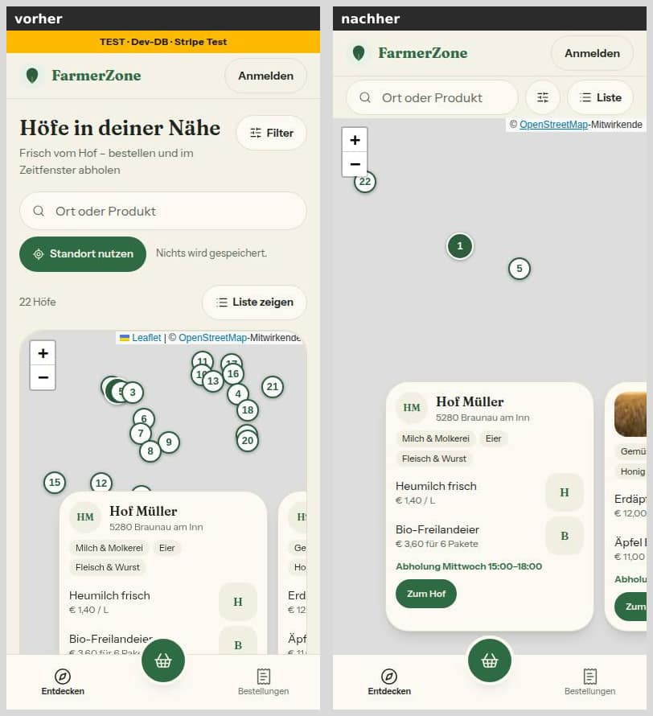
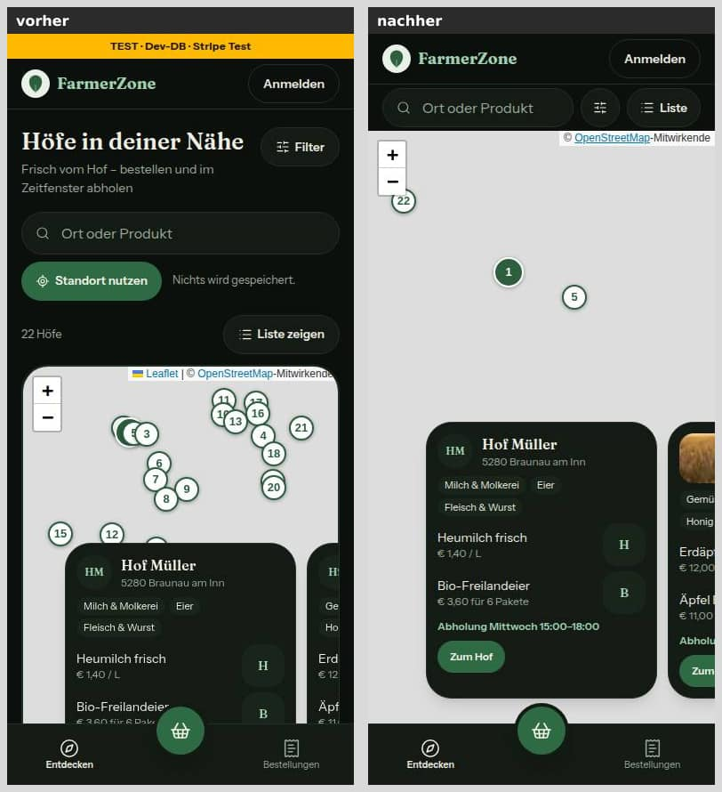

375 × 667:

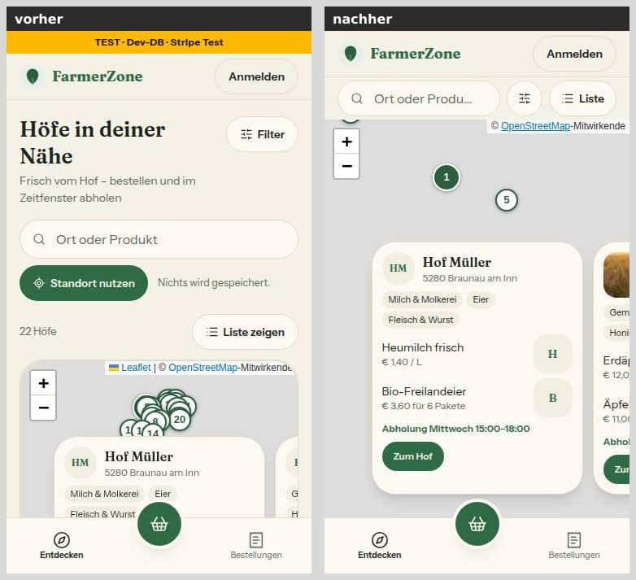
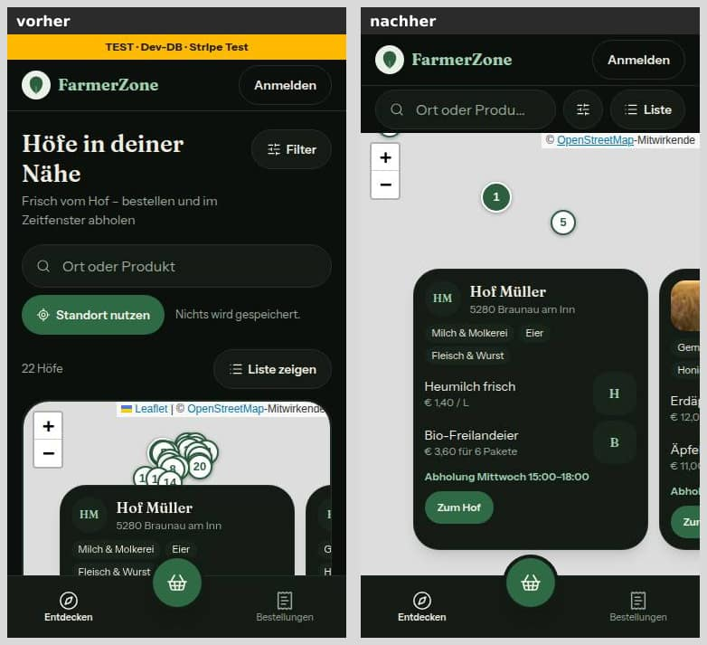

Querformat 844 × 390, Übersicht:

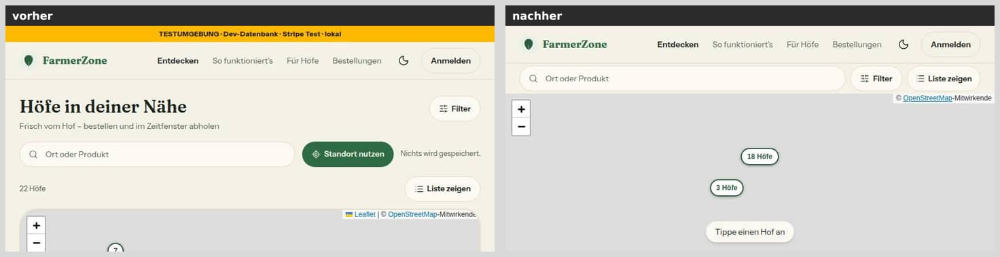

Splitscreen 1440 px (Liste gescrollt, Karte klebt; seit Runde 1 wieder mit Rahmen):

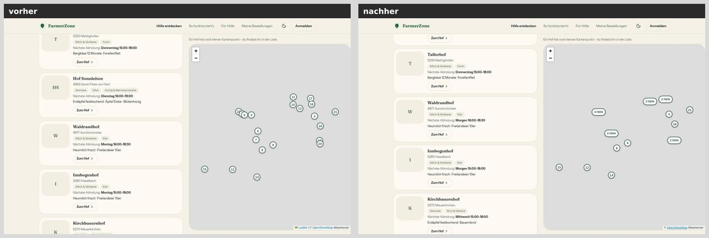
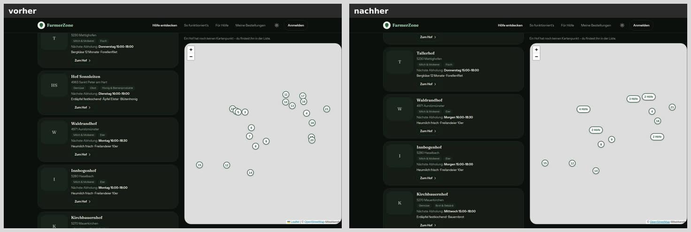

Ladezustand beim Öffnen der Karte (390 px; Nachladen im Browser zurückgehalten):

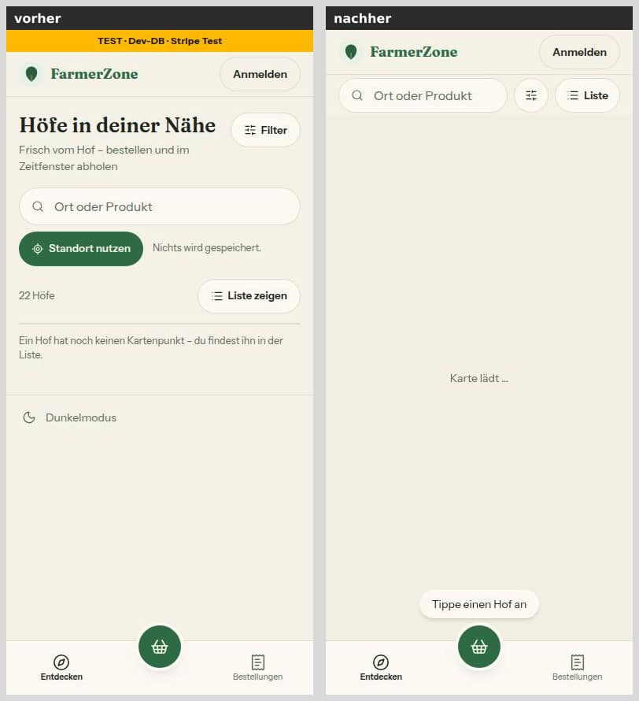

Standortkarte im Hof-Profil (Attribution ohne „Leaflet"):

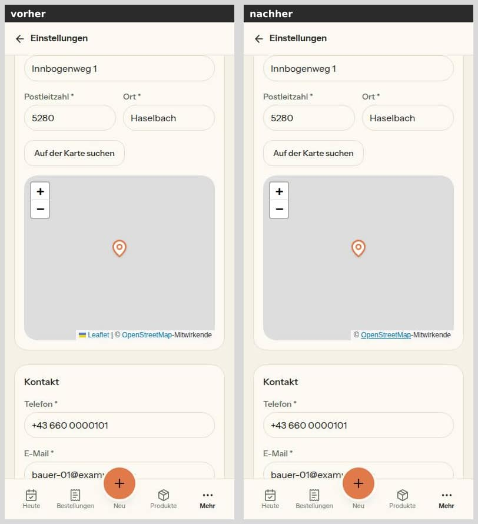
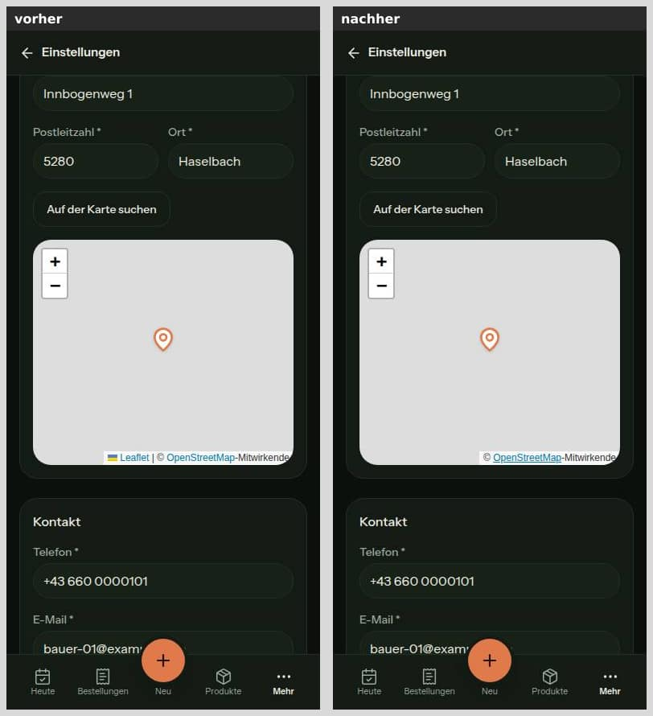
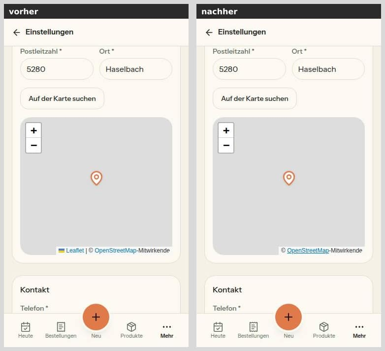
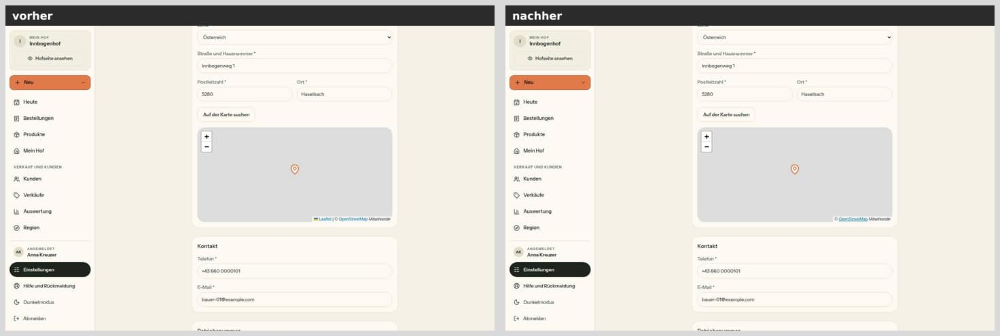
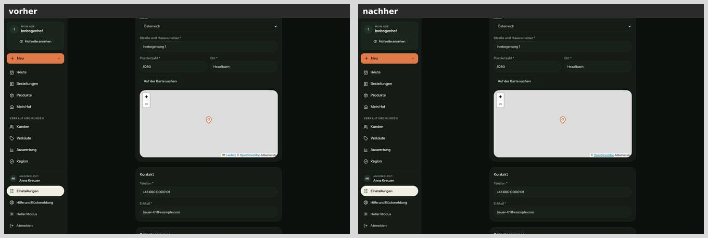

Bei 375 px nur hell, weil die Standortkarte dort wie bei 390 aussieht.

## Mockup-Abweichungen — bitte freigeben (mit Bild)

Der Kartenmodus hat kein Mockup (§13: „→ DESIGN_SYSTEM"); die Regeln stehen jetzt in `docs/ai/DESIGN_SYSTEM.md`, „Entdecken" und „Karten (Leaflet)". Freizugeben sind die Teile, die die Mockups `mobil-k1-entdecken` und `web-k1-entdecken-einstieg` nicht zeigen:

1. **Kartenmodus am Handy:** eine Werkzeugzeile, die Karte randlos bis zur Unterleiste, kein Titel. Bild: `karte-390-hell.jpg`.
2. **Gruppen-Pins** „n Höfe" als Pille in den Pin-Farben, in der Übersicht und im Splitscreen. Bilder: `karte-quer-844-hell.jpg` und `karte-1440-hell.jpg`.
3. **Kompakte Karussell-Karte** in niedrigen Fenstern (ohne Kategorien und Produktzeilen). Bilder (Runde 1): `karte-quer-844-gewaehlt-hell.jpg` und `karte-quer-844-gewaehlt-dunkel.jpg`.
4. ~~Splitscreen randlos~~ — in Runde 1 zurückgenommen, die Karte hat wieder ihren Rahmen (`karte-1440-hell.jpg`).

**Zur Freigabe (Stand, keine Regel):**

5. **„Standort nutzen" nur in der Liste:** Im Kartenmodus fehlen der Knopf samt „Nichts wird gespeichert." und die Karte „Wir zeigen Höfe rund um …". Den Bezugspunkt zeigt der Kartenmodus seit Runde 1 als Eintrag „Rund um …" unter „Aktive Filter", entfernbar wie der Umkreis. Bild: `ort-390-hell.jpg`.
6. **Vorschlagsliste über der Karte** im Kartenmodus, der getippte Text ohne Eintrag „Suche: …". Bild: `suche-390-hell.jpg`.

## Wie der Mensch es testet

1. Vorschau-Deployment am Handy (oder Browser 390 × 844): `/hoefe` → „Karte öffnen".
   - Erwartung: Oben steht eine Zeile Suche · Filter · Liste, kein Titel. Darunter „Karte lädt …" in voller Größe, dann die Karte, die genau an der Unterleiste endet.
   - Die Seite springt nicht. „Tippe einen Hof an" liegt über dem Warenkorb-Knopf.
2. Einen Gruppen-Pin „n Höfe" antippen.
   - Erwartung: Die Karte zoomt hinein, bis die Gruppe in Pins oder kleinere Gruppen zerfällt.
   - Danach einen Pin antippen: Die Karussell-Karte erscheint über der Unterleiste, der Pin steht sichtbar darüber.
3. Handy quer drehen.
   - Erwartung: Die Karte füllt mindestens 70 % der Höhe und passt die Übersicht neu ein, solange man nicht selbst gezoomt oder verschoben hat.
   - Mit gewähltem Hof ist die Karussell-Karte kompakt.
4. Im Browser bei 1440 px `/hoefe` öffnen und das Fenster auf 1100 px verkleinern.
   - Erwartung: Alle Höfe bleiben im Kartenausschnitt.
   - Nach einem Zoom mit „+" bleibt der Ausschnitt beim Verkleinern stehen.
5. Als Hof anmelden → Einstellungen → Hofdaten.
   - Erwartung: Kurz „Karte lädt …" in Kartengröße, die Attribution ohne „Leaflet".
   - Das Fenster schmaler ziehen oder das Handy drehen: Der Pin bleibt auf demselben Punkt, das Formular meldet keine Änderung.
6. Region → Preise vergleichen → Karte: Attribution ohne Präfix, Gruppen-Pins. Ohne gewählten Hof füllt der Umkreis die Karte.
7. (Runde 1) Im Kartenmodus „Ei" ins Suchfeld tippen.
   - Erwartung: Die Vorschläge legen sich über die Karte, die Karte behält ihre Höhe, es erscheint keine zweite Zeile.
8. (Runde 1) In der Liste „Standort nutzen", dann „Karte öffnen".
   - Erwartung: Unter der Werkzeugzeile steht „Aktive Filter: Rund um deinen Standort ×". Ein Tipp auf den Eintrag hebt den Bezugspunkt auf, die Zeile verschwindet.
9. (Runde 1) Handy quer unter 768 px Breite (z. B. 740 × 360).
   - Erwartung: Karte, Karussell und „Tippe einen Hof an" enden über der Unterleiste; die Karte hat dort nur rund die Hälfte der Höhe (siehe Nachbesserung).

## Angepasste `.md`

- `docs/ai/DESIGN_SYSTEM.md`: Kartenmodus am Handy (Entdecken), neuer Abschnitt „Karten (Leaflet)", Maße der KundeShell; in Runde 1 nachgezogen (Trefferfläche, Querformat, Stand zur Freigabe, eine Quelle ehrlich).
- `docs/ai/CODING_STANDARDS.md`: §7, Gruppen-Pins folgen dem Dunkelmodus nicht.
- `DEVELOPMENT.md`: Eintrag Nr. 52, dazu „Nachbesserung Runde 1".
- `docs/nachtlauf/berichte/52.md`: dieser Bericht.

## Checkliste §3 (freigabe.md §13)

- [x] Register und Freigabe decken den Inhalt ab (§13 „52"; O6 nur als Vorschlag)
- [x] origin/main vor dem Push hineingeholt (Basis 90cff24; Push und PR macht der Dirigent)
- [x] pnpm typecheck, pnpm lint (kein neuer Befund), pnpm test grün
- [x] pnpm test:integration grün, wenn Datenbank oder Geld berührt — nicht berührt
- [x] Migration: nein
- [x] Geld nur als Int-Cent bzw. Decimal, Beträge nur serverseitig — keine Beträge berührt
- [x] Keine Personendaten oder Secrets in Code, Logs, Tests (Bilder nur mit erfundenen Seed-Daten)
- [x] Bilder 390, 375 und 1440 px vorher/nachher, beide Themes, im Bericht (375 bei der Standortkarte nur hell)
- [x] Axe ohne Fehler, Touch-Ziele ≥ 44 px, neue Seiten mit loading.tsx (keine neue Seite)
- [x] Texte aus einer Quelle, Deutsch, per Du
- [x] tester und pruefer gelaufen, Befunde erledigt oder begründet — tester grün (Unit 313/6182, Integration 40/350, Lint 13/7, Kachel-Adresse textgleich); pruefer ohne Blocker, vier „Sollte“ und alle Hinweise in Runde 1 erledigt (fc5aaae, a0bdf38), Punkt 7 (BottomNav) ehrlich dokumentiert statt umgestellt; danach selbst wiederholt: Typecheck grün, `pnpm test` 313/6198 (fünf Zeitüberschreitungen unter Last einzeln grün, `keine-emojis` mit längerer Zeitgrenze)
- [x] Entwurf, wenn eine Vorbedingung offen ist — keine offen

## Nachbesserung Runde 1

Befunde des Prüfers (vier „Sollte", neun Hinweise), alle in Commit fc5aaae (auf d64b53a). Gemessen wie in Runde 0 mit eigenem Server und agent-browser, ohne Kacheln; „vorher" ist 90cff24 (in dieser Runde erneut aufgesetzt, für die neuen Bildpaare und die Seitenhöhe bei 375 und 360).

**Die Punkte, je ein Satz:**

1. **Vorschlagsliste im Kartenmodus:** Sie liegt jetzt über der Karte (`absolute`, `z-[1000]` über der `isolate`-Ebene, unten bis über die Unterleiste, der Rest scrollt). Beim Nachmessen fiel auf: Das erste Zeichen ließ zusätzlich die Zeile „Aktive Filter" mit „Suche: …" erscheinen (844 × 390: Karte 273 → 221 px). Im Kartenmodus wird der getippte Text deshalb kein Eintrag mehr (`suchtextImFeld`, er steht im Feld; Such-Marken bleiben Einträge). Die Karte behält beim Tippen ihre Höhe (Tabelle).
2. **Mindesthöhe:** `min-h-[280px]` gilt erst ab md. Unter 768 px quer sind 70 % mit Kopf (57 px), Werkzeugzeile (52 px) und Unterleiste (69 px) nicht erreichbar — 740 × 360 ergibt 182 px (50,6 %), 667 × 375 197 px (52,5 %); so steht es jetzt in DESIGN_SYSTEM und oben unter „nicht gelöst".
3. **Ein Hof allein:** Neue Tests: `gruppierePins([BASIS], 12)` und bei maximaler Zoomstufe (auch darüber) ergeben genau einen Pin an seiner eigenen Stelle, ohne Auffächer-Versatz.
4. **Bild der kompakten Karussell-Karte:** gewählter Hof bei 844 × 390, hell und dunkel (unten).
5. **Zoomstufe:** Gruppiert wird für `map.getZoom()`; statt der gemerkten Stufe zählt ein Zähler jedes `zoomend` — so wird auch neu gruppiert, wenn ein Flug auf der Ausgangsstufe endet (unterwegs kann der Effekt den Zwischen-Zoom gelesen haben).
6. **Schwelle = Trefferfläche:** Eine Konstante für beides (`TREFFERFLAECHE` = 44, `trefferMasse` in `src/lib/hoefe-anzeige.ts`; die Karte nimmt sie von dort). Die Flächen sind rund wie das Bild (`rounded-full` an Leaflets Element und an der Fläche); geprüft wird als Strecke mit Radius, damit schräge Nachbarn, deren Kreise sich nicht berühren, nicht gruppieren. Tests angepasst: Grenze 44 px, 40 px ist jetzt eine Gruppe, schräg 32/32 zwei Pins und 31/31 eine Gruppe, breite Gruppe bei 48 px, Aufzoomen 13/16, Anfahren 16.
7. **„EINE Quelle":** Die Unterleiste liest weiter nicht aus der Datei — sie gehört auch der HofShell, und an der Hof-Leiste arbeitet parallel Nr. 49; eine gemeinsame Variable hätte beide Welten berührt. Die Doku sagt es jetzt ehrlich: eine Quelle für die Karte, die Unterleiste trägt ihre Zahlen selbst und ist durch die Wache gekoppelt, `main pb-28` ist die Luft unter dem Inhalt.
8. **Datei verlegt:** `src/lib/kunde-shell-masse.ts`; die Ausnahme in `tests/shells.test.ts` ist entfernt (die Datei entspricht main).
9. **Wortlaut korrigiert:** Das Rollen beim Öffnen wirkt auch in der Produktion, aus einer gescrollten Liste (Annahmen oben).
10. **Mit gesetzten Filtern:** Die zweite Zeile kostet die Karte 52 px — 844 × 390 mit einem Filter 221 px (56,7 %), 390 × 844 614 px (72,7 %); steht in Bericht und DESIGN_SYSTEM.
11. **„Standort nutzen":** In DESIGN_SYSTEM als Stand zur Freigabe, nicht als Regel (oben „Zur Freigabe" 5). Der Bezugspunkt bleibt im Kartenmodus sichtbar und entfernbar: als Eintrag „Rund um …" in der vorhandenen Zeile „Aktive Filter" — ein Knopf wie der Umkreis, ohne neuen Baustein; „Alle zurücksetzen" nimmt ihn mit.
12. **Splitscreen:** randlos zurückgenommen — §13 verlangt es nicht, es war keine zwingende Folge; die Karte hat wieder ihren eigenen Rahmen, randlos bleibt sie nur im Kartenmodus am Handy.
13. **Casts:** `gruppierePins` führt je Haufen die Summe der Pixel mit, ein Nachschlagen samt `as` entfällt; der Test des Filterknopfs übergibt typisierte Eigenschaften mit `children: null` statt `as unknown as ComponentType`.

**Zusätzlich beim Nachmessen gefunden und behoben:** Der Hinweis „Tippe einen Hof an" deckte im Querformat Pins zu (844 × 390: die Pins 12 und 14; 740 × 360: eine Gruppe). Ohne Auswahl hält die Übersicht ihn jetzt frei (`polsterOhneAuswahl`, die Seite misst ihn am Kasten der Karte). Preis: Im Querformat zeigt die Übersicht eine Zoomstufe weiter draußen — 844 × 390 zwei Gruppen statt acht Marken, 740 × 360 und 667 × 375 eine Gruppe „21 Höfe". Für Zoomstufe 9 bräuchte die Übersicht dort rund 190 px Höhe, mit dem Hinweis bleiben 154 px — mit ganzen Zoomstufen geht nur eins von beiden. Im Hochformat bleibt es bei acht Marken, keine unter dem Hinweis.

**Messwerte**

| Messung | vorher (90cff24) | Runde 0 | Runde 1 |
|---|---|---|---|
| 390 × 844: Unterkante Karussell-Karte / Hinweis (Leiste ab 775) | 866,9 / 862,9 px | 747 / 747 px | 747 / 747 px |
| 375 × 667 (Leiste ab 598) | 793,2 / 789,2 px | 570 / 570 px | 570 / 570 px |
| 360 × 740 (Leiste ab 671) | 837 / 833 px | 643 / 643 px | 643 / 643 px |
| 844 × 390: sichtbare Karte | 72,5 px = 18,6 % | 273 px = 70,0 % | 273 px = 70,0 %; mit einem Filter 221 px = 56,7 % |
| 844 × 390, Hof gewählt: Karussell-Karte; Pin darüber | unter dem Fensterrand | 246–378 px; ja | 230–378 px; ja (Pin-Unterkante 186) |
| 740 × 360: Karte; Karussell / Hinweis (Leiste ab 291) | Karte verdeckt (0 px); 922,5 / 603,5 px | laut Prüfer rund 18 px unter der Leiste | 182 px = 50,6 %; 263 / 263 px |
| 667 × 375 (Leiste ab 306) | 5,5 px = 1,5 %; 922,5 / 603,5 px | wie oben | 197 px = 52,5 %; 278 / 278 px |
| 740 × 360 bzw. 667 × 375, Hof gewählt: Platz über der Karussell-Karte | — | — | 6 bzw. 21 px (Pin teils verdeckt) |
| Kartenhöhe vor → nach dem Tippen: 844 × 390 / 390 × 844 / 740 × 360 | — (Liste im Fluss, Karte darunter) | nicht gemessen; Zwischenstand mit der Liste schon über der Karte: 273 → 221 / 666 → 614 px (allein durch die Zeile „Suche: …") | 273 → 273 / 666 → 666 / 182 → 182 px |
| Vorschlagsliste: Unterkante gegen Leiste bzw. Fensterrand; scrollt | im Fluss | im Fluss | 380/390, 385/775, 281/291 px; scrollt quer |
| Seitenhöhe nach dem Tipp → Karte geladen: 390 / 375 / 360 | 872 → 1138 / 695 → 1065 / 768 → 1109 px | 1038 → 1038 / 861 → 861 / 934 → 934 px | 1038 → 1038 / 861 → 861 / 934 → 934 px |
| Überdeckte Pin-Bilder in der Übersicht: 390 / 375 / 360 / 844 / 1440 / 1100 | 18 / 114 / 46 / — / 5 / 18 | 0 / 0 / 0 / — / 0 / 0 | 0 / 0 / 0 / 0 / 0 / 0 |
| Überdeckte Trefferflächen, dieselben Größen | — | nicht gemessen | 0 überall |
| Ecken-Probe (2 px in der Ecke des Kastens einer Marke) | — | nicht gemessen | trifft keine Marke (0 von 8 bzw. 13) |
| Marken in der Übersicht: 390 / 844 × 390 / 740 × 360 / 1440 / 1100 | 21 Pins | 8 / 8 / — / 14 / 8 | 8 / 2 / 1 / 13 / 8 |
| Pins unter dem Hinweis: 844 × 390 / 740 × 360 | — | 2 / 1 Gruppe | 0 / 0 |
| 1440 ↔ 1100: Höfe im Kartenausschnitt (Karte im Blick) | 19 von 21 | 21 von 21 | 21 von 21 in beiden Richtungen |
| 1440, nach „+": erste Marke nach 1100 und zurück | — | bleibt | bleibt (842,603 → 842,603) |

Axe: 0 Verstöße auf /hoefe im Kartenmodus (390, hell und dunkel), mit offener Vorschlagsliste, mit dem Eintrag „Rund um …" und im Splitscreen (1440); offen nur Leaflets Zoom-Knopf „−" bzw. während des Tippens die Attribution unter der Liste (Farbe nicht bestimmbar). Trefferflächen: der Eintrag „Rund um …" 199 × 36 px plus 4 px oben und unten (44 px wie die übrigen Einträge), jede Marke mindestens 44 px, rund. Die Standortkarte ist in dieser Runde unverändert und nicht neu gemessen.

**Bilder (Runde 1)**

Gewählter Hof im Querformat 844 × 390 — die kompakte Karussell-Karte (Abweichung 3). Im Vorher-Bild lädt das Foto der zweiten Karte noch nicht; daran ändert diese Nummer nichts:

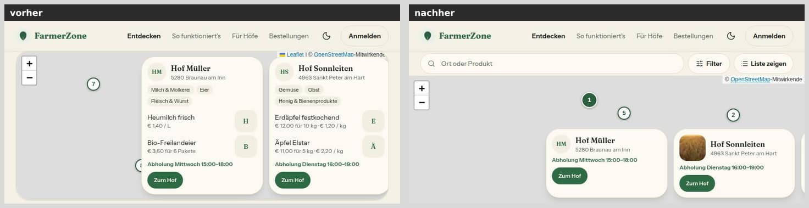
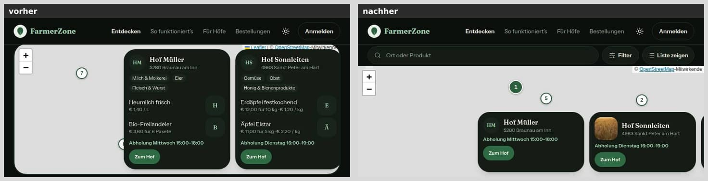

Querformat unter 768 px (740 × 360): Die Karte endet über der Unterleiste, hat aber nur rund die Hälfte der Höhe:

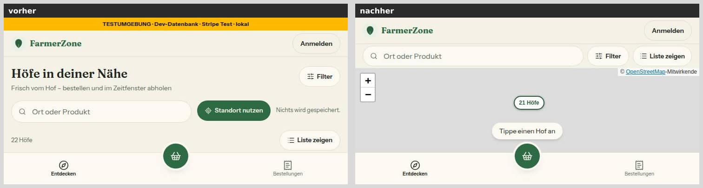

Tippen im Kartenmodus (390 px): Die Vorschläge liegen über der Karte, die Karte behält ihre Höhe:

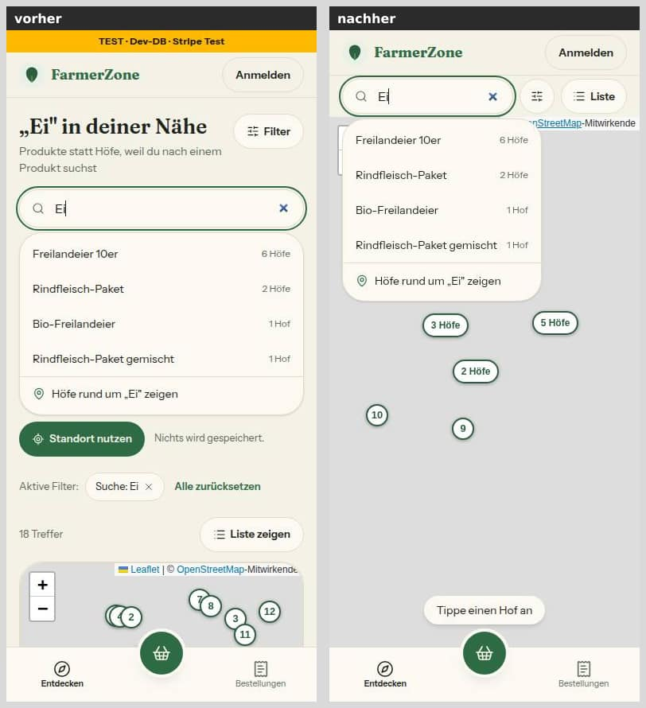

Bezugspunkt im Kartenmodus (390 px): vorher stand über der Karte die Karte „Wir zeigen Höfe rund um …" samt „Ort ändern", nachher der Eintrag „Rund um deinen Standort" unter „Aktive Filter" (zur Freigabe 5):

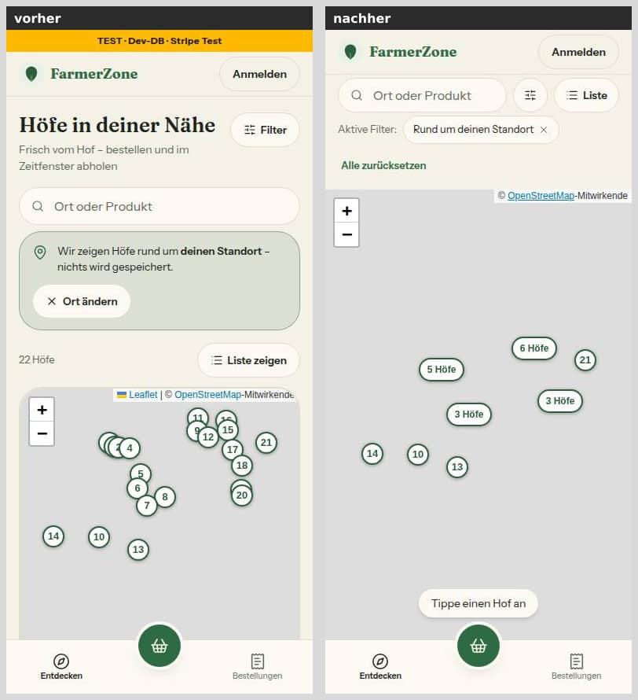

Neu aufgenommen (Stand Runde 1) sind außerdem `karte-390-*`, `karte-375-*`, `karte-quer-844-hell` (Übersicht mit zwei Gruppen, nichts unter dem Hinweis) und `karte-1440-*` (Splitscreen wieder mit Rahmen) — eingebunden oben unter „Bilder". Insgesamt 18 Bildpaare, 0,72 MB.

**Tests und Prüfungen (Runde 1):** `pnpm typecheck` 0; `pnpm lint` 13 Fehler / 7 Warnungen = Grundlinie, keiner in den Dateien dieser Nummer; `pnpm test` 313 Dateien / 6198 Tests grün (Runde 0: 6182); Integrationstests nicht nötig (keine Datenbank, kein Geld). Neu bzw. angepasst: `tests/hoefe-anzeige.test.ts` (Trefferfläche, ein Hof allein, Grenzen 44 px), `tests/hoefe-seite.test.ts` (Liste über der Karte, „Rund um …", kein „Suche: …" im Kartenmodus, Splitscreen mit Rahmen, Filterknopf ohne Cast), `tests/hoefe-entdecken.test.ts` (Bezugspunkt in `aktiveFilter`), `tests/karte-wache.test.ts` (Zoomstufe, eine Trefferfläche, rund), `tests/kunde-shell-masse.test.ts` (Pfad, Mindesthöhe erst ab md), `tests/shells.test.ts` (wieder wie main).
