# Bericht Nr. 55 — Testzahlungen aus Auswertungen (Z4; Geld-Anzeige, Nachprüfung)

Branch `nacht/2026-10-10/55-testzahlungen`, Basis `origin/main` 90cff24. Auftrag freigabe.md §13 „55“, Register Z4 (dazu Z1, Z2, F6, B1, E4, G1). **Keine Migration.**

## In einem Satz

Eine Online-Bestellung, die vor dem Zeitpunkt in der Server-Variable `STRIPE_LIVE_AB` angelegt wurde, zählt in Auswertung, Verkäufen, Heute, Kunden, Admin-Finanzen und Admin-Hofliste nicht mehr als Umsatz und nicht als Servicegebühr. Bar und Karte beim Hof zählen immer, und ohne Variable bleibt alles wie heute.

## Was geändert wurde (je Datei ein Satz)

**Die eine Regel und die Variable**
- `src/lib/testzahlung.ts` (neu): die Regel in drei Formen: `istTestzahlung`, `testzahlungWhere`/`ohneTestzahlungenWhere` (Prisma; ohne Stichtag ein leeres Objekt) und `ohneTestzahlungenSql(Prisma.sql, ab)` (gebundener Parameter, ohne Stichtag `TRUE`), dazu der Satz `testzahlungenHinweis`.
- `src/lib/umgebung.ts`: `leseStripeLiveAb` lässt nur einen ISO-Zeitpunkt mit Zeitzone gelten und prüft die Teile selbst (30. Februar wird abgelehnt, nicht umgerechnet). Ungültig oder ohne Zone gilt der Wert nicht und landet als Warnung in `UMGEBUNG.warnungen`, `Umgebung.stripeLiveAb` ist neu. Seit Runde 1: Versatz nur −12:00 bis +14:00, dazu `stichtagWeitInDerZukunft` (mehr als 24 Stunden voraus).
- `src/lib/umgebung-server.ts`: die eine Stelle, die `env.STRIPE_LIVE_AB` liest (`STRIPE_LIVE_AB`). Die Sentry-Warnung geht über das bestehende `meldeUmgebungsWarnungen`, höchstens einmal je Instanz; seit Runde 1 meldet es dort auch einen Stichtag mehr als 24 Stunden in der Zukunft (ohne den Wert).
- `src/lib/env.ts`: `STRIPE_LIVE_AB` als optionale Variable ohne Formprüfung, damit ein Tippfehler nie den Start verhindert.

**Wo die Regel gilt**
- `src/lib/umsatz.ts`: `umsatzBestellungWhere` bekommt den Stichtag als Pflichtparameter und mischt `ohneTestzahlungenWhere` ein (seit Runde 1 als `AND`). Das gilt für Auswertung, Verkäufe samt Jahressumme und Heute. Neu in Runde 1: `umsatzTestzahlungenWhere`, dieselbe Form für die Hinweiszeile.
- `src/lib/finanzen.ts`: `topfVonBestellung` legt Testzahlungen in „keiner“, `einnahmenImMonat` reicht den Stichtag durch. Neu ist `testzahlungenBetroffen` für die Zeile der Finanzseite (seit Runde 1 mit den gezeigten Töpfen als Parameter).
- `src/lib/auswertung.ts`: `servicegebuehrenImMonat` bekommt den Stichtag. Neu ist `auswertungSummen` (Runde 1, ersetzt `auswertungZeigtAb`): die Summen der Seite, also Balken samt Vorperiode, das Wiener Jahr und der Monat der Servicegebühren.
- `src/lib/hof-kunden.ts`: `KundenBestellung` trägt `paymentMethod`, und `fasseKundinZusammen` nimmt Testzahlungen nur aus dem Umsatz heraus.
- `src/lib/hof-verkaeufe.ts`: Neu ist `verkaeufeSummen` (Runde 1, ersetzt `verkaeufeZeigenAb`): Woche und Wiener Jahr.
- `src/server/queries/admin.ts`: `monatsSpaltenJeHof` nimmt den SQL-Baustein in die WHERE-Klausel, `getAdminFarms(jetzt, stripeLiveAb = STRIPE_LIVE_AB)`.
- `src/server/queries/finanzen.ts`: `getFinanzen` zählt mit dem Stichtag und liefert `testzahlungenHinweis`.
- `src/server/queries/umsatz.ts`, `analytics.ts`, `auswertung.ts`, `heute.ts`: Der Stichtag geht als Parameter (Standard `STRIPE_LIVE_AB`) bis in `umsatzBestellungWhere` bzw. `servicegebuehrenImMonat`.
- `src/server/queries/manual-sales.ts`: Woche, Jahressumme und Schnellwahl laufen ohne Testzahlungen, `SalesOverview.testzahlungenHinweis` ist neu.
- `src/server/queries/customers.ts`: Liste und Detail laden `paymentMethod` mit und geben den Stichtag weiter.
- `src/server/queries/testzahlungen.ts` (neu): `testzahlungenHinweisFuerHof` liefert die Zeile genau dann, wenn eine gezeigte Zahl eine Testzahlung auslässt (Runde 1): je Umsatzfenster `umsatzTestzahlungenWhere`, auf der Auswertung dazu der Gebührenmonat über `testzahlungenBetroffen`.
- `src/server/queries/dashboard.ts`: `getDashboardStats` gelöscht (seit Heute ungenutzt), `getFarmForUser` bleibt.
- `src/lib/erste-schritte.ts`: Ein veralteter Kommentar über `getDashboardStats` ist weg.

**Oberfläche**
- `src/app/(hof)/analytics/page.tsx`: lädt die Zeile in `ladeAuswertung` und zeigt sie leise im Kopf. Die Kopf-Vorlage steht jetzt nach dem Laden, außerhalb des `try`.
- `src/components/hof-verkaeufe/verkaeufe-ansicht.tsx`: die Zeile unter „Was du diese Woche eingenommen hast“.
- `src/app/admin/finanzen/page.tsx`: die Zeile unter dem Titel „Finanzen“.

**Tests**
- `tests/testzahlung.test.ts` (neu): die drei Formen an der Grenze (genau, ±1 ms), bar und Karte immer, ohne Stichtag nie; der Satz in Wiener Zeit.
- `tests/testzahlung-wache.test.ts` (neu): Quelltext-Wache mit dem TypeScript-Parser, wie bei `optInEmail`, mit Gegenproben je Suche. Sie meldet:
  - die Variable, wenn sie außerhalb von `umgebung-server.ts` gelesen wird;
  - einen Import des Stichtags außerhalb von `src/server`;
  - eine zweite Fassung der Regel: Vergleich, `lt`/`gte`, Vorlage/SQL, Umbenennung, eigener Prisma-Filter oder eigenes SQL;
  - `null` statt Stichtag;
  - ein zurückgekehrtes `getDashboardStats`;
  - seit Runde 1 auch `UMGEBUNG.stripeLiveAb` außerhalb von `src/server` und ein eigenes `AND` neben der gespreizten Regel. Der Kopf nennt die Grenzen.
- `tests/stripe-live-ab.test.ts` (neu): Das Modul wird frisch geladen. Ein gültiger Wert wird zum Stichtag, ein ungültiger gilt nicht und meldet sich genau einmal an Sentry, ohne den Wert zu nennen. Seit Runde 1 auch der Stichtag in der Zukunft (Grenze 24 Stunden).
- `tests/testzahlungen-hinweis.test.ts` (neu): Auswertung und Admin-Finanzen werden echt gerendert. Die Zeile steht nur im Kopf und nur, wenn der Server sie schickt.
- `tests/integration/testzahlungen.int.test.ts` (neu), gegen echtes Postgres:
  - Die drei Formen wählen dieselben Bestellungen.
  - /admin und /admin/finanzen zählen mit und ohne Stichtag gleich, bar und Karte zählen immer.
  - Umsatz von Verkäufen (Woche, Jahr), Kennzahlen, Heute und Kundin ist mit Stichtag ohne die Testzahlung und ohne Stichtag wie vorher.
  - Die Hinweiszeile kommt genau dann, wenn eine gezählte Zahl betroffen ist (Runde 1: offene Testzahlung → keine Zeile, abgeholte → Zeile).
- `tests/umgebung.test.ts`: Fälle für `leseStripeLiveAb` (Zone, ohne Zone, unmögliche Werte, Schalttag, seit Runde 1 −12:00/+14:00) und die Warnung in jeder Umgebung; `stichtagWeitInDerZukunft` an der Grenze.
- `tests/umsatz.test.ts`: `umsatzBestellungWhere` ist ohne Stichtag Zeichen für Zeichen die alte Bedingung, mit Stichtag kommt nur `AND: [{ NOT: … }]` dazu; ein eigenes `NOT` des Aufrufers bleibt erhalten (Runde 1).
- `tests/finanzen.test.ts`:
  - Topf und Monatssumme mit Stichtag; bar und Karte zählen immer.
  - `testzahlungenBetroffen`.
  - Ohne Stichtag ist das Ergebnis gleich einem Stichtag vor allen Bestellungen.
- `tests/auswertung.test.ts`: Servicegebühren mit Stichtag, Hof und Betreiber gleich; `auswertungSummen` (Runde 1, mit der Lücke bei einem älteren Jahr).
- `tests/hof-kunden.test.ts`: Umsatz ohne Testzahlung, Bestellzahl bleibt, die Zahlart wird mitgeladen.
- `tests/hof-verkaeufe.test.ts`: Zeile im Kopf, Abfrage mit und ohne Stichtag, `verkaeufeSummen` (Runde 1).
- `tests/heute-seite.test.ts`, `tests/bargebuehr.test.ts`: Die bestehenden Aufrufe bekommen `null` als Stichtag, ihre Erwartungen bleiben unverändert. Das belegt „ohne Variable wie heute“.

**Doku**
- `docs/betrieb/stripe-live.md`:
  - Schritt 0: ruhige Stunde auch wegen der Online-Bestellungen.
  - Schritt 4: `STRIPE_LIVE_AB`, nur Production, Wert = Beginn des Redeploys aus Schritt 8, mit Zeitzone, dazu der Hinweis zum Bau-Fenster.
  - Schritt 8: Admin → Finanzen prüfen.
  - §10 heißt „umgesetzt (Nr. 55, Variable statt Konstante)“.
- `.env.example`: `STRIPE_LIVE_AB` mit Erklärung und Beispiel.
- `docs/ai/ARCHITECTURE.md`: neuer Punkt „Testzahlungen zählen nicht“ unter §5 Zahlungen; die Altlast „Wochen in Serverzeit“ ist erledigt; Finanzen-Satz in §4.
- `docs/ai/CODING_STANDARDS.md`: Regel „Umsatz und Servicegebühr ohne Testzahlungen“ unter Geld.
- `docs/ai/TECH_STACK.md`: Der Stichtag wird nur über `@/lib/umgebung-server` gelesen.
- `docs/ai/DESIGN_SYSTEM.md`: die leise Zeile bei Verkäufe, Auswertung und Admin-Finanzen.
- `docs/entwicklung/verkauf-auswertung.md`: Der offene Punkt `getDashboardStats` ist erledigt.
- `DEVELOPMENT.md`: Eintrag Nr. 55 (Fachregel, warum Variable und Zeitzone, was zählt und was bleibt, Bau-Fenster).

## Was nicht gelöst wurde und warum

- **Bestellzahl, Status und Lieblingsprodukte einer Kundin** zählen Testzahlungen weiter. §13 nennt nur „Kunden-Umsätze“, Z4 nur Umsatz und Gebühr. Entscheidung offen, siehe „Zur Freigabe“.
- **„Letzte Verkäufe“ und die letzten Bestellungen einer Kundin** zeigen Testzahlungen weiter. Es sind Listen von Bestellungen, keine Summen, und „Bestellungen … unverändert“.
- **`date-fns`** wird in `src/` nicht mehr importiert. Das Paket bleibt in package.json, weil ein Paket-Eingriff nicht beauftragt ist.
- **`buildLowStockHint` und `countUniqueCustomers`** (`dashboard-hints.ts`) nutzt nur noch ihr eigener Test. Sie sind nicht gelöscht, weil das nicht beauftragt ist.
- **Altlast „online“ in der Admin-Hofliste (Runde 2, zur Kenntnis, nicht geändert):** `monatsSpaltenJeHof` (`src/server/queries/admin.ts`, Spalte „online“) zählt eine online bezahlte Gebühr ohne `status <> 'CANCELLED'`. `topfVonBestellung` schließt stornierte Bestellungen dagegen zuerst aus. Eine stornierte Online-Bestellung mit gescheiterter Erstattung (bleibt PAID, Gebühr nicht als entfallen vermerkt) steht so in `/admin` unter „online“, in `/admin/finanzen` nicht. Testzahlungen betrifft das nicht, die nimmt in beiden die Regel heraus. Das bestand schon vor Nr. 55 und braucht einen eigenen Auftrag.
- **Bau-Fenster:** Online-Bestellungen zwischen Beginn des Redeploys und fertigem Deployment zählen mit, obwohl sie noch Testzahlungen sind. Das ist der Preis eines Zeitpunkts als Stichtag. stripe-live.md sagt, wie man es prüft und bei Bedarf nachstellt.

## Annahmen

- **Zahlart „online“ = `paymentMethod` ONLINE**, wie überall im Code (Kennzahlen, Töpfe). Geprüft sind alle drei Enum-Werte: ONLINE ist Stripe. ONSITE_CASH und ONSITE_CARD („Karte bei Abholung“, seit E5 ohne neue Bestellungen) kassiert der Hof selbst, das Geld ist echt, also zählen beide immer.
- **Grenze:** „vor dem Zeitpunkt“ heißt `createdAt < STRIPE_LIVE_AB`. Genau am Stichtag zählt die Bestellung.
- **Hinweis mit Uhrzeit:** „Testzahlungen vor dem 8. Oktober 2026, 12:00 Uhr sind nicht mitgezählt.“ Der Stichtag ist ein Zeitpunkt, und ohne Uhrzeit wäre der Satz am Tag der Umstellung ungenau. Die Vorlage in §13 sagt „<Datum>“. Soll die Uhrzeit weg, ist das eine Zeile in `testzahlungenHinweis`.
- **„Betrifft sie Bestellungen“** heißt seit Runde 1: Eine gezeigte Zahl lässt eine Testzahlung aus. In Runde 0 reichte eine nicht stornierte Testzahlung ab dem frühesten gezeigten Zeitpunkt.
  - Auswertung: abgeholt in den Balken samt Vorperiode oder im Wiener Jahr (Grenzkarte); oder im Monat der Servicegebühren als „eingezogen“ oder „geschuldet“.
  - Verkäufe: abgeholt in der Woche oder im Wiener Jahr.
  - Admin-Finanzen (seit Runde 2): in den Vormonaten nur „eingezogen“ und „geschuldet“ (Verlauf und Schnitt), im gewählten Monat dazu „erwartet“.
  - So verschwindet die Zeile von selbst, wenn die Testzeit aus allen gezeigten Zeiträumen gefallen ist.
- **Admin-Hofliste:** Die Regel steht in der WHERE-Klausel, damit zählen Testzahlungen in keiner Spalte, auch nicht in „Best./Monat“ und „entfallen“. Das ist dieselbe Wirkung wie in den Finanzen, wo sie im Topf „keiner“ liegen. Entscheidung offen, siehe „Zur Freigabe“.
- **Ungültige Variable** (ohne Zone, unmögliches Datum, anderes Format): Sie meldet sich wie `NEXT_PUBLIC_TESTUMGEBUNG_URL` über `UMGEBUNG.warnungen`. In der Produktion geht das höchstens einmal je Instanz an Sentry, in Vorschau und lokal steht es im roten Banner.
- **Stichtag an die Abfragen:** Er kommt als letzter Parameter mit Standard `STRIPE_LIVE_AB` (wie `jetzt`). Die Seiten selbst kennen ihn nicht, die reinen Funktionen nehmen ihn als Pflichtparameter.
- **SQL-Baustein ohne Prisma-Laufzeit in `src/lib`:** `ohneTestzahlungenSql` bekommt `Prisma.sql` vom Aufrufer. So bleiben `finanzen.ts` und `hof-kunden.ts`, die auch im Browser landen, frei von `@prisma/client` (ARCHITECTURE §1).
- **Bilder:** Zwischen Vorher- und Nachher-Aufnahme wurde die gemeinsame Test-DB neu eingespielt (Integrationslauf). Tagesangaben wie „Gestern“/„Heute“ und die Zahl am Reiter „Bestellungen“ haben sich dadurch verschoben, die Beträge sind dieselben. Alle Unterschiede in den Summen sind genau die Testzahlungen.

## Bilder (vorher/nachher)

Lokal mit Seed-Daten der Test-DB, `STRIPE_LIVE_AB=2026-10-08T12:00:00+02:00` (vorher ignoriert der Basisstand die Variable). Auswertung als `/analytics?periode=jahr`, damit die Jahreszahlen oben stehen. 18 Paare, zusammen 968 KB.

**Auswertung**: Warenumsatz und Bestellungen ohne die Online-Bestellung aus der Testzeit, Zeile unter dem Untertitel.

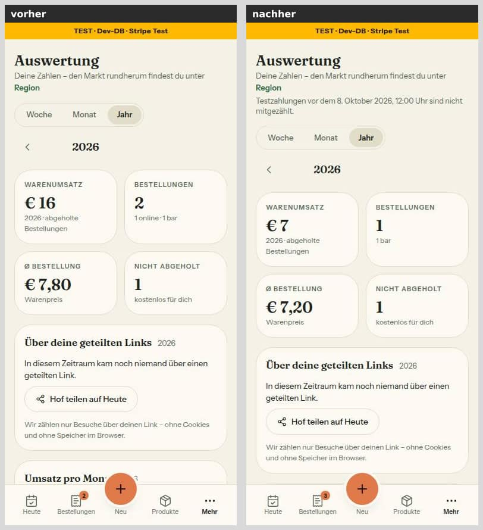
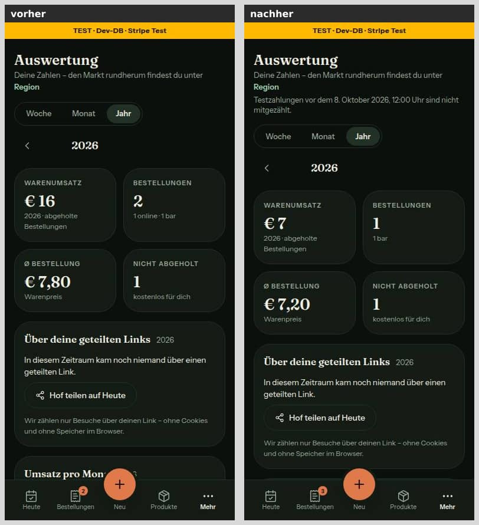
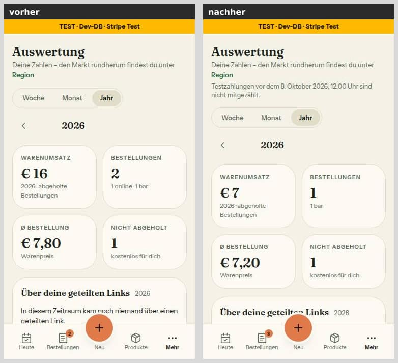
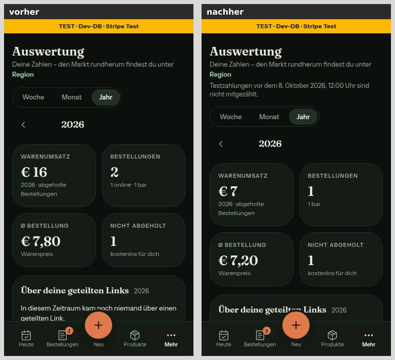
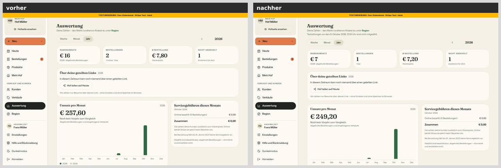
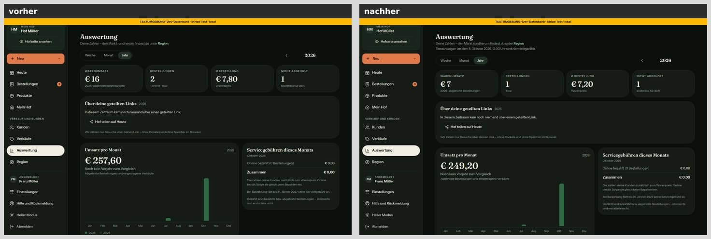

**Verkäufe**: „Dieses Jahr (für die Umsatzgrenze)“ ohne die Testzahlung, Zeile im Kopf.

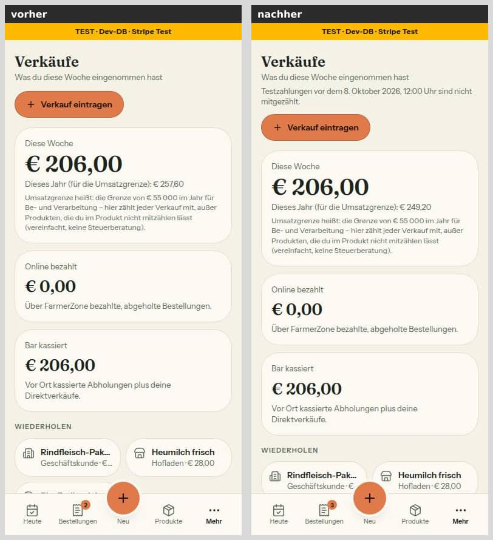
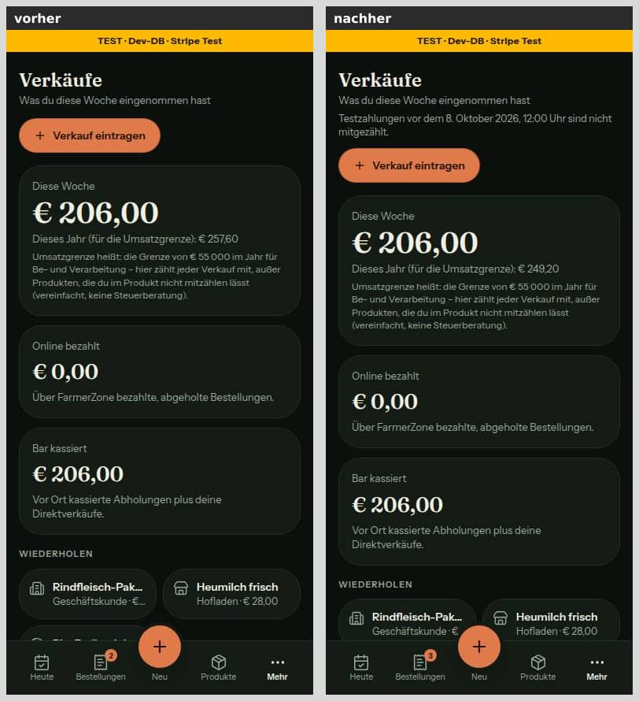
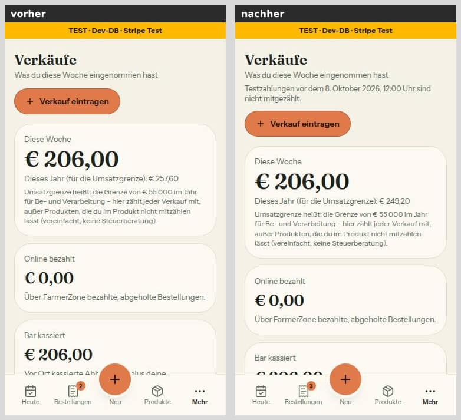
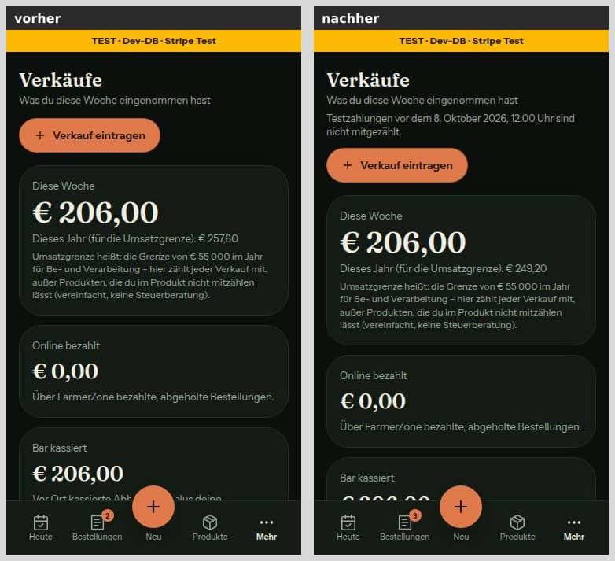
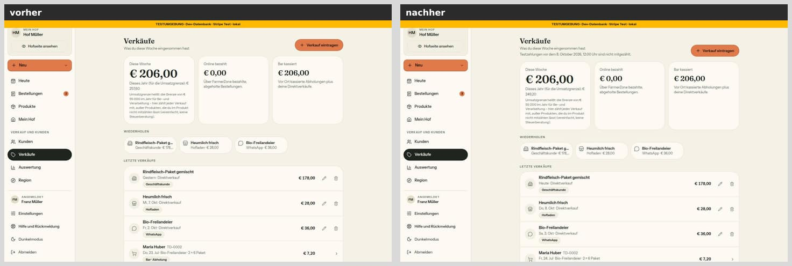
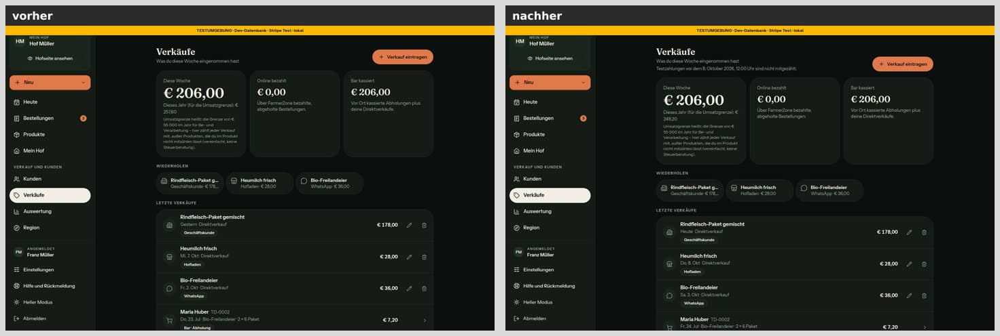

**Admin-Finanzen**: „Servicegebühr, online“ ohne die Bestellung vom 4. Oktober, „Im Oktober 2026 waren es 1“, Zeile unter dem Titel. Die Breite über 390 px ist Altbestand und kommt mit Nr. 54.

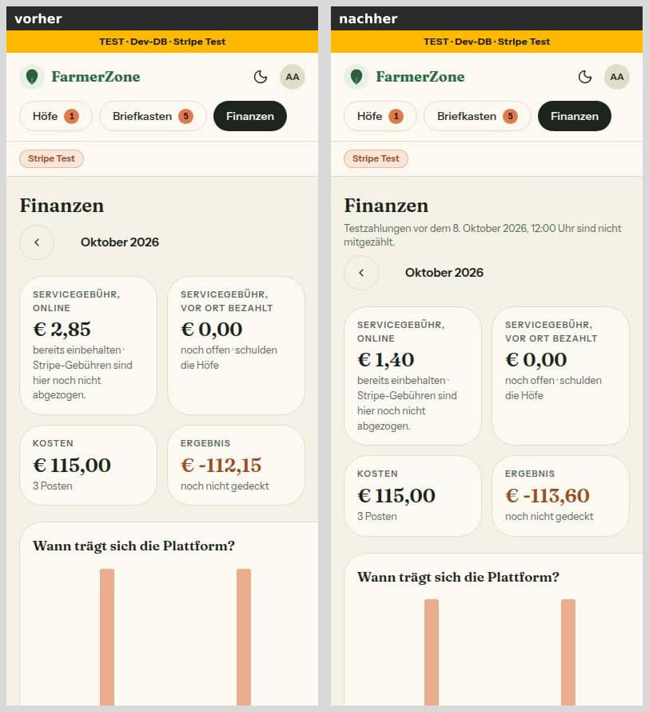
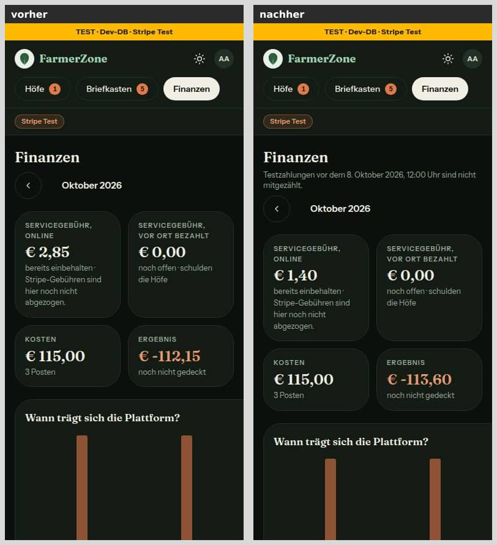
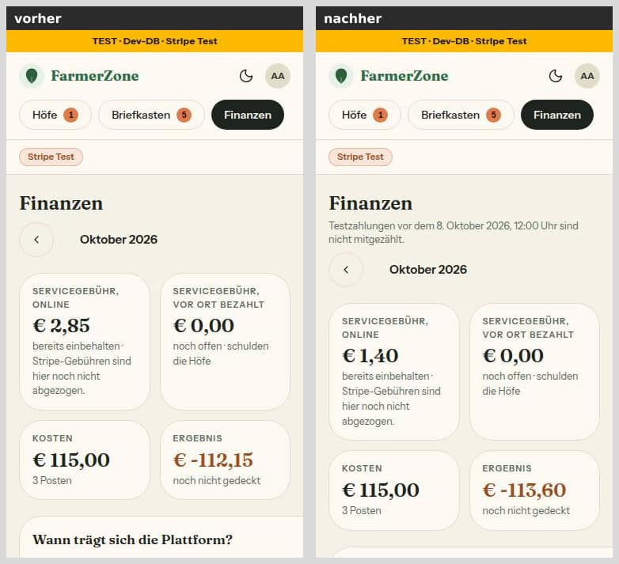
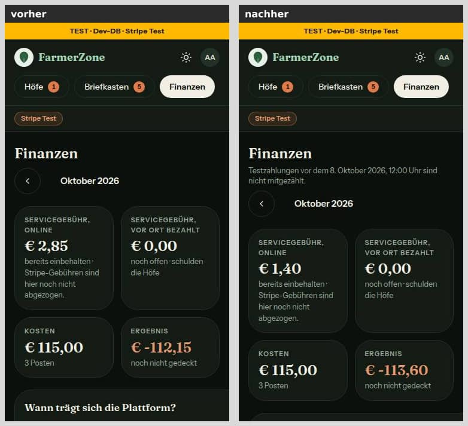
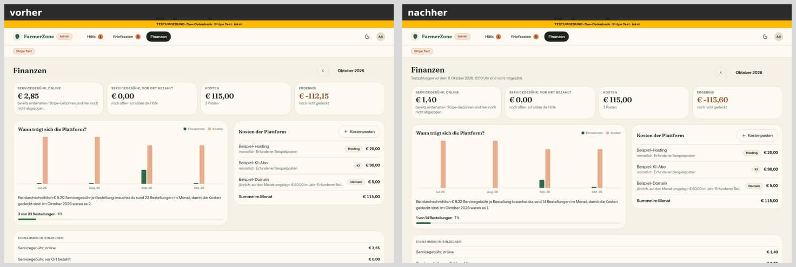
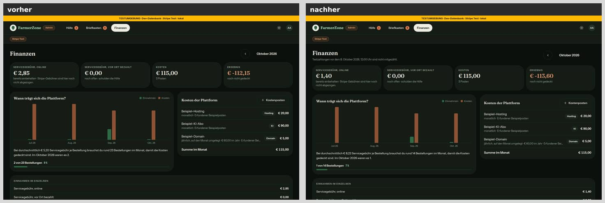

## Mockup-Abweichungen — bitte freigeben

- **Leise Zeile „Testzahlungen vor dem … sind nicht mitgezählt.“** auf Auswertung (Mockup `web-h5-auswertung-abrechnung-teilen-wirkung`, Kopf), Verkäufe (kein Mockup) und Admin-Finanzen (Mockup `admin-finanzen`, unter dem Titel). Die Zeile steht so in §13.
  - Stil: 12,5 px, `text-muted-foreground` (`--fz-text-muted`), kein Symbol, keine Karte.
  - Kontrast 5,05 : 1 hell und 7,71 : 1 dunkel.
  - Sie erscheint nur mit gesetzter Variable und betroffenen Bestellungen.
  - Bilder oben (jeweils „nachher“).

## Zur Freigabe — Entscheidung des Menschen (Runde 1, keine Codeänderung)

Z4 regelt nur **Umsatz und Servicegebühr**. Zwei Stellen gehen heute darüber hinaus bzw. bleiben bewusst dahinter, und sie widersprechen sich bei der Bestellzahl:

- **Admin-Hofliste (`/admin`):** Die Regel steht in der WHERE-Klausel von `monatsSpaltenJeHof`. Eine Testzahlung fehlt deshalb in **allen** Monatsspalten, auch in **„Best./Monat“** (Zahl der Bestellungen) und **„entfallen“** (erstattete Servicegebühr).
- **Kunden (`/customers`):** Nur der Umsatz einer Kundin ist ohne Testzahlungen. **Bestellzahl**, Status und Lieblingsprodukte zählen sie weiter.

Zur Wahl:
- **A — so lassen:** Der Admin sieht nur echte Bestellungen, der Hof sieht bei den Kunden alle Bestellungen wie in seiner Bestellliste.
- **B — Admin-Hofliste nur bei den Gebühren:** Die Regel wandert aus der WHERE-Klausel in die Filter der Spalten „online“ und „bar“. „Best./Monat“ und „entfallen“ zählen dann wie bei den Kunden alles mit. Das ist am nächsten am Wortlaut von Z4.
- **C — Kunden auch bei der Bestellzahl ohne Testzahlungen:** Dann fallen auch Status und Lieblingsprodukte anders aus.

B und C sind jeweils ein kleiner eigener Auftrag. Gebaut ist A.

## Wie der Mensch es testet

1. **Ohne Variable (Vorschau des PR):**
   - Als Hof `/analytics`, `/sales` und `/dashboard` öffnen, als Admin `/admin` und `/admin/finanzen`.
   - Erwartet: Zahlen wie auf `main`, keine Zeile „Testzahlungen …“.
2. **Lokal mit Variable** (Test-DB mit Seed):
   - Starten mit `STRIPE_LIVE_AB=2026-10-08T12:00:00+02:00 pnpm dev` und als `bauer@example.com` anmelden.
   - `http://localhost:3000/analytics?periode=jahr`: Warenumsatz und Bestellungen ohne die abgeholte Online-Bestellung des Seeds. Unter „Deine Zahlen …“ steht „Testzahlungen vor dem 8. Oktober 2026, 12:00 Uhr sind nicht mitgezählt.“
   - `/sales`: „Dieses Jahr (für die Umsatzgrenze)“ ist um diese Bestellung kleiner, die Zeile steht unter dem Untertitel, „Letzte Verkäufe“ zeigt die Bestellung weiter.
   - Als `admin@example.com`, `/admin/finanzen`: „Servicegebühr, online“ ohne die Online-Bestellungen vor dem 8. Oktober, 12:00 Uhr, Zeile unter dem Titel.
   - `/admin`: Spalte Servicegebühr bzw. Best./Monat für Oktober ohne diese Bestellungen.
3. **Ungültiger Wert:**
   - Starten mit `STRIPE_LIVE_AB=2026-10-08T12:00 pnpm dev`, also ohne Zone.
   - Erwartet: Zahlen wie ohne Variable, keine Zeile, das Banner oben rot mit „STRIPE_LIVE_AB hat keine Zeitzone …“.
4. **Stichtag weit in der Zukunft** (Runde 1): Starten mit `STRIPE_LIVE_AB=2027-10-08T12:00:00+02:00 pnpm dev`.
   - Erwartet: Online-Umsätze fehlen überall, die Zeile „Testzahlungen vor dem 8. Oktober 2027 …“ steht.
   - Die Warnung geht nur an Sentry, lokal ohne DSN sieht man sie nicht. Belegt ist sie durch `tests/stripe-live-ab.test.ts`.
5. **Produktion** (erst zur Live-Schaltung): nach `docs/betrieb/stripe-live.md` Schritt 4 und 8, danach Admin → Finanzen prüfen.

## Prüfung

Stand 40d35c2 (Runde 0); die Zahlen nach Runde 1 stehen unten unter „Nachbesserung Runde 1“.

- `pnpm typecheck`: grün.
- `pnpm lint`: 13 Fehler / 7 Warnungen wie auf `main` 90cff24. Kein neuer Befund, eigene Dateien sauber (`pnpm exec eslint`).
- `pnpm test`: 315 Dateien / 6169 Tests grün (Grundlinie 311 / 6110).
- `pnpm test:integration` unter `flock`: 41 Dateien / 356 Tests grün (Grundlinie 40 / 350).
- **Tests zuerst rot:**
  - Die Fälle für Finanzen, Auswertung, Umsatz, Kunden, `leseStripeLiveAb` und die Zeile der Verkäufe liefen vor der Umsetzung rot.
  - Gegenproben durch kurzes Verändern der Regel: `<=` statt `<` bzw. Verneinung weg, 4 rot; SQL-Baustein und Prisma-Bedingung wirkungslos gegen Postgres, 3 rot.
  - Die Variable nicht weitergereicht: 3 rot. Die Zeile in beiden Seiten abgeschaltet: 2 rot.
  - Danach jeweils wiederhergestellt und grün.
- **Axe** (wcag2a/aa, 21a/aa): Auswertung, Verkäufe und Admin-Finanzen bei 390 und 1440 px, hell und dunkel, 12 Läufe, 0 Verstöße.
- **Touch-Ziele:** keine neuen Bedienelemente, die Zeile ist Text.

## Checkliste §3 (freigabe.md §13)

- [x] Register und Freigabe decken den Inhalt ab (Z4; freigabe.md §13 „55“)
- [x] `origin/main` vor dem Push hineingeholt: `origin/main` steht beim Push auf 90cff24, der Basis dieses Branches
- [x] `pnpm typecheck`, `pnpm lint` (kein neuer Befund), `pnpm test` grün
- [x] `pnpm test:integration` grün (Geld und Datenbank berührt)
- [x] Migration: nein
- [x] Geld nur als Int-Cent bzw. Decimal, Beträge nur serverseitig. Nichts neu gerechnet, nur gefiltert; Summen weiter über die bestehenden Cent-Wege.
- [x] Keine Personendaten oder Secrets in Code, Logs, Tests (Adressen `@example.com`; die Warnung nennt den Wert der Variable nicht)
- [x] Bilder 390, 375 und 1440 px vorher/nachher, beide Themes, im Bericht
- [x] Axe ohne Fehler, Touch-Ziele ≥ 44 px (keine neuen), neue Seiten: keine
- [x] Texte aus einer Quelle (`testzahlungenHinweis`, Warnungen in `umgebung.ts`), Deutsch
- [x] tester und pruefer gelaufen, Befunde erledigt oder begründet: tester grün; pruefer ohne Blocker und ohne „Sollte“, sechs Hinweise in Runde 1 erledigt (Nr. 6 unter „Zur Freigabe“); Nachprüfung Runde 1 mit einem „Sollte“, in Runde 2 erledigt; Nachprüfung Runde 2 ohne Blocker und ohne „Sollte“, ihre drei Hinweise in der Nacharbeit erledigt (siehe unten)
- [x] Entwurf, wenn eine Vorbedingung offen ist: keine offen

## Angepasste `.md`

- `docs/betrieb/stripe-live.md`
- `docs/ai/ARCHITECTURE.md`
- `docs/ai/CODING_STANDARDS.md`
- `docs/ai/TECH_STACK.md`
- `docs/ai/DESIGN_SYSTEM.md`
- `docs/entwicklung/verkauf-auswertung.md`
- `DEVELOPMENT.md`
- dieser Bericht

## Nachbesserung Runde 1

Sechs Hinweise aus der Prüfung von 40d35c2. Rahmen wie zuvor: Tests zuerst rot, keine Migration, kein Push.

**Die sechs Hinweise**
1. **Stichtag in der Zukunft:** `stichtagWeitInDerZukunft(ab, jetzt)` ist rein (`src/lib/umgebung.ts`) und schlägt erst bei echt mehr als 24 Stunden an (`STICHTAG_ZUKUNFT_GRENZE_MS`).
   - `meldeUmgebungsWarnungen(jetzt = new Date())` misst zur Laufzeit, bei jedem Seitenaufbau über das Umgebungsbanner.
   - Es meldet „Umgebung widersprüchlich: STRIPE_LIVE_AB liegt mehr als 24 Stunden in der Zukunft …“ in jeder Umgebung höchstens einmal je Instanz an Sentry, ohne den Wert.
   - Der Stichtag gilt trotzdem.
2. **Hinweiszeile genau dann, wenn eine gezählte Zahl betroffen ist:** Neu ist `umsatzTestzahlungenWhere`, dieselbe Form wie `umsatzBestellungWhere`, nur mit `testzahlungWhere` statt der Verneinung. Sie gilt je Umsatzfenster der Seite (`auswertungSummen`, `verkaeufeSummen`).
   - Offene und stornierte Testzahlungen bringen keine Zeile mehr.
   - Zwei Fenster statt eines von früh bis jetzt: Bei einem älteren Jahr liegt in der Auswertung eine Lücke dazwischen, die keine Zahl zeigt.
   - Admin-Finanzen sind unverändert.
3. **`AND` statt Spread:** `ohneTestzahlungenWhere` liefert `{ AND: [{ NOT: testzahlungWhere(ab) }] }`, damit auch `umsatzBestellungWhere`. Ein eigenes `NOT` des Aufrufers bleibt erhalten, belegt in Einheit und gegen Postgres. Den spiegelbildlichen Fall, ein eigenes `AND` neben der gespreizten Regel, meldet jetzt die Wache.
4. **Quelltext-Wache:** Der Kopf nennt die Grenzen ehrlich:
   - den Stichtag nur unter seinen Namen;
   - `null` nur als Literal;
   - `UMGEBUNG` nicht unter anderem Namen;
   - `AND` nicht über eine Zwischenvariable;
   - eine neue Summe ohne die Regel grundsätzlich nicht.

   Neu gemeldet werden `UMGEBUNG.stripeLiveAb` außerhalb von `src/server` und ein eigenes `AND` neben `...umsatzBestellungWhere(…)` bzw. `...ohneTestzahlungenWhere(…)`. `stichtagWeitInDerZukunft` ist als Plausibilitätsprüfung benannte Ausnahme. Für jeden Fall gibt es eine Gegenprobe.
5. **Zeitzonen:** Der Kommentar (−12:00 bis +14:00) beschreibt die gewollte Regel, die echten Zonen. Darum ist der Code angeglichen: `-12:00` und `+14:00` gelten, `-12:01`, `-13:00`, `-14:00` und `+14:01` nicht.
6. **Admin-Hofliste und Kunden:** keine Codeänderung, siehe „Zur Freigabe“.

**Was geändert wurde (je Datei ein Satz)**
- `src/lib/umgebung.ts`: Zeitzonen −12:00 bis +14:00, `stichtagWeitInDerZukunft` mit Grenze und Warnungstext.
- `src/lib/umgebung-server.ts`: `meldeUmgebungsWarnungen(jetzt)` meldet den Stichtag in der Zukunft einmal je Instanz.
- `src/lib/testzahlung.ts`: Die Prisma-Form steht im `AND`, neu ist der Typ `GezeigteSummen`.
- `src/lib/umsatz.ts`: `umsatzTestzahlungenWhere`, der gemeinsame Teil heißt `abgeholtImFenster`.
- `src/lib/finanzen.ts`: `testzahlungenBetroffen` bekommt die gezeigten Töpfe als Parameter (Standard: alle drei).
- `src/lib/auswertung.ts`: `auswertungSummen` ersetzt `auswertungZeigtAb`.
- `src/lib/hof-verkaeufe.ts`: `verkaeufeSummen` ersetzt `verkaeufeZeigenAb`.
- `src/server/queries/testzahlungen.ts`: `testzahlungenHinweisFuerHof(farmId, summen)` fragt die Umsatzfenster und auf der Auswertung den Gebührenmonat.
- `src/server/queries/manual-sales.ts`, `src/app/(hof)/analytics/page.tsx`: Sie reichen die Summen statt eines Zeitpunkts, `manual-sales.ts` hat dazu einen neuen Kommentar.
- `src/server/queries/finanzen.ts`: nur der Kommentar zur Zeile.
- Tests:
  - `tests/umgebung.test.ts`, `tests/stripe-live-ab.test.ts`: Zonen und die Grenze von 24 Stunden (genau 24 h nein, 1 ms mehr ja; 23:59:59 h davor nein, 24 h + 1 s ja). Die Warnung kommt einmal und ohne den Wert.
  - `tests/testzahlung.test.ts`, `tests/umsatz.test.ts`: die `AND`-Form; ein eigenes `NOT` bleibt.
  - `tests/finanzen.test.ts`, `tests/auswertung.test.ts`, `tests/hof-verkaeufe.test.ts`, `tests/testzahlungen-hinweis.test.ts`: Töpfe, Summen der Seiten, Abfrage der Zeile.
  - `tests/testzahlung-wache.test.ts`: Kopf, `UMGEBUNG`, eigenes `AND`, Ausnahme, Gegenproben.
  - `tests/integration/testzahlungen.int.test.ts`: Ein eigenes `NOT` bleibt. Die Zeile prüfen drei Fälle:
    - offen → keine Zeile, abgeholt → Zeile, ohne Stichtag keine;
    - bezahlt, nicht abgeholt → Zeile nur auf der Auswertung;
    - Lücke, storniert oder bar → keine Zeile.
- Doku: ARCHITECTURE §5, CODING_STANDARDS (Geld), DESIGN_SYSTEM (Verkäufe, Auswertung, Finanzen), DEVELOPMENT.md (Eintrag Nr. 55), stripe-live.md (Schritt 4, 8, §10), dieser Bericht.

**Annahmen**
- **Über den Wortlaut von Hinweis 2 hinaus:** Die Auswertung zeigt auch „Servicegebühren dieses Monats“, nach Bestelleingang und der Topf-Regel. Eine bezahlte, noch nicht abgeholte Testzahlung fehlt dort als „eingezogen“, steht aber in keiner Umsatzsumme.
  - Die Auswertung fragt deshalb zusätzlich den Monat (`testzahlungenBetroffen` mit „eingezogen“ und „geschuldet“; „erwartet“ zeigt die Karte nicht). Sonst wäre eine Zahl kleiner, und die Zeile fehlte.
  - Die Verkäufe zeigen keine Gebühren, dort gelten nur die Umsatzfenster.
- **Grenze 24 Stunden echt größer:** Genau 24 Stunden voraus meldet sich noch nicht. Gemessen wird in Millisekunden, nicht in Wiener Tagen.
- **Warnung in jeder Umgebung:** Die bestehenden Warnungen gehen nur in der Produktion an Sentry. Ein Stichtag in der Zukunft erscheint aber in keinem Banner, darum geht er überall an Sentry. Ohne DSN ist das ein No-op.

**Prüfung (Runde 1)**
- `pnpm typecheck`: grün.
- `pnpm lint`: 13 Fehler / 7 Warnungen wie auf `main`, alle in fremden Dateien; `pnpm exec eslint` über die geänderten Dateien sauber.
- `pnpm test`: 315 Dateien / 6178 Tests grün (Runde 0: 6169).
- `pnpm test:integration` unter `flock`: 41 Dateien / 357 Tests grün (Runde 0: 356).
- **Zuerst rot:**
  - Zonen und Zukunft: 4 rot in `umgebung`, 2 rot in `stripe-live-ab`.
  - Summen und Töpfe: 7 rot.
  - Hinweiszeile gegen Postgres: 3 rot.
  - Wache: `UMGEBUNG` 1 rot, eigenes `AND` 1 rot.
- **Nach dem Neustart der Maschine erneut geprüft** (Stand als WIP-Commit 6414c51 gesichert):
  - `pnpm typecheck` grün.
  - `pnpm exec eslint` über die 36 eigenen Dateien sauber, `pnpm lint` 13/7.
  - `pnpm test` 315/6178 grün.
  - `tests/integration/testzahlungen.int.test.ts` unter `flock` 7/7 grün.
- **Am Rande, ohne Bezug zu Nr. 55:** Unter hoher Last (andere Läufe parallel) lief `tests/keine-emojis.test.ts` vor dem Neustart zweimal in die Grenze von 5 s (5,3 bzw. 5,5 s). Allein braucht der Test 2 s, im nächsten Lauf und nach dem Neustart war er grün.
- **Gegenprobe zur `AND`-Form:** Die alte Spread-Form, kurz zurückgesetzt, ergibt 5 rot in der Einheit und 1 rot gegen Postgres. Danach ist die Datei byteweise wiederhergestellt und wieder grün.
- **Bilder:** keine neuen. Das Aussehen ist unverändert, nur die Bedingung ist enger.
  - Nachgesehen mit agent-browser: Lokal mit `STRIPE_LIVE_AB=2026-10-08T12:00:00+02:00` und den Seed-Daten steht die Zeile auf `/analytics?periode=jahr` und `/sales` weiter. Die Jahreszahl lässt dort eine abgeholte Testzahlung aus.
  - Die Bilder oben bleiben damit gültig.

## Nachbesserung Runde 2

Ein „Sollte“ und drei Hinweise aus der Nachprüfung von 6414c51/4ee2785. Rahmen wie zuvor: Test zuerst rot, kein Push, kein amend.

**Die vier Punkte**
1. **Admin-Finanzen genau dann (Sollte):** „Erwartet“ zeigt die Seite nur für den gewählten Monat, Verlauf und Schnitt nehmen nur `gezaehltCents`. Neu ist die reine Regel `finanzseiteLaesstTestzahlungenAus(bestellungen, gewaehlterMonat, ab)` in `src/lib/finanzen.ts`:
   - Für die Vormonate gilt `GEZAEHLTE_TOEPFE` (eingezogen, geschuldet), für den gewählten Monat `TOEPFE_IM_GEWAEHLTEN_MONAT` (dazu „erwartet“).
   - Beide Listen sind dieselbe Quelle wie die Anzeige: `einnahmenImMonat` zählt `gezaehltCents`, `bestellungen` und Provision jetzt über `GEZAEHLTE_TOEPFE`. Die Ergebnisse sind gleich geblieben, das zeigen die bestehenden Tests.
   - `testzahlungenBetroffen` hat keine Vorgabe mehr für die Töpfe. Jeder Aufrufer nennt die Liste, die seine Seite zeigt.
2. **Fall „storniert“ prüft wieder etwas:** Der Test ist geteilt. Die stornierte Testzahlung hat jetzt einen Abholzeitpunkt im Jahr, die Erstattung ist gescheitert (bleibt PAID). Der Aufruf gibt `gebuehrenMonat: MAERZ` mit, so hält nur der Status sie aus beiden Abfragen heraus. In derselben Abfrage kann keine abgeholte Testzahlung des März stehen, die würde zu Recht die Zeile bringen. Darum steht „abgeholt nur zwischen den Fenstern“ in einem eigenen Test.
3. **Wache:** `REGEL_IM_AND` kennt `umsatzTestzahlungenWhere`. Neu ist außerdem `finanzseiteLaesstTestzahlungenAus` in der Liste der Aufrufe mit Stichtag, damit `null` dort auffällt.
4. **Eine Konstante für die Karte:** `SERVICEGEBUEHREN_TOEPFE` steht in `src/lib/auswertung.ts`, und zwar als dieselbe Konstante wie `GEZAEHLTE_TOEPFE`, denn Hof und Betreiber sehen dieselbe Zahl. `servicegebuehrenImMonat` und `testzahlungenHinweisFuerHof` nehmen sie, `AUSWERTUNG_TOEPFE` ist weg.

Zur Kenntnis, nicht geändert: Die Admin-Hofliste zählt „online“ ohne Storno-Ausschluss, siehe „Was nicht gelöst wurde“.

**Was geändert wurde (je Datei ein Satz)**
- `src/lib/finanzen.ts`: `GEZAEHLTE_TOEPFE`, `TOEPFE_IM_GEWAEHLTEN_MONAT` und `finanzseiteLaesstTestzahlungenAus`. `einnahmenImMonat` zählt „gezählt“ über die Konstante, `testzahlungenBetroffen` verlangt die Töpfe.
- `src/lib/auswertung.ts`: `SERVICEGEBUEHREN_TOEPFE`; `servicegebuehrenImMonat` zählt nur deren Töpfe.
- `src/server/queries/finanzen.ts`: Die Zeile kommt aus `finanzseiteLaesstTestzahlungenAus(fuerRegel, monat, ab)`.
- `src/server/queries/testzahlungen.ts`: `SERVICEGEBUEHREN_TOEPFE` statt der eigenen Liste.
- `tests/finanzen.test.ts`: die drei Fälle und Grenzen der Finanzseite, „gezählt“ genau aus `GEZAEHLTE_TOEPFE`, Aufrufe mit ausdrücklichen Töpfen.
- `tests/auswertung.test.ts`: `SERVICEGEBUEHREN_TOEPFE` ist `GEZAEHLTE_TOEPFE`, und die Karte zählt genau deren Töpfe.
- `tests/integration/testzahlungen.int.test.ts`:
  - Fall „storniert“ geteilt und geschärft.
  - Neu: Admin-Finanzen gegen Postgres. Der Monat war März 2028, damit kein Seed im Fenster liegt (seit der Nacharbeit März 2084, siehe unten). Offene Testzahlung im Vormonat → keine Zeile, im gewählten Monat → Zeile, bezahlte im Vormonat → Zeile; ohne Stichtag keine.
- `tests/testzahlung-wache.test.ts`: `umsatzTestzahlungenWhere` in `REGEL_IM_AND`, `finanzseiteLaesstTestzahlungenAus` in der Liste, je eine Gegenprobe.
- Doku: ARCHITECTURE §5, CODING_STANDARDS (Töpfe als Konstante, keine zweite Liste), DESIGN_SYSTEM (Finanzen), DEVELOPMENT.md (Hinweiszeile), dieser Bericht.

**Prüfung (Runde 2)**
- `pnpm typecheck`: grün.
- `pnpm exec eslint` über die 36 eigenen Dateien sauber, `pnpm lint` 13/7 wie `main`.
- `pnpm test`: 315 Dateien / 6182 Tests grün (Runde 1: 6178).
- `pnpm test:integration` unter `flock`: `testzahlungen.int.test.ts` 10/10 grün. Weil `einnahmenImMonat` umgebaut ist, lief auch die ganze Integration: 41 Dateien / 360 Tests grün (Runde 1: 357).
- **Zuerst rot:**
  - Wache: `umsatzTestzahlungenWhere` 1 rot; der Eintrag für `null` 1 rot, kurz entfernt.
  - Konstante der Karte: 2 rot.
  - Finanzseite in der Einheit: 3 rot.
  - Admin-Finanzen gegen Postgres: 1 rot (offene Testzahlung im Vormonat brachte die Zeile).
- **Gegenproben zum Fall „storniert“:** Der Statusfilter in `abgeholtImFenster` kurz entfernt: 1 rot. Der Storno-Ausschluss in `topfVonBestellung` kurz entfernt: 1 rot. Beide Dateien sind danach byteweise wiederhergestellt.

## Nachprüfung Runde 2 und Nacharbeit des Dirigenten

Die Nachprüfung von 4dd6cf9 fand keinen Blocker und kein „Sollte“. Sie hat `einnahmenImMonat` alt gegen neu verglichen: 4000 Zufallslisten mal 9 Monate, mit und ohne Stichtag, mit Storno, „nicht abgeholt“, bar und Karte vor und nach B1, Bruch- und Negativbeträgen und entfallener Gebühr. Ergebnis: 0 Abweichungen in allen sieben Rückgabefeldern, ebenso bei `servicegebuehrenImMonat`. Die Monatsgrenzen in Wiener Zeit stimmen auch bei der Zeitumstellung.

Ihre drei Hinweise hat der Dirigent nachgezogen (nur Test, Doku und ein Kommentar, keine Logik):

1. **Integrationstest ohne Ablaufdatum:**
   - Der Seed legt Bestellungen relativ zur echten Uhr an, und `getFinanzen`/`getAdminFarms` zählen alle Höfe. Die Fenster März 2027 und April 2027 bis März 2028 wären ab etwa März 2027 in Seed-Bestellungen gelaufen, und der Test wäre rot geworden.
   - Alle Zeitpunkte in `tests/integration/testzahlungen.int.test.ts` liegen jetzt 56 Jahre später (2083/2084). Diese Jahre haben denselben Kalender wie 2027/2028: Wochentage, Schaltjahr und Tag der Zeitumstellung sind gleich.
   - Nach B1 und den Tarifen bleibt das Verhalten gleich, beide Stichtage liegen davor. Danach 10/10 grün.
2. **Doku eingeschränkt** (ARCHITECTURE §5, CODING_STANDARDS):
   - Über die Konstante zählt die Anzeige nur bei `GEZAEHLTE_TOEPFE` (`einnahmenImMonat`).
   - „Erwartet“ und die Zeilen der Servicegebühren zeigt die Seite über feste Felder. Wer dort einen Topf ergänzt, zieht die Konstante mit.
3. **Kommentar auf `/admin/finanzen`:** Er verweist auf `finanzseiteLaesstTestzahlungenAus` statt auf die Regel vor Runde 2.

Danach: Typecheck grün, eslint über die geänderten Dateien sauber, `testzahlungen.int.test.ts` unter `flock` 10/10.
