# Bericht Nr. 57 — Datenschutzerklärung, Nachtrag (Entwurf)

Enthält Migration: **nein**. Keine Schema-Änderung, keine Datenänderung, kein neues Paket, kein Aufruf an externe Dienste.

- Branch `nacht/2026-10-10/57-datenschutz-nachtrag`, **Basis ist der Branch der Nr. 33** (`nacht/2026-10-07/33-datenschutz` @ dbb7223, Entwurf #210, `origin/main` 90cff24 schon hineingeholt). Daraus wird ein Entwurfs-PR mit genau dieser Basis, nicht im Sammel-PR.
- Auftrag `freigabe.md` §13 „57" (Fassung `origin/docs/lauf9`), Register S11, R1, N2, O6.
- **Grundsatz: Nur Tatsachen aus dem Code, keine Rechtsberatung.** Jede neue oder geänderte Aussage steht unten mit ihrer Stelle im Code. Was der Code nicht belegt, steht nicht auf der Seite, sondern unter „Offene Rechtsfragen". Bestehende Rechtsgrundlagen, Fristen und Anschriften der Nr. 33 sind unverändert; keine neue Rechtsgrundlage, keine neue Frist außer der aus dem Code folgenden Speicherdauer der Zähler.
- Zeilennummern beziehen sich auf den Stand dieses Branches.

## Was geändert wurde (je Datei ein Satz)

- `src/app/(public)/datenschutz/page.tsx`: Nachtrag (Neuigkeiten, „Standort nutzen", Schutz vor Missbrauch, Sentry ohne IP und mit Sitzungsmeldungen, Kartenkacheln) und Umzug in die KundeShell des neuen Designs; Zahlen und Namen kommen aus ihrer Konstante, wo es eine gibt, sonst bindet die Wache den festen Text an die Stelle, die ihn zeigt.
- `src/lib/datenschutz.ts` (neu, rein): Höchstdauer der Zähler aus Fensterlänge, Cron-Stunde und Spiel beim Start des Crons (`zaehlerHoechstensStunden`, `ZAEHLER_STUNDEN`, `ZAEHLER_AUFRAEUMEN_SPIEL_MS`), die Zuordnung jeder Bremse zu dem, wonach sie zählt (`ZAEHLER_JE_MERKMAL`), und die Namen „Mein Konto" und „Hilfe und Rückmeldung" aus den Navigationen (`MEIN_KONTO`, `HILFE_UND_RUECKMELDUNG`).
- `tests/datenschutz-sachstand.test.ts`: 21 neue Tests (jetzt 28), je neue Aussage Seite gegen Code mit Gegenprobe; gegen die alte Seite 18 rot, gegen den Stand aus Runde 0 noch 5, danach alle grün.
- `tests/shells.test.ts`: `/datenschutz` in der Liste der umgestellten Routen.
- `tests/kunden-kopf.test.ts`: `/datenschutz` ohne KundenKopf, dazu ein Test, dass sie die KundeShell trägt.
- `docs/ai/DESIGN_SYSTEM.md`: Abschnitt „Datenschutzerklärung (/datenschutz, seit Nr. 57)"; die Regel zu Namen sagt seit Runde 1, woher sie kommen (Konstante oder von der Wache gebundener fester Text).
- `docs/ai/TESTING_GUIDELINES.md`: Zeile in §2 — jede Aussage der Erklärung hat ihre Wache; Namen aus Konstante oder an ihre Stelle gebunden, Fakten aus dem Sentry-SDK über die Paketauflösung.
- `DEVELOPMENT.md`: Eintrag „Datenschutzerklärung, Nachtrag (Nachtlauf Nr. 57)".
- `docs/nachtlauf/berichte/57.md` und `docs/nachtlauf/berichte/bilder/57/*.jpg`: dieser Bericht mit Bildpaaren.

## Aussage → Stelle im Code (zum Gegenlesen)

Wörtlich gekürzt. „Wache" ist der Test in `tests/datenschutz-sachstand.test.ts`, der die Aussage an die Stelle bindet.

### Abschnitt 2 „Schutz vor Missbrauch" (neu) und Abschnitt 5 (neue Zeile)

| Aussage | Stelle im Code | Wache |
|---|---|---|
| „bei der Anmeldung mit Code … je IP-Adresse und je E-Mail-Adresse" | `src/lib/auth.ts:255` (Code prüfen, IP), `:282` (Code anfordern, IP und Adresse) → `src/server/bremse-datenbank.ts:176` | Zuordnung `ZAEHLER_JE_MERKMAL` |
| „bei „Bestellungen finden" je IP-Adresse und je E-Mail-Adresse" | `src/server/actions/bestellungen-finden.ts:84`, `:87`, `:124` | dito |
| „beim Bestellen je IP-Adresse und je Warenkorb-Kennung deines Browsers" | `src/app/api/checkout/route.ts:405` (`bremseCheckout(request, data.sessionId)`); die Kennung ist eine Zufallszahl im localStorage: `src/lib/use-cart.ts:41–44`, Schlüssel `bauernshop_sid` in `src/lib/warenkorb-speicher.ts:27` | dito |
| „beim Registrieren eines Hofes und bei „Problem melden" ohne Hof-Anmeldung je IP-Adresse" | `src/server/actions/register.ts:98`; `src/server/actions/meldung.ts:136` (nur ohne Hof-Sitzung) | dito |
| „bei der Anmeldung zu Neuigkeiten je Bestellung" | `src/server/actions/neuigkeiten.ts:93` → `src/server/bremse-datenbank.ts:206` | dito |
| „nur ein Prüfwert, den unser Server mit einem geheimen Schlüssel … berechnet, dazu Zählerstand und Zeitfenster — nie die Adresse oder Kennung selbst" | `src/lib/bremse-datenbank.ts:132–138` (HMAC-SHA256 mit `BETTER_AUTH_SECRET`, Zweck + 32 Hex); Spalten `prisma/schema.prisma:1058–1066` | „… nur ein Prüfwert …" (Schlüssel ohne IP/Adresse, Spaltenliste) |
| „Eine tägliche Aufräumarbeit löscht die Einträge, sobald ihr Zeitfenster vorbei ist" | `vercel.json` (`0 3 * * *`), `src/app/api/cron/cleanup-reservations/route.ts:28`, `src/server/bremse-datenbank.ts:52` (`ablauf` = Fensterende), `:216` (gelöscht ab `ablauf`) | „… Höchstdauern aus Code und vercel.json …" |
| „nach höchstens etwa 26 Stunden, bei der Anmeldung zu Neuigkeiten nach höchstens etwa 28 Stunden" (auch Abschnitt 5) | `src/lib/datenschutz.ts` rechnet aus den Fenstern in `src/lib/bremse-datenbank.ts:54–79`: Fenster 1 bis 60 min + bis 24 h Warten + 1 h Spiel = 26 h; Tagesfenster (UTC-Tag) + Aufräumen ab 3 Uhr + 1 h Spiel = 28 h. Das Spiel (`ZAEHLER_AUFRAEUMEN_SPIEL_MS`) steht nicht im Code, sondern in Vercels Regeln für den Hobby-Tarif (Tarif: `docs/ai/TECH_STACK.md:114`) — offene Frage 2 | dito, die Zahlen leitet sie aus den Konstanten ab; plus Fachregel-Test `zaehlerHoechstensStunden` |

### Abschnitt 4 „Externe Dienstleister"

| Aussage | Stelle im Code | Wache |
|---|---|---|
| Resend „sowie die Bestätigungsmail und die Neuigkeiten der Höfe" | `src/lib/email.ts:331` (`sendAboBestaetigung`), `:694` (`sendStatusUpdateEmail`), beide über `sendRaw` → `resend.emails.send` `:142` | — (Bericht 33, Vorschlag 5) |
| Sentry: „Vor dem Versand werden aus Fehlerberichten und Messungen personenbezogene Inhalte (IP-Adressen, …) automatisch entfernt" | `src/lib/sentry-hygiene.ts:130` (`IP_HEADER`), `:550` (Header), `:564` (`request.env`), `:604` (Nutzer nur Hof-Kennung), `:163` (Span-Attribute); `sendDefaultPii: false` in `src/instrumentation.ts:30`, `src/instrumentation-client.ts:29`; der Filter hängt an `beforeSend` und `beforeSendTransaction` (`src/instrumentation-client.ts:33–34`) — Sitzungsmeldungen laufen nicht hindurch | „… und der Filter nimmt sie wirklich heraus" (Verhaltensprobe mit Testadresse) |
| Sentry: „Fehlerberichte und Messungen aus deinem Browser bitten Sentry zudem ausdrücklich, deine IP-Adresse auch nicht aus der Verbindung zu übernehmen" | `src/instrumentation-client.ts:26–29`; im SDK `@sentry/browser@10.66.0` `build/npm/esm/prod/client.js:17–23` (`infer_ip: userInfo ? "auto" : "never"` in den SDK-Angaben), `userInfo` ist ohne `sendDefaultPii` aus (`@sentry/core@10.66.0` `utils/data-collection/defaultPiiToCollectionOptions.js`); die Angaben reisen im Ereignis mit (`@sentry/core` `build/esm/envelope.js:20`, `event.sdk.settings`), also nur bei Fehlern und Messungen | „… sendDefaultPii: false ohne dataCollection", „Sentry-Sitzungen …" |
| Sentry: „aus deinem Browser bei jedem Seitenaufruf eine kurze Sitzungsmeldung (ob die Seite ohne Fehler lief)" (Runde 1) | `@sentry/browser@10.66.0` `build/npm/esm/prod/sdk.js:29` (`browserSessionIntegration()` unter den Standard-Integrationen), `integrations/browsersession.js:7` (Vorgabe `lifecycle: "route"`), `:15–22` (Sitzung beim Laden), `:34–41` (neue Sitzung bei jedem Seitenwechsel); `src/instrumentation-client.ts:21–35` setzt keine eigene Integrationsliste | „Sentry-Sitzungen …" |
| „Die Sitzungsmeldungen enthalten selbst keine IP-Adresse, tragen diese Bitte aber nicht mit." (Runde 1) | Inhalt `@sentry/core@10.66.0` `build/esm/session.js:86–105` (u. a. `did`, `status`, `errors`, `attrs.user_agent`; `attrs.ip_address` nur, wenn gesetzt); gesetzt würde sie nur über `userInfo` (`@sentry/browser` `client.js:38–40`, `addAutoIpAddressToSession`) oder aus dem Nutzer (`session.js:23–30`) — der trägt nur die Hof-Kennung (`src/components/farmer/sentry-nutzer.tsx:18`), die als `did` mitgeht; der Umschlag einer Sitzung nennt nur Name und Version des SDK (`envelope.js:27–36`, `utils/envelope.js:136–142`) | dito |
| „Fehlerberichte, Messungen und Sitzungsmeldungen enthalten die Kennung deines Browsers (User-Agent)." (Runde 1) | Sitzung: `session.js:102`; Fehler und Messungen: `httpContextIntegration()` ist Standard (`sdk.js:27`) und hängt in `preprocessEvent` die Kopfzeilen `User-Agent` und `Referer` an (`integrations/httpcontext.js:7–20`, `helpers.js:86–99`), aufgerufen für jedes Ereignis (`@sentry/core` `client.js:514`); `bereinigeEreignis` lässt `User-Agent` stehen (`src/lib/sentry-hygiene.ts:547–560`) | dito (Verhaltensprobe mit erfundener Kennung) |

### Abschnitt 9 „Newsletter und Neuigkeiten von Höfen" (neu gefasst)

| Aussage | Stelle im Code | Wache |
|---|---|---|
| „Nach einer Bestellung … auf der Bestätigungsseite … mit dem Knopf „Ja, Neuigkeiten per E-Mail"" | `src/app/(public)/[farmSlug]/confirm/[orderId]/page.tsx:229`, Karte `src/components/bestaetigung/neuigkeiten-karte.tsx:77–89`, Text `src/lib/abo-bestaetigung.ts:117` | „… Anmeldung auf der Bestätigungsseite …" |
| „Angemeldet wird die E-Mail-Adresse, die du bei der Bestellung angegeben hast." | `src/server/actions/neuigkeiten.ts:71–105` (Adresse aus der Bestellung, nie aus dem Browser) | dito |
| „Beim Bestellen selbst fragen wir nicht danach." | `src/schemas/checkout.ts:106` (keine Abo-Felder), `src/app/api/checkout/route.ts:733` (kein Abo im Checkout) | dito |
| „zuerst eine E-Mail mit einem Link. Erst wenn du ihn öffnest und dort auf „Anmeldung bestätigen" tippst, bist du angemeldet; vorher bekommst du keine Neuigkeiten." | Abo ohne Haken `src/server/actions/neuigkeiten.ts:101`; Link-Mail `src/server/abo-anmeldung.ts:46–70`, `:84–108`; Seite liest nur `:176`, der Knopf bestätigt `:197–203`; Empfänger nur Bestand und Bestätigte `:21–24`, `src/server/actions/status-posts.ts:107` | „Double-Opt-in …" |
| „Der Link gilt 7 Tage." | `src/lib/abo-bestaetigung.ts:21`, geprüft `src/lib/abo-bestaetigung-token.ts:63` | dito (Zahl aus der Konstante) |
| „Über den Link „Abmelden" in jeder Neuigkeiten-Mail." | `src/emails/status-update.tsx:102`, Link `src/lib/email.ts:714` | „Ein-Klick-Abmeldung …" |
| „Bietet dein E-Mail-Programm selbst „Abmelden" an, genügt dort ein Klick, ohne weitere Rückfrage." | Kopfzeilen `List-Unsubscribe` und `List-Unsubscribe-Post` `src/lib/abmelde-link.ts:39–44`, gesetzt `src/lib/email.ts:718`; POST ohne Rückfrage `src/app/api/abmelden/route.ts:27–50` (GET ändert nichts, `:53`) | dito |
| „Abgemeldet wirst du damit für diesen Hof per E-Mail und per WhatsApp." | `src/server/abo-anmeldung.ts:149–160` (`optInEmail: false, optInWhatsApp: false`) | dito |
| „Neuigkeiten per WhatsApp lassen sich nicht mehr neu bestellen. Wer sie früher … bestellt hat, kann sie unter „Mein Konto" weiter ein- und ausschalten." | Kein Weg setzt eine Nummer: `src/server/actions/neuigkeiten.ts:101`, `src/server/actions/subscriptions.ts:61` (`customerPhone: null`); Schalter ohne Nummer gesperrt `src/app/account/profile/profile-client.tsx:194`; WhatsApp-Empfänger nur mit Nummer `src/server/actions/status-posts.ts:116` | „WhatsApp ohne neuen Einstieg …" (sucht alle Schreibwege, seit Runde 1 auch `{ customerPhone }`) |
| „Gespeichert werden deine E-Mail-Adresse, der Hof, wann wir dir den Bestätigungslink geschickt und wann du bestätigt hast, bei früheren WhatsApp-Anmeldungen auch deine Telefonnummer." | `prisma/schema.prisma:848–870` | „… genau die Felder des Abos" |
| „Meldest du dich ab, löschen wir den Eintrag nicht, sondern schalten ihn aus; die Zeitpunkte einer bestätigten Anmeldung bleiben als Nachweis." | `src/server/abo-anmeldung.ts:127–136` und `:149–160` (nur `updateMany`, kein Löschen) | — |
| „Ganz löschen kannst du ihn mit deinem Kunden-Konto (Abschnitt 10)." | `src/server/actions/subscriptions.ts:148` (alle Abos der bestätigten Adresse) | — |

### „Standortsuche und Kartendarstellung" (Kacheln neu beschrieben)

| Aussage | Stelle im Code | Wache |
|---|---|---|
| „Die Kartenkacheln … lädt dein Browser direkt von der OpenStreetMap Foundation (tile.openstreetmap.org)." | `src/components/hoefe/hoefe-karte.tsx:150`, `src/components/settings/standort-karte.tsx:77` — die einzigen zwei Kachel-Ebenen | „Kacheln laden genau zwei Leaflet-Stellen …" |
| „Dabei erhält sie deine IP-Adresse und, wie bei jedem Abruf, die Kennung deines Browsers (User-Agent) sowie als Herkunft nur die Adresse unserer Website ohne Seitenpfad; an den geladenen Kacheln ist zu erkennen, welchen Kartenausschnitt du ansiehst. Weitere Angaben über dich schickt die Karte nicht mit." (Runde 1) | Kachel-Adresse enthält nur `{z}/{x}/{y}` (s. o.); Herkunft nur der Ursprung: `Referrer-Policy: strict-origin-when-cross-origin` (`next.config.ts:80`) gilt für alle drei Kartenseiten — die `no-referrer`-Regeln `:109–177` betreffen keine —, und keine der beiden Kachel-Ebenen setzt `referrerPolicy` oder `crossOrigin`; den User-Agent schickt der Browser selbst mit; Pins als `L.divIcon` ohne Bilder von außen `hoefe-karte.tsx:55`, `:73`; Leaflet-Stylesheet aus dem Paket `:5` | „… was der Browser beim Laden der Kacheln mitschickt …" |
| Hofübersicht: „Im Browserfenster ab 1024 Pixel Breite … lädt gleich mit der Seite; auf schmaleren Bildschirmen lädt sie erst in der Kartenansicht — nach „Karte öffnen" oder über einen Link, der direkt dorthin führt" (Runde 1 berichtigt) | `src/components/hoefe/hoefe-client.tsx:58–70` (`useIstBreit`, 1024 px), Splitscreen mit Karte `:453–467`, schmal nur in der Kartenansicht `:492–514`; die Kartenansicht steht in der Adresse (`src/schemas/hoefe-filter.ts:162` gelesen, `:179` geschrieben), die Startseite verlinkt sie direkt (`src/lib/startseite.ts:55` `KARTE_ADRESSE` → `src/components/startseite/hoefe-in-der-naehe.tsx:38`, „Alle Höfe auf der Karte"); Neuladen, Zurück und geteilte Links öffnen sie also auch ohne „Karte öffnen"; Vorschau ohne Kartendienst `:550–556` | „… ab 1024 px lädt die Karte mit der Seite, schmaler erst in der Kartenansicht — die auch ein Link öffnet" (verbietet den Satz aus Runde 0) |
| „im Hofbereich die Minikarte im Hofprofil …; sie lädt mit der Seite" | `src/components/settings/profile-form.tsx:46`, `:330` (dauerhaft unter den Adressfeldern) | Kachel-Wache |
| „im Hofbereich die Karte unter „Region", sobald dort die Kartenansicht offen ist — auch über einen Link, der direkt dorthin führt" (Runde 1 berichtigt) | `src/components/analytics/umfeld-anzeige.tsx:18`, `:96`; die Ansicht steht in der Adresse (`?ansicht=karte`, gelesen `:52`); `src/components/analytics/umfeld-karte.tsx:6` (dieselbe Karte wie /hoefe); Name `src/lib/bauern-navigation.ts:295` | Kachel-Wache (liest `?ansicht`, verbietet den Satz aus Runde 0) |

### „Umkreissuche auf der Hofübersicht" (erster Absatz neu)

Geprüft, was beim Knopf geschieht: Der Browser fragt nach der Position (`getCurrentPosition`, `enableHighAccuracy: false`, 8 s). Die Position wird **nicht gerundet** — sie verlässt den Browser nicht, wird nicht in die Adresse geschrieben, nicht gespeichert, nicht geloggt und nicht an Nominatim oder einen anderen Dienst geschickt.

| Aussage | Stelle im Code | Wache |
|---|---|---|
| „Tippst du … auf „Standort nutzen", fragt die Seite deinen Browser nach deinem Standort" | `src/components/hoefe/hoefe-suche.tsx:229`, `:238`; `src/components/hoefe/use-ortssuche.ts:120–137` | „… nennt den Knopf mit seinem Namen …" |
| „Er wird nicht an uns und an niemanden sonst übertragen, steht nicht in der Adresse der Seite und wird nicht gespeichert" | Position nur an den Zustand: `use-ortssuche.ts:128`; in Hook und Seite kein `fetch`, kein Browser-Speicher, kein Log, kein Schreiben der Position in die Adresse; die Adresse trägt nur Filter (`src/components/hoefe/hoefe-client.tsx:125–129`), das Schema kennt keinen Standort (`src/schemas/hoefe-filter.ts`); Zustand `hoefe-client.tsx:139`; die Karte bekommt ihn nicht (`:467`, `:514`) | „… der Code schickt, merkt und schreibt ihn nirgends hin" |
| „Die Entfernungen … rechnet dein Gerät selbst aus den Hofkoordinaten" | `src/lib/hofuebersicht.ts:597` (Haversine), `:643` | — |
| „Tippst du „Ort ändern" oder schließt du die Seite, ist er fort." | `hoefe-suche.tsx:253`, `:258`; `hoefe-client.tsx:443` | dito (Text aus `SUCHFELD_TEXT`) |
| „Nach dem Standort fragen darf nur die Hofübersicht; alle anderen Seiten sperren die Abfrage." | `next.config.ts:83` (`geolocation=()` überall), `:101` (`geolocation=(self)` nur `/hoefe`) | „… nur die Hofübersicht dürfe nach dem Standort fragen …" |
| „Wählst du dazu einen Umkreis, zeigt auch die Karte nur noch die Höfe darin; ihre Kacheln kommen dann für diese Gegend" | Umkreisfilter `src/lib/hofuebersicht.ts:668`; Liste und Karte lesen dieselbe Auswahl `hoefe-client.tsx:164` | — |

### „Fehler- und Wunschmeldungen" (ein Satz neu)

| Aussage | Stelle im Code | Wache |
|---|---|---|
| „zählen wir die Meldungen ohne Hof-Anmeldung zusätzlich je IP-Adresse …; dieser Zähler hängt nicht an deiner Meldung" | `src/server/actions/meldung.ts:135–136`; der Zähler steht in einer eigenen Tabelle ohne Bezug zur Meldung (`prisma/schema.prisma:1058–1066`) | „… nur ein Prüfwert …" |
| „Über „Problem melden" bzw. „Hilfe und Rückmeldung" …" (Runde 1; vorher „Fehler melden") | `PROBLEM_MELDEN` `src/lib/fehlerseite.ts:53`; „Hilfe und Rückmeldung" aus `UNTEN` `src/lib/bauern-navigation.ts:168` über `HILFE_UND_RUECKMELDUNG`; „Fehler melden" steht seit Nr. 22e nirgends mehr in der Oberfläche | „Namen und die Wache selbst" |

### Unverändert, aber geprüft

- „Die Suche startet erst, wenn du sie absendest; die Eingabe speichern wir nicht" (Postleitzahl/Ort): stimmt; an Nominatim nur auf Wunsch (`src/server/actions/hoefe.ts:47–68`, `src/lib/geokodierung.ts:285`), vom Server mit eigenem User-Agent (`:244`), ohne Kopfzeilen der Besucherin.
- Abschnitt 10 inhaltlich gleich; der Link steht jetzt auf eigener Zeile („Zu „Mein Konto""). Seit Runde 1 ohne „→ Konto löschen": Einen Knopf dieses Namens gibt es nicht; unter „Mein Konto" heißt er „Konto und alle Abos löschen (DSGVO)" (`src/app/account/profile/profile-client.tsx:213`, ohne Konstante) — die Seite sagt nur noch „unter „Mein Konto" vollständig löschen".

## Offene Rechtsfragen

Nur Fragen, keine Antworten. Jede mit dem Sachstand aus dem Code.

1. **Rechtsgrundlage der Zähler zum Schutz vor Missbrauch** (und der Server-Logs): Abschnitt 3 nennt nur lit. b und c. Die Zähler speichern einen HMAC aus IP, Adresse, Warenkorb-Kennung oder Bestellung — pseudonymisiert, aber laut Bericht 40 weiter personenbezogen.
2. **Reicht „höchstens etwa 26 bzw. 28 Stunden" als Angabe, und stimmt die Stunde Spiel?** Gelöscht wird erst, wenn der tägliche Cron läuft; scheitert er, bleiben die Zeilen bis zum nächsten Lauf (`cleanup-reservations`, eigenes `try`). Die Zahlen enthalten eine Stunde Spiel, weil Vercel im Hobby-Tarif einen täglichen Cron irgendwann innerhalb der angegebenen Stunde startet (`ZAEHLER_AUFRAEUMEN_SPIEL_MS` in `src/lib/datenschutz.ts`; der Tarif steht in `docs/ai/TECH_STACK.md:114`). Ob das Projekt in diesem Tarif läuft und wann der Cron tatsächlich anläuft, ist von hier nicht prüfbar (keine Aufrufe an Vercel) — bitte im Vercel-Dashboard bei den Cron-Läufen nachsehen. Gilt etwas anderes, die Konstante anpassen; Seite und Wache ziehen nach.
3. **Nachweis der Einwilligung nach Abmeldung:** Adresse, Hof und Zeitpunkte bleiben ohne Frist stehen; gelöscht wird nur, wenn die Kundin unter „Mein Konto" ihr Konto löscht („Konto und alle Abos löschen (DSGVO)", Code-Anmeldung nötig, `src/server/actions/subscriptions.ts:148`) oder der Hof gelöscht wird (`onDelete: Cascade`, `prisma/schema.prisma:865`). Wie lange darf bzw. muss der Nachweis bleiben?
4. **Bestand ohne Double-Opt-in (S11):** Abos von vor Nr. 38 bekommen weiter Mails ohne Bestätigung; die Erklärung beschreibt nur neue Anmeldungen („Bei einer neuen Anmeldung …"). Über den Bestand entscheidet laut S11 der Mensch.
5. **WhatsApp-Versand:** Der Hof verschickt WhatsApp-Neuigkeiten selbst über „WhatsApp fortsetzen" und sieht dafür Name und Nummer (`src/server/queries/status-posts.ts:128–148`). Die Erklärung beschreibt das nicht (schon vor Nr. 57 so), ebenso wenig WhatsApp als Empfänger.
6. **Vorname aus der Bestellung in der Neuigkeiten-Mail:** Schreibt der Hof `{Vorname}`, setzt der Versand den Vornamen aus der letzten Bestellung bei diesem Hof ein (`src/server/actions/status-posts.ts:147–159`). Nicht genannt.
7. **OpenStreetMap Foundation als Empfänger:** Sitz und Grundlage der Übermittlung (Kacheln und Nominatim) sind nicht aus dem Code belegbar und stehen deshalb nicht auf der Seite; Bericht 52 schlägt vor, sie zu nennen.
8. **Kacheln ohne eigene Wahl:** Am großen Bildschirm (ab 1024 px) geht die IP schon beim Öffnen von /hoefe an OpenStreetMap, am Handy erst in der Kartenansicht — die öffnet aber nicht nur „Karte öffnen", sondern auch jeder Link mit `?ansicht=karte` (Startseite „Alle Höfe auf der Karte", Neuladen, Zurück, geteilte Links); ebenso unter „Region" im Hofbereich. Genügt dafür die bisherige Grundlage, oder braucht es eine Wahl vorher? Hängt auch an O6 (Kachelquelle).
9. **Sentry und die Verbindung:** Browser schicken Berichte direkt an Sentry (kein Tunnel in `next.config.ts`), die IP erreicht Sentry also technisch. Ob Sentry sie speichert, regelt die Projekteinstellung „Prevent Storing of IP Addresses" (Bericht 37) — von hier nicht prüfbar.
10. **Suchtext in der Adresse:** Was ins Suchfeld getippt wird (auch eine Postleitzahl), steht als `?q=` in der Adresse (`src/schemas/hoefe-filter.ts:85`, `:177`), also im Verlauf des Browsers und beim Neuladen in der Anfrage an den Server. Vercel Web Analytics bekommt laut Komponente nur den Pfad (`usePathname` in `@vercel/analytics@2.0.1` `dist/next`); das Zählskript selbst liefert Vercel aus — ob dort Suchparameter ankommen, ist von hier nicht prüfbar.
11. **Abmeldelink mit lesbarer Adresse:** Der Token trägt die Adresse in base64url (`src/lib/unsubscribe.ts:25–28`, Bericht 47 Hinweis d). Nicht genannt.
12. **„Problem melden — keine IP-Adresse":** bleibt wörtlich richtig (die Meldung selbst trägt keine), der Zähler daneben ist jetzt genannt. Reicht das so?
13. **Nie bestätigte Anmeldungen zu Neuigkeiten** (Runde 1): Wer auf der Bestätigungsseite „Ja, Neuigkeiten per E-Mail" tippt, den Link aber nie öffnet, bleibt als Abo stehen — E-Mail-Adresse, Hof, Zeitpunkt der Anfrage, `optInEmail: false` (`src/server/actions/neuigkeiten.ts:98–106`, `src/server/abo-anmeldung.ts:53–64`). Der Link verfällt nach 7 Tagen, die Zeile nicht: Kein Cron räumt sie ab, gelöscht wird sie nur wie in Frage 3 (Konto löschen oder Hof gelöscht). Wie lange dürfen nie bestätigte Anmeldungen bleiben, und muss die Erklärung das sagen? Code unverändert.
14. **Zähler je Hof** (Runde 1): Eine Bremse zählt je Hof-Kennung (`stripeKontoUnbekannt`, Tagesfenster, `src/lib/bremse-datenbank.ts:74`, genutzt in `src/server/hofkonto-unbekannt.ts:55`: höchstens eine Sentry-Meldung am Tag zu einem unbekannten Stripe-Konto), gespeichert als Prüfwert wie die anderen und nach höchstens etwa 28 Stunden gelöscht. Die Erklärung nennt diesen Zähler nicht. Ein Hof kann ein Einzelunternehmen sein — gehört er in die Erklärung?
15. **Umkreis und Kacheln** (Runde 1): Mit „Standort nutzen" und einem Umkreis zeigt die Karte nur noch die Höfe im Umkreis und rahmt sie ein (`src/components/hoefe/hoefe-karte.tsx:212–231`: ein Hof → Ansicht auf ihm, mehrere → `fitBounds` über alle, keiner → Österreich; Umkreisfilter `src/lib/hofuebersicht.ts:665–668`). Die Kacheln, die der Browser dann von OpenStreetMap lädt, zeigen die Gegend um den Standort; die Position selbst geht nicht hinaus, aber aus IP und Kartenausschnitt lässt sich mittelbar auf die Gegend schließen. Die Seite sagt dazu „ihre Kacheln kommen dann für diese Gegend". Reicht das?
16. **Sentry-Sitzungen** (Runde 1): Der Browser schickt zu jedem Seitenaufruf eine Sitzungsmeldung mit User-Agent direkt an Sentry (bei angemeldeten Höfen mit der Hof-Kennung als `did`), die IP erreicht Sentry also über die Verbindung. Anders als Fehlerberichte und Messungen trägt die Sitzungsmeldung die Bitte `infer_ip: "never"` nicht. Ob Sentry für Sitzungen die IP ableitet oder speichert, regeln Sentry und die Projekteinstellung (vgl. Frage 9) — von hier nicht prüfbar. Rechtsgrundlage und Erforderlichkeit sind offen. **Vorschlag, nicht gebaut (eigener Auftrag):** Sitzungen abschalten, indem `src/instrumentation-client.ts` die Integration `BrowserSession` aus der Standardliste filtert (`integrations: (standard) => standard.filter((i) => i.name !== 'BrowserSession')`). Folge: In Sentry fehlt dann die Kennzahl der fehlerfreien Sitzungen; der Satz auf der Seite fiele weg, und die Wache schlüge an, bis er gestrichen ist.
17. **Adresse der Seite in Sentry-Ereignissen** (Runde 1): Fehlerberichte und Messungen aus dem Browser tragen außer dem User-Agent die Adresse der Seite und die vorherige Adresse (`Referer`), beide bereinigt (`src/lib/sentry-hygiene.ts:557`, `:572`). Die Erklärung sagt dazu nur „Übermittelt wird, was technisch schiefging" (Bestand der Nr. 33). Muss das genauer stehen?
18. Weiter offen aus Bericht 33: Teilen (T1), Online-Zahlwege, Käuferart und Betriebsnummer bei Futter, Vercel Blob, Browser-Speicher vollständig, Nummerierung der letzten Abschnitte, Bestelldaten „7 Jahre" ohne Löschung im Code, Server-Logs „30 Tage" (Vercel-Plan), ruhende Altkonten.

## Was nicht gelöst wurde und warum

- **Gemeinsame Ladeansicht der Infoseiten** (`src/app/(public)/loading.tsx`) bleibt im alten Aussehen. Sie gilt auch für Impressum, Konditionen und „Problem melden", die Nr. 54 parallel umzieht. Die Seite ist statisch; die Ansicht erscheint höchstens kurz beim Wechsel ohne Vorabladen. Damit nichts springt, hat die neue Lesespalte dieselben Maße (672 px, 16 px Rand).
- **Erste Stufe der Bremse** (je Instanz im Arbeitsspeicher, IP als Schlüssel, flüchtig) nicht eigens genannt — sie speichert nichts dauerhaft; die Server-Logs-Zeile deckt die IP-Verarbeitung allgemein ab. Falls gewünscht: Satz ergänzen.
- **Kein Inhaltsverzeichnis** — kein Mockup, nicht beauftragt.
- **Zusammenführen später** (57 baut auf 33, nicht auf `main`):
  - Mit **52**: Die Kachel-Wache liest heute das Adress-Literal in `L.tileLayer(…)`; 52 legt es in `KARTEN_KACHELN` (`src/lib/hoefe-anzeige.ts`) und baut den Kartenmodus um. Nach dem Hineinholen die Wache auf `KARTEN_KACHELN.url` und den neuen Aufbau umstellen. Die Aussage bleibt wahr, solange 52 die Quelle nicht ändert, der Splitscreen ab 1024 px bleibt und die Kartenansicht in der Adresse steht. Die Wache bindet „Karte öffnen" an das `aria-label` in `hoefe-client.tsx` — benennt 52 den Knopf um, schlägt sie an.
  - Mit **54**: `tests/shells.test.ts` (Liste `UMGESTELLT`) und `tests/kunden-kopf.test.ts` (Arten, Gegenprobe über `/impressum`) ändern beide — beide Seiten behalten, die Gegenprobe auf eine Seite legen, die dann noch KundenKopf trägt.

## Annahmen

- **Empfänger genannt, Sitz nicht:** Der Empfänger der Kacheln heißt auf der Seite „OpenStreetMap Foundation (tile.openstreetmap.org)" wie schon bei Nominatim; Sitz und Übermittlungsgrundlage stehen unter den offenen Fragen (nicht aus dem Code belegbar).
- **Zwei Höchstdauern statt „bis etwa 25 Stunden":** Seit Nr. 46 zählt die Anmeldung zu Neuigkeiten je Bestellung im Tagesfenster; dort sind es bis etwa 28 Stunden, sonst bis etwa 26 (beide mit einer Stunde Spiel beim Start des Crons, seit Runde 1). Der Satzvorschlag aus Bericht 40 („verschlüsselt", „nach spätestens einem Tag") ist entsprechend berichtigt (HMAC ist keine Verschlüsselung).
- **„Warenkorb-Kennung deines Browsers"** statt „Sitzung": Die „Sitzung" der Checkout-Bremse ist die Zufallskennung im localStorage, keine Anmeldesitzung.
- **„Bietet dein E-Mail-Programm …"** statt „Viele E-Mail-Programme …": Ob ein Programm den Knopf zeigt, entscheidet das Programm; belegt ist nur, was unsere Kopfzeilen und unser Endpunkt tun.
- **Resend-Zweck ergänzt** (Bestätigungsmail und Neuigkeiten), weil Abschnitt 9 sie neu beschreibt; der Rest der Zweckliste (Bericht 33, Vorschlag 5) bleibt offen.
- **Satz zur Abmeldung** („löschen wir den Eintrag nicht …") aufgenommen, weil er beschreibt, was die Abmeldung tut; die Frist ist offene Frage 3.
- **Kein Satz zur Kachel-Richtlinie oder zu Cookies von OpenStreetMap:** Was der Kachel-Server antwortet, steht nicht in unserem Code.

## Bilder (vorher/nachher)

Je Paar links vorher (Stand dbb7223, aufgenommen vor der ersten Änderung), rechts nachher, eigener Server, nur der sichtbare Ausschnitt. 12 Paare aus Runde 0, zusammen 792 KB, jedes höchstens 101 KB; dazu 6 Paare aus Runde 1 (Abschnitt „Nachbesserung Runde 1"), zusammen 466 KB, jedes höchstens 102 KB. Keine Personendaten (die Adresse `datenschutz@farmerzone.at` ist das Postfach der Plattform und steht schon im Code).

**Seitenanfang** (KundeShell statt altem Kopf mit Pfeil; Überschriften in Fraunces; E-Mail als eigene Zeile mit Symbol):

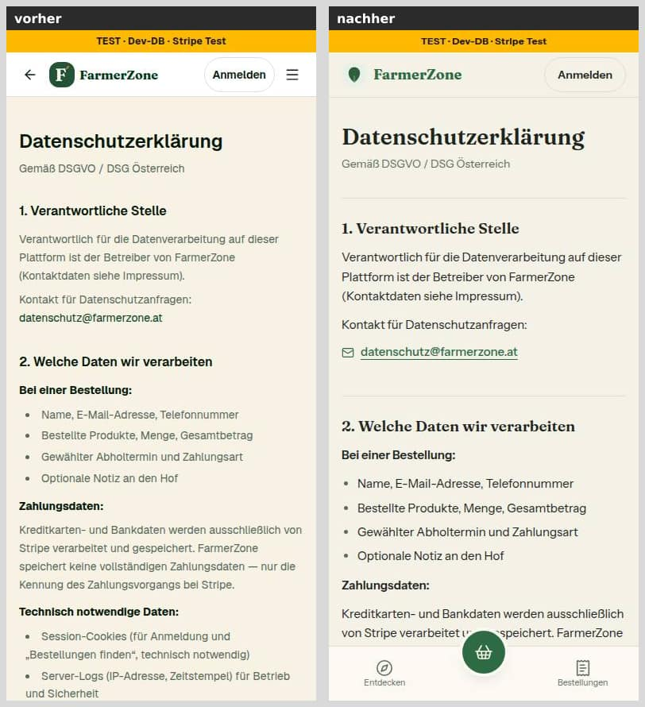
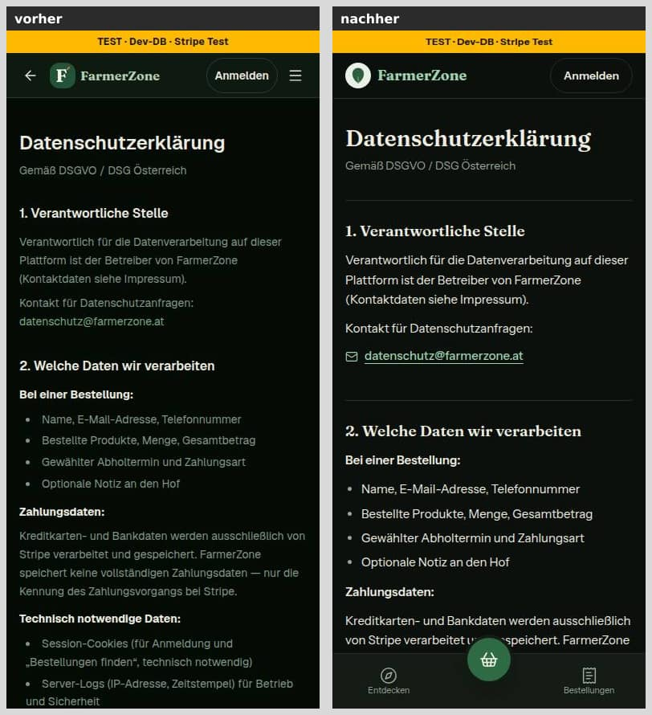
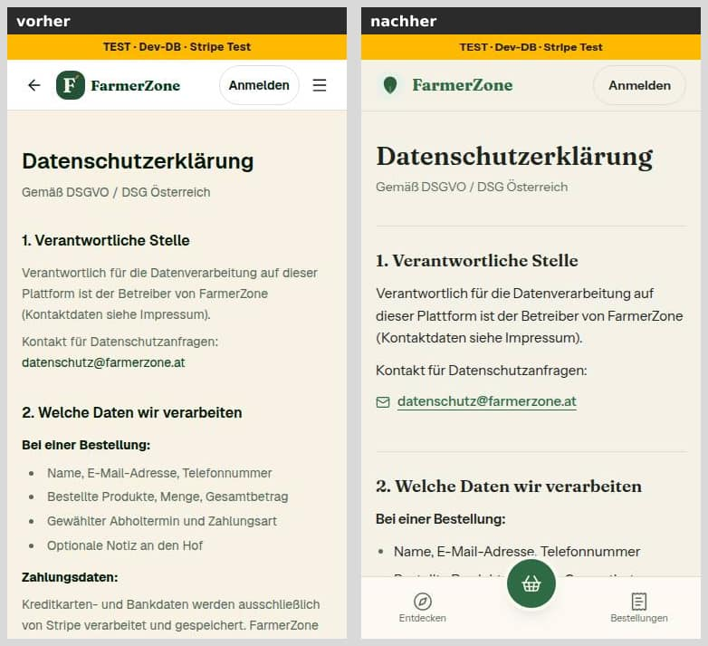
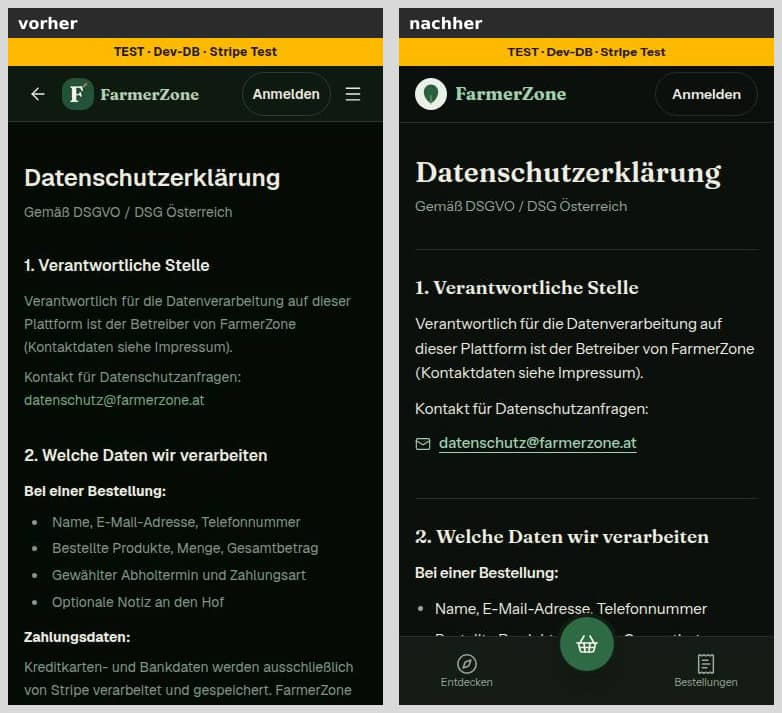
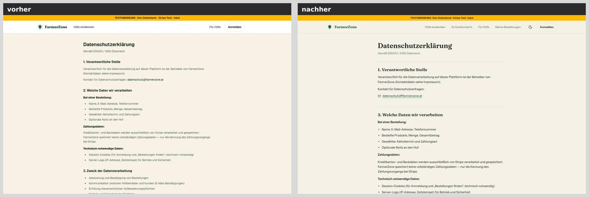
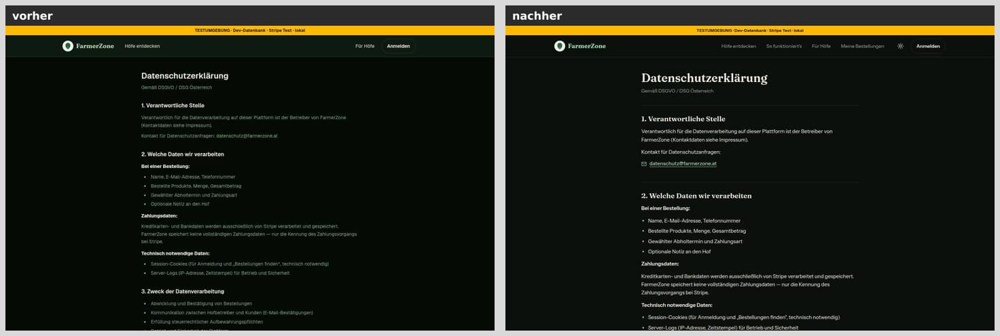

**Abschnitt 9, Neuigkeiten** (vorher Haken beim Bestellen, E-Mail und/oder WhatsApp; nachher Bestätigungsseite, Link, Ein-Klick-Abmeldung, WhatsApp, gespeicherte Angaben):

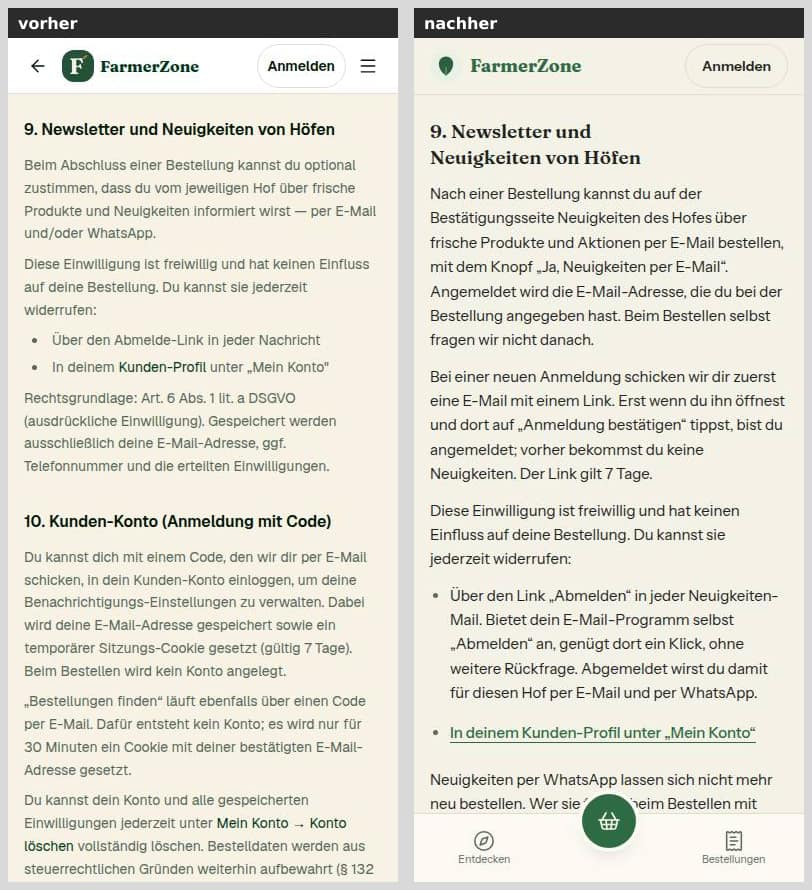
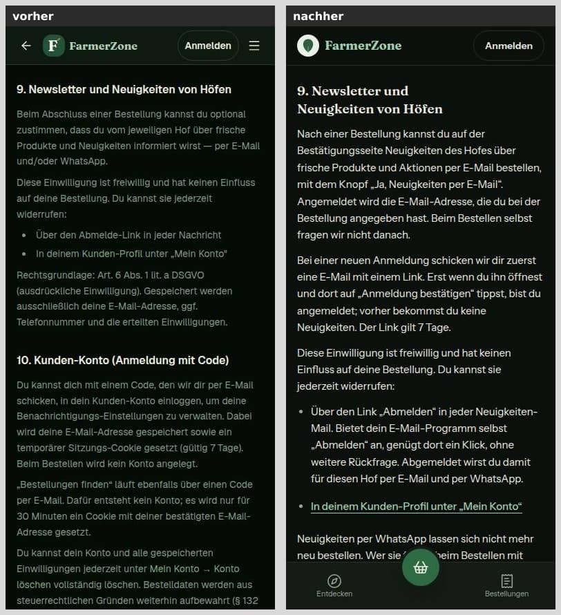
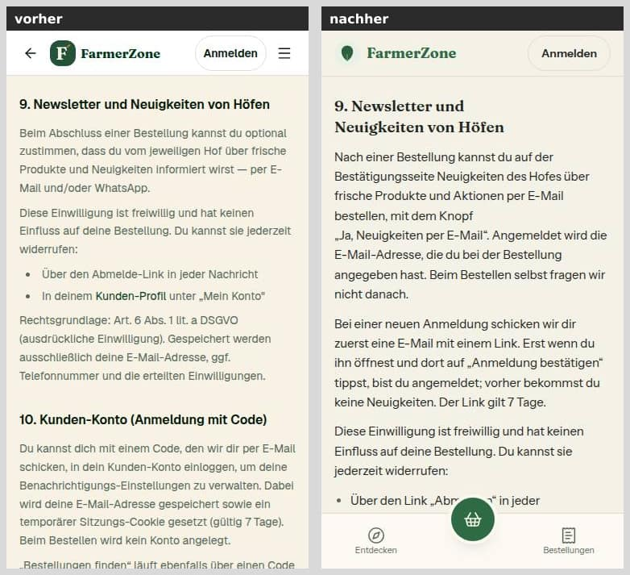
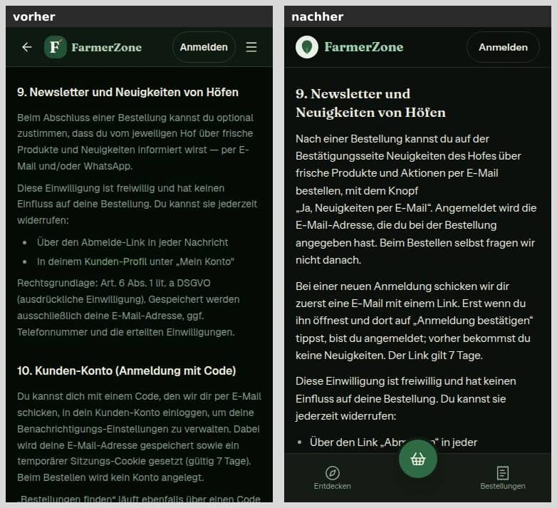
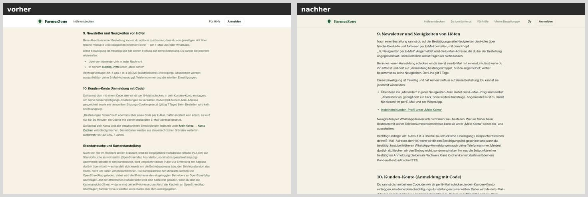
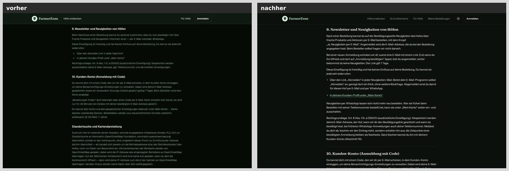

**Gemessen** (agent-browser, Sitzung nur für localhost):
- Axe auf `/datenschutz`: 390 und 1440 px, je hell und dunkel — **0 Verstöße**. „Unvollständig" nur bei 390 px ein Absatz, über dem in diesem Moment die feste Unterleiste liegt (Hintergrund nicht bestimmbar).
- Trefferflächen: 12 Ziele (390 px) bzw. 13 (1440 px); alle Links der Seite 44 px hoch. Unter 44 px nur Bestand der Shell: der Sprunglink (nur bei Fokus sichtbar) und der Logo-Link (32 px hoch, auf jeder KundeShell-Seite gleich).
- Kopfzeilen der Seite unverändert: kein `X-Robots-Tag`, `Referrer-Policy: strict-origin-when-cross-origin`, `Permissions-Policy: …geolocation=()`.
- Kartenaussage zur Laufzeit (keine Anfrage ging hinaus, fremde Hosts sind gesperrt; gezählt wurden nur die Elemente, die Leaflet anlegt): `/hoefe` bei 1440 px sofort eine Karte mit 12 Kachel-Anfragen an `tile.openstreetmap.org`; bei 390 px keine Karte, erst nach „Karte öffnen" eine Karte mit 6 Kacheln. Runde 0 schloss daraus zu viel: Auch `/hoefe?ansicht=karte` öffnet die Kartenansicht bei 390 px direkt — aus dem Code belegt (Tabelle oben), nicht eigens gemessen.
- „Standort nutzen" mit vorgetäuschter Position: Adresse der Seite, localStorage und sessionStorage unverändert; danach nur zwei neue Anfragen (Hoffotos über `/_next/image`), keine mit Koordinaten; die Seite zeigt „Wir zeigen Höfe rund um deinen Standort".

## Mockup-Abweichungen — bitte freigeben

Keine: Für `/datenschutz` gibt es kein Mockup (`docs/mockups/README.md`); gebaut nach den Regeln in DESIGN_SYSTEM (neuer Abschnitt „Datenschutzerklärung"). Zur Kenntnis: Die Seite trägt jetzt die KundeShell (am Handy mit Unterleiste) statt des alten Kopfs mit Pfeil; Links stehen auf eigener Zeile.

## Wie der Mensch es testet

1. `pnpm vitest run tests/datenschutz-sachstand.test.ts tests/shells.test.ts tests/kunden-kopf.test.ts` — alles grün (28 Tests in der Wache).
2. Vorschau des Entwurfs öffnen: `/datenschutz`, am Handy (390 px) und im Browser (1440 px), hell und dunkel.
   - Erwartung: Kopf der KundeShell („Anmelden" rechts), am Handy die Unterleiste; Überschriften in der Serifenschrift; Dienstleister als Karten; E-Mail und DSB-Link als eigene Zeilen.
   - Abschnitt 2 hat „Schutz vor Missbrauch" mit „etwa 26 Stunden" und „etwa 28 Stunden"; Abschnitt 4 Sentry nennt „IP-Adressen", die Sitzungsmeldungen und den User-Agent; Abschnitt 9 beschreibt die Anmeldung auf der Bestätigungsseite, den Link (7 Tage), die Ein-Klick-Abmeldung und WhatsApp; „Umkreissuche" nennt „Standort nutzen"; „Kartendarstellung" nennt User-Agent und Herkunft, drei Stellen, 1024 Pixel und die Kartenansicht samt direktem Link.
3. Gegenprobe im Browser: Auf `/hoefe` bei 1440 px lädt die Karte sofort (Entwicklerwerkzeuge → Netzwerk: Anfragen an `tile.openstreetmap.org`), bei 390 px erst nach „Karte öffnen" — oder sofort über `/hoefe?ansicht=karte` bzw. von der Startseite über „Alle Höfe auf der Karte". „Standort nutzen" erlauben: keine Anfrage mit Koordinaten, die Adresse ändert sich nicht.
4. Die Tabelle oben und die offenen Rechtsfragen rechtlich prüfen lassen, zusammen mit Bericht 33.

## Angepasste `.md`

- `docs/ai/DESIGN_SYSTEM.md` (Abschnitt „Datenschutzerklärung (/datenschutz, seit Nr. 57)")
- `docs/ai/TESTING_GUIDELINES.md` (§2, Zeile zur Wache der Erklärung)
- `DEVELOPMENT.md` (Eintrag „Datenschutzerklärung, Nachtrag (Nachtlauf Nr. 57)")
- `docs/nachtlauf/berichte/57.md` (neu; seit Runde 1 mit Abschnitt „Nachbesserung Runde 1")

## Checkliste §3 (freigabe.md §13)

- [x] Register und Freigabe decken den Inhalt ab (freigabe.md §13 „57"; S11, R1, N2, O6)
- [x] origin/main vor dem Push hineingeholt — Basis ist der Branch der Nr. 33 (dbb7223); `origin/main` steht beim Push auf 90cff24 und ist darin enthalten
- [x] pnpm typecheck, pnpm lint (kein neuer Befund: 12 Fehler / 7 Warnungen, ein Altbefund weniger), pnpm test grün (312 Dateien / 6135 Tests; im ersten Lauf unter Last rissen zwei fremde Dateien die 5-s-Grenze, einzeln und im zweiten Gesamtlauf grün). Runde 1: typecheck grün, eslint über die drei geänderten Code-Dateien ohne Befund, pnpm test grün (312 Dateien / 6139 Tests)
- [x] pnpm test:integration grün, wenn Datenbank oder Geld berührt — nicht berührt (keine Datenbank, kein Geld), nicht gelaufen
- [x] Migration: nein
- [x] Geld nur als Int-Cent bzw. Decimal, Beträge nur serverseitig — nicht berührt
- [x] Keine Personendaten oder Secrets in Code, Logs, Tests (Testadressen aus RFC 5737, `@example.com`)
- [x] Bilder 390, 375 und 1440 px vorher/nachher, beide Themes, im Bericht (12 Paare, dazu 6 aus Runde 1)
- [x] Axe ohne Fehler, Touch-Ziele ≥ 44 px (Ausnahmen nur Bestand der Shell, siehe oben), neue Seiten mit loading.tsx — keine neue Seite; die gemeinsame Ladeansicht der Infoseiten bleibt (siehe „Was nicht gelöst wurde")
- [x] Texte aus einer Quelle, Deutsch, per Du — Tage, Stunden und die Namen mit Konstante (`NEUIGKEITEN_TEXT`, `ABO_TEXT`, `SUCHFELD_TEXT`, `PROBLEM_MELDEN`, „Mein Konto", „Hilfe und Rückmeldung") aus ihrer Quelle; „Abmelden" (Mail), „Karte öffnen", „Region" und „Bestellungen finden" haben keine Konstante und stehen fest im Text, die Wache bindet sie an die Stelle, die sie zeigt (Runde 1)
- [x] tester und pruefer gelaufen, Befunde erledigt oder begründet — tester ohne Befund (Typecheck, Lint 12/7, Unit 312/6135, Integration 40/350); pruefer: ein Blocker (Satz zu den Kacheln), vier „Sollte“ und die Hinweise in Runde 1 erledigt (94b142a); danach selbst wiederholt: Typecheck grün, `pnpm test` 312/6139
- [x] Entwurf, wenn eine Vorbedingung offen ist — es ist ein Entwurf (Basis #210, rechtliche Prüfung offen)

## Nachbesserung Runde 1

Befunde des pruefers zum Stand aus Runde 0 (b587a1c), behoben als eigener Commit auf demselben Branch. Gegen den Stand aus Runde 0 schlagen 5 der 28 Tests an, gegen die alte Seite (dbb7223) 18.

| Befund | Änderung |
|---|---|
| **Blocker:** „auf schmaleren Bildschirmen erst, wenn du „Karte öffnen" tippst" war falsch. Die Kartenansicht steht in der Adresse (`src/schemas/hoefe-filter.ts:162`, `:179`), die Startseite verlinkt sie direkt (`src/lib/startseite.ts:55` → `hoefe-in-der-naehe.tsx:38`); Neuladen, Zurück und geteilte Links laden die Kacheln auch bei 390 px. | Seite: „auf schmaleren Bildschirmen lädt sie erst in der Kartenansicht — nach „Karte öffnen" oder über einen Link, der direkt dorthin führt". Wache umgedreht: Sie verlangt diesen Satz, verbietet den alten und prüft `?ansicht` in `hoefe-filter.ts` und `KARTE_ADRESSE` auf der Startseite. DEVELOPMENT.md, Tabelle, „Gemessen" und offene Frage 8 berichtigt. |
| Feste Namen („Abmelden", „Mein Konto", „Karte öffnen", „Region", „Karte") gegen die Behauptung „nie abgeschrieben" | Aus der Konstante, wo es eine gibt: `MEIN_KONTO` (aus `kundenNavigation`), `HILFE_UND_RUECKMELDUNG` (aus `UNTEN`), `PROBLEM_MELDEN`. Ohne Konstante bleiben „Abmelden" (Mail), „Karte öffnen", „Region" und „Bestellungen finden" fest im Text; die Wache bindet jeden an die Stelle, die ihn zeigt, und verlangt für jeden Namen in „…" auf der Seite eine der beiden Quellen. „Karte" (Region) kommt im neuen Satz nicht mehr vor. DESIGN_SYSTEM und Checkliste sagen das jetzt so. Dabei aufgefallen: „Fehler melden" steht seit Nr. 22e nirgends mehr in der Oberfläche (jetzt „Hilfe und Rückmeldung"), unter „Mein Konto" gibt es keinen Knopf „Konto löschen" (gestrichen, siehe „Unverändert, aber geprüft"). |
| Der Cron startet im Hobby-Tarif irgendwann innerhalb der Stunde | `ZAEHLER_AUFRAEUMEN_SPIEL_MS` (eine Stunde, Quelle im Kommentar): „höchstens etwa 26 Stunden", je Bestellung „etwa 28". Die Wache leitet die Zahlen aus den Konstanten ab. Offene Frage 2 ergänzt (Tarif und Laufzeit prüfen). |
| Nie bestätigte Anmeldungen bleiben ohne Frist | Offene Frage 13; Code unverändert. |
| Kommentar „Keine Person: die Kennung eines Hofs" war eine Rechtswertung | Kommentar neutral gefasst (`src/lib/datenschutz.ts:71–73`); offene Frage 14. |
| Sentry-Sitzungen | Im installierten SDK nachgelesen, ohne Netz: Sitzungen sind Standard und tragen den User-Agent und bei Höfen die Hof-Kennung, keine IP und keine Bitte `infer_ip`. Die Seite sagt das; offene Frage 16 mit dem Vorschlag, sie abzuschalten (nicht gebaut). Beim Nachlesen zusätzlich gefunden: Auch Messungen tragen den User-Agent (`httpContextIntegration`) — die Seite nennt jetzt „Fehlerberichte, Messungen und Sitzungsmeldungen"; Seitenadresse und Referer in den Ereignissen als offene Frage 17. |
| Mit Umkreis erfährt OpenStreetMap die Gegend mittelbar über die Kacheln | Offene Frage 15. |
| „weitere Angaben über dich schickt die Karte nicht mit" verschwieg User-Agent und Herkunft | Die Seite nennt den User-Agent und als Herkunft nur die Adresse der Website ohne Seitenpfad; neue Wache (Referrer-Policy der Kartenseiten, kein `referrerPolicy` oder `crossOrigin` an den Kachel-Ebenen). |
| Die Region-Karte öffnet auch über die Adresse (`?ansicht=karte`) | Satz: „sobald dort die Kartenansicht offen ist — auch über einen Link, der direkt dorthin führt"; die Wache prüft, dass `umfeld-anzeige.tsx` die Ansicht aus der Adresse liest. |
| Blinde Flecken der Wache: `ohneKommentare` schnitt ab `/*` in Zeichenketten (`image/*` …), die WhatsApp-Suche übersah `{ customerPhone }` | Der Kommentar-Entferner liest Zeichen für Zeichen (Zeichenketten, Vorlagen mit `${}`, Regex-Literale bleiben stehen), mit Selbsttest und Gegenprobe gegen das alte Muster; die WhatsApp-Suche fängt die Kurzschreibweise, mit Gegenprobe. |

**Geändert in Runde 1 (je Datei ein Satz):**

- `src/app/(public)/datenschutz/page.tsx`: Kartensatz berichtigt, User-Agent und Herkunft bei den Kacheln, Region auch über die Adresse, Sentry-Sitzungen und User-Agent, Namen aus Konstanten, „Fehler melden" ersetzt und „Konto löschen" gestrichen.
- `src/lib/datenschutz.ts`: Spiel beim Start des Crons als Konstante, neutraler Kommentar zum Hof-Zähler, `MEIN_KONTO` und `HILFE_UND_RUECKMELDUNG` aus den Navigationen.
- `tests/datenschutz-sachstand.test.ts`: Kartenwache umgedreht, neue Tests zu Sitzungen, Kachel-Kopfzeilen und Namen, Zahlen aus den Konstanten, neuer Kommentar-Entferner mit Selbsttest, WhatsApp-Kurzschreibweise (28 Tests).
- `DEVELOPMENT.md`: Eintrag berichtigt (Kartenansicht, 26/28 Stunden, Zählung) und um „Nachbesserung Runde 1" ergänzt.
- `docs/ai/DESIGN_SYSTEM.md`: Regel zu Namen ehrlich gefasst (Konstante oder gebundener fester Text).
- `docs/ai/TESTING_GUIDELINES.md`: Zeile zur Wache ergänzt (Namen, SDK über die Paketauflösung).
- `docs/nachtlauf/berichte/57.md` und `bilder/57/karten-*.jpg`: dieser Abschnitt, Tabelle und Fragen nachgezogen, sechs neue Bildpaare.

**Bilder:** Sichtbar ändert sich nur Wortlaut, kein Aufbau. Deshalb ein neues Paar je Breite und Theme nur für die wichtigste Stelle, den Absatz „Kartenkacheln" mit der Liste der drei Kartenstellen; vorher = Runde 0 (b587a1c), nachher = Runde 1. Nebenbei zu sehen: „Karte öffnen" bricht bei 1440 px nicht mehr in sich um. Die übrigen Änderungen im Wortlaut (Abschnitte 2, 4, 5, 10 und „Fehler- und Wunschmeldungen") stehen in der Tabelle, ohne eigene Bilder (dieselben Bausteine); in Abschnitt 9 bleibt der Text gleich, nur die Namen brechen nicht mehr in sich um. Danach Axe wieder 0 Verstöße (390 und 1440 px, hell und dunkel), Trefferflächen unverändert.

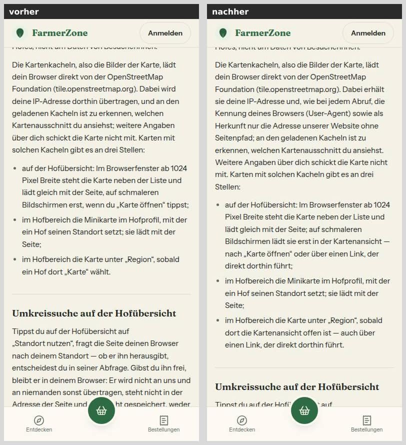
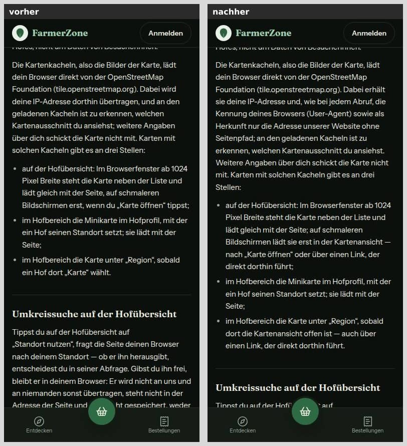
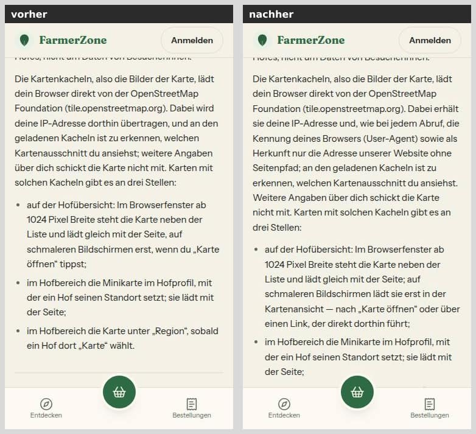
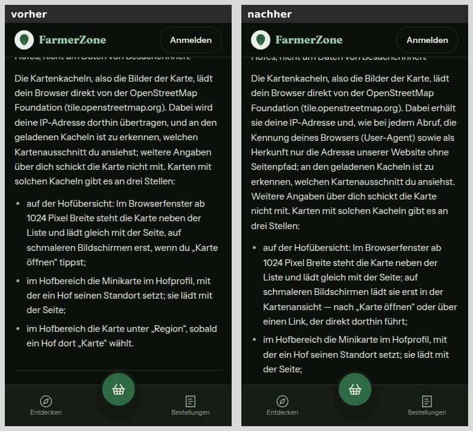
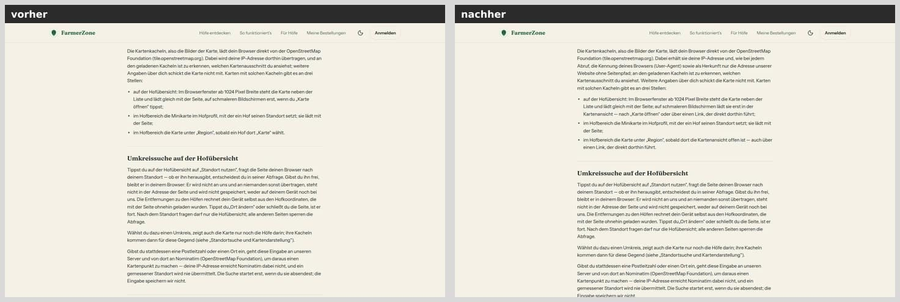
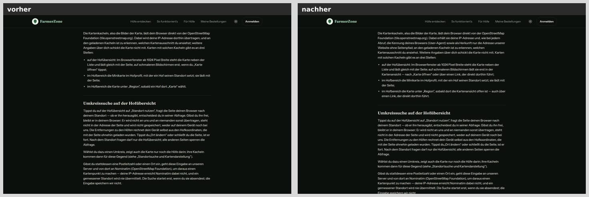
