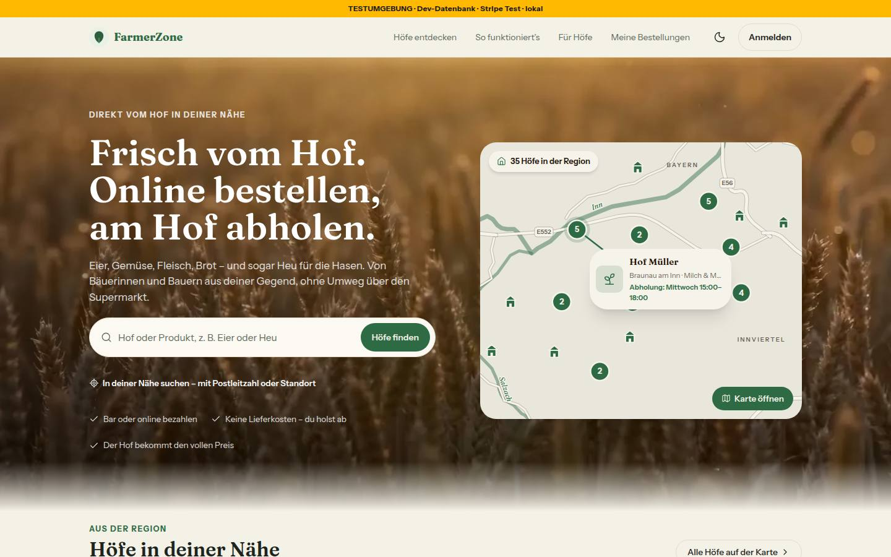
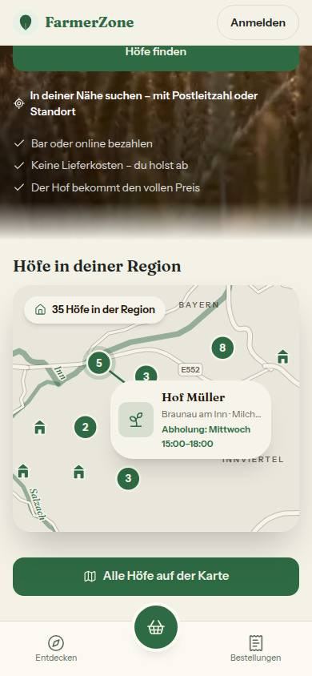
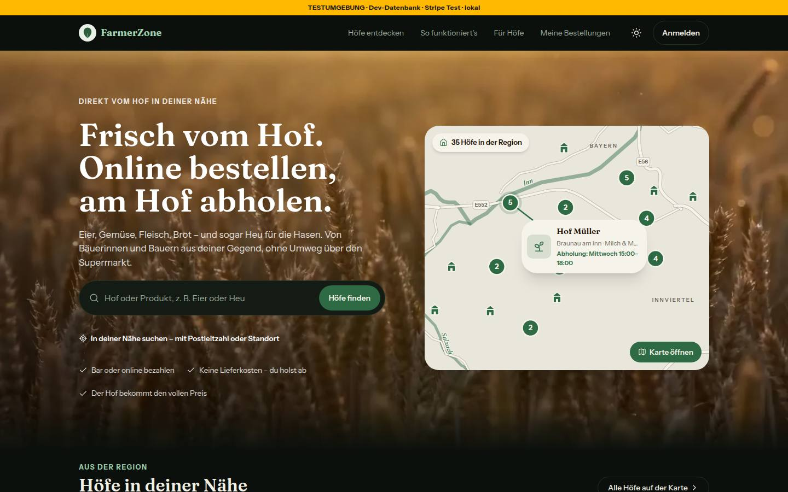
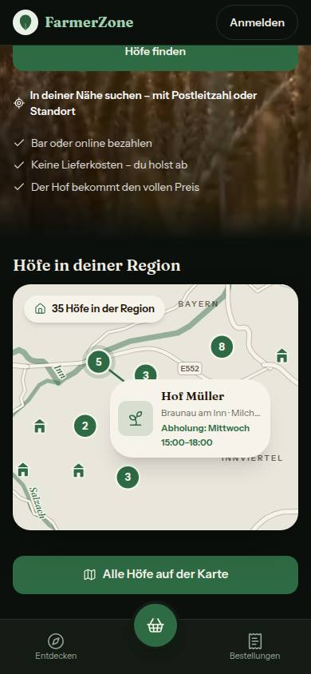

# Bericht Nr. 59 — Startseite: Karte der Region

Enthält Migration: **nein** (keine Schema-Änderung, kein neues Paket, kein Fremdaufruf). Branch `nacht/2026-10-12/59-startseite-karte`, Basis Branch 63 (2d2ae4b). Mockups `web-k0-startseite-karte-region`, `mobil-k0-startseite-karte-region`.

**Quelle der Daten:** Natural Earth, gemeinfrei, 1:10 Mio. (github.com/nvkelso/natural-earth-vector, Zweig master, Abruf 12.10.2026): `ne_10m_rivers_lake_centerlines` (Inn), `ne_10m_rivers_europe` (Salzach), `ne_10m_roads` (Straßen, Beschriftung nur aus dem Feld `label`). OpenStreetMap war gesperrt; daher kein OSM-Hinweis unter der Karte. Erzeugt mit einem Skript außerhalb des Repos (schneiden, Douglas-Peucker 0,0005°, auf 4 Stellen runden); die Schritte stehen im Kopf von `regionskarte-daten.ts`.

## Was geändert wurde (je Datei ein Satz)

- `src/lib/regionskarte-daten.ts` (neu, erzeugt): Inn, Salzach und neun Straßenstücke als Linienzüge in Grad, auf den Ausschnitt geschnitten.
- `src/lib/regionskarte.ts` (neu): Ausschnitt als Konstante, Projektion `projiziere` über `weltPixel`, zwei Entwurfsgrößen, Marken über `gruppierePins` bei fester Zoomstufe, Lage der Hofkarte samt Linie, Beschriftungen, die Rand, Pins und einander ausweichen.
- `src/lib/startseite.ts`: `waehleStartseitenHoefe` behält die Koordinaten (`lage`); neu `waehleKartenHoefe` (Pins, Zähler, hervorgehobener Hof), `formatiereRegionsZaehler`, `benenneKartenLink`, `KARTE_KNOPF`, `KARTE_OEFFNEN`, `KARTE_UEBERSCHRIFT`.
- `src/components/startseite/startseite-kopf.tsx`: `RegionsKarte` (ein Link, SVG `aria-hidden`, Zähler und Hofkarte als Text); im Browser rechts wie bisher, am Handy seit Runde 1 ein eigener Abschnitt unter dem Kopf (Überschrift, Karte, Knopf „Alle Höfe auf der Karte"); Schmuckfläche (`NADELN`) entfernt.
- `src/app/page.tsx`: eine Abfrage für Hofkarten und Karte; die Karte je Form hinter Suspense, bis dahin das Land ohne Pins.
- `tests/regionskarte.test.ts` (neu, 15 Tests) und `tests/startseite.test.ts` (+16, ein Test auf die Karte umgestellt, keiner gelöscht).

## Annahmen

- Zähler = Höfe der öffentlichen Liste mit Koordinaten im Ausschnitt, pausierte mit; dieselbe Zahl im `aria-label`. Ab zwei Höfen „Alle n Höfe …", sonst ohne Zahl.
- Hervorgehoben: zuletzt freigeschaltet mit Foto, aber nur nicht pausierte Höfe; sonst der erste in der Reihenfolge der Hofkarten. Steckt er in einer Gruppe, trägt die Gruppe Hof und Linie.
- „Ort" in der Hofkarte ist der Ort ohne PLZ (wie im Mockup); die Abholzeit kommt aus `formatiereAbholung` wie bei den Hofkarten und darf zweizeilig umbrechen.
- Am Handy bleiben Text, Link „In deiner Nähe suchen" und Versprechen im Kopf, obwohl das Mockup sie nicht zeigt — ihr Wegfall ist nicht beauftragt; der Abschnitt mit der Karte folgt danach. Nach unten hält er den Abstand der übrigen Abschnitte (52 px), das Mockup zeigt darunter nichts.
- Die Karte folgt dem Modus nicht: Papier wie die Kacheln der Hofübersicht, hell wie im dunklen Mockup — im Browser auf dem Foto, am Handy auf dem Seitengrund (im hellen Modus trägt dort ihr Schatten); nur theme-feste Tokens, Hover über die Deckkraft.
- Der Knopf am Handy ist grün wie im Mockup, obwohl „Höfe finden" auch grün ist (DESIGN_SYSTEM „ein primärer CTA"): Das Mockup geht vor.

## Nicht gelöst

- Ebenen ohne Datenquelle (siehe Abweichungen): Orte, Mattig, Antiesen, Waldflächen, B148/B147/B156/B141, „A8" — keine Koordinaten aus dem Gedächtnis.
- `KartenHof` in `hoefe-in-der-naehe.tsx` wird nicht mehr benutzt, und dort steht „Alle Höfe auf der Karte" noch als eigener Text statt `KARTE_KNOPF` — die Datei liegt außerhalb meiner Grenzen.

## Mockup-Abweichungen (begründet)

1. **Fehlende Ebenen:** Natural Earth hat im Ausschnitt keine Orte, kleinen Flüsse, Wälder und B-Nummern; die Feld-Rechtecke des Mockups sind gezeichnet, nicht Daten — alles weggelassen. Straßen tragen E-Nummern aus den Daten (E552, E56; E55 nur, wo Platz ist). Bild: 
2. **Flüsse grün statt blau:** Das Design-System hat kein Blau, keine neue Farbe ohne Freigabe. Bild: 
3. **Kein Kartenhinweis oben rechts:** keine OSM-Daten, Natural Earth verlangt keinen. Bild: 
4. **Gruppen und Hofkarte nach echten Daten:** 35 Seed-Höfe liegen im Ausschnitt (Pins in Gruppen 2–8); die Hofkarte steht zur Kartenmitte hin, nicht an der Stelle des Mockups. Bild: 

## Wie der Mensch es testet

- `/` bei 1440 px: rechts die Karte mit „n Höfe in der Region", Pins, einer Hofkarte mit Linie und „Karte öffnen"; ein Klick irgendwo auf die Karte führt zu `/hoefe?ansicht=karte`.
- `/` bei 390 px: unter dem Foto-Kopf die Überschrift „Höfe in deiner Region", die Karte, darunter „Alle Höfe auf der Karte" (gleiches Ziel). Hell und dunkel sieht die Karte gleich aus, die Überschrift folgt dem Modus; mit Tab trägt die Karte dort den grünen Fokusring.
- Screenreader: ein Link „Alle n Höfe auf der Karte ansehen"; die Zeichnung wird nicht vorgelesen.

Gemessen: Axe im Kopf 0 Verstöße (390/1440, hell/dunkel); offen bleibt nur „incomplete" für SVG-Text, nachgerechnet 5,1–16,4:1. Tippflächen: Karte 358 × 308 bzw. 520 × 447 px, Knopf 358 × 48 px.

## Angepasste .md

`docs/ai/DESIGN_SYSTEM.md` (Karten: Karte der Region), `docs/ai/CODING_STANDARDS.md` §7 (folgt dem Modus nicht), `DEVELOPMENT.md` (Eintrag Nr. 59); Runde 1: DESIGN_SYSTEM und DEVELOPMENT nachgezogen.

## Nacharbeit und Regelvorschlag

- **Für dich:** einen OSM-Auszug des Ausschnitts bereitstellen (Orte, Mattig, Antiesen, Wald, B-Straßen); dann nur `regionskarte-daten.ts` neu erzeugen und den Hinweis „Kartendaten: © OpenStreetMap-Mitwirkende" unter die Karte setzen. Ein Wasser-Token (Blau) wäre eine Register-Frage.
- **Regelvorschlag:** Ursache — Geodaten sind Fremddaten, die leicht „aus dem Kopf" ergänzt würden. Gegenmaßnahme — Prüfung vor Textregel: Der Test „jeder Punkt im Ausschnitt, Beschriftung nur E-Nummern" (`tests/regionskarte.test.ts`) bleibt die Wache; eine neue Ebene braucht eine neue Datei-Quelle im Kopf der Datendatei. Ort: `docs/ai/DESIGN_SYSTEM.md`, Abschnitt Karten (dort steht es schon).

Wiederverwendet: `weltPixel`, `gruppierePins`, `gruppenBeschriftung` (hoefe-anzeige), `formatiereAbholung`, `KATEGORIE_LABEL`, `KARTE_ADRESSE`, `FOKUS_RAHMEN`/`FOKUS_AUF_FOTO`, lucide `House`/`Map`/`Sprout` / Neu, weil: Es gab keine Karte ohne Leaflet und keinen Baustein für ein SVG der Region; `KartenHof` passte nicht (eigener Link im Link, ``).

## Nachbesserung Runde 1

- **Blocker Handy-Aufbau:** Der Kopf endet am Handy vor der Karte; darunter ein eigener Abschnitt auf dem Seitengrund wie im Mockup: Überschrift „Höfe in deiner Region" (`KARTE_UEBERSCHRIFT`, `text-foreground`, Kontrast 14,1:1 hell / 16,5:1 dunkel), Karte, Knopf; Abstände 18/10/22 px aus dem Mockup. Ab `lg` bleibt die Karte rechts im Kopf. Bilder:   — 1440 nicht neu, dort ändert sich nichts.
- **Fokus am Handy:** Karte und Knopf tragen dort `FOKUS_RAHMEN` (grüner Ring, 2 px) statt Weiß — auf dem hellen Seitengrund wäre Weiß unsichtbar.
- **Sollte:** Die Pille „Karte öffnen" reagiert beim Hover über `opacity-90` wie „Höfe finden", nicht mehr über `accent-hover` (je Theme verschieden).
- **Tests:** +2 in `tests/startseite.test.ts` (Reihenfolge Kopf → Abschnitt mit Überschrift, Karte, Knopf; Abschnitt ohne Weiß, mit Fokusring), beide zuerst rot.
- **Gemessen bei 390 px, hell und dunkel:** Axe im Abschnitt 0 Verstöße, „incomplete" nur der SVG-Text der Karte (wie oben); Tippflächen Karte 358 × 308, Knopf 358 × 48 px.
- Wiederverwendet: `RegionsKarte`, `FOKUS_RAHMEN`, `KARTE_KNOPF`, `KARTE_ADRESSE` / Neu, weil: `KARTE_UEBERSCHRIFT` — der Text der Überschrift braucht eine Quelle.
