# Bericht Nr. 60 — Telefonnummer erst nach dem Kauf (Kaufstrecke mit Pflichtangaben)

Branch `nacht/2026-10-12/60-telefon-nach-kauf`, Basis Branch 63 (2d2ae4b). Keine Migration, keine neuen Pakete, Mails und `getPublicFarm` unverändert, Knopftexte unverändert. Voller Lauf vor dem Commit: Typecheck grün, Lint 0 Fehler / 7 Warnungen (dieselben wie auf Branch 63), 329 Testdateien / 6673 Tests grün.

## Was geändert wurde (je Datei ein Satz)
- `src/app/(public)/[farmSlug]/page.tsx`: gibt den Hof ohne `phone`/`email` an `FarmPageView` (`entferneKontaktdaten`) — beide stehen nicht mehr in den Seitendaten, auch nicht in der Vorschau des Hofs (dieselbe Route).
- `src/lib/hofseite-kunde.ts`: neu `KONTAKT_NACH_DEM_KAUF` (Hinweis statt Nummer) und `entferneKontaktdaten`.
- `src/components/hofseite/hofseite-kunde.tsx`: Typ `HofseiteHof` ohne Telefon/E-Mail, beide „Anrufen" weg, JSON-LD ohne `telephone`/`email`, leerer Zustand „Schau bald wieder vorbei." mit „Andere Höfe entdecken".
- `src/components/hofseite/hofseite-seitenspalte.tsx`: `tel:`-Link weg, in „Zahlung & Kontakt" der Hinweis als gedämpfter Kasten; `SeitenspalteHof` ohne `phone` (gilt auch für die Produktseite ab lg).
- `src/components/farm/farm-page-view.tsx`: nimmt `HofseiteHof`.
- `src/lib/stripe-konto.ts`: `ANGABEN_ZUM_HOF_TITEL` und die eine Sackgassen-Konstante `KONTAKT_UNTER_ANGABEN_ZUM_HOF`, auch in `hofKontoUnbekanntText`.
- `src/components/checkout/angaben-zum-hof.tsx` (neu): `AngabenZumHof` (`
`, Verkäufer, Anschrift, Telefon, E-Mail, Satz zum Vertragspartner) und `hofAdresse` (aus `checkout-form.tsx` hierher gezogen).
- `src/components/checkout/checkout-form.tsx`: `KassenAbschluss` legt Übersicht → Angaben → Kaufknopf fest, online wie bar (Knopf samt Texten unverändert hineingezogen); der Sackgassen-Satz an zwei Stellen aus der Konstante.
- `src/components/checkout/kasse-skelett.tsx`: Ladeansicht mit Platzhalter für die Angaben, der Knopf darunter.
- `src/components/bestaetigung/hof-erreichen.tsx` (neu): Karte „Hof erreichen" (Satz, Nummer, E-Mail ab 768 px, „Anrufen" `tel:`, „E-Mail" `mailto:`).
- `src/app/(public)/[farmSlug]/confirm/[orderId]/page.tsx`: liest `phone`/`email` erst nach der Signaturprüfung, Karte mit der Abholkarte.
- `src/app/(public)/[farmSlug]/bestellung/[orderId]/page.tsx`: liest `phone`/`email` erst nach der Signaturprüfung, Karte unter „Abholung", nicht bei storniert.
- Tests: `tests/telefon-nach-kauf.test.ts` (neu, 16 Tests), je 4 neue in `bestaetigung-zugang` und `bestellverfolgung-zugang` (Karte nur mit Signatur, Abfrage liest erst danach), `kasse-seite` (neue Datei in der Farb- und Konto-Wache), `hofseite-abholtermine` (Fixture ohne `phone`).

Wiederverwendet: `KARTE`, `KNOPF_RAHMEN` (bestaetigung-teile), `HINWEIS`, `AktionsLeiste`, `KNOPF_GRUEN` (kasse-teile), `FOKUS_RAHMEN`, `hofAdresse`, das `
`-Muster der Startseite / Neu, weil: Eine Karte mit den Pflichtangaben des Verkäufers und eine Kontaktkarte nach dem Kauf gab es nicht (Bausteinverzeichnis: nichts zu „Vertragspartner", „erreichen"); `KassenAbschluss`, damit die Reihenfolge an einer Stelle steht und gerendert prüfbar ist.

## Annahmen
- „Kaufknopf" online ist „Weiter zur Zahlung" (Formularschritt, wie im Mockup); der Zahlungsschritt wiederholt die Angaben nicht (kein Mockup).
- Titel und Sackgassen-Konstante stehen in `stripe-konto.ts` (ohne Importe, für Server und Browser); `kasse.ts` liegt außerhalb der Dateigrenzen.
- „Hof erreichen" erscheint auf der Bestätigung mit der Abholkarte (bezahlt, bestätigt, Zahlung wird geprüft), nicht bei offener Bar-Bestellung; auf der Bestellseite außer bei storniert (wie „Abholung").
- Was der Hof nicht angegeben hat (die Hof-E-Mail ist im Onboarding freiwillig), entfällt als Zeile bzw. Knopf; ohne beides keine Karte.
- Kasse-Bilder mit Barzahlung: Kein Seed-Hof hat ein fertiges Stripe-Konto, und die Test-DB ist geteilt; online belegen die Tests.

## Nicht gelöst / Nacharbeit
- Die Produktseite (`produkt/[id]/page.tsx` → `ProduktdetailKunde`) reicht den Hof samt Telefon und E-Mail in die Seitendaten — außerhalb der Dateigrenzen; sichtbar ist die Nummer dort nicht mehr. Vorschlag: dort ebenfalls `entferneKontaktdaten`.
- S1 verlangt für die Bestellseite `Referrer-Policy: no-referrer`; dort gilt weiter die allgemeine Regel (`next.config.ts`, außerhalb; `sicherheits-header.test.ts` hält den Stand fest). Nr. 60 öffnet keinen neuen Weg (`tel:`/`mailto:` senden keinen Referrer).
- Die klebende rechte Spalte der Kasse ist um die Angaben (~230 px, zuklappbar) höher; in Fenstern unter ~800 px Höhe steht der Knopf erst am Seitenende ganz im Bild.

## Wie der Mensch es testet
1. `/hof-sonnleiten` (Seed): kein „Anrufen", in „Zahlung & Kontakt" der Hinweis; der Seitenquelltext (Strg+U) enthält weder Nummer noch Hof-E-Mail.
2. Etwas in den Korb, dann `/hof-sonnleiten/checkout`: unter der Übersicht „Angaben zum Hof (dein Vertragspartner)" mit Verkäufer, Anschrift, Telefon, E-Mail, darunter der Kaufknopf (am Handy die feste Leiste), Text wie bisher.
3. Bar bestellen und bestätigen: Die Bestätigung zeigt „Hof erreichen"; „Bestellung ansehen" zeigt dieselbe Karte unter „Abholung". Ohne `?sig=` bzw. `?s=`: keine Karte, keine Nummer.

## Angepasste .md
`docs/ai/DESIGN_SYSTEM.md` (Hofseite, Kasse, Bestätigung, Bestellseite), `docs/ai/CODING_STANDARDS.md` (§2: Ungezeigtes geht nicht an Client-Komponenten), `DEVELOPMENT.md` (Eintrag Nr. 60).

## Regelvorschlag
Ursache: Die Hofseite gab das ganze `farm` an eine Client-Komponente; Telefon und E-Mail standen in den Seitendaten, auch wo nichts sie zeigte. Gegenmaßnahme (Prüfung vor Textregel): je öffentlicher Seite ein Test auf die Props ihrer Client-Komponente, Vorbild `tests/telefon-nach-kauf.test.ts`; die Produktseite fehlt dort noch. Die Textregel steht in CODING_STANDARDS §2.

## Bilder (nachher; Axe 0 Verstöße auf Hofseite, Kasse, Bestellseite und Bestätigung; Tippflächen 44–50 px)
Hofseite (390 hell: Kopf, 390 dunkel: „Zahlung & Kontakt"): 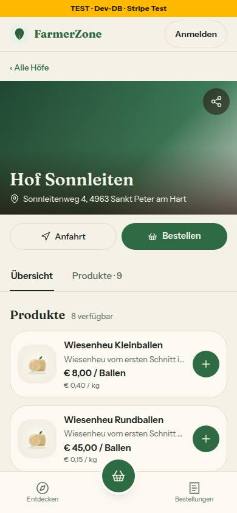 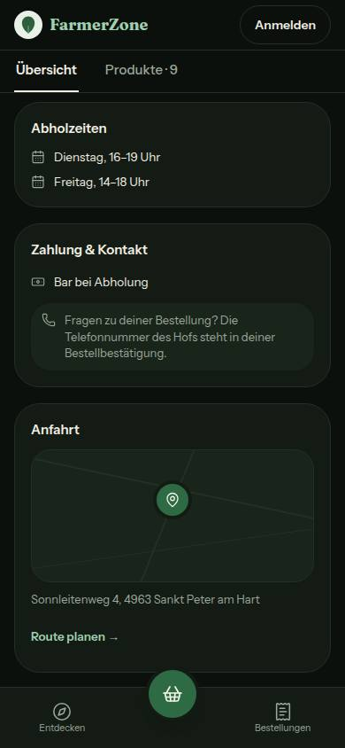 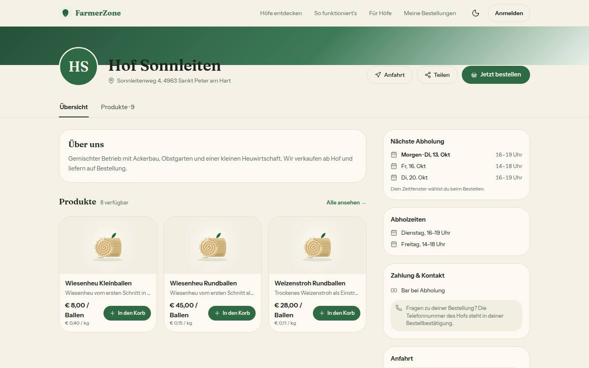 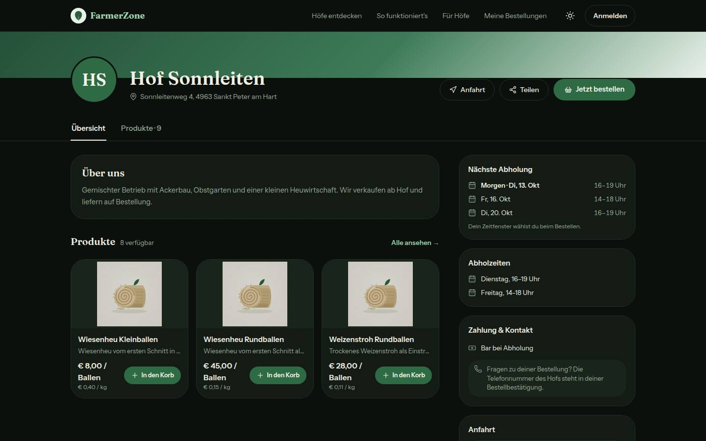
Kasse: 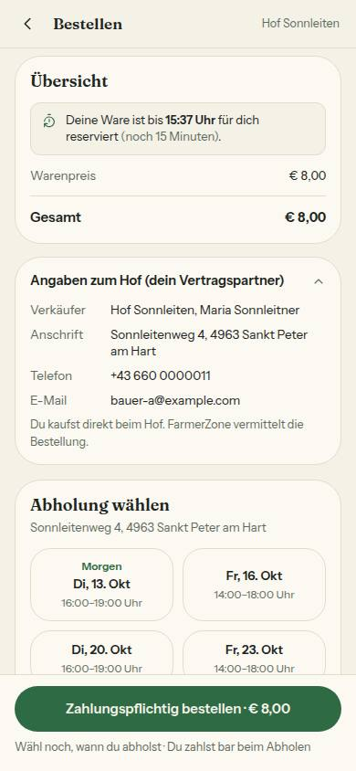 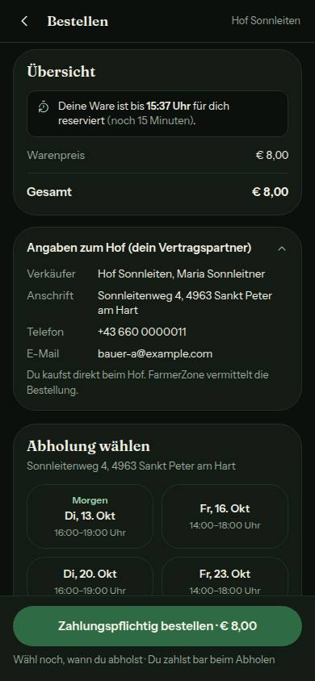 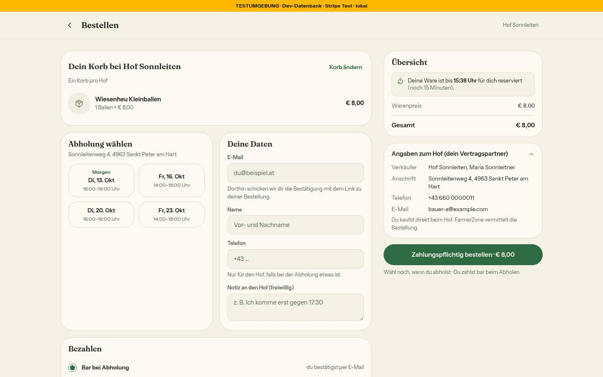 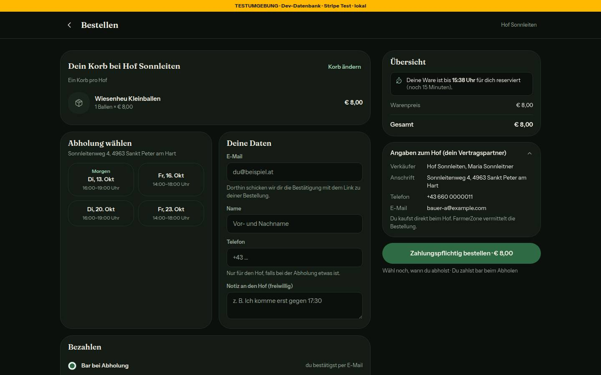
Bestellseite: 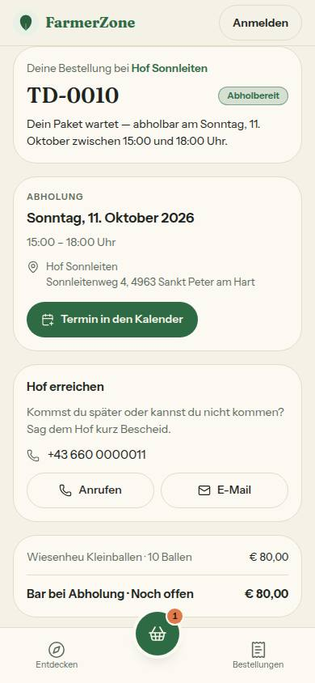 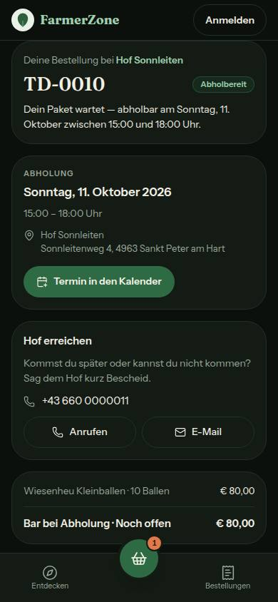 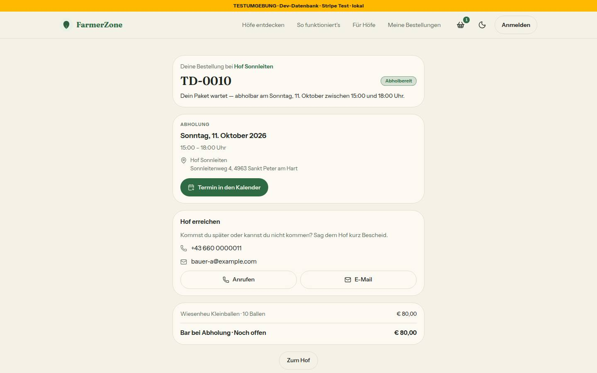 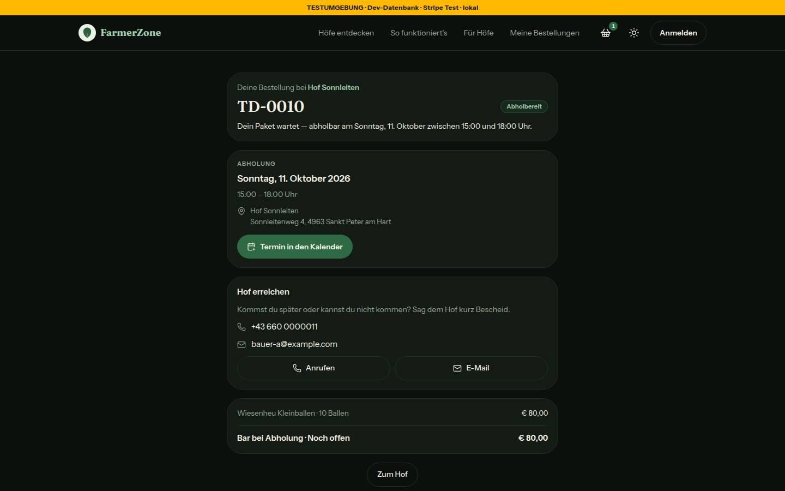

## Mockup-Abweichungen
- „Hof erreichen": „Anrufen" als Rahmen-Pille statt grün — beide Seiten haben ihre eine grüne Hauptaktion schon (bestellung-390-hell, bestellung-1440-hell).
- Hofseite am Handy: Kopf wie bisher mit „Anfahrt" und „Bestellen" in einer Reihe, Teilen als Symbol auf dem Titelbild (Mockup: Anfahrt und Teilen, darunter „Jetzt bestellen") — nicht Teil der Freigabe (hofseite-390-hell).
- Kasse am Handy: Der Knopf bleibt die feste Leiste (DESIGN_SYSTEM „Kasse"), die Positionen stehen in der Korbkarte darüber statt in „Deine Bestellung" (kasse-390-hell).
- Satz- und Hinweisfarbe `muted-foreground` statt des helleren Mockup-Tons, für den es kein Token gibt.
