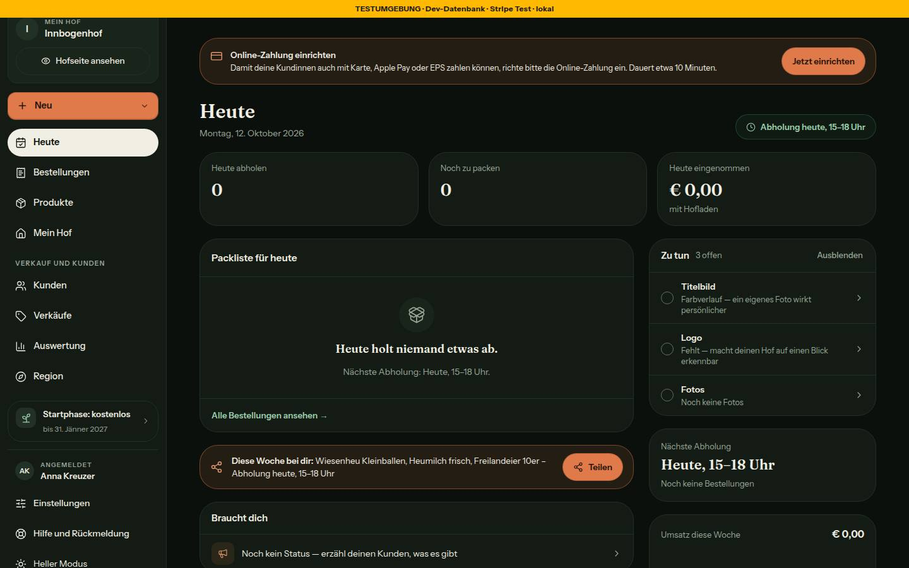
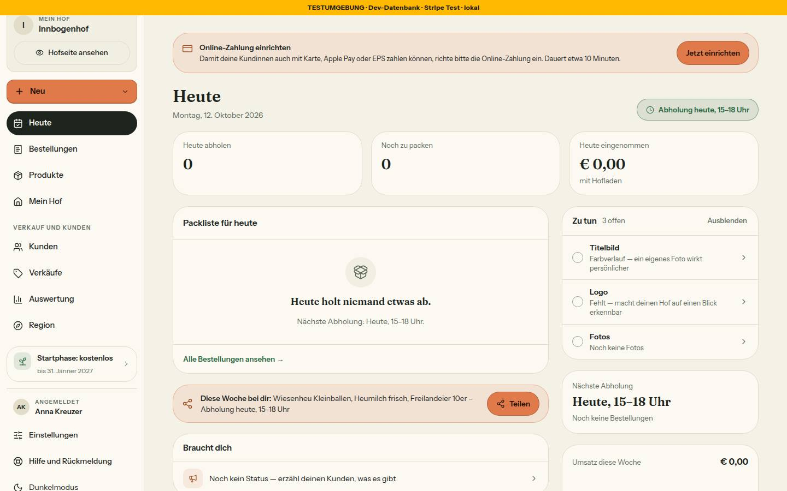
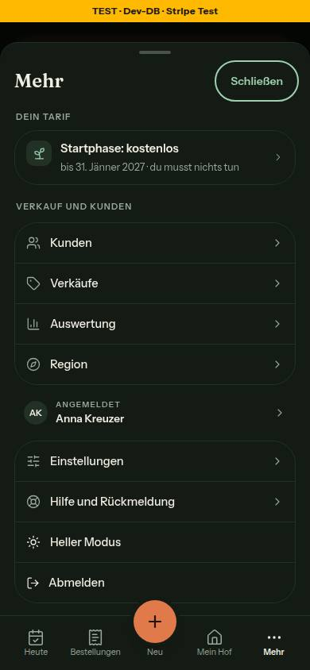
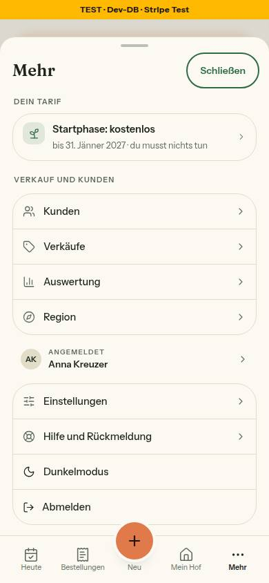
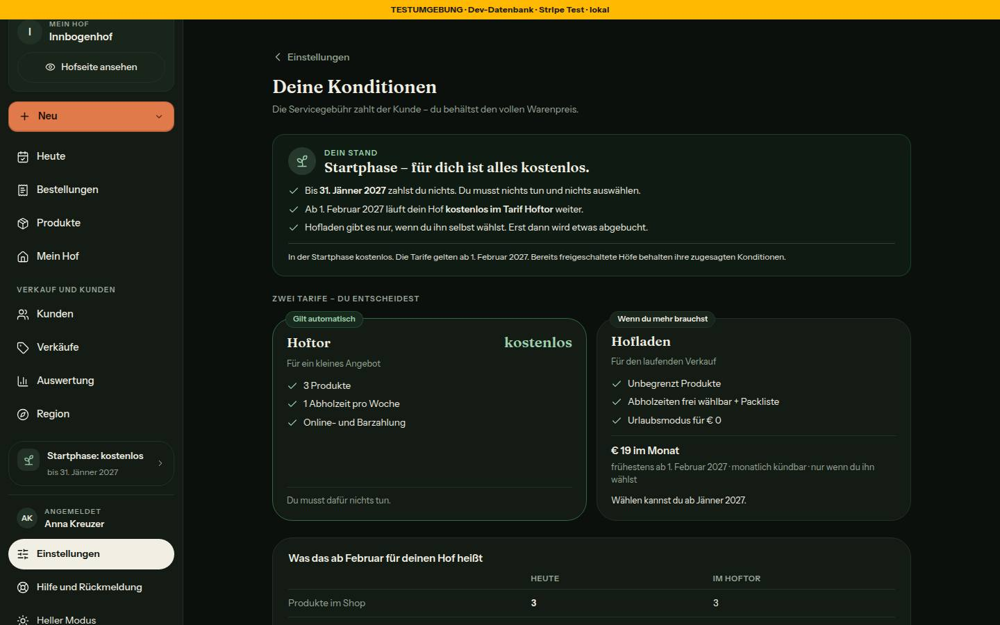
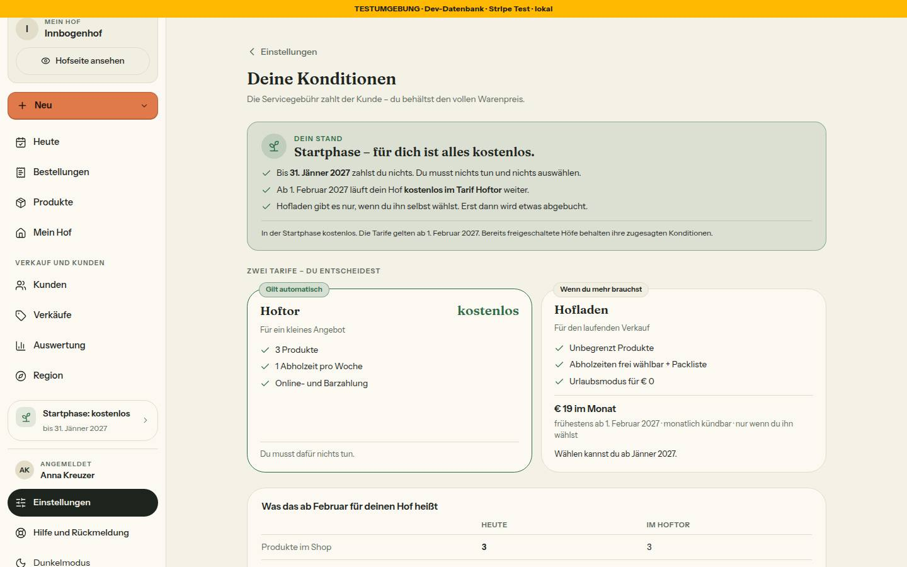
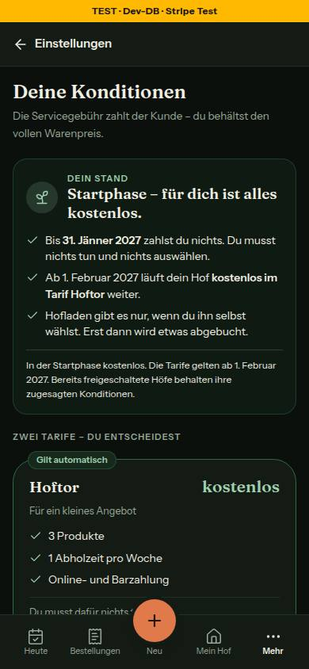
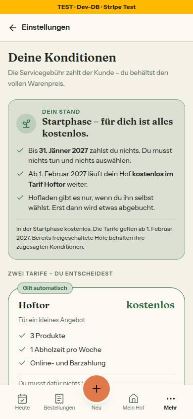
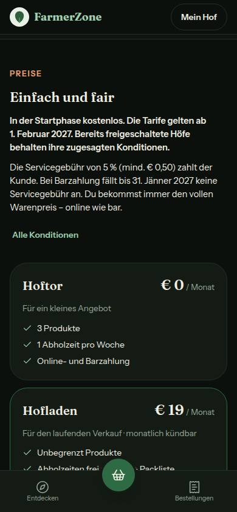
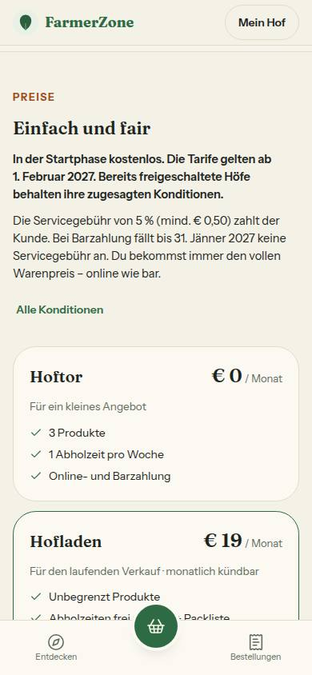

# Nr. 61 – Tarif-Zeile und „Deine Konditionen" Fassung 2

## Was geändert wurde
- `src/lib/konditionen.ts`: EINE Regel `bestimmeTarifZustand` (Gründungshof bis einschließlich seines Wiener Kalendertags mit Vorrang, sonst Startphase vor `TARIFE_AB`, danach Hoftor ohne Wahl, Hofladen nur nach Wahl), `TARIF_ZEILE` und `baueTarifZeile`, die Texte der Fassung 2 (`DEIN_STAND_STARTPHASE`, `TARIF_MARKE`, `PREIS_BEDINGUNGEN`, `TARIF_WAHL_SATZ`, `VERGLEICH_*`, `MONATSABRECHNUNG_TEILE`), Hoftor-Zusatz „Für ein kleines Angebot", Feld `fuerWen`, Kommentar bei `tarifKarte`.
- `src/lib/bauern-navigation.ts`: `DEIN_TARIF_TITEL`, `EINSTELLUNG_KONDITIONEN` und Feld `tarif` in `HofNavigation` — kein neuer HofNavPunkt, Aktiv-Regeln unverändert.
- `src/lib/hof-einstellungen.ts`: `KonditionenHof` um `gruendungBis`, `produkteImShop`, `abholzeitenJeWoche`; `baueKonditionenSeite` (Stand, Karten mit Marken, Vergleich); die Übersicht nimmt `EINSTELLUNG_KONDITIONEN`.
- `src/server/queries/einstellungen.ts`: `ladeKonditionenHof` zählt Produkte im Shop und aktive Abholzeiten in derselben Abfrage; neu `ladeTarifStand`.
- `src/server/hofbereich.ts`: `ladeTarifZeile` (Zustand und Texte auf dem Server), in `ladeHofbereich` parallel.
- `src/app/(hof)/layout.tsx`, `src/app/(auth)/onboarding/page.tsx`: reichen `tarifZeile` an die HofShell.
- `src/components/hofbereich/tarif-zeile.tsx` (neu): der Baustein; `src/components/shells/hof-shell.tsx`: Zeile vor der Person in der Seitenleiste, Gruppe „Dein Tarif" oben im Mehr-Blatt.
- `src/components/hof-einstellungen/konditionen-ansicht.tsx`: nach Mockup v2.
- Tests: `tests/tarif-zeile.test.ts` (neu, 26), `hof-einstellungen`, `konditionen-seiten`, `tab-wechsel`, `integration/einstellungen.int` (unter Sperre, 5 grün).

Wiederverwendet: Hinweiskarte, StatusBadge, KARTE/KICKER, UnterseitenKopf, FOKUS_RAHMEN, kalendertagInWien, formatDatumLang, Muster `EINSTELLUNG_*`. / Neu, weil: `TarifZeile` — ListRow ist ein Listeneintrag ohne Symbolkachel, Balken und Hinweis; ProgressBar kündigt sich im Link als zweite Fortschrittsanzeige an (der Balken ist hier stumm, „n von 3" steht als Text da).

## Annahmen
- Ziel der Zeile als `EINSTELLUNG_KONDITIONEN` in bauern-navigation.ts (dokumentiertes Muster); hof-einstellungen.ts liest es von dort — umgekehrt entstünde ein Importring und die Shell zöge Prisma-Decimal in den Browser.
- „Produkte im Shop" = `isAvailable`; jede Verkaufsgröße zählt einzeln (wie Familien zählen, klärt der Bau von O8).
- „Dein Stand" und Vergleich nur vor dem Stichtag; „Gilt automatisch" nur ohne Wahl und nie für Gründungshöfe; „Dein Tarif" bleibt bei gewähltem Tarif (bestehender Test).
- „Wählen kannst du ab Jänner 2027" ist abgeleitet (Monat des letzten Tags vor `TARIFE_AB`), kein zweites Datum.

## Nicht gelöst
- `KonditionenLaden` (einstellungen-laden.tsx) und die Vorschau unter /intern (shell-vorschau.tsx) liegen außerhalb der Dateigrenze: Ladeform noch Fassung 1, Vorschau ohne Zeile (Prop optional).
- „Dein Stand" nach dem Stichtag samt Wahl (Gate 8) — bis dahin steht dort der Übergang K1 als Hinweiskarte.

## Wie der Mensch es testet
1. `/dashboard` ab 768 px: unten in der Seitenleiste über „Angemeldet" „Startphase: kostenlos / bis 31. Jänner 2027"; Tipp führt nach `/settings/konditionen`.
2. Am Handy „Mehr": oben „Dein Tarif", Unterzeile „… · du musst nichts tun".
3. `/settings/konditionen`: „Dein Stand" mit drei Sätzen und dem Übergang; Hoftor „kostenlos"; „€ 19 im Monat" erst unter den Leistungen; Vergleich mit den eigenen Zahlen.
4. `/fuer-hoefe` und `/konditionen`: Hoftor „Für ein kleines Angebot".

## Angepasste .md
`docs/ai/DESIGN_SYSTEM.md` (Seitenleiste, Mehr-Blatt, Tarif-Zeile, Konditionen), `docs/ai/ARCHITECTURE.md` (Shells, Einstellungen), `DEVELOPMENT.md` (Eintrag Nr. 61).

## Nacharbeit
- Seitenleiste bei 1440×900: Mit der Zeile 978 px Inhalt (vorher etwa 886) — Darstellung und Abmelden brauchen Scrollen in der Leiste; den unteren Block zu verdichten wäre ein eigener Auftrag.
- `(farmer)/layout.tsx` lädt die Zeile über `ladeHofbereich` mit, ohne sie zu zeigen (eine Abfrage).

## Für Nr. 62
- 62 setzt nur noch den Wert `gruendungBis` ein: in `src/server/hofbereich.ts` (`ladeTarifZeile`) und in `src/server/queries/einstellungen.ts` (`ladeTarifStand`, `ladeKonditionenHof`, `ladeEinstellungenUebersicht`). Heute steht `null` mit Kommentar „erst Nr. 62" in `ladeTarifZeile`, `ladeKonditionenHof` und `ladeEinstellungenUebersicht`; `ladeTarifStand` liest den Wert für die Tarif-Zeile noch nicht. Tarif-Zeile, „Dein Stand" und Übersichtszeile folgen von selbst.
- `gruendungsKonditionenText` in `gruendungshof.ts` verweist auf `baueGruendungsZusage(bis)` in konditionen.ts — der Wortlaut steht nur dort.

## Regelvorschlag
Ursache: Leise Schrift (`text-muted-foreground`) auf der getönten Hinweiskarte fiel im hellen Thema auf 4,28:1 — erst Axe fand es. Gegenmaßnahme: Prüfung in `tests/bausteine.test.ts`, dass Kinder einer `Hinweiskarte` keine leise Textfarbe tragen (die Doku der Hinweiskarte sagt es schon). Prüfung vor Textregel.

## Bilder und Mockup-Abweichungen
Axe 0 Verstöße (Konditionen 390/1440, Seitenleiste, Mehr-Blatt, /fuer-hoefe; beide Themes). Tippflächen: Zeile 64 px (Seitenleiste), 69 px (Mehr-Blatt).

 
 
 
 
 

1. Leistungen wie in `TARIFE` („3 Produkte", „Urlaubsmodus für € 0") statt „3 Produkte gleichzeitig im Shop"/„Urlaubsmodus: pausieren für € 0": eine Fassung für alle Seiten, der Auftrag ändert an `TARIFE` nur den Hoftor-Zusatz (Bild Konditionen 1440).
2. Kopfsatz ohne „immer": `VOLLER_WARENPREIS` teilt sich die Seite mit Einrichten, und „immer" wäre bei `platformFeePercent` > 0 eine Zusage ohne Register-Eintrag (mit Provision entfällt der Satz ganz). Marken als getönte `StatusBadge` statt voll grüner Pille, weil DESIGN_SYSTEM „Status als `StatusBadge`" vorgibt; Kopf mit Rückweg (`UnterseitenKopf`) wie jede Unterseite (Bild Konditionen 1440).
3. „So rechnen wir ab" behält „rechnen wir … ab" (ein Satz mit /konditionen, `tests/konditionen-uebergang`) — liegt unter dem Bildausschnitt, kein Zusatzbild (§0 6 b).
4. Gründungshof-Datum „31. Dezember 2027" statt „31.12.2027" (formatDatumLang wie die Startphase; Tarif-Zeile und „Dein Stand") — in 61 nicht erreichbar, kein Bild.
5. Übersicht, Zeile „Konditionen und Tarif": „Hofladen" statt „Hofladen · 19 € pro Monat" (web-h1-einstellungen-uebersicht, mobil-h5-einstellungen) — Register E6-Ergänzung: Preis nur auf „Deine Konditionen". Erst nach dem Stichtag mit Wahl erreichbar, kein Bild.

## Nachbesserung Runde 1
- `src/lib/konditionen.ts`: `baueGruendungsZusage(bis)` – die Zusage K2 wörtlich nach der Freigabe für 62, Datum über `formatDatumLang`; `baueDeinStand(hof, jetzt)` wählt „Dein Stand" aus der einen Regel (Gründungshof mit Vorrang, sonst Startphase, nach dem Stichtag null).
- `src/lib/hof-einstellungen.ts`: `baueKonditionenSeite` nimmt `baueDeinStand`; `konditionenZeile(hof, jetzt)` leitet die Übersichtszeile aus `baueTarifZeile` ab, ohne Preis (Hofladen nur der Name); neu `EinstellungenDaten.gruendungBis`.
- `src/server/queries/einstellungen.ts`: `ladeEinstellungenUebersicht` liefert `gruendungBis: null`. `konditionen-ansicht.tsx`: nur Kommentare – die Karte zeigt jeden Stand schon.
- Tests `tests/hof-einstellungen.test.ts`, zuerst rot (5): Zusage mit Datum in „Dein Stand" (Daten und gerendert, vor dem Übergang K1, ohne Preis), Tagesgrenze Wien, Übersichtszeile je Zustand und mit `gruendungBis` aus den Daten.
- Wiederverwendet: DeinStandKarte, `baueTarifZeile`, `TARIF_ZEILE`, `formatDatumLang` / Neu, weil: den Wortlaut K2 gab es nicht (`GRUENDUNGS_KONDITIONEN` ist der alte Satz mit Provision); `baueDeinStand` reicht das Datum typsicher aus der Regel weiter.
- Annahmen: Übersichtszeile = Titel und Unterzeile der Tarif-Zeile („Startphase: kostenlos · bis 31. Jänner 2027" statt des Übergangs K1), bei Hoftor nur der Titel (die Übersicht lädt keine Produktzahl); die Zusage als ein Satz ohne Hervorhebung (kein Mockup).
- Testen: `/settings` → „Konditionen und Tarif" zeigt „Startphase: kostenlos · bis 31. Jänner 2027". Den Gründungshof-Fall zeigt erst 62 (bis dahin nur in den Tests, kein Bild).
- Angepasste .md: `docs/ai/DESIGN_SYSTEM.md` (Konditionen: Gründungshof-Stand, Übersichtszeile), `DEVELOPMENT.md` (Eintrag Nr. 61, Runde 1).
- Nacharbeit: Einem Gründungshof nennen die Tarifkarten weiter „€ 19 im Monat – frühestens ab 1. Februar 2027" und „Wählen kannst du ab Jänner 2027" (kein Mockup, keine neuen Texte) – braucht eine Entscheidung zu Text oder Mockup.
