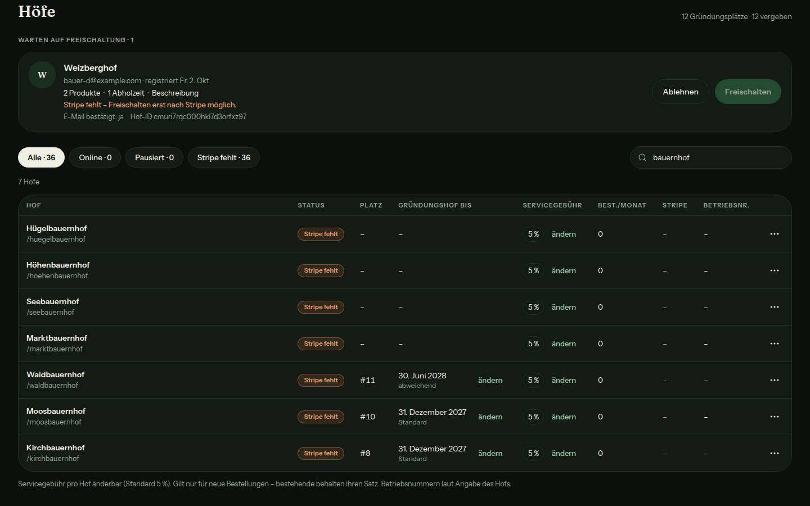
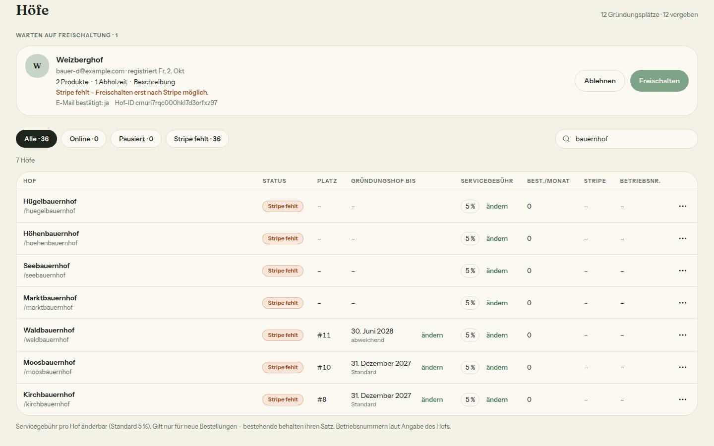
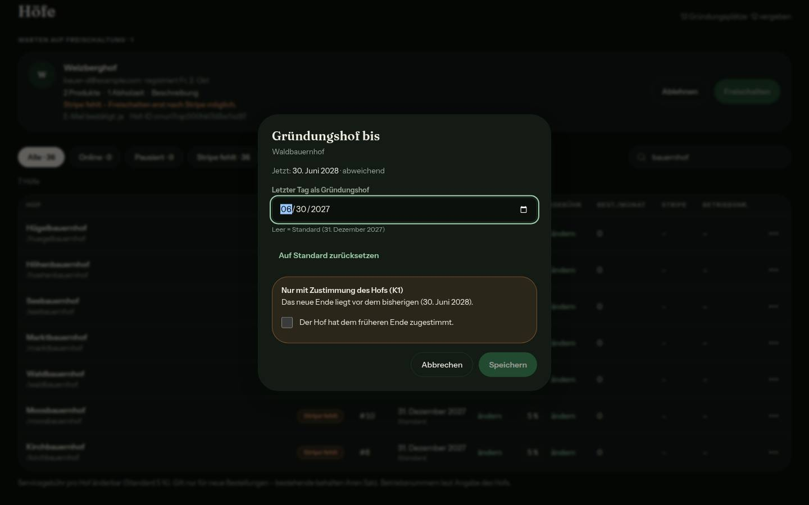
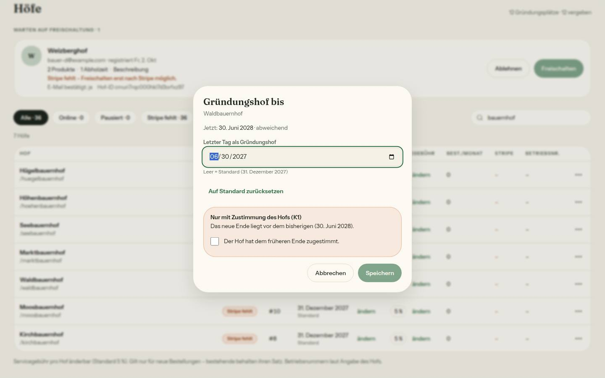
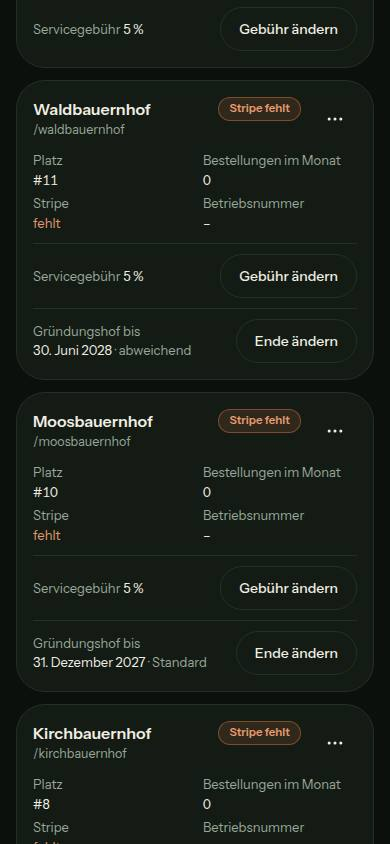
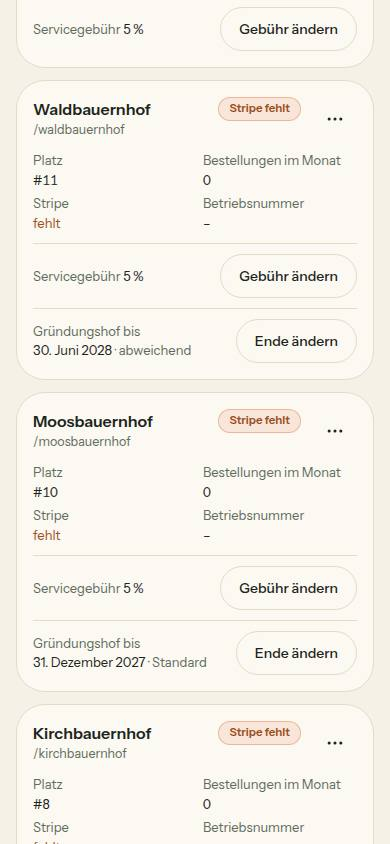

# Nr. 62 – Gründungs-Enddatum je Hof (K2)

## Was geändert wurde
- `prisma/schema.prisma`: `Farm.gruendungBis DateTime? @db.Date` (null = Standard), sonst nichts.
- `prisma/migrations/20261012120000_gruendung_bis/migration.sql`: die freigegebene Expand-Migration (SQL unten).
- `src/lib/gruendungshof.ts`: `GRUENDUNG_BIS_STANDARD_TAG` (2027-12-31) samt Datum und Text, `bestimmeGruendungBis` (Platz ≤ 12 ? Spalte ?? Standard : null), `gruendungsKonditionenText` → `baueGruendungsZusage`, `verkuerztGruendung`(`Tag`), `baueGruendungAnzeige`, Texte für Spalte und Dialog; Zusage „2029, danach dauerhaft 3 %" und die vier unbenutzten Bausteine entfernt.
- `src/schemas/gruendungshof.ts` (neu): `gruendungBisSchema(jetzt)` – Tag oder leer (= Standard), nicht vor dem heutigen Wiener Tag, `bestaetigt` boolean, eigene Sätze.
- `src/server/queries/admin.ts`: schmale `ladeHoefeFuerGruendung`, der EINE Lader `ladeGruendungBis` (Kennung oder Inhaber), `getAdminFarms` liefert Spalte und fertige Anzeige.
- `src/server/queries/einstellungen.ts`: `ladeTarifStand`, `ladeKonditionenHof`, `ladeEinstellungenUebersicht` holen den Lader parallel; `src/server/hofbereich.ts`: `ladeTarifZeile` reicht den Stand nur durch.
- `src/server/actions/admin.ts`: `setzeGruendungBisAction` – `verlangeAdminAktion`, Zod, früher als das wirksame Ende nur mit `bestaetigt` (K1), bedingtes `updateMany`, DEV-Log mit altem und neuem Wert, `revalidatePath` /admin, /settings/konditionen, /settings.
- `src/components/admin/gruendung-bis-dialog.tsx` (neu); `hoefe-ansicht.tsx`: Spalte, Kartenzeile, Dialog; `hof-aktion-dialog.tsx`: Zusage K2 mit dem Standard; `src/app/admin/page.tsx`: eine Zeile reicht `gruendung` durch.
- Tests neu: `migration-gruendung-bis`, `gruendung-bis-admin`, `gruendung-bis-lader`, `integration/gruendung-bis.int`; angepasst: `gruendungshof`, `admin-ansichten`, `tab-wechsel`, `hof-einstellungen`, `konditionen-uebergang`, `integration/einstellungen.int`.

```sql
SET lock_timeout = '5s';

ALTER TABLE "Farm" ADD COLUMN IF NOT EXISTS "gruendungBis" DATE;
```
`prisma migrate diff` gegen das Schema von origin/main gab nur `ALTER TABLE "Farm" ADD COLUMN "gruendungBis" DATE;` aus – keine weitere Änderung.

Wiederverwendet: `gruendungsplaetze`/`istGruendungshof`, `baueGruendungsZusage`, `kalendertagInWien`, `wienerMitternacht`, `formatDatumLang`, `BestellDialog`, `DialogFehler`, `Hinweiskarte`, `FELD`/`TEXT_GRUEN`/`KNOPF_RAHMEN`, Muster `setServiceFeeAction` und Haken-Zeile aus `bestell-detail`, `KEIN_GRUENDUNGSPLATZ`, `EINSTELLUNG_UNGUELTIG`. / Neu, weil: `GruendungBisDialog` – kein Dialog trägt ein Datum mit Zustimmung (der Servicegebühr-Dialog hat Gebühr und Monatsspalten); `ladeHoefeFuerGruendung` – die genannte schmale Abfrage gibt es nicht, der Admin rechnet die Plätze aus `getAdminFarms` (alle Höfe mit E-Mail und Monatsspalten, zu schwer für jede Hofseite).

## Annahmen
- `src/app/admin/page.tsx` steht nicht in der Dateiliste; ohne die eine Zeile (wie `aktivitaet`) bekäme die Spalte keine Daten.
- „abweichend" = am Hof steht ein eigenes Datum (auch eines gleich dem Standard); „Auf Standard zurücksetzen" setzt null.
- „Früher" misst am wirksamen Ende: Auch das Zurücksetzen von einem späteren eigenen Datum auf den Standard braucht die Zustimmung. Ohne Platz gibt es nichts zu verkürzen; bearbeitbar ist das Ende in der Liste nur mit Platz.
- Geschrieben wird bedingt auf den gelesenen Stand (zweiter Tab); „nicht vor heute" gilt für einen Tag, nicht für den Standard. Zusätzlich `revalidatePath('/settings')` für die Übersichtszeile.
- Datum in Liste und Dialog lang („31. Dezember 2027") wie in Tarif-Zeile und „Dein Stand".

## Nicht gelöst
- `docs/entscheidungen.md` nennt in O7 noch `GRUENDUNGS_KONDITIONEN`; den Eintrag K2 bringt der Doku-PR.
- Dauerhaftes Admin-Protokoll (S12) braucht eine Tabelle – Lauf 11.
- Aus 61 offen: Die Tarifkarten nennen auch Gründungshöfen „€ 19 im Monat – frühestens ab 1. Februar 2027" (`konditionen.ts`, nicht meine Grenze).

## Wie der Mensch es testet
1. `/admin` ab 1024 px als Betreiber: Spalte „Gründungshof bis" – Höfe auf Platz 1–12 zeigen „31. Dezember 2027 · Standard", alle übrigen „–".
2. „ändern": späteren Tag wählen, Speichern → Toast, Spalte „abweichend". Früheren Tag → orange Karte „Nur mit Zustimmung des Hofs (K1)", Speichern erst mit Haken. „Auf Standard zurücksetzen" + Speichern → wieder „Standard".
3. Als Inhaber eines Gründungshofs: Seitenleiste „Gründungshof / ohne Grundgebühr bis …", `/settings/konditionen` „Dein Stand" mit der Zusage, `/settings` Zeile „Konditionen und Tarif".
4. Wartenden Hof freischalten (mit freiem Platz): „Hofladen ohne Grundgebühr bis 31. Dezember 2027. Danach gelten die normalen Tarife – ohne Wahl Hoftor, kostenlos."

## Angepasste .md
`docs/ai/ARCHITECTURE.md` (Tarif-Zeile, §5 „Gründungs-Ende", Expand-Integrationstest), `docs/ai/DESIGN_SYSTEM.md` (Admin: Spalte, Karte, Dialog), `DEVELOPMENT.md` (Eintrag Nr. 62).

## Nacharbeit
- Das Datumsfeld zeigt im Bild das Format des englischen Testbrowsers (mm/dd/yyyy); ein deutscher Browser zeigt TT.MM.JJJJ.

## Regelvorschlag
Ursache: Ein Kalendertag wird an vier Stellen von Hand zum DATE-Wert (`new Date(\`${tag}T00:00:00.000Z\`)`); ohne das `Z` verschöbe er sich je nach Serverzone um einen Tag. Gegenmaßnahme: ein Helfer in `src/lib/wiener-tag.ts` und eine Wache in `tests/`, die das Muster nur dort zulässt. Ort: `wiener-tag.ts`, `tests/`.

## Bilder und Mockup-Abweichungen
Axe 0 Verstöße (Tabelle, Dialog, Karte; beide Themes). Tippflächen: „ändern" 44×59, „Ende ändern" 44×121, „Auf Standard zurücksetzen" 44×203, Haken-Zeile 44×438 px; 390 px ohne Querscrollen.

 
 
 

1. Spalte und Kartenzeile „Gründungshof bis" fehlen in den Mockups admin-hoefe-und-freischaltung und admin-mobil-unterwegs-freischalten – vom Auftrag verlangt (Bilder Tabelle, Karte). In der Karte steht die Beschriftung über dem Datum, damit „Ende ändern" bei 390 px neben dem Text bleibt (Bild Karte 390).
