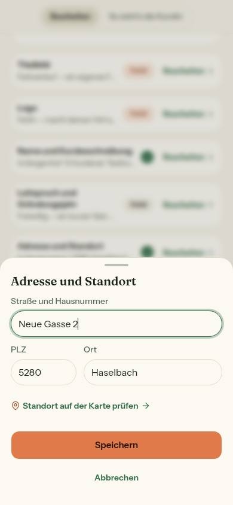
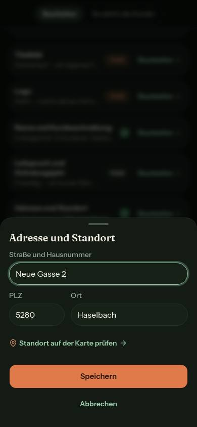

# Bericht Nr. 65 — Nacharbeit Lauf 9: Mein Hof speichern und Testzahlungen (Datenpfad)

Enthält Migration: **nein** (kein neues Paket, keine Änderung an Stripe-Aufrufen, Erstattung, Storno, Bestand oder gespeicherten Beträgen). Branch `nacht/2026-10-12/65-mein-hof-testzahlungen`, Basis `origin/main` e2f5add. Register N4 und Z4 (Ergänzungen Lauf 10).

## Was geändert wurde
- `src/schemas/auftritt.ts`: Alle Felder des Auftritts sind freiwillig, keins hat einen Standard (`sectionsConfig` ohne `.default([])`, `farmValues` optional).
- `src/server/actions/appearance.ts`: `saveAppearanceAction` schreibt nur, was mitkommt; die Werte löscht und legt sie nur an, wenn sie mitkommen; `ladeAuftrittStand` entfällt.
- `src/lib/abschnitt-stand.ts`: `bereiteAuftrittVor` (nur der Teil des Abschnitts), `bereiteAdresseVor` (Adresse als Ganzes, Land und Punkt vom Laden), `brauchtKartenpruefung` und `KARTENPUNKT_PRUEFEN` (Text und Ziel aus einer Quelle); `AuftrittStand`, `auftrittBasis`, `auftrittMitTeil`, `auftrittStandAus` entfallen.
- `src/components/mein-hof/abschnitt-speichern.ts`: `speichereAuftritt` schickt nur den Teil und liest nichts mehr; das Profil liest weiter frisch.
- `src/components/mein-hof/abschnitt-formulare.tsx`: Das Adress-Formular schickt Land und Punkt vom Laden mit; nach geänderter Straße heißt der Link „Standort auf der Karte prüfen".
- `src/lib/hof-kunden.ts`: `orderCount` ohne Testzahlungen; Status und Filter aus den gezählten Bestellungen, ohne gezählte keiner.
- Tests: `abschnitt-stand`, `abschnitt-speichern`, `hof-kunden` an die neuen Regeln; `hof-profil-absenden.test.ts` neu (echtes Absenden, ersetzt die Textvergleiche in `unterseiten-kopf.test.ts`); `hofseite-editor.test.ts` mit Wache über ganz `src/` (Syntaxbaum, Gegenproben); `testzahlung-wache.test.ts` mit engeren Grenzen und Gegenproben für `server/actions/orders.ts` und `server/teilerstattung.ts`; Integration: `auftritt-abschnitte` (Teil-Schreiben, zwei Tabs, Adresse, Altwerte), `testzahlungen` (vier Abfragen mit Stichtag, Bestellzahl der Kundin).
- Gelöscht: die drei Fälle von `ladeAuftrittStand` in `abschnitt-stand-lesen.test.ts` — die Funktion gibt es nicht mehr.

Wiederverwendet: `TEXTLINK`, `EINSTELLUNG_FUER_ZEILE.adresse` (Ziel), `profilMitTeil`, `alsLand`, `speichernOhneWurf`, lucide `MapPin`. Neu, weil: der Teil statt des Stands (`bereiteAuftrittVor`) und die Adress-Regeln gehören rein und testbar nach `src/lib`.

## Annahmen
- „Alle fünf Felder" sind Leitspruch, Gründungsjahr, Über uns, Abschnitte und Werte; Logo und Titelbild waren schon freiwillig.
- `ladeAuftrittStand` ist ohne Aufrufer und darum entfernt (Hinweis des Dirigenten: frischer Stand nur, wo nötig).
- Der Hinweis steht nur bei geänderter Straße (Wortlaut), nur mit gesetztem Punkt (sonst bleibt „setzen") und nicht bei leerem Feld. Er ersetzt den Text des bestehenden Links (ein Link, ein Ziel) und bekommt eine orange Kartennadel als Blickfang, in einer `aria-live`-Region.
- Der Status einer Kundin folgt der Bestellzahl. Lieblingsprodukte, erste und letzte Bestellung und „zuletzt vor …" beschreiben die Liste, die alle Bestellungen zeigt, und zählen weiter alle.
- Zwei Tabs im Integrationstest sind ein zweites Exemplar des Moduls (`import('…/abschnitt-speichern?zweiter-tab')`).

## Nicht gelöst
- Kundendetail: `weitereBestellungen(orderCount, gezeigt)` (`kunden-detail.tsx`) rechnet jetzt mit der Zahl ohne Testzahlungen, die Liste zeigt aber alle; eine Kundin nur mit Testzahlungen steht als „0 Bestellungen" in der Liste (`server/queries/customers.ts`). Beides liegt außerhalb der Dateigrenze.
- Ein Klick auf den Link vor dem Speichern verwirft die Eingabe im Blatt (Bestand, wie bisher bei „ändern").
- Profil: Eine zu kurze Beschreibung als Altwert sperrt jedes Profil-Speichern aus Mein Hof, und zwei Tabs bleiben ein Wettlauf, weil `updateProfile` das ganze Profil prüft und schreibt (`farm.ts`, außerhalb).

## Wie der Mensch es testet
- `/farm-page` bei 390 px, Hof mit Standort: „Adresse und Standort" → Bearbeiten → andere Straße tippen → der Link heißt „Standort auf der Karte prüfen"; alte Straße zurück → „ändern". Speichern → Land und Kartenpunkt im Hof-Profil unverändert.
- Mein Hof in zwei Tabs: in Tab A „Über uns" speichern, in Tab B ohne Neuladen den Leitspruch → beide stehen auf der Hofseite.
- `/customers` mit `STRIPE_LIVE_AB` (lokal): Eine Kundin mit Testzahlung zeigt eine Bestellung weniger, der Umsatz wie bisher ohne sie.

## Prüfung
- `pnpm typecheck` grün; `pnpm lint` 7 Fehler / 7 Warnungen wie `main` (alle in fremden Dateien), `pnpm exec eslint` über die 17 eigenen Dateien sauber; `pnpm test --maxWorkers=2` 328 Dateien / 6658 Tests grün.
- Integration unter `flock`: `auftritt-abschnitte` 26/26 (gegen die alte Aktion 5 rot aus dem richtigen Grund, auch die zwei Tabs: Tab B setzte „Über uns" zurück), `testzahlungen` 13/13.
- Zuerst rot: Schema ohne Standard 1, Speicherweg 5, Adress-Formular 1, Bestellzahl 4, Wache 1. Gegenprobe Hof-Profil: alter Maßstab bzw. ganzes Formular je 1 rot, Datei danach byteweise zurück.
- Browser (390 px, Seed-Hof, nichts gespeichert): Link 44 px hoch, Axe auf dem Blatt hell und dunkel je 0 Verstöße, 0 unvollständig.

## Angepasste `.md`
ARCHITECTURE §4 (Mein Hof) und §5 (Zahlungen), CODING_STANDARDS §2, DESIGN_SYSTEM (Mein Hof), TESTING_GUIDELINES §1 (Absenden ohne DOM, zwei Fenster in der Integration), DEVELOPMENT.md (Eintrag Nr. 65), `docs/betrieb/stripe-live.md`.

## Nacharbeit
Kundendetail „weitere Bestellungen" und Kundinnen nur mit Testzahlungen (siehe oben); Profil-Speichern mit Altwert.

## Regelvorschlag
Ursache: Der Schutz vor dem Überschreiben lag nur im Browser; die Aktion machte aus jedem fehlenden Feld `null`. Gegenmaßnahme (Prüfung vor Textregel): eine Wache am Syntaxbaum über `src/server/actions`, die in `update`-Daten kein `feld ?? null` für ein freiwilliges Feld zulässt — ein fehlendes Feld bleibt stehen, Leeren kommt ausdrücklich als `null`. Ort: `tests/`, Satz in CODING_STANDARDS §4.

## Bilder (Mein Hof, Adress-Formular nach geänderter Straße, 390 px)
Kein Mockup für das Adress-Blatt; der Zustand folgt DESIGN_SYSTEM, keine Abweichung.

