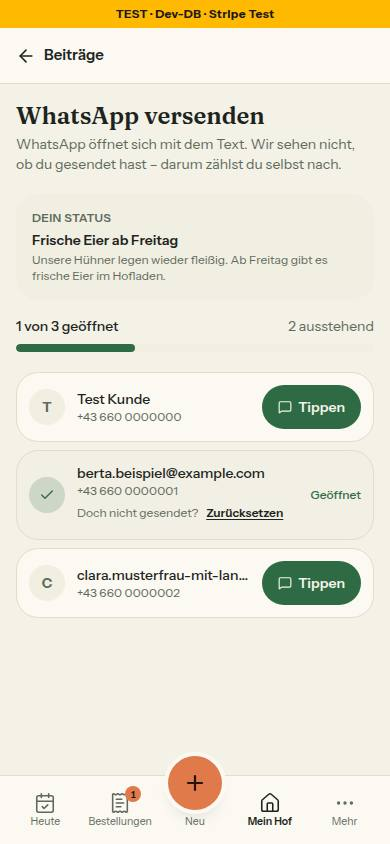
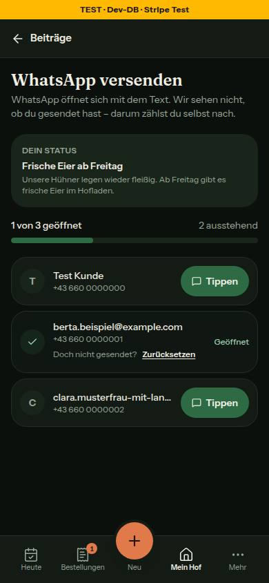
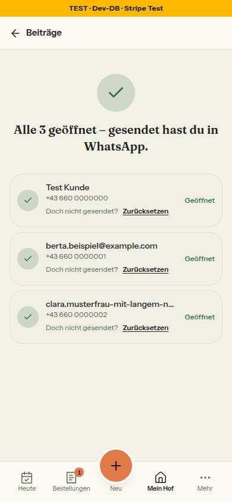

# Bericht Nr. 66 — WhatsApp an Abonnentinnen: ehrlich, je Person, fortsetzbar (Register W1)

Enthält Migration: **ja**, genau die freigegebene Expand-Migration `prisma/migrations/20261012200000_whatsapp_getippt/` (kein neues Paket). Branch `nacht/2026-10-12/66-whatsapp-geoeffnet`, Basis origin/main dc89213. `prisma migrate diff` gab `ALTER TABLE "StatusPost" ADD COLUMN "whatsappGetippt" TEXT[] DEFAULT ARRAY[]::TEXT[];` aus, von Hand um `IF NOT EXISTS` und `lock_timeout` ergänzt:

```sql
SET lock_timeout = '5s';

ALTER TABLE "StatusPost" ADD COLUMN IF NOT EXISTS "whatsappGetippt" TEXT[] DEFAULT ARRAY[]::TEXT[];
```

## Was geändert wurde
- `prisma/schema.prisma`: `StatusPost.whatsappGetippt String[] @default([])` (Abonnements-IDs) mit W1-Kommentar; Zähler und Empfängerzahl bleiben.
- `migration.sql`: die eine Spalte, nullable, Default nur im Katalog, kein Backfill, kein UPDATE.
- `src/lib/whatsapp-versand.ts` (neu, rein): Sätze `WHATSAPP_VERSAND_TEXT`, `versandStand` (zählt nur heutige Abonnentinnen), `nachSeitenEreignis` (geöffnet erst nach Verlassen und Rückkehr).
- `src/schemas/status-post.ts`: `whatsAppGetipptSchema` (zwei cuid, ein boolean) ersetzt das Zähler-Schema.
- `src/server/actions/status-posts.ts`: `setzeWhatsAppGetippt` ersetzt `markWhatsAppSent` — EIN UPDATE mit `array_remove`/`array_append`, `whatsappSentCount` = Länge, Beitrag und Abo über `farmId` in der WHERE-Klausel, Liste per `RETURNING` zurück.
- `src/server/queries/status-posts.ts`: `getStatusPostForWhatsApp` liefert `getippt` und je Person id, Name, Nummer (feste Reihenfolge); neu `zaehleWhatsAppAbonnentinnen` (dieselbe Bedingung); `whatsappGetippt` in `StatusPostSummary` (Annahmen).
- `src/lib/mein-hof-beitraege.ts`: Knopf „WhatsApp · n von m" (n = Länge der Liste, m = heutige Abonnentinnen) für aktive und vergangene Beiträge, solange m > n.
- `src/app/(hof)/farm-page/page.tsx`: nur die Abonnentinnen-Zahl laden (einmal je Seitenaufruf) und übergeben.
- `send-whatsapp/page.tsx`, `whatsapp-tap-client.tsx`: Zustand vom Server, Speichern bei der Rückkehr statt `setTimeout`, je Person „Zurücksetzen", ehrliche Sätze, Action nie im setState-Updater.
- Tests neu: `whatsapp-versand.test.ts` (Regeln, Quelltext-Wache mit Gegenprobe), `migration-whatsapp-getippt.test.ts`, `integration/whatsapp-getippt.int.test.ts`; angepasst: `status-posts`, `beitraege-hilfe`, `mein-hof-seite`.
- `docs/ai/BAUSTEINE.md` mit `pnpm bausteine` erzeugt (sonst rot: `bausteine-verzeichnis.test.ts`).

Wiederverwendet: `toWaPhone`, `teilenLink`, `FOKUS_RAHMEN`, `angemeldeterHof`, `meldeFehler`, Wachen-Muster von Nr. 62. / Neu, weil: Regeln und Sätze für „geöffnet" und die Rückkehr gehören rein und testbar nach `src/lib` — kein Baustein passte.

## Annahmen
- **Grenze um zwei Zeilen erweitert:** n = `whatsappGetippt.length` braucht das Feld in `StatusPostSummary`/`getStatusPostsForFarm` (Quelle von `beitraegeUebersicht`); `getActiveStatusPost` (Nr. 68) unberührt. `zaehleWhatsAppAbonnentinnen` steht hinter `getStatusPostForWhatsApp`.
- „Doch nicht gesendet? Zurücksetzen": die Frage als Text, „Zurücksetzen" als Knopf. Die Abo-Prüfung gilt auch beim Zurücksetzen.
- Balken und Zähler der Liste aus der Schnittmenge mit den heutigen Abonnentinnen. (Die Annahme „Knopf nur mit `sentViaWhatsApp`" ist mit Runde 1 entfallen.)
- Ein Fokus ohne vorheriges Verlassen zählt nicht. Fertig: Abschluss-Satz oben, Liste bleibt darunter (Zurücksetzen bleibt möglich).

## Nicht gelöst
- Die Zeile „… und WhatsApp" hängt weiter an `sentViaWhatsApp` aus `publishStatusPost` (Datei von Nr. 67); der Knopf seit Runde 1 nicht mehr.
- n im Knopf zählt Kennungen inzwischen Abgemeldeter mit (Wortlaut der Freigabe), die Liste nicht. `BEITRAG_WHATSAPP_MAX` (`eingabegrenzen.ts`, außerhalb) hat keinen Nutzer mehr. `APP_URL` im Client (Server rendert farmerzone.at, Browser die eigene Adresse) bleibt wie bisher.

## Wie der Mensch es testet
- `/farm-page?reiter=beitraege`, Beitrag mit WhatsApp-Häkchen, drei WhatsApp-Abos: Knopf „WhatsApp · 0 von 3".
- Knopf → `/status/<id>/send-whatsapp` am Handy: „Tippen" bei A → WhatsApp öffnet sich → zurück → A „Geöffnet", „1 von 3 geöffnet"; neu laden → bleibt; „Zurücksetzen" → A wieder offen.
- Zwei Tabs, je eine andere Person öffnen → nach Neuladen beide geöffnet. Alle geöffnet → „Alle 3 geöffnet – gesendet hast du in WhatsApp."; Mein Hof ohne Knopf, bis eine neue Abonnentin kommt („WhatsApp · 3 von 4").

## Prüfung
- Typecheck grün; Lint 0 Fehler / 6 Warnungen (main 7: die Warnung `farmName` im alten Client ist weg); `pnpm test` 342 Dateien / 6891 Tests grün.
- Integration unter `flock`: `whatsapp-getippt.int.test.ts` 9/9. Gegenprobe Lesen-dann-Schreiben ohne Abo-Prüfung: 2 rot (3 von 6 gleichzeitigen Tipps verloren, fremdes Abo angenommen).
- Zuerst rot gegen den alten Stand: 11 Fälle (Action, Client-Wache, Knopf, Migration mit NOT NULL).
- Browser 390 px (Seed-Hof bauer-01, Daten danach entfernt): Axe hell und dunkel 0 Verstöße, 0 unvollständig; „Tippen" 99×44, „Zurücksetzen" 85×44 px; kein waagrechtes Scrollen. Rückkehr per blur/focus nachgestellt: nur Fokus speichert nichts, Verlassen und Rückkehr speichert; Zurücksetzen schreibt [] und 0.

## Angepasste `.md`
ARCHITECTURE §5 (W1), CODING_STANDARDS §4 (Liste in Array-Spalte), DESIGN_SYSTEM (Reiter Beiträge, Versandseite), DEVELOPMENT.md (Nr. 66), BAUSTEINE.md (erzeugt).

## Nacharbeit
Contract für `whatsappSentCount`/`whatsappRecipientCount` (eigene Freigabe); Register-Eintrag W1 mit den Sätzen (Doku-PR).

## Regelvorschlag
Ursache: Die Zusage „Gesendet" stand im Client ohne Quelle und ohne Prüfung. Gegenmaßnahme (Prüfung vor Textregel): die Quelltext-Wache aus `whatsapp-versand.test.ts` (keine Zeitschaltung, keine Zustell-Sätze, keine Action im setState-Updater) auf alle Client-Komponenten unter `src/app/(hof)` ausweiten. Ort: `tests/`.

## Bilder (390 px, eine Person geöffnet, zwei offen)
Kein Mockup für die Tipp-Liste (Aufbau wie heute). Vom Bestand abweichend: Zählhinweis unter der h1 statt „Tippe auf Senden", geöffnete Zeilen ohne Abblenden und Durchstreichen (Kontrast des Knopfs; „geöffnet" heißt nicht „erledigt"), der Satz „Fortschritt wird automatisch gespeichert" entfällt; der Fertig-Zustand ist kein eigener Bildschirm ohne Liste mehr — oben der Abschluss-Satz, darunter die Liste mit „Zurücksetzen" (drittes Bild).

**Mockup-Abweichung:** `mobil-h4-beitraege-teilen-je-beitrag.html` zeigt einen vergangenen Beitrag „Nur auf der Hofseite" ohne WhatsApp-Knopf. Nach dem Wortlaut der Freigabe „66" (aktiv und vergangen, solange m > n) bekommt er bei Abonnentinnen „WhatsApp · 0 von m" — begründete Abweichung. Das Bild des Reiters Beiträge liefert Nr. 67 (dort beauftragt).





## Nachbesserung Runde 1
- **Blocker behoben** (`src/lib/mein-hof-beitraege.ts`): Der Knopf hängt nicht mehr an `sentViaWhatsApp` — nur noch „kein Entwurf" und m > n (Freigabe „66", W1: Stand von heute, nicht der beim Veröffentlichen). So führt er auch von vergangenen Beiträgen ohne Häkchen zurück in die Tipp-Liste.
- **Tests** (`beitraege-hilfe.test.ts`): „ohne Häkchen, m > n → WhatsApp · 0 von 5" (vorher fest null) und „vergangen ohne Häkchen → WhatsApp · 1 von 2" zuerst rot (1 Fall), danach grün; „m = 0 → kein Knopf" auch ohne Häkchen und für aktive Beiträge.
- **Bild 3:** Fertig-Zustand bei 390 px hell (Axe 0 Verstöße, 0 unvollständig), Testdaten beim Seed-Hof bauer-01 danach entfernt.
- **Prüfung:** Typecheck grün; Lint 0 Fehler / 6 Warnungen; `pnpm test` 342 Dateien / 6892 Tests grün.
- **Testen:** `/farm-page?reiter=beitraege` mit einem vergangenen Beitrag ohne WhatsApp-Häkchen und drei WhatsApp-Abos → Knopf „WhatsApp · 0 von 3" führt in die Tipp-Liste; ohne WhatsApp-Abos kein Knopf.
- **Angepasste `.md`:** dieser Bericht (Annahmen, Nicht gelöst, Abweichungen, Bild), `DEVELOPMENT.md` (Nr. 66).
