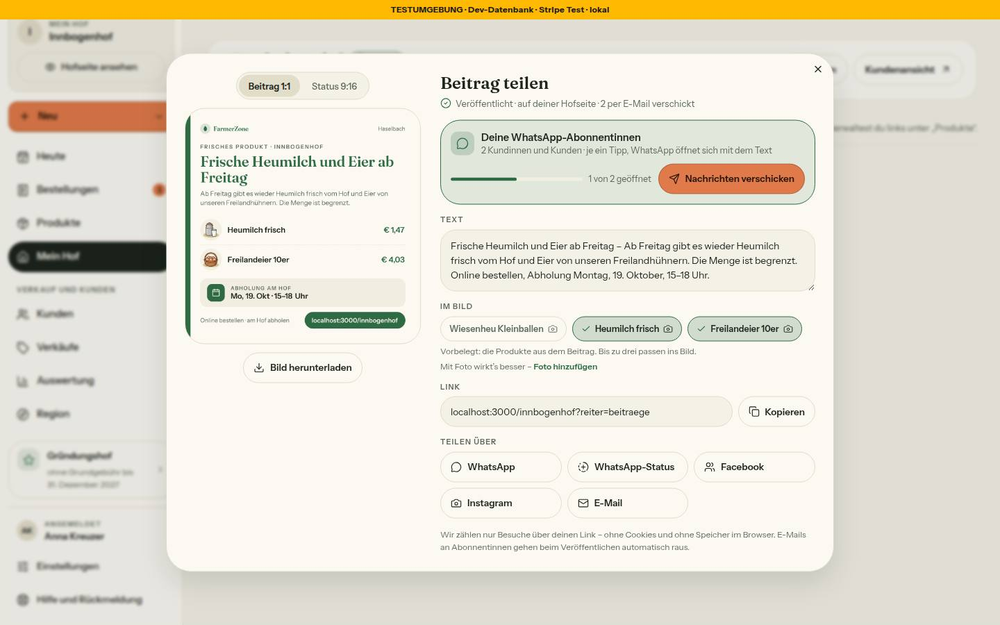
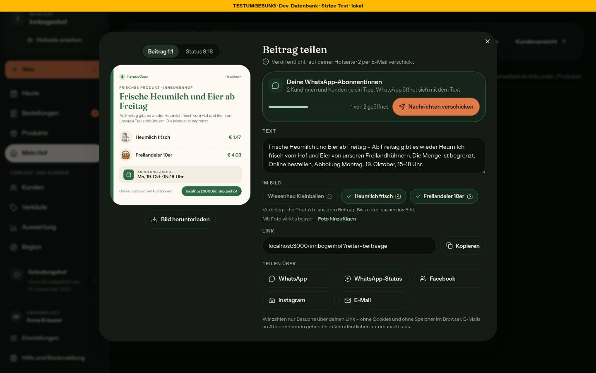
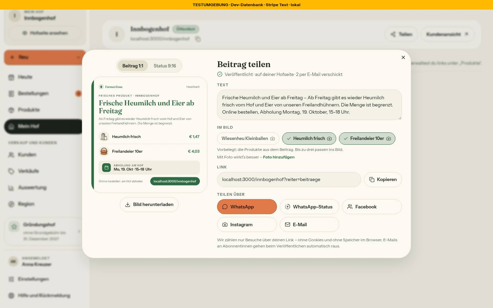
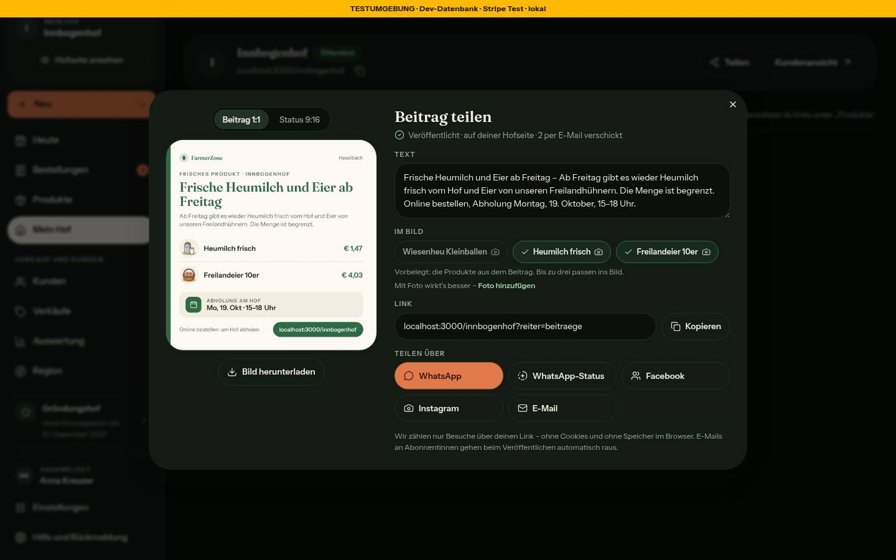
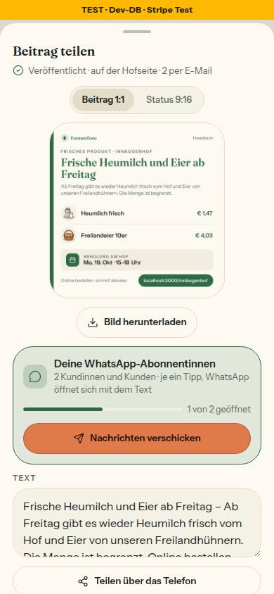
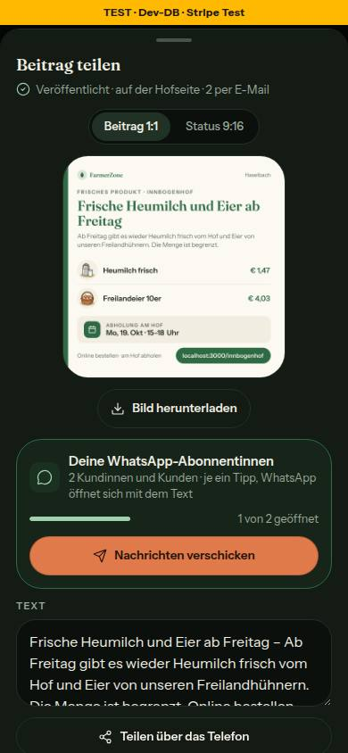
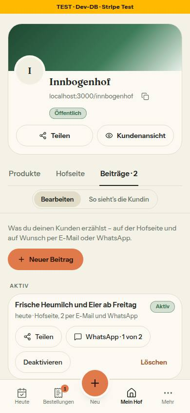
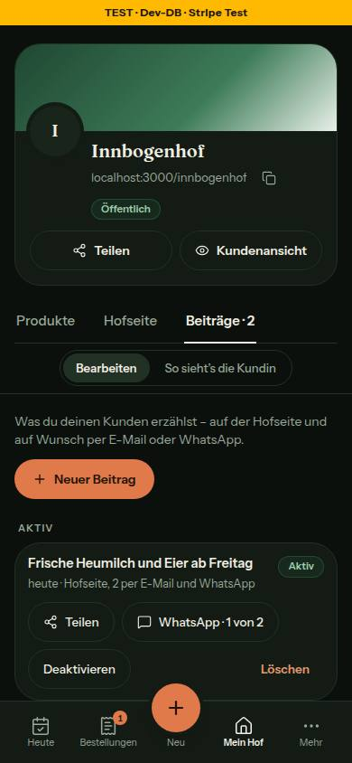

# Nr. 67 · Beitrag teilen = ein Fenster (Register T5)

## Was geändert wurde
- `src/lib/teilen-fenster.ts`: `TeilenFensterDaten` mit `art: 'hof' | 'beitrag'` (Beitrag: beitragId, titel, link `?reiter=beitraege`, vorbelegt, ohneFoto, abonnentinnen, versandPfad, email), `kanalZiel` nimmt den Link aus den Daten (`linkMitKanal`), dazu die reinen Regeln `beitragVorbelegung`, `anfangsAuswahl`, `beitragWhatsApp`, `beitragTextVorschlag`, `plakatPfad`, `orangerKnopf`, `fensterFussnote` und die Sätze mit Zusage `BEITRAG_TEILEN_TEXT`.
- `src/components/teilen/teilen-fenster.tsx`: Beitrag-Modus nach den Mockups — Titel und Unterzeile, Abonnentinnen-Karte mit dem einzigen orangen Knopf, Vorbelegung, Kamera-Symbol und Foto-Satz, kein Plakat, „Teilen über das Telefon"; Bild mit `?b=` ohne `v`.
- `src/components/teilen/beitrag-teilen.tsx` (neu): `ladeBeitragFenster` (wirft nie, meldet wie `speichernOhneWurf`) und `BeitragTeilenKnopf` für den Reiter.
- `src/server/actions/teilen-fenster.ts` (neu): `ladeTeilenFensterBeitragAction` — nur lesen, Zod, Hof aus der Sitzung, sonst ein Satz.
- `src/server/queries/teilen-bild.ts`: `ladeTeilenFensterBeitrag` (Besitz in der WHERE-Klausel, `beitragDarfInsBild`, Abonnentinnen über `zaehleWhatsAppAbonnentinnen`); `ladeTeilenBildQuelle` liest `imageUrl`; `ladeTeilenVorschau` rechnet die Prüfsumme samt Fotos wie die Route; `getTeilenFensterDaten` liefert `art: 'hof'` und `link`.
- `src/app/(hof)/status/new/status-new-client.tsx`: beide WhatsApp-Häkchen samt Zusammenfassung weg; nach dem Veröffentlichen öffnet sich das Fenster (Schließen → Reiter), Toast nur ohne Hofseite oder wenn das Fenster nicht kommt.
- `src/app/(hof)/status/new/page.tsx`: Zählung der WhatsApp-Abonnentinnen entfällt.
- `src/server/actions/status-posts.ts` (nur `publishStatusPost`) und `src/schemas/status-post.ts`: kein `sendWhatsApp`; `sentViaWhatsApp`/`whatsappRecipientCount` werden nicht mehr gesetzt.
- `src/lib/mein-hof-beitraege.ts`: `teilen` nur aktiv und auf der Hofseite; „WhatsApp" in der Zeile, sobald `whatsappGetippt` nicht leer ist; `sentViaWhatsApp` raus aus `BeitragQuelle` (Knopf ohne Häkchen wie 66 Runde 1).
- `src/components/mein-hof/beitrag-zeile.tsx`: „Teilen" zuerst, dann WhatsApp, Deaktivieren, Vorlage, Löschen (Mockup); `beitraege-reiter.tsx`: Hinweis wie im Mockup, Kopfkommentar.
- Tests: neu `tests/beitrag-teilen.test.ts` (Beitrag-Modus, Action) und `tests/teilen-vorschau-version.test.ts` (über die echte Route); angepasst `status-posts`, `beitraege-hilfe`, `mein-hof-seite`, `mein-hof-umschalter`, `teilen-fenster`, `bild-url-pruefung` und zwei Integrationstests (nur `sendWhatsApp: false` aus der Eingabe).
- Wiederverwendet: `TeilenFenster`, `teilenBildPfad` (69), `zaehleWhatsAppAbonnentinnen`/`WHATSAPP_VERSAND_TEXT` (66), `beitragDarfInsBild`, `produktBildQuelle`/`heldKandidaten`, `istEigenesBild`, `hofAdresse`, `beitragIdSchema`. / Neu, weil: die Action darf nicht in `status-posts.ts` (Grenze: nur `publishStatusPost`), der Loader nicht in `teilen-fenster.tsx` (sonst zöge Heute die Server-Action mit).

## Befund aus 69, behoben in 67
`ladeTeilenVorschau` rechnete `v` ohne Fotos, die Route mit — bei Höfen mit eigenem Produktfoto lag das Open-Graph-Bild nur 60 s im CDN. Jetzt dieselben Held-Kandidaten (`istEigenesBild`); Test gegen den `cache-control` der echten Route, Gegenprobe rot.

## Annahmen
- Fenster und „Teilen" nur für Beiträge auf der Hofseite: Bild (`?b=`) und Link zeigen andere nicht (Route gibt 404). Ohne Hofseite bleibt der Toast.
- n im Fenster nie über m (`Math.min`), sonst Zählregel wie der Knopf.
- Kamera-Symbol und Foto-Satz nur im Beitrag-Modus (Wortlaut der Freigabe steht dort); Heute bleibt unverändert.
- Kommt das Fenster nach dem Veröffentlichen nicht (Netz, Fehler), Toast und Reiter wie bisher — der Beitrag ist veröffentlicht.
- `heute-teile.tsx` blieb unverändert: `getTeilenFensterDaten` liefert schon `art: 'hof'`.

## Nicht gelöst
- Bild-Route (69, `route.tsx`): im Beitrag-Modus gehen die verknüpften Produkte vor `?p=` — Umschalten unter „Im Bild" ändert das Bild nicht, solange eines davon kaufbar ist. Vorschlag für 69: `p` vor den verknüpften Produkten (das Fenster belegt sie ohnehin vor).
- `src/schemas/status-post.ts` lag nicht in der Grenzliste; die Freigabe verlangt „Schema anpassen" (eine Zeile).

## Wie der Mensch es testet
1. Als Hof `/status/new`: Beitrag mit zwei Produkten, „Auf meiner Hofseite" an → „Versand starten". Erwartet: Fenster „Beitrag teilen", Unterzeile, ohne WhatsApp-Häkchen im Schritt 2. Schließen → `/farm-page?reiter=beitraege`.
2. Mit WhatsApp-Abonnentinnen: Karte „n von m geöffnet", „Nachrichten verschicken" → `/status/<id>/send-whatsapp`; ohne: keine Karte, WhatsApp orange.
3. Reiter „Beiträge": „Teilen" nur beim aktiven Beitrag; Link im Fenster endet auf `?reiter=beitraege`, kopiert mit `&k=link`.
4. Beitrag ohne Hofseite veröffentlichen: Toast, kein Fenster.

## Angepasste `.md`
`docs/ai/DESIGN_SYSTEM.md` (Teilen: Beitrag-Modus), `DEVELOPMENT.md` (Eintrag Nr. 67), `docs/ai/BAUSTEINE.md` (erzeugt).

## Nacharbeit
Route (69) könnte `quelle.fotos` statt eigener Fotoabfrage nehmen; Foto-Satz auch für Heute entscheiden.

## Regelvorschlag
Ursache: Metadaten und Route rechneten dieselbe Prüfsumme an zwei Stellen. Gegenmaßnahme: Prüfsumme nur über die echte Route testen (wie hier). Ort: TESTING_GUIDELINES §2.

## Bilder und Mockup-Abweichungen (Axe 0 in allen Ansichten)
 
 
   
- „Abonnentinnen" statt „Abonnenten" (Karte, Fußnote) und Kamera-Symbol/Foto-Satz: Wortlaut der Freigabe (Bild Fenster 1440). Bei einer Person „1 Person" (Mockup zeigt nur die Mehrzahl).
