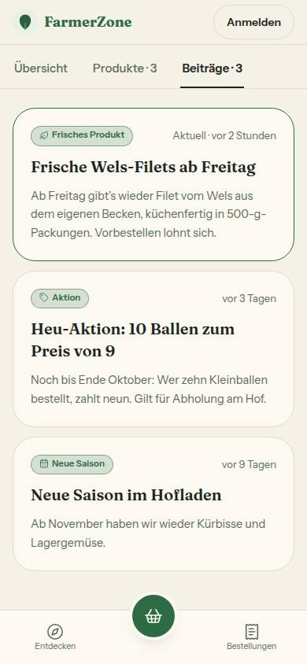
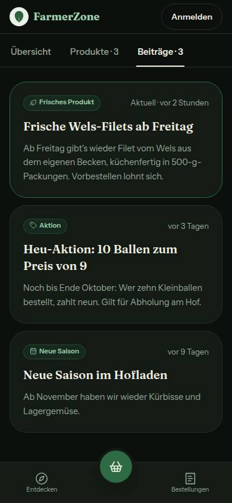
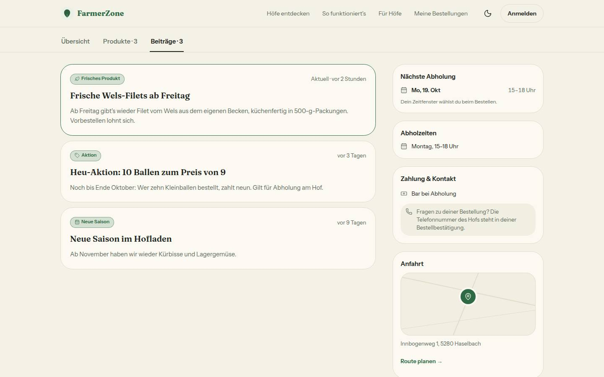
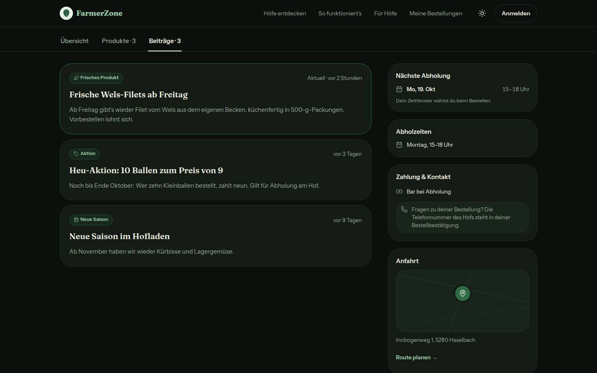

# Bericht Nr. 68 – Hofseite: alle aktiven Beiträge (Register F8, in der Freigabe „F7“)

Branch `nacht/2026-10-12/68-hofseite-beitraege`, gestapelt auf Nr. 66. Keine Migration, kein neues Paket.
Wiederverwendet: `StatusBadge`, `KARTE`, `ANLASS`, `vorWieLange`, `formatZahl`, `ladeBeitrag`-Muster (Stichworte beitrag, reiter, hofseite, status). / Neu, weil: `getActiveStatusPosts`, `beitragZeitText`, `HOFSEITE_BEITRAEGE_MAX` — dafür gab es keinen Treffer.

## Was geändert wurde
- `src/server/queries/status-posts.ts`: `getActiveStatusPosts(farmId, anzahl)` ersetzt `getActiveStatusPost` (neueste zuerst, bei gleicher Zeit nach Kennung, nur die sieben Felder der Karte per `select`, Frist beim Lesen wie bisher); Typ `ActiveStatusPost` bleibt als Listenelement.
- `src/lib/hofseite-kunde.ts`: `HOFSEITE_BEITRAEGE_MAX = 5`; `hofseiteReiter({ produktAnzahl, beitragAnzahl })` mit „Beiträge · n“ (`formatZahl`), Reiter nur bei n > 0; neu `beitragZeitText` („Aktuell · vor …“ nur am neuesten).
- `src/components/hofseite/hofseite-kunde.tsx`: Prop `beitraege` statt `activeStatus`; `Beitraege` (Liste) mit einer `Beitrag`-Karte je Eintrag, der neueste mit grünem Rahmen und „Aktuell“, Überschrift-Kennung je Karte, Symbol der Anlass-Marke in einer Zeile mit dem Wort.
- `src/app/(public)/[farmSlug]/page.tsx`: `ladeBeitraege` ruft `getActiveStatusPosts(farm.id, HOFSEITE_BEITRAEGE_MAX)`; ein Fehler geht weiter nur nach Sentry, die Seite bleibt (leere Liste).
- `src/components/farm/farm-page-view.tsx`: nur Prop-Typ und Durchreichen (`beitraege`) — außerhalb der Grenzen, siehe Annahmen.
- `tests/hofseite-kunde.test.ts`, `tests/hofseite-kunde-ansicht.test.ts`: Label, Reihenfolge, „Aktuell“ nur am ersten, eigene Kennung je Karte, ausgeblendeter Abschnitt; `tests/hofseite-einmal.test.ts`, `tests/telefon-nach-kauf.test.ts`: Prop-Name und Mock.
- `tests/integration/hofseite-beitraege.int.test.ts` (neu, echtes Postgres): Grenze 5, Reihenfolge, Entwurf/Frist/Ausgeblendet/fremder Hof, feste Reihenfolge bei gleicher Zeit, nur die Kartenfelder. Gegenprobe: mit entschärfter Abfrage 3 von 5 rot.

## Annahmen
- Die Mein-Hof-Vorschau braucht keine eigene Änderung: „So sieht’s die Kundin“ ist ein iframe derselben Route (`?vorschau=1`), `src/server/hofseite-vorschau.ts` lädt keine Beiträge (einziger Aufrufer war `page.tsx`) und blieb unverändert.
- `farm-page-view.tsx` musste mit: Der Typ `ActiveStatusPost | null` läuft dort durch, sonst ist der Typecheck rot. Bitte im Morgenbericht als Grenzerweiterung nennen.
- n im Reiter ist die Zahl der gezeigten Karten (höchstens 5), wie „Produkte · n“. Einen Hinweis auf weitere Beiträge zeigt das Mockup nicht, also gibt es keinen.
- Der Prop heißt `beitraege` (Fachbegriff deutsch), nicht mehr `activeStatus`. Der Sentry-Tag `hofseite-beitrag` bleibt.

## Nicht gelöst
- `StatusBadge` (`src/components/ui/status-badge.tsx`, außerhalb der Grenzen) setzt ein Symbol über das Wort; dasselbe gilt für die Haken-Marken in „Über uns“. In der Beitragskarte mit einem Wrapper umgangen, sonst unverändert.
- Register F8 ist noch nicht eingetragen (Doku-PR); im Code steht „Register F8“.

## Wie der Mensch es testet
- Als Hof drei Beiträge veröffentlichen (Mein Hof → Beiträge, „Auf der Hofseite zeigen“ an), dann `/<hof>?reiter=beitraege` ohne Anmeldung öffnen.
- Erwartung: Reiter „Beiträge · 3“; drei Karten, der neueste oben mit grünem Rahmen und „Aktuell · vor …“, die anderen nur „vor …“. Mit sieben Beiträgen nur die fünf neuesten und „Beiträge · 5“; abgelaufene und ausgeblendete fehlen. In Mein Hof → „So sieht’s die Kundin“ (Reiter Beiträge) steht dieselbe Liste.

## Angepasste .md
`docs/ai/DESIGN_SYSTEM.md` (Hofseite: Reiter, Beiträge-Liste), `DEVELOPMENT.md` (Eintrag Nr. 68), `docs/ai/BAUSTEINE.md` (erzeugt).

## Nacharbeit
Keine.

## Regelvorschlag
- Ursache: `StatusBadge` legt seine Kinder in einen Block-Span, ein Symbol steht dort auf eigener Zeile (Mockups: daneben); kein Test sieht das Layout.
- Gegenmaßnahme: optionales `symbol` im Baustein (Symbol und Wort in einer Zeile) plus Rendertest dafür; erst danach eine Textregel.
- Ort: `src/components/ui/status-badge.tsx`, danach `docs/ai/DESIGN_SYSTEM.md`.

## Bilder und Mockup-Abweichungen
Mockup `mobil-k2-hofseite-beitraege-alle-aktiven.html`. Testdaten: drei erfundene Beiträge bei einem Seed-Hof, danach gelöscht.
- 390 hell:  · 390 dunkel: 
- 1440 hell:  · 1440 dunkel: 
- Axe (wcag2a/aa/21): 0 Verstöße in allen vier Ansichten; unklar bleibt der Kontrast von 2–3 Elementen (Überschrift auf dem Titelbild, Adresszeile, bei 390 hell die Überschrift der ersten Karte; Token-Paar Text auf Karte). Reiter 48 px hoch; die Karten haben keine Bedienelemente.
- Abweichungen, alle im Bild sichtbar: (1) Reiter als unterstrichene Links statt Pillen (Bestand seit Nr. 10, nicht Teil von 68); (2) Karten mit Polster 22 und Radius 16 (`KARTE`) statt 18/18 wie die übrigen Karten der Seite; (3) Rahmen des neuesten `border-accent` statt Hex #3a6b4c (dafür gibt es kein Token); (4) Titelbild und rechte Spalte stehen um die Liste, das Mockup zeigt nur Reiter und Karten.
