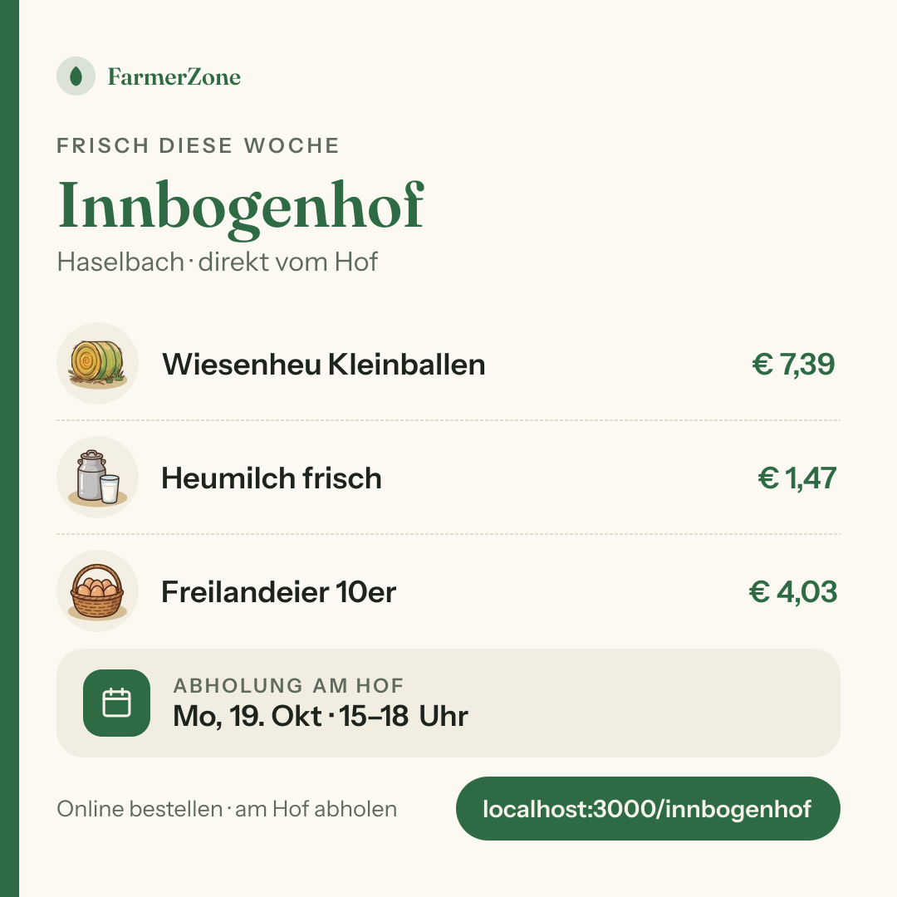
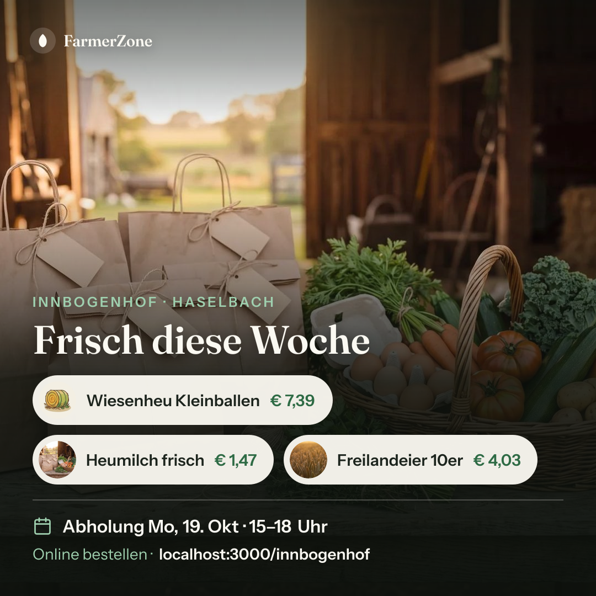
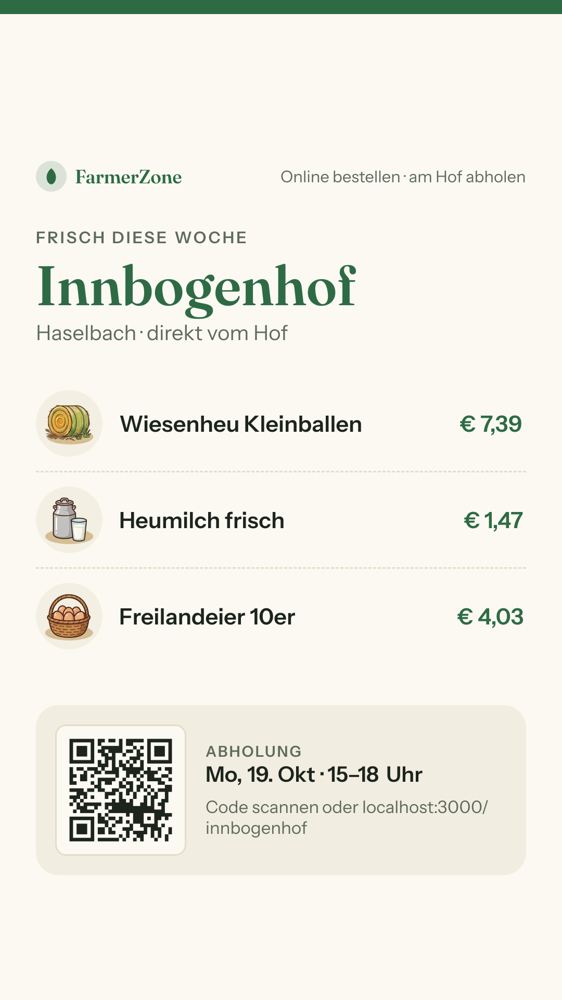
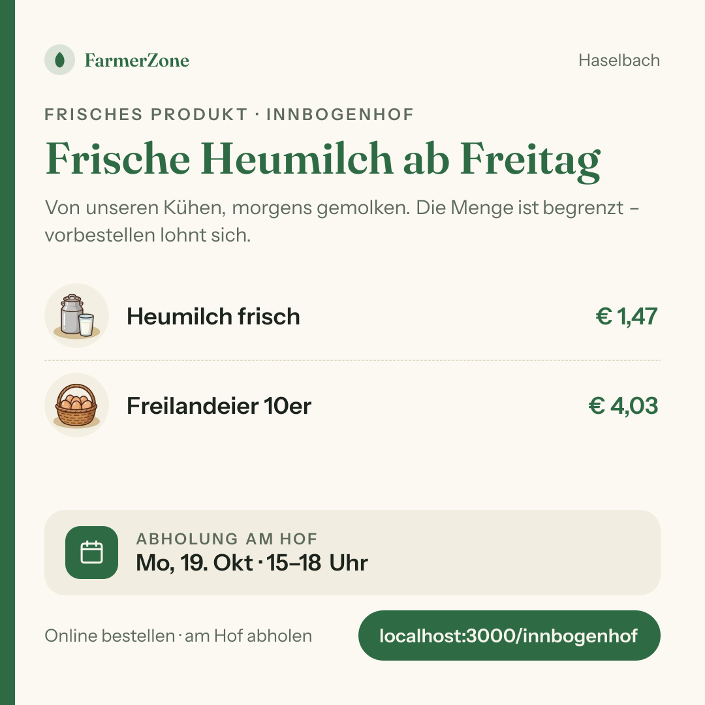
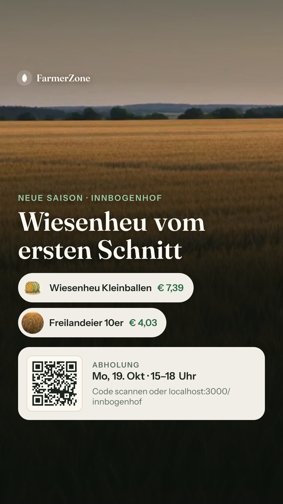

# Bericht Nr. 69 – Teilen-Bild neu: Marktkarte, Foto-Held, QR nur in der Story (Register T6)

## Was geändert wurde
- `src/lib/teilen-bild-quellen.ts` (neu): Quellenkette je Zeile (eigenes Foto → Illustration der Kategorie → „Sonstiges"), Reihenfolge für Variante B, Lader mit Zeitlimit 1,5 s (Abruf und Umwandeln) und Größenlimit 1,5 MB, ohne Umleitung, Format an den ersten Bytes, Umwandlung über sharp in JPEG, Schriften einmal je Prozess.
- `src/lib/teilen-bild.ts`: Beitrag (Anlass, Titel, zwei Sätze), Zugriffsregel `beitragDarfInsBild`, `teilenBildAuswahl` (verknüpft ∩ kaufbar → `p` → Standard; Familie zählt über jede Größe), `abholTermin` mit Datum, Prüfsumme mit Beitrag und Fotoadressen.
- `src/components/teilen/teilen-bild-grafik.tsx`: Variante A und B nach den Mockups, QR nur in der Story, `TEILEN_BILD_FARBE` neu (helles Theme, Herkunft je Wert).
- `src/app/(public)/[farmSlug]/opengraph-image/route.tsx`: `?b=` (cuid, sonst 404); Beitrag nur nach `beitragDarfInsBild`, sonst 404; Produktfotos und Beitrag unter derselben DB-Frist; Fotos nur mit `istEigenesBild`; Schriften im `ImageResponse`; kurzer Cache, wenn ein Foto nicht kam.
- `src/schemas/teilen.ts`: `b` als cuid. `src/lib/teilen-kanal.ts`: `teilenBildPfad` mit `beitrag`.
- `next.config.ts`: `outputFileTracingIncludes` für die Route: Schriften, `public/categories/*.webp`, sharp-Binärpakete (Schlüssel mit Nexts picomatch gegen den Routenpfad geprüft).
- `src/assets/fonts/` (neu): Fraunces72pt-SemiBold, InstrumentSans-Regular/-SemiBold (TTF, sha256 geprüft), je mit `OFL.txt`.
- Tests: `tests/teilen-bild.test.ts` angepasst und erweitert, `tests/teilen-bild-quellen.test.ts` neu. Gegenprobe: vier Regeln gebrochen → 10 Tests rot.
- `docs/ai/BAUSTEINE.md` mit `pnpm bausteine` erzeugt (nur die drei eigenen Einträge); sonst wäre `bausteine-verzeichnis.test.ts` rot.

Wiederverwendet: `istEigenesBild`, `bildFormat`, `mitZeitlimit`, `kategorieBildPfad`, `einzeiligerFremdtext`, `stripStatusVariables`, `formatTagKurz`, `qrPfad`, `ladeTeilenBildQuelle`, sharp / Neu, weil: `teilen-bild-quellen.ts` – kein Baustein lädt Bilder für Satori (Netz mit Limits, sharp, Cache).

## Annahmen
- **Satori zeichnet kein WebP** („Unsupported image type"; nur PNG, JPEG, GIF, SVG – nachgelesen in `next/dist/compiled/@vercel/og`). Die Mappe nahm WebP an. Deshalb wandelt sharp Illustrationen und Fotos vorher in JPEG.
- Eine falsche Form von `b` ergibt 404 (fällt nicht still weg). Im Beitrag-Modus zwei Produktzeilen (wie im Mockup).
- Die Prüfsumme deckt die Fotoadressen ab (Regel: lang zwischenspeichern nur mit der Prüfsumme des Inhalts). Folge: Das OG-Bild eines Hofs mit Produktfotos bekommt nur den kurzen Cache, bis `ladeTeilenBildQuelle` `imageUrl` mitliest (siehe Nacharbeit).
- Instrument Sans kommt aus github.com/Instrument/instrument-sans, Commit 7fa2230 (Entscheidung des Dirigenten; die Adresse github.com/googlefonts/… gibt es nicht). Fraunces: undercasetype/Fraunces, Commit 7ccdec3.
- Fehlt eine Schrift, gibt es 503 wie bei jedem Zeichenfehler (keine stille Standardschrift). Eine fehlende Illustration wird einmal gemeldet, dann steht „Sonstiges" da.

## Nicht gelöst
- `server/queries/teilen-bild.ts` liegt außerhalb der Grenzen: Die Route liest Fotos und Beitrag selbst (zweite Abfrage).
- Das Teilen-Fenster (Nr. 67) bietet den Beitrag-Modus noch nicht an (`teilenBildPfad(…, { beitrag })` steht bereit).
- `ARCHITECTURE.md` („Vorschaubild und Icons": `?b=`, Schriften, sharp) und `DEVELOPMENT.md` liegen außerhalb der Grenzen.

## Wie der Mensch es testet
Vorschau: `/<slug>/opengraph-image` (1:1), `?format=story`, `?b=<Beitrags-ID>` jeweils mit beiden Formaten. Erwartung: 1:1 ohne QR, Story mit QR und „Code scannen oder …"; mit Produktfoto Variante B; ein Entwurf, ein abgelaufener oder fremder Beitrag ergibt 404.

## Angepasste .md
`docs/ai/DESIGN_SYSTEM.md` („Teilen"), `docs/ai/TECH_STACK.md` (Schriften im Repo, Zeile „Schriftdateien für das Teilen-Bild (OFL)", sharp für das Teilen-Bild), `docs/ai/BAUSTEINE.md` (erzeugt).

## Nacharbeit
- `ladeTeilenBildQuelle` soll `imageUrl` mitlesen; dann entfällt die zweite Abfrage, und die Prüfsumme der Metadaten passt wieder zur Route (langer Cache).
- Die Beitragsregel gibt es doppelt (`beitragDarfInsBild`, `getActiveStatusPost` in `status-posts.ts` von 66/68): eine gemeinsame Bedingung, wenn 68 die Datei umbaut.
- Die Anlass-Wörter stehen jetzt in fünf Dateien: eine Quelle (`BEITRAG_ANLASS_TEXT`) für alle.

## Regelvorschlag
Ursache: Die Freigabe nahm WebP in `next/og` an. Gegenmaßnahme: ein Test (umgesetzt: der echte Lader liefert aus der WebP-Illustration ein JPEG) und die Regel in TECH_STACK (Teilen-Bild: Bilder vorher über sharp in JPEG).

## Bilder (aus der Route, 1080 px, Dev-Server gegen Test-DB, ein Seed-Hof (bauer-01); Fotos über einen Abfang ohne Netz)
| Bild | Ladezeit (warm) | Größe |
|---|---|---|
|  quadrat-ohne-foto | 0,41 s | 136 KB |
|  quadrat-mit-foto | 0,64 s | 1,44 MB |
|  story-ohne-foto | 0,51 s | 206 KB |
|  story-mit-foto | 0,87 s | 1,39 MB |
|  quadrat-beitrag (ohne Foto) | 0,24 s | 130 KB |
|  story-beitrag (Beitragsfoto) | 0,79 s | 1,16 MB |

Die Adresse lautet lokal „localhost:3000/…" (`NEXT_PUBLIC_APP_URL` des Dev-Servers), in Produktion „farmerzone.at/…".

## Mockup-Abweichungen (mit Bild)
- Grüne Schrift (Titel, Preise, Marke) und die Kalender-Kachel nehmen `--accent` statt #1F4B32; Linien, QR-Rahmen und Kreise nehmen `--border` bzw. `--accent` 16 % statt der Werte im Mockup. Grund: Tokens statt Werte ohne Token (quadrat-ohne-foto).
- Der Termin steht als „Mo, 19. Okt · 15–18 Uhr" (`formatTagKurz`, CODING_STANDARDS) statt „Sonntag, 18. Oktober · …" (quadrat-ohne-foto).
- Titel von B: „Frisch diese Woche", der Hofname steht in der Vorzeile, statt „… am Kapellenhof". Grund: Die Präposition passt nicht zu jedem Namen (quadrat-mit-foto).
- Der Verlauf über dem Foto ist dichter als im Mockup, oben gibt es einen leichten Schatten, Marke und Vorzeile haben Schatten. Grund: Auf hellem Himmel waren sie unlesbar (story-mit-foto).
- Im 1:1 ist der Abstand je Zeile 8 statt 9 und der Abstand zum Titel 20 statt 22 Mockup-px; bei langem Titel stehen zwei Zeilen da. Grund: Das Mockup läuft mit drei Zeilen selbst über (quadrat-ohne-foto). Kleine Überschriften in 600 statt 700 (es sind nur 400/600 geladen).
