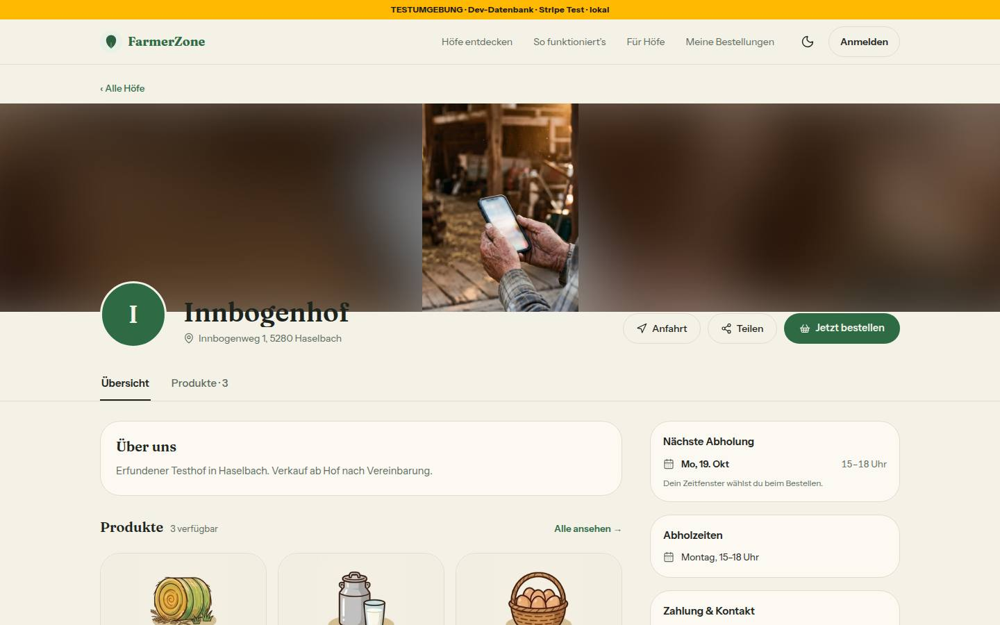
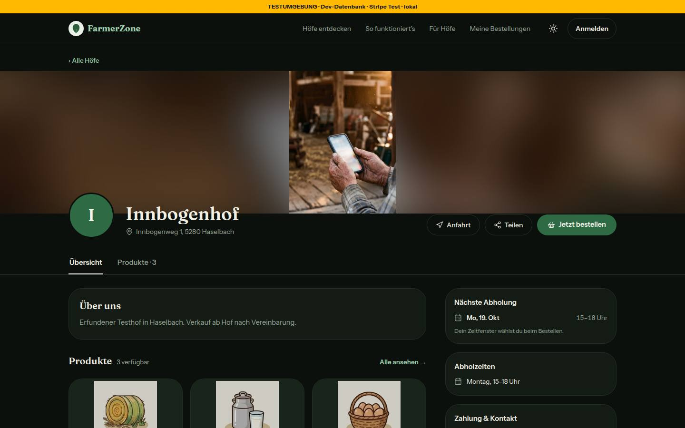
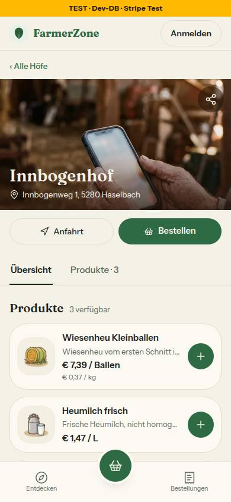
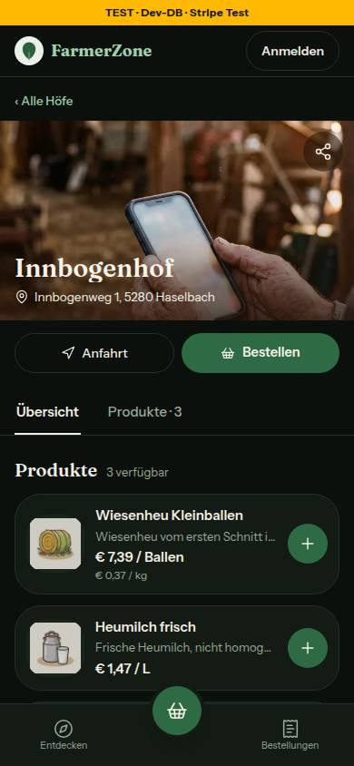
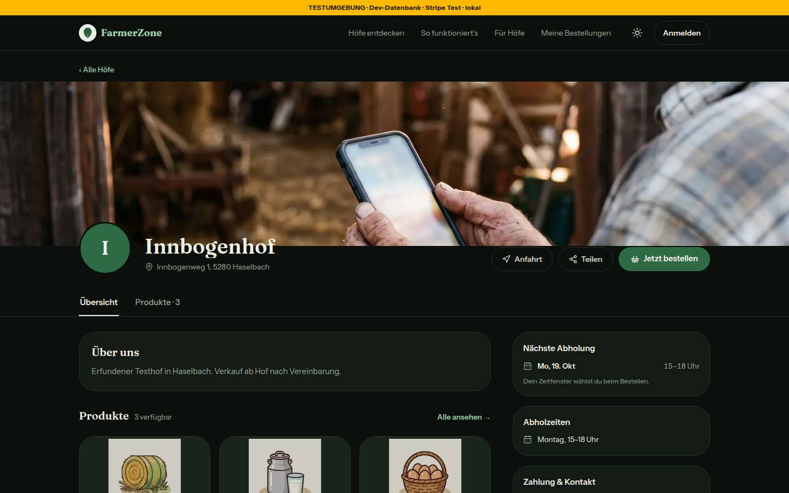
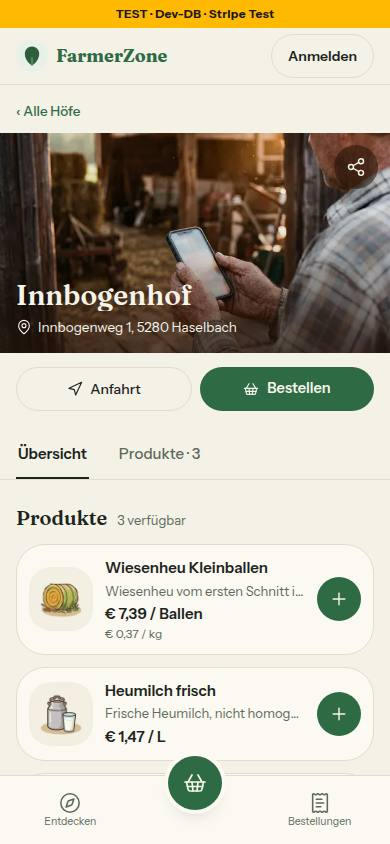
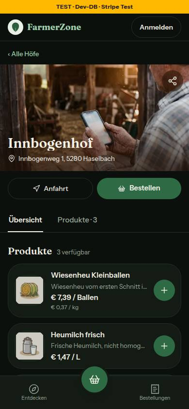

# Bericht Nr. 72 – Titelbild im Hochformat (Register N6, in der Freigabe „B2“)

Branch `nacht/2026-10-12/72-titelbild-hochformat`, gestapelt auf Nr. 68. Keine Migration, kein neues Paket.
Wiederverwendet: `titelbildFoto`, `titelbildVerlauf` (`src/lib/mein-hof.ts`), Schleier und Teilen-Knopf der Hofseite unverändert, `FOKUS_RAHMEN` (Stichworte titelbild, banner, bild, fokus, overlay). / Neu, weil: `src/lib/titelbild.ts` (Regel Hochformat, Maße lesen, Satz) und `components/hofseite/titelbild.tsx` (Rahmen mit zwei Lagen, `useBildmasse`) — dafür gab es keinen Treffer.

## Was geändert wurde
- `src/lib/titelbild.ts` (neu, rein): `titelbildDarstellung` (`ganz` nur bei höher als breit, sonst `beschnitt`), `leseBildmasse` (0 = unbekannt), `titelbildHinweis` (der Satz für Mein Hof, nur bei Hochformat).
- `src/components/hofseite/titelbild.tsx` (neu): `Titelbild` (Rahmen, Verlauf ohne Foto, Schleier am Handy, Knöpfe als `children`), `TitelbildBilder` (bei `ganz` ab 768 px: unscharfe Kopie mit Tönung `bg-primary-foreground/45` hinten, ganzes Foto `object-contain` vorn; beide `next/image` mit `fill`, `sizes="100vw"`, leerem Alt-Text), `useBildmasse` (Maße aus `onLoad`, nur für dieselbe Bildadresse).
- `src/components/hofseite/hofseite-kunde.tsx`: nur der Titelbild-Block; er ruft `Titelbild` auf, der Teilen-Knopf bleibt dort.
- `src/components/mein-hof/bild-bausteine.tsx`: Die Vorschau meldet ihre Maße (`onLoad`); bei Hochformat steht der Satz unter ihr.
- `tests/titelbild.test.ts` (neu, 18 Fälle): Hochformat, ein Pixel mehr Höhe, Quer, Quadrat, unbekannt; Maße aus dem Bild (0 = unbekannt); Satz nur bei Hochformat; zwei Bilder bei `ganz`, eines bei `beschnitt`, nur das vordere liest die Maße, Alt-Text leer; Server-Ausgabe immer ein Bild; Titelbild nur in `titelbild.tsx`, Satz nur in `lib`. Gegenprobe: mit `>=` und ohne `onLoad` vier Fälle rot.

## Annahmen
- Der Satz in Mein Hof steht, solange das Foto ein Hochformat ist — nicht nur direkt nach dem Hochladen: Die Maße kommen aus der Vorschau, einen Zustand „gerade hochgeladen“ gibt es dort nicht. Er steht über der bestehenden Zeile „Querformat wirkt am besten …“ (beide bleiben).
- Ein Quadrat bleibt beim Beschnitt; Hochformat heißt höher als breit.
- Nicht genannte Werte: Tönung 45 %, `blur-2xl`, Kopie 10 % größer (`scale-110`, sonst bleiben helle Ränder); in beiden Themes im Bild geprüft.
- `TitelbildBilder` ist exportiert, weil auf dem Server keine Maße entstehen: Der Test rendert die Darstellung dort direkt; `Titelbild` rendert auf dem Server immer `beschnitt`.

## Nicht gelöst
- Der einmalige Wechsel nach dem Laden bleibt, solange die Maße nicht gespeichert sind (Vormerkung Lauf 12, Expand-Migration, eigene Freigabe).
- `onLoad` → Zustand → Wechsel läuft nur im Browser (Node ohne DOM, TESTING_GUIDELINES §1). Gedeckt durch die Bilder (Hochformat: zwei Bilder im Dokument, Querformat eines) und den Test, der `onLoad` am vorderen Bild verlangt.
- Register N6 ist noch nicht eingetragen (Doku-PR); im Code steht „Register N6“.
- Bestand, nicht verändert: Ab 768 px ragt der Hofname einige Pixel in den unteren Rand des Titelbilds (Überlappung mit dem Hofzeichen), bei Querformat wie vorher.

## Wie der Mensch es testet
- Als Hof in Mein Hof → Hofseite → Titelbild ein Handyfoto im Hochformat hochladen; danach `/<hof>` ohne Anmeldung am Computer (ab 768 px) öffnen.
- Erwartung: Das ganze Foto steht mittig in voller Höhe, links und rechts eine weiche, dunkle Kopie; nach dem Laden wechselt die Ansicht einmal. Unter 768 px bleibt es beschnitten, der Name steht auf dem Bild. Ein Querformat sieht aus wie vorher. In Mein Hof steht unter der Vorschau „Hochformat – am Computer zeigen wir es ganz, mit weichem Rand. Ein Querformat wirkt dort größer.“ — nur bei Hochformat.

## Angepasste .md
`docs/ai/DESIGN_SYSTEM.md` (Hofseite: Titelbild; Mein Hof: Titelbild), `DEVELOPMENT.md` (Eintrag Nr. 72), `docs/ai/BAUSTEINE.md` (erzeugt).

## Nacharbeit
Doku-PR: Register N6 eintragen. Lauf 12: Maße beim Hochladen speichern, `Titelbild` bekommt sie dann als Vorgabe.

## Regelvorschlag
- Ursache: Was erst im Browser entsteht (`onLoad` → Zustand), prüft die Node-Suite nicht; der Verlust eines einzelnen `onLoad` ließe Hochformat still beschnitten.
- Gegenmaßnahme: Rendertest, dass das vordere Bild `onLoad` trägt, und Quelltext-Test für die Vorschau (steht in `tests/titelbild.test.ts`); keine Textregel nötig.
- Ort: `tests/titelbild.test.ts`.

## Bilder und Mockup-Abweichungen
Kein Mockup zeigt ein Hochformat-Titelbild, Querformat ist unverändert: keine Abweichung. Testdaten: ein Seed-Hof, Titelbild vorübergehend auf zwei lokale Dateien, danach zurückgesetzt; die Hochformat-Datei ist nicht committet.
- Hochformat 1440:  · 
- Hochformat 390:  · 
- Querformat 1440:  · 
- Querformat 390:  · 
- Gemessen: Hochformat bei 1440 zwei Bilder (Kopie `cover`, vorn `contain`), bei 390 die Kopie verborgen und das Foto `cover`; Querformat überall ein Bild. In einer frischen Sitzung bei 390 kam nur eine Bildanfrage (gleiche Adresse für Kopie und Foto).
- Axe (wcag2a/aa/21a/21aa), Hochformat, vier Ansichten: 0 Verstöße; unklar bleibt der Kontrast von Text über dem Bild (Hofname, Hofzeichen, Adresse; Bestand). Teilen-Knopf 44 × 44 px bei 390.
- Mein Hof bei 1440 einmal angesehen (nicht committet): Der Satz steht unter der Vorschau, danach die bestehende Zeile.
