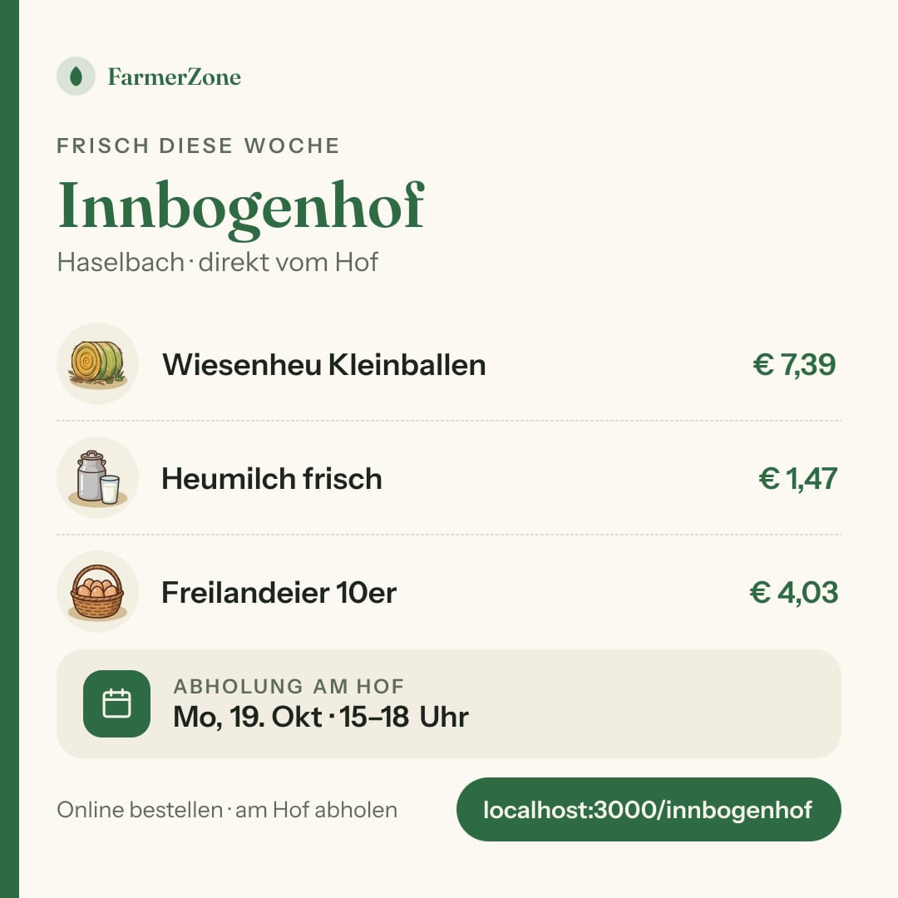
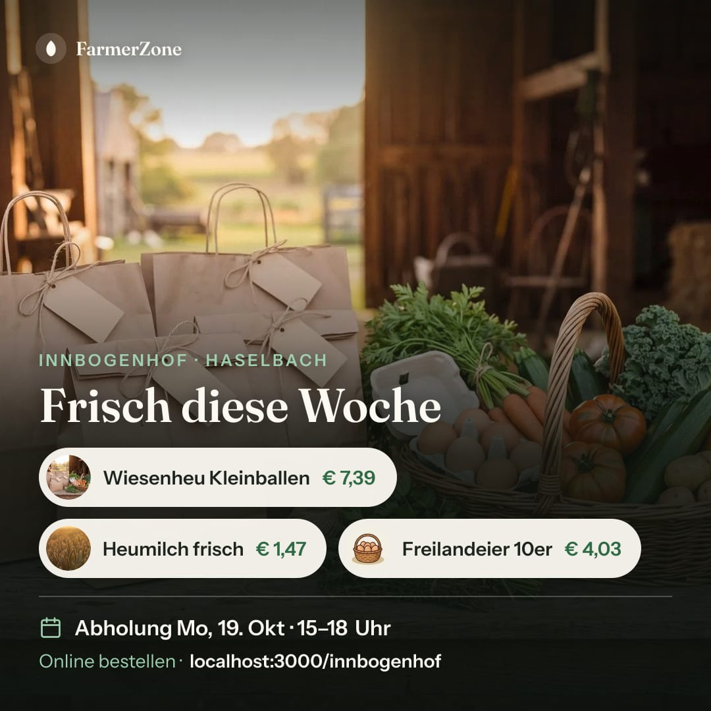
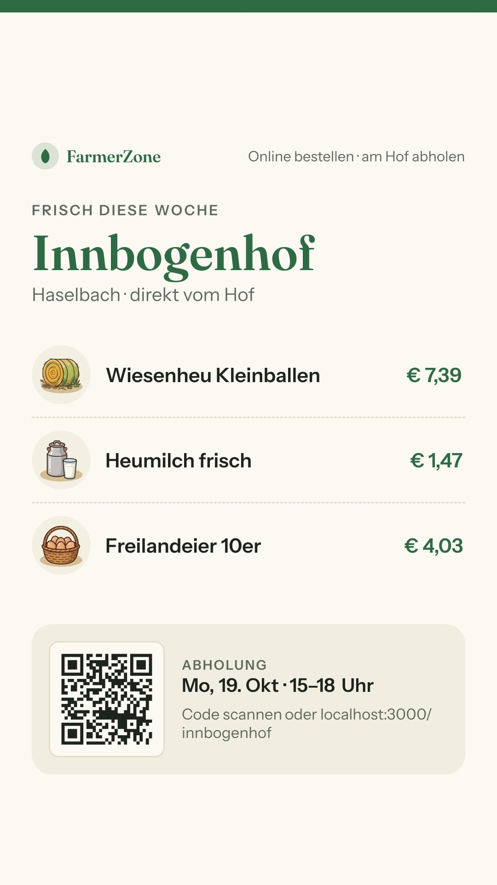
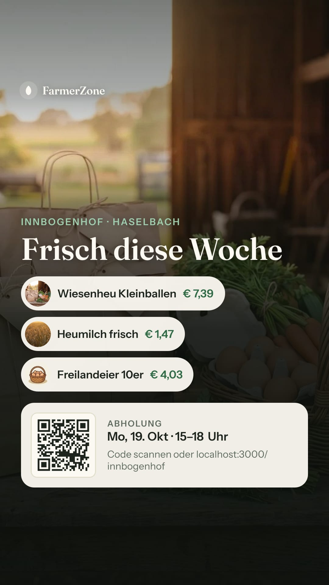
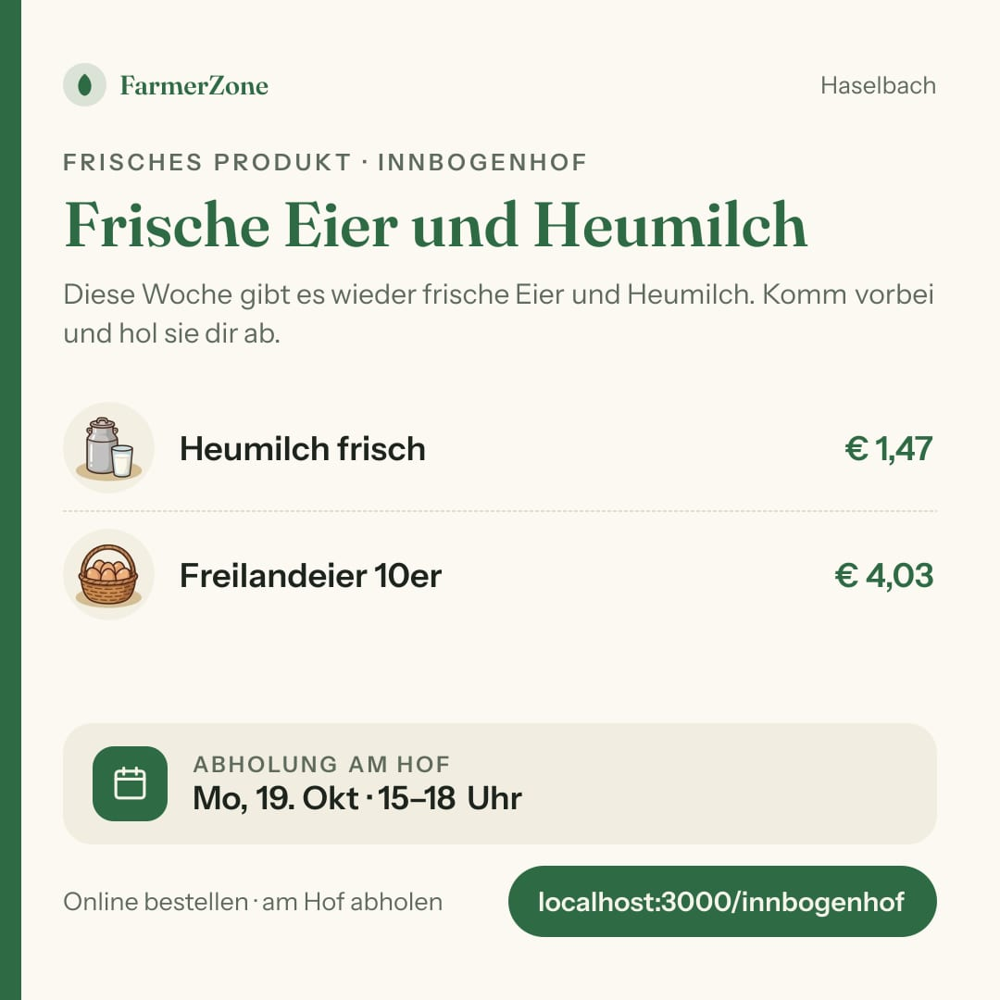
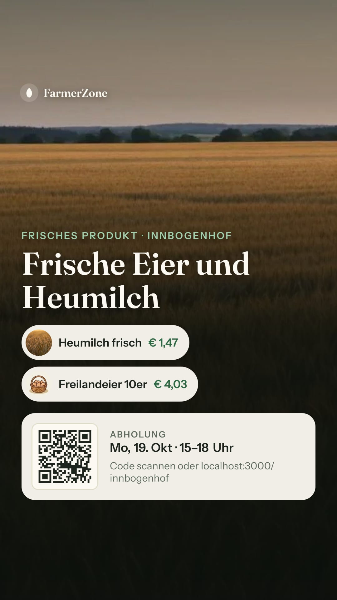

# Bericht Nr. 76 – Teilen-Bild als JPEG (Register T7)

## Was geändert wurde
- `src/app/(public)/[farmSlug]/opengraph-image/route.tsx` (nur Antwortblock und eine Importzeile): Das PNG von Satori geht im selben `try` durch `sharp(…).jpeg({ quality: 82, mozjpeg: true })`, die Antwort trägt `Content-Type: image/jpeg`; ein Fehler dort nimmt den 503-Pfad, Cache-Regeln und Satori, Schriften, Bildquellen unverändert.
- `src/lib/teilen-bild.ts`: `TEILEN_BILD_TYP = { mime: 'image/jpeg', endung: 'jpg' }` als EINE Quelle, dazu `teilenBildDateiName(slug, format)` (`<hof>-beitrag.jpg`, `<hof>-status.jpg`).
- `src/components/teilen/teilen-fenster.tsx`: Dateiname aus `teilenBildDateiName`, `File`-Typ aus `TEILEN_BILD_TYP.mime`; `download` bleibt, wie es war.
- `src/lib/vorschaubild.ts`: `Vorschaubild` kennt `type`, `hofVorschaubild` setzt `image/jpeg` (die Hofseite schreibt daraus `og:image:type`, am laufenden Server gesehen).
- `tests/teilen-bild-jpeg.test.ts` (neu): echte Route mit echtem Satori (Schriften echt; Datenbank, Fotos, Sentry gemockt): JPEG-Bytes FF D8 FF … FF D9 und Maße 1080 × 1080 bzw. 1080 × 1920, Typ neben dem kurzen Zwischenspeicher, unlesbares Bild → 503 `no-store` mit Sentry nur mit Hof-Kennung, Dateiname `.jpg`, Typ nur aus `TEILEN_BILD_TYP` (mit Gegenprobe der Suche).
- `tests/vorschaubild.test.ts`: Erwartung um `type` ergänzt. `tests/teilen-bild.test.ts`, `tests/teilen-vorschau-version.test.ts`: Die Attrappe von `next/og` liefert ein echtes PNG (ein Bildpunkt) statt Text, sonst wäre jede 200 nun ein 503.
- `docs/nachtlauf/berichte/bilder/76/`: die sechs Teilen-Bilder als JPEG.

Wiederverwendet: sharp-Import wie in `teilen-bild-quellen.ts`, `TEILEN_BILD_MASSE`, Attrappen-Muster aus `tests/teilen-bild.test.ts` / Neu, weil: `TEILEN_BILD_TYP` und `teilenBildDateiName` – der Typ stand bisher an drei Stellen als Text, kein Baustein bündelt ihn.

## Annahmen
- `STARTSEITE_VORSCHAUBILD` (liegt als JPEG vor) bekommt kein `type`: nicht beauftragt.
- Den Dateinamen baut eine reine Funktion in `lib/teilen-bild.ts` (innerhalb der Dateigrenzen, Z. 145 des Fensters ruft sie), damit sich `.jpg` ohne DOM testen lässt.
- Kein `flatten` nötig: Das Bild füllt die ganze Fläche (Creme bzw. Foto), das JPEG hat keinen Alpha-Kanal und keine schwarzen Ränder.
- Bilder: Seed-Hof des Kontos bauer-01, Testdaten per psql (ein Beitrag, zwei Produktfotos; Fotos über den Abfang ohne Netz) und danach zurückgesetzt (0 Beiträge, Fotoadressen wieder leer). Server mit `stop-dev.sh` beendet.

## Nicht gelöst
- Handy-Scan des QR-Codes und die echte Vorschau in WhatsApp: nur ein Mensch nach dem Deployment (siehe unten).
- mozjpeg schreibt progressive JPEG (Vorgabe). Zeigt ein Dienst das Bild nicht, wäre `progressive: false` die erste Stellschraube; bekannt ist kein Problem.

## Wie der Mensch es testet
1. Lokal mit Seed (`pnpm dev`): `http://localhost:3000/<Hof-Adresse>/opengraph-image?format=story` öffnen. Erwartung: Bild erscheint, „Bild speichern unter" bietet `.jpg`, Größe unter 300 KB.
2. Heute › orange Teilen-Zeile (Fenster „Hof teilen“) › „Bild herunterladen": Datei `<hof>-beitrag.jpg` (1:1) bzw. nach Umschalten auf „Status 9:16" `<hof>-status.jpg`; „Teilen über das Telefon" gibt das Bild als JPEG weiter.
3. Handy: Story-Bild am Bildschirm mit der Kamera scannen. Erwartung: Die Hofseite öffnet sich. (Das ist die offene Abnahme des QR-Codes.)
4. Nach dem Deployment: Hof-Link in einen WhatsApp-Chat einfügen. Erwartung: Vorschau mit Bild.

## Angepasste `.md`
`docs/ai/TECH_STACK.md` (Zeile Teilen-Bild), `docs/ai/ARCHITECTURE.md` (neuer Punkt unter „Vorschaubild und Icons"), `docs/ai/DESIGN_SYSTEM.md` (ein Satz bei „Teilen"), `docs/ai/BAUSTEINE.md` (mit `pnpm bausteine` erzeugt: zwei neue Einträge), `DEVELOPMENT.md` (Eintrag Nr. 76).

## Nacharbeit
- Doku-PR (docs/lauf12) trägt T7 ins Register ein; im Code steht die Kennung schon.
- Sammel-PR: Mögliche Konflikte mit Nr. 75 an der Importzeile in `route.tsx` (Z. 7) und an der `next/og`-Attrappe in `tests/teilen-bild.test.ts` (Z. 44–48); beides ist je eine Zeile bzw. ein Block.

## Regelvorschlag
Ursache: Eine Attrappe, die einen Bild-Körper nur vortäuscht (Text „png"), trägt keine neue Verarbeitung der Route; zwei Testdateien wurden mit der Umwandlung rot. Gegenmaßnahme: Attrappen für `next/og` liefern ein echtes PNG (steht in ARCHITECTURE, „Vorschaubild und Icons"). Prüfung statt Textregel: `tests/teilen-bild-jpeg.test.ts` zeichnet ohne Attrappe und prüft die Bytes der Antwort.

## Bilder (aus der Route, 1080 px, Dev-Server gegen Test-DB, Seed-Hof bauer-01, Fotos über einen Abfang ohne Netz)
| Bild | Größe | PNG in Nr. 69 |
|---|---|---|
|  quadrat-ohne-foto | 58 KB | 136 KB |
|  quadrat-mit-foto | 107 KB | 1,44 MB |
|  story-ohne-foto | 83 KB | 206 KB |
|  story-mit-foto | 118 KB | 1,39 MB |
|  quadrat-beitrag (ohne Foto) | 62 KB | 130 KB |
|  story-beitrag (Beitragsfoto) | 110 KB | 1,16 MB |

Alle mit Foto liegen unter dem Ziel von 300 KB. Der Schritt selbst kostet etwa 0,1–0,2 s je neu gezeichnetem Bild (mozjpeg; ohne 0,02 s, dafür etwa 8–16 % größer); die Antwort dauert lokal 0,4–1,3 s unter Last der parallelen Läufe.

**QR im Story-Bild:** maschinell geprüft; Handy-Scan offen (Mensch). Modulmatrix der Adresse aus dem Paket `qrcode` (29 × 29) gegen die Helligkeit des JPEG an den Modulmitten: in allen drei Story-Bildern 0 von 841 Modulen abweichend, dunkelstes Hell 243, hellstes Dunkel 38–40 (Schwelle 128), Modul etwa 5,8–6,8 px. Schrift und QR sind bei 1080 px in voller Größe lesbar (kleinste Schrift „Code scannen oder …" und Preis-Chips an Ausschnitten geprüft).

**Mockup-Abweichungen:** keine; das Aussehen ist unverändert, nur die Dateiart ist eine andere.
