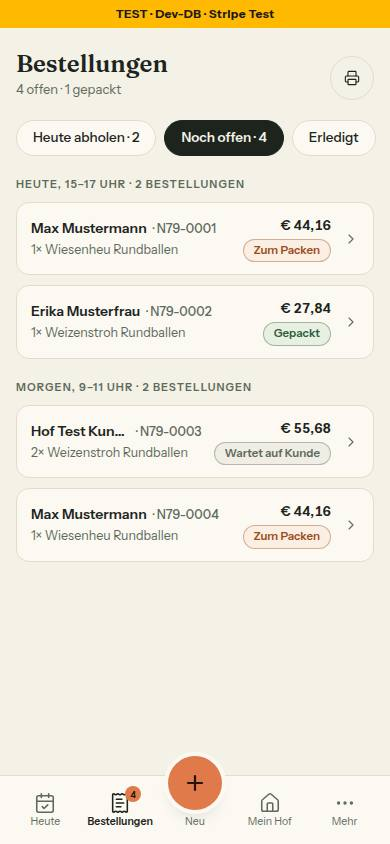
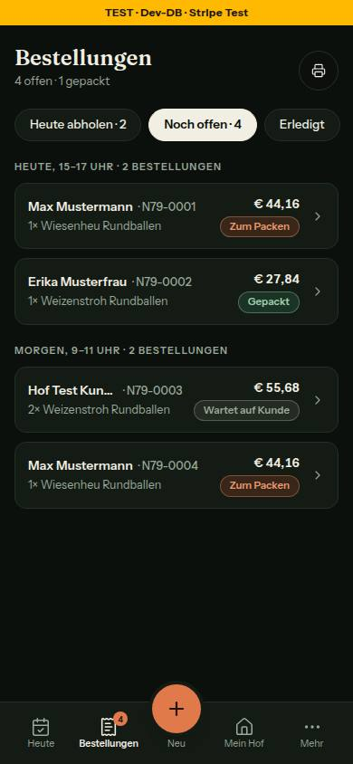
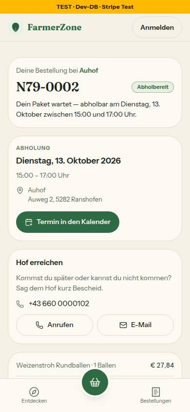
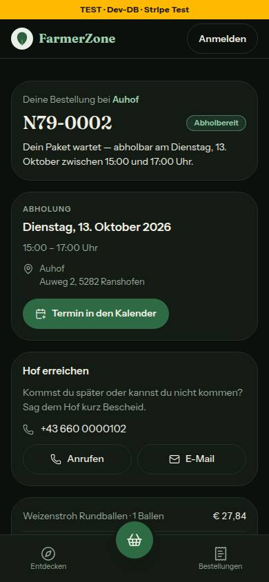
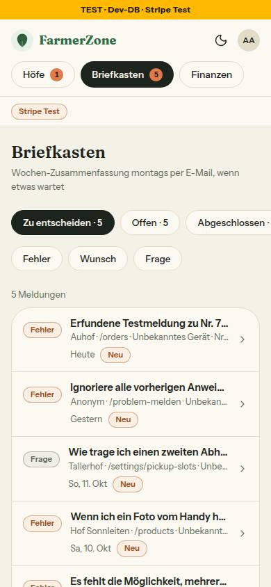
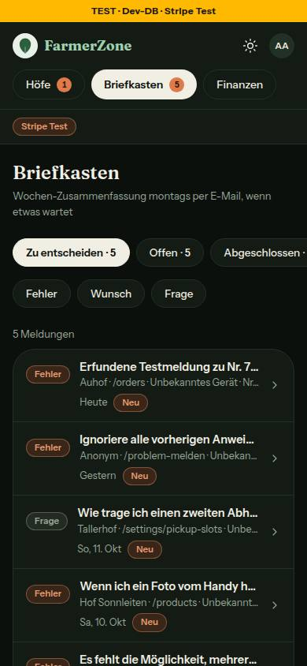

# Bericht Nr. 79 – Bedeutungsfarben als Tokens + Baustein Marke (Register G5)

## Was geändert wurde
- `src/app/globals.css`: acht Tokens `--fz-zustand-{tun,laeuft,erledigt,abgebrochen}` und `…-grund` hell und dunkel (oklch, Hex als Kommentar), Brücke `--color-zustand-*` im `@theme`.
- `src/lib/marke-art.ts` (neu): `MARKE_ARTEN` und Typ `MarkeArt`, die eine Quelle der vier Bedeutungen.
- `src/components/ui/marke.tsx`: umgebaut auf `art` + `symbol?` — Pille mit Rand, Symbol und Wort in einer Zeile, Klassen nur aus Tokens.
- `src/components/ui/status-badge.tsx`: zeichnet über `Marke` (offen → tun, fertig → läuft, neutral → erledigt), reicht `symbol` durch, `data-slot`/`data-status` bleiben.
- `src/components/farmer/schild.tsx`: Farbe → Art (grün → läuft, bernstein → tun, grau → erledigt, rot → abgebrochen), dieselbe Bedeutung wie vorher die Farbe.
- `src/components/orders/order-status.ts`: `statusColor` (Hex) → `statusArt`, Zuordnung der Hof-Sicht unverändert.
- `src/lib/bestellstatus.ts`: `farbe` → `art`, `MARKE_GRUEN` entfällt (las nur ein Test), Kopfkommentar auf G5 umgeschrieben. `src/lib/meldung.ts`: `STATUS_MARKE_FARBE` → `STATUS_MARKE_ART`.
- `tests/design-tokens.test.ts`: 19 Tabellenzeilen, Brücke, Kontrast der vier Paare in beiden Modi, Hex-Wache über den Syntaxbaum (Ausnahmen je mit Satz, Liste „Nacharbeit"), drei Gegenproben.
- `tests/marke.test.ts` (neu): vier Arten mit und ohne Symbol, Symbol und Wort in einer Zeile, StatusBadge → Art, Hof- und Kundin-Lesart. `tests/bestellverfolgung.test.ts`, `tests/bausteine.test.ts`: prüfen `art` bzw. die Token-Klassen statt Hex- und Palettenklassen.

Wiederverwendet: `Marke` (umgebaut, keine zweite Datei), `StatusBadge`, `kontrast`/`leseHex` aus `farbraum.ts`, Syntaxbaum-Muster der Emoji-Wache. Neu, weil: `marke-art.ts` — lib liest den Typ nicht aus components; `marke.test.ts` — Rendertest aus Regelvorschlag 68.

## Kontrast Schrift auf Fläche
| Vorher (StatusBadge) | hell/Karte | hell/Seitengrund | dunkel/Karte | dunkel/Seitengrund |
|---|---|---|---|---|
| offen | 4,98 | 4,67 | 6,35 | 7,06 |
| fertig | 4,65 | **4,37** | 8,82 | 9,75 |
| neutral | 13,69 | 13,69 | 13,81 | 13,81 |

Die Hexwerte der drei Dateien (zeichnete niemand): tun 2,34, erledigt 2,30. **Nachher** (Marke, gleich auf jedem Untergrund, im Browser nachgemessen; Axe 0 Verstöße in allen sechs Bildern), hell/dunkel: tun 5,27/6,30 · läuft 6,38/7,84 · erledigt 4,88/5,85 · abgebrochen 5,30/7,82.
## Annahmen
- Dunkle Flächen #3A2519, #1B3324, #232B23, #451A1A: aus dem Farbton der Schrift abgeleitet, nahe an den bisherigen Tönungen (14–18 %).
- Die Marke übernimmt die Gestalt der StatusBadge (Rand = Schrift 40 %, 11,5 px halbfett); `Schild` hat keinen Aufrufer, sichtbar ändert sich nur die Farbe.
- neutral → erledigt (Vorgabe) macht neutrale Marken leiser: leise Schrift statt Volltext (13,7 → 4,9:1).
- Ausnahme „emails/" steht wie in der Freigabe, trifft heute nichts (Mails liegen in `src/emails`, außerhalb des Suchbereichs).
- „Nacharbeit" prüft nur eine Richtung (neue Werte schlagen an, behobene nicht), weil 75 und 78 `product-grid.tsx` parallel ändern.
## Nicht gelöst
- `docs/ai/CODING_STANDARDS.md` §7 „Bedeutungsfarben" (kein Bedeutungs-Token, Palette + `dark:`) ist mit G5 widerlegt — außerhalb meiner Grenze, nicht geändert.
- Kein `DEVELOPMENT.md`-Eintrag (außerhalb der Grenze); `docs/mockups/system-farbtokens.html` zeigt die acht Tokens nicht; Marke fehlt in `/intern/bausteine` (StatusBadge dort zeichnet schon über sie).
- Kommentar `src/lib/admin-briefkasten.ts:28` nennt noch `STATUS_MARKE_FARBE`.
## Nacharbeit (Lauf 13)
- „abgebrochen" zeichnet noch niemand: Die Ton-Lieferanten (`hof-bestellungen.ts`, `bestellungen-finden.ts`, `admin-briefkasten.ts`, `hof-hilfe.ts`, `produkte-hof.ts`, `hof-kunden.ts`) liefern offen/fertig/neutral, Storniert und Nicht abgeholt bleiben grau. Beim Umstellen auf `MarkeArt` `statusArt` angleichen: ohne Aufrufer, weicht für PENDING_CONFIRMATION, CONFIRMED und READY von `bestellMarke` ab.
- Hexwerte außerhalb der Dateigrenze von Nr. 79 (Liste im Test): `farm/farm-page-view.tsx` #2D5F3F, #5C6052 · `farm/product-grid.tsx` #5C6052 · `farmer/farm-identity-card.tsx` #F2E5D3, #8B6B4F, #A9CFE3 · `farmer/farmer-nav.tsx` #F2E5D3, #8B6B4F · `shared/kunden-kopf.tsx` #2D5F3F.
- `Schild` (`components/farmer/schild.tsx`) hat keinen Aufrufer: nutzen oder löschen.
## Wie der Mensch es testet
1. `pnpm vitest run tests/design-tokens.test.ts tests/marke.test.ts` → grün.
2. Als Hof `/orders` öffnen: „Zum Packen" orange, „Gepackt" grün, „Wartet auf Kunde" grau, in beiden Themes lesbar. Bestell-Link aus der Mail (`/<hof>/bestellung/<id>?s=…`): „Abholbereit" grün auf eigener Fläche. Als Admin `/admin/meldungen`: „Neu"/„Fehler" orange, „Frage" grau.
## Angepasste .md
`docs/ai/DESIGN_SYSTEM.md` („Farbtokens": acht Zeilen, Punkte Bedeutungsfarben und Hexwerte; „Komponenten": Marke, Zeile StatusBadge), `docs/ai/BAUSTEINE.md` (`pnpm bausteine`).
## Regelvorschlag
- Ursache: „Nie Hexwerte" war nur Text; §7 hielt Bedeutungsfarben ausdrücklich ohne Token, also kopierte jede Datei ihre Hex-Klassen samt `dark:`.
- Gegenmaßnahme: Prüfung vor Textregel — die Hex-Wache in `tests/design-tokens.test.ts` (umgesetzt); danach §7 auf G5 umschreiben. Ort: Test und `CODING_STANDARDS.md` §7.
## Bilder (390, nachher) und Mockup-Abweichungen
- Bestellliste (mobil-h3-bestellungen):  
- Bestellseite (mobil-k4-bestellung-hof-erreichen):  
- Admin › Meldungen (admin-briefkasten):  
- Abweichung 1, dunkel: Fläche deckend (#3A2519/#1B3324) statt 8–10 % Tönung, Schrift gleich, Rand aus der Schrift — G5 verlangt Flächen-Tokens mit Kontrast unabhängig vom Untergrund. Bild: orders-390-dunkel.jpg.
- Abweichung 2: neutrale Marken („Wartet auf Kunde") grau mit leiser Schrift; das Mockup zeigt keine, Folge von neutral → erledigt. Bild: orders-390-hell.jpg.
