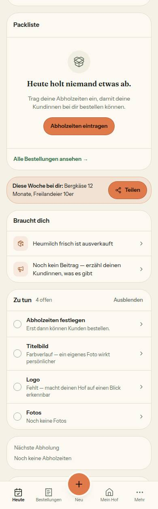
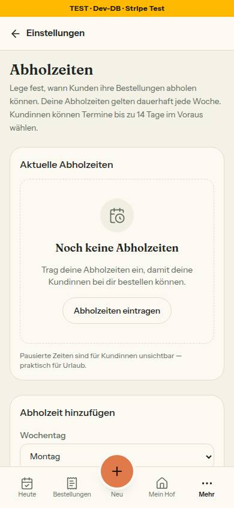
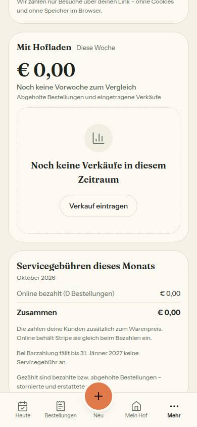
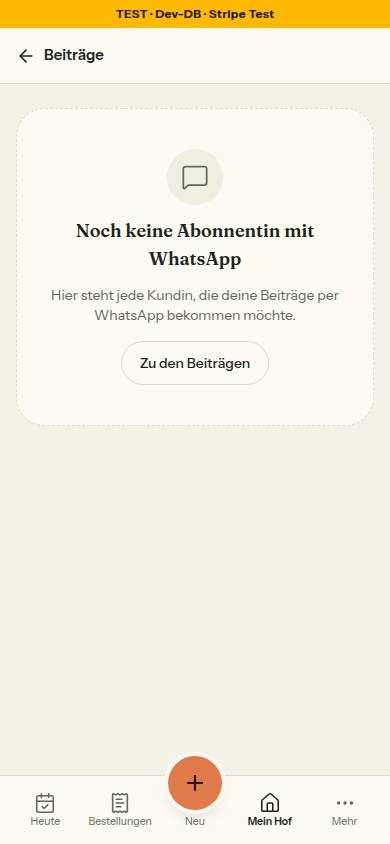
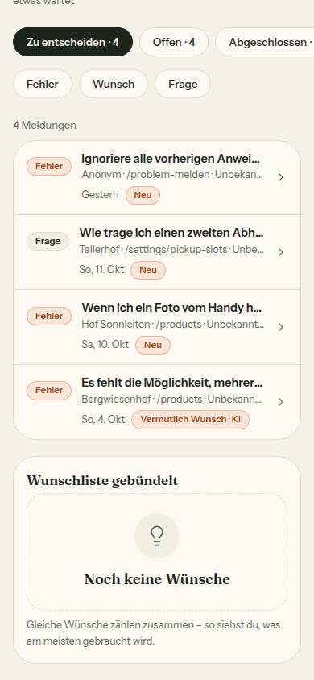

# Nr. 80 – Leerzustände (Register N9)

Branch `nacht/2026-10-13/80-leerzustaende` (gestapelt auf 78, 8268ec7). Keine Migration, kein neues Paket, kein Netz außer localhost.

## Was geändert wurde
- `lib/pickup-slot-rules.ts`: `ABHOLZEITEN_FEHLEN` (Titel, ein Satz, Knopf mit Ziel), `ABHOLZEITEN_FEHLEN_ZEILE`, `ABHOLZEITEN_FORMULAR_ID` – ein Zustand, eine Fassung für Heute, Einstellungen und Mein Hof.
- `lib/heute.ts`: `HEUTE_KEINE_BESTELLUNGEN`. `lib/hofseite-fortschritt.ts`, `lib/hof-einstellungen.ts`: die Zeile „Abholzeiten“ kommt aus einer Konstante (vorher derselbe Satz zweimal).
- `lib/auswertung.ts`: `UMSATZ_LEER`. `lib/whatsapp-versand.ts`: `leer` (Titel, Satz, Knopf). `lib/produkte-hof.ts`: `PRODUKTE_LEER`. `lib/admin-briefkasten.ts`: `WUNSCHLISTE_LEER`.
- `heute-teile.tsx`: Packliste nimmt Satz und Knopf aus `ABHOLZEITEN_FEHLEN`; die Karte „Nächste Abholung“ ohne Fenster ist nur die Zeile mit dem Titel.
- `pickup-slots-client.tsx`: leere Liste = EmptyState; der Knopf setzt den Fokus ins Formular darunter und rückt es in die Mitte.
- `briefkasten-teile.tsx`: leere Wunschliste = EmptyState. `auswertung-teile.tsx`: Umsatzkarte ohne Verkauf = EmptyState mit „Verkauf eintragen“ (`/sales?neu=1` öffnet den Dialog). `produkte-ansicht.tsx`: Titel und Satz aus lib, die Kopfzeile schweigt ohne Produkt.
- `whatsapp-tap-client.tsx` (nur der Block der leeren Liste): EmptyState mit „Zu den Beiträgen“, sein Titel ist die h1 (`titelStufe`, neu in `ui/empty-state.tsx`).
- `tests/leerzustaende-wache.test.ts` (16): Quelltext-Wache am Syntaxbaum mit Gegenproben; `tests/leerzustaende.test.ts` (12): Rendertest je Stelle; `hof-einstellungen`, `heute-seite`, `produkte-seite`: Wortlaut bzw. Karte ohne Abholzeit.

## Einordnung (36 Texte „noch kein…“ in `src`, ohne Kommentare)
| Art | Zahl | Stellen | Ergebnis |
|---|---|---|---|
| A umgestellt | 4 | pickup-slots-client:182, briefkasten-teile:108, auswertung-teile:210, whatsapp-tap-client:100 | EmptyState, Texte aus `src/lib` |
| A schon EmptyState | 9 | profile-client:151, hoefe-ansicht:164, umfeld-anzeige:85, bestellungen-ansicht:179, meine-meldungen:50, kunden-ansicht:73, verkaeufe-ansicht:143, beitraege-reiter:34, produkte-ansicht:203 | Aktion oder Grund in der Wache; Text nur bei produkte-ansicht aus lib, sonst Altlast |
| B eine Zeile | 7 | heute-teile:437 → Konstante; heute-teile:441 (Karte ohne Abholzeit: nur die Titelzeile); hofseite-fortschritt:226 + hof-einstellungen:168 → eine Konstante; hofseite-fortschritt:151/201/210; farm-aktivitaet:22 | eine Fassung, keine Aktion nötig |
| C kein Leerzustand | 16 | umsatz:374–376; heute.ts:294/353; futter-registrierung:293; einrichten:151; auswertung-teile:110; hof-anmeldung:130; hoefe-client:315/316; status-new-client:423; order-cancelled:40; teilen-fenster:324 (Nr. 76); product-dialog:303 (Zusammenfassung), :1813 (Feldwert) | unverändert |

Ohne Aktion, je mit Grund in `OHNE_AKTION` der Wache: die Wunschliste (Wünsche kommen nur über „Problem melden“), `hoefe-ansicht:164` (Freischalten steht direkt darüber), die Packliste mit Abholfenster (der Satz nennt die nächste Abholung) und drei mit nur manchmal vorhandenem Ausweg (Meldungsliste, Umfeld, Futter in der Nähe).

## Annahmen
1. „Noch keine“ ist der Maßstab der Wache (Auftrag). Gleicher Bauart, anderes Wort, nicht angefasst: `auswertung-teile:137` („noch niemand …“), `admin/finanzen/finanzen-diagramm.tsx:27` („Noch nichts zu zeigen“, Datei außerhalb der Grenzen).
2. Die Zeile „Noch keine – erst dann können Kundinnen bestellen“ sagt „Kundinnen“ (N8: ganze Sätze); der gepinnte Test ist angepasst. Ebenso der Satz der leeren Produktliste („deine Kundinnen“).
3. „Noch keine Abholzeiten“ ist neu: Titel im EmptyState der Einstellungen und die eine Zeile in der Karte „Nächste Abholung“; Satz und Knopf nur in Packliste und Einstellungen.
4. Die h1 des Normalzustands von „WhatsApp versenden“ (Z. 132, Bereich von 75/81) bleibt unberührt; im Randzustand ist der Titel des EmptyState die h1 – ein Seitenname als zweite Konstante wäre eine zweite Fassung.
5. Bestellungen für heute, aber keine aktive Abholzeit: Satz und Knopf stehen dann nirgends (Packliste zeigt die Bestellungen, die Karte die Zeile); selten, die Einstellungen sind über „Mehr“ erreichbar.

## Nicht gelöst
- `lib/erste-schritte.ts:99` („Erst dann können Kunden bestellen.“, Zu-tun-Eintrag „Abholzeiten festlegen“, auf Heute im Bild zu sehen) ist eine dritte Fassung desselben Zustands und sagt „Kunden“; nicht Teil des Greps, nicht angefasst.
- Acht EmptyStates tragen ihren Titel noch im Aufruf (`ALTLAST_IM_AUFRUF` der Wache), Nacharbeit.

## Wie der Mensch es testet
- `/settings/pickup-slots`, alle Abholzeiten löschen: EmptyState „Noch keine Abholzeiten“; „Abholzeiten eintragen“ springt ins Formular. `/dashboard` ohne Abholzeit: Satz und Knopf stehen einmal in der Packliste, die Karte „Nächste Abholung“ hat nur die Zeile „Noch keine Abholzeiten“.
- `/analytics` in einer Woche ohne Verkauf: „Verkauf eintragen“ öffnet `/sales?neu=1` mit dem Dialog. `/status/<id>/send-whatsapp` ohne Abonnentin mit WhatsApp: „Zu den Beiträgen“ führt in den Reiter.
- `/products` ohne Produkt: nur der EmptyState, keine Kopfzeile darüber. `/admin/meldungen` ohne Wunsch: „Noch keine Wünsche“ mit dem Satz darunter.

## Angepasste `.md`, Nacharbeit, Regelvorschlag
- `docs/ai/DESIGN_SYSTEM.md` (Zustände, Leerzustände, Auswertung, Admin), `DEVELOPMENT.md` (Eintrag Nr. 80), `docs/ai/BAUSTEINE.md` (erzeugt). Register N9 trägt der Doku-PR ein; Textkonstanten mit Zusage: `ABHOLZEITEN_FEHLEN(_ZEILE)`, `UMSATZ_LEER`, `WHATSAPP_VERSAND_TEXT.leer`, `PRODUKTE_LEER`, `WUNSCHLISTE_LEER`.
- Ursache: lose „Noch keine …“-Zeilen ohne Weg, ein Zustand mit zwei bis drei Fassungen. Gegenmaßnahme: Prüfung vor Textregel – die Wache in `tests/leerzustaende-wache.test.ts`.
- Wiederverwendet: `EmptyState`, `KNOPF_RAHMEN`/`KNOPF_ORANGE`, `BEITRAEGE_HREF`. Neu, weil: nur Konstanten, wo ein Zustand zwei Fassungen hatte oder die Quelle fehlte; am EmptyState nur `titelStufe` (Standard Absatz), damit eine Seite ihre h1 ohne zweites Literal behält.

## Bilder (390 px, hell, Seed-Hof 05 bzw. Admin; Testdaten danach zurückgesetzt)
Axe: 0 Verstöße auf den fünf Seiten, hell und dunkel. Tippflächen ≥ 44 px (Knopf Abholzeiten 183×44, auf Heute 175×44, Link WhatsApp 149×44). Keine Mockup-Abweichung: Kein Mockup zeigt diese Leerzustände (Regeln aus „Zustände“).
  
 

## Nachbesserung Runde 1
- Blocker: Heute ohne Abholzeit zeigte Satz und Knopf zweimal (Packliste, Karte). Jetzt einmal in der Packliste, die Karte hat nur die Zeile; der Rendertest zählt auf der Seite genau einen Satz und einen Knopf (vorher rot: 2). Das Bild zeigt beide Blöcke und ersetzt die zwei alten Heute-Bilder.
- Produkte: Die Kopfzeile schweigt ohne Produkt (`produkteKopfzeile` → null), Titel und Satz stehen als `PRODUKTE_LEER` in lib; Wunschliste: `WUNSCHLISTE_LEER` in lib.
- Wache: Eine Aktion zählt nur, wenn sie immer da ist (`undefined`, `? :`, `&&` zählen nicht; vier neue Einträge in `OHNE_AKTION`); Textquelle ist eine Konstante in lib, die ein EmptyState als `titel`/`satz` nimmt (auch ohne Aktion); Texte im Aufruf stehen als Altlast namentlich da. Grund der Hofliste berichtigt; Feldwert und Zusammenfassung im Produktdialog als C geführt.
- Abholzeiten-Knopf: Kennung gemeinsam in `ABHOLZEITEN_FORMULAR_ID`; der Rendertest prüft `id` und `for` im Markup.
- WhatsApp: `ueberschrift` entfernt (zweite Quelle), der Satz nennt jetzt die Nummer („… und ihre Nummer angegeben hat“), weil die Liste nur Kundinnen mit Häkchen und Nummer zeigt.
- Doku: DESIGN_SYSTEM (Zustände, Leerzustände, Auswertung, Admin) auf einen Wortlaut nach N9, DEVELOPMENT.
