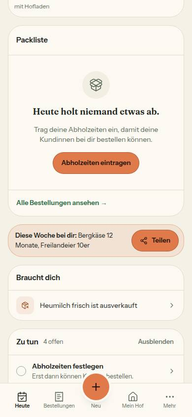
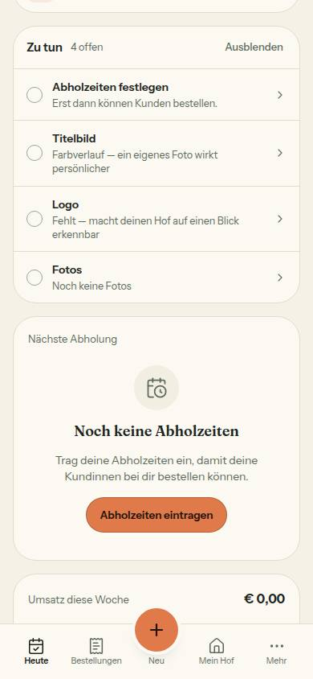

# Nr. 80 – Leerzustände (Register N9)

Branch `nacht/2026-10-13/80-leerzustaende` (gestapelt auf 78, 8268ec7). Keine Migration, kein neues Paket, kein Netz außer localhost.

## Was geändert wurde
- `lib/pickup-slot-rules.ts`: `ABHOLZEITEN_FEHLEN` (Titel, ein Satz, Knopf mit Ziel) und `ABHOLZEITEN_FEHLEN_ZEILE` – ein Zustand, eine Fassung für Heute, Einstellungen und Mein Hof.
- `lib/heute.ts`: `HEUTE_KEINE_BESTELLUNGEN`. `lib/hofseite-fortschritt.ts`, `lib/hof-einstellungen.ts`: die Zeile „Abholzeiten“ kommt aus einer Konstante (vorher derselbe Satz zweimal).
- `lib/auswertung.ts`: `UMSATZ_LEER`. `lib/whatsapp-versand.ts`: `ueberschrift` und `leer` im Text der Seite.
- `heute-teile.tsx`: Packliste nimmt Satz und Knopf aus `ABHOLZEITEN_FEHLEN`; die Karte „Nächste Abholung“ ohne Fenster ist ein EmptyState (vorher eigener Satz + Textlink = zweite Fassung).
- `pickup-slots-client.tsx`: leere Liste = EmptyState; der Knopf setzt den Fokus ins Formular darunter und rückt es in die Mitte.
- `briefkasten-teile.tsx`: leere Wunschliste = EmptyState. `auswertung-teile.tsx`: Umsatzkarte ohne Verkauf = EmptyState mit „Verkauf eintragen“ (`/sales?neu=1` öffnet den Dialog).
- `whatsapp-tap-client.tsx` (nur der Block der leeren Liste): EmptyState mit „Zu den Beiträgen“; die h1 bleibt, unsichtbar (der EmptyState zeichnet seinen Titel als Absatz).
- `tests/leerzustaende-wache.test.ts` (12): Quelltext-Wache am Syntaxbaum mit Gegenprobe; `tests/leerzustaende.test.ts` (10): Rendertest je Stelle (Titel, Satz, Aktion) und Gegenprobe mit Inhalt; `tests/hof-einstellungen.test.ts`: Wortlaut der Zeile.

## Einordnung (36 Texte „noch kein…“ in `src`, ohne Kommentare)
| Art | Zahl | Stellen | Ergebnis |
|---|---|---|---|
| A umgestellt | 5 | heute-teile:441 (+326 zusammengeführt), pickup-slots-client:182, briefkasten-teile:108, auswertung-teile:210, whatsapp-tap-client:100 | EmptyState, Texte aus `src/lib` (Wunschliste inline) |
| A schon EmptyState | 9 | profile-client:151, hoefe-ansicht:164, umfeld-anzeige:85, bestellungen-ansicht:179, meine-meldungen:50, kunden-ansicht:73, verkaeufe-ansicht:143, beitraege-reiter:34, produkte-ansicht:203 | unverändert (8 mit Aktion) |
| B eine Zeile | 9 | heute-teile:437 → Konstante; hofseite-fortschritt:226 + hof-einstellungen:168 → eine Konstante; hofseite-fortschritt:151/201/210; produkte-hof:56; farm-aktivitaet:22; product-dialog:303/1813 | eine Fassung, keine Aktion nötig |
| C kein Leerzustand | 14 | umsatz:374–376; heute.ts:294/353; futter-registrierung:293; einrichten:151; auswertung-teile:110; hof-anmeldung:130; hoefe-client:315/316; status-new-client:423; order-cancelled:40; teilen-fenster:324 (Nr. 76) | unverändert |

Ohne Aktion bleiben zwei EmptyStates, beide mit Grund in `OHNE_AKTION` der Wache: die Wunschliste (Wünsche kommen nur von Höfen und Kundinnen über „Problem melden“, der Admin legt keinen an; jeder Wunsch außer Dubletten steht schon in der Liste) und `hoefe-ansicht:164` (Höfe legt niemand von dort an). Dazu die Packliste mit Abholfenster: Es gibt nichts zu tun, der Satz nennt die nächste Abholung.

## Annahmen
1. „Noch keine“ ist der Maßstab der Wache (Auftrag). Gleicher Bauart, anderes Wort, nicht angefasst: `auswertung-teile:137` („noch niemand …“, Satz mit Knopf in der Teilen-Karte), `admin/finanzen/finanzen-diagramm.tsx:27` („Noch nichts zu zeigen“, Datei außerhalb der Grenzen).
2. Die Zeile „Noch keine – erst dann können Kundinnen bestellen“ sagt jetzt „Kundinnen“ (N8: ganze Sätze); der gepinnte Test ist angepasst.
3. Der Titel „Noch keine Abholzeiten“ ist neu (nur Kurzform für die Karte und die Einstellungen); Satz und Knopf sind überall dieselben.
4. In `whatsapp-tap-client.tsx` bleibt die h1 des Normalzustands ein Literal (Zeilen von 75/81 nicht berührt); `ueberschrift` gilt nur im Randzustand.

## Nicht gelöst
- Bei einem Hof ohne Abholzeit stehen Satz und Knopf auf Heute zweimal untereinander (Packliste, Karte „Nächste Abholung“). Vorschlag an den Menschen: Karte bis zur ersten Abholzeit ausblenden.
- `lib/erste-schritte.ts:99` („Erst dann können Kunden bestellen.“ im Zu-tun-Eintrag „Abholzeiten festlegen“) ist eine dritte Fassung desselben Zustands und sagt „Kunden“; nicht Teil des Greps, nicht angefasst.

## Wie der Mensch es testet
- `/settings/pickup-slots`, alle Abholzeiten löschen: EmptyState „Noch keine Abholzeiten“; „Abholzeiten eintragen“ springt ins Formular. `/dashboard`: Packliste und „Nächste Abholung“ zeigen denselben Satz; der Knopf führt zu `/settings/pickup-slots`.
- `/analytics` in einer Woche ohne Verkauf: „Verkauf eintragen“ öffnet `/sales?neu=1` mit dem Dialog. `/status/<id>/send-whatsapp` ohne Abonnentin mit WhatsApp: „Zu den Beiträgen“ führt in den Reiter.
- `/admin/meldungen` ohne Wunsch (alle als Dublette markiert): „Noch keine Wünsche“ mit dem Satz darunter.

## Angepasste `.md`, Nacharbeit, Regelvorschlag
- `docs/ai/DESIGN_SYSTEM.md` (Abschnitt „Leerzustände“ unter „Zustände“), `DEVELOPMENT.md` (Eintrag Nr. 80), `docs/ai/BAUSTEINE.md` (erzeugt). Register N9 trägt der Doku-PR ein; Textkonstanten mit Zusage: `ABHOLZEITEN_FEHLEN(_ZEILE)`, `UMSATZ_LEER`, `WHATSAPP_VERSAND_TEXT.leer`.
- Ursache: lose „Noch keine …“-Zeilen ohne Weg, ein Zustand mit zwei bis drei Fassungen. Gegenmaßnahme: Prüfung vor Textregel – die Wache in `tests/leerzustaende-wache.test.ts` (neue Stelle muss EmptyState sein oder mit Art und Grund in `AUSNAHMEN` stehen).
- Wiederverwendet: `EmptyState`, `KNOPF_RAHMEN`/`KNOPF_ORANGE`, `BEITRAEGE_HREF`. Neu, weil: nur Konstanten, wo ein Zustand zwei Fassungen hatte oder die Quelle fehlte; keine neue Komponente.

## Bilder (390 px, hell, Seed-Hof 05 bzw. Admin; Testdaten danach zurückgesetzt)
Axe: 0 Verstöße auf den fünf Seiten, hell und dunkel. Tippflächen ≥ 44 px (Knopf Abholzeiten 183×44, Link WhatsApp 149×44). Keine Mockup-Abweichung: Kein Mockup zeigt diese Leerzustände (Regeln aus „Zustände“).
  
  
