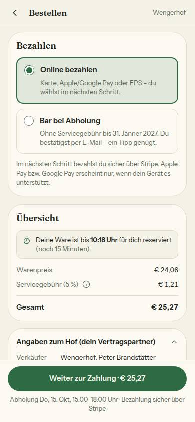
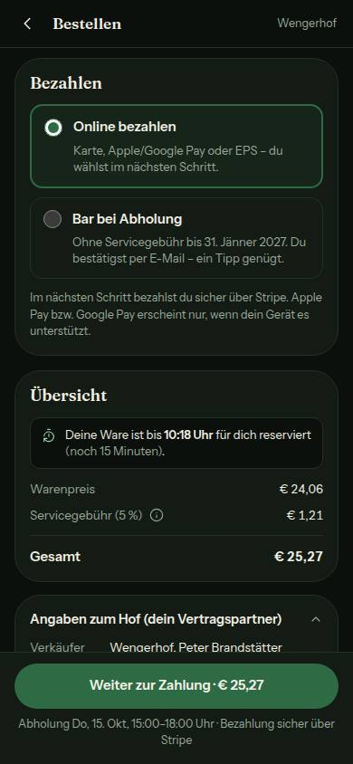
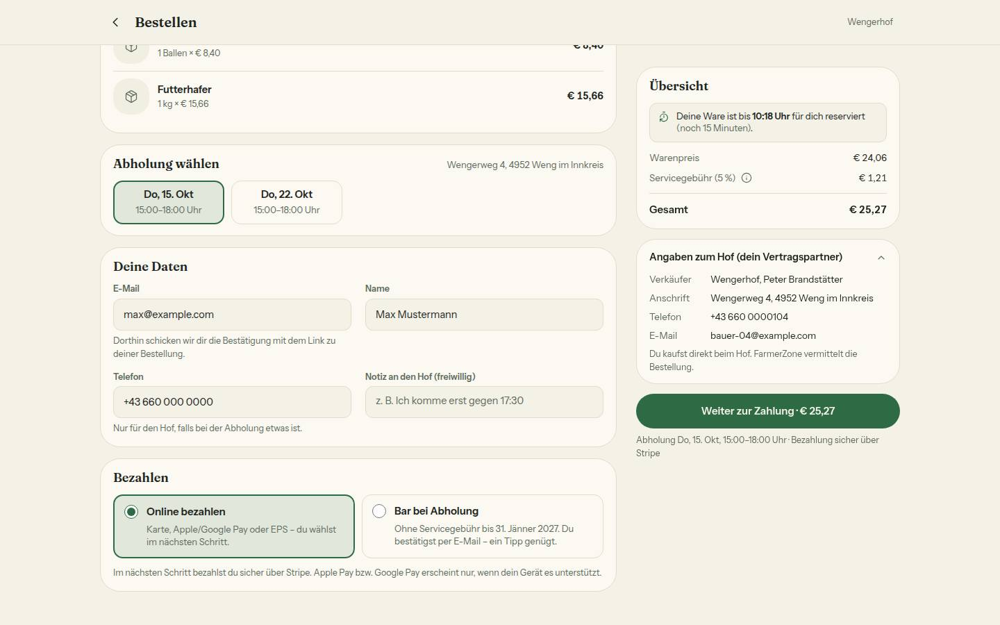
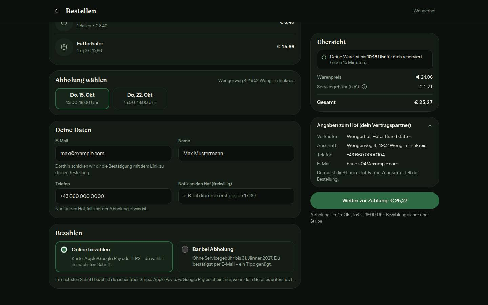
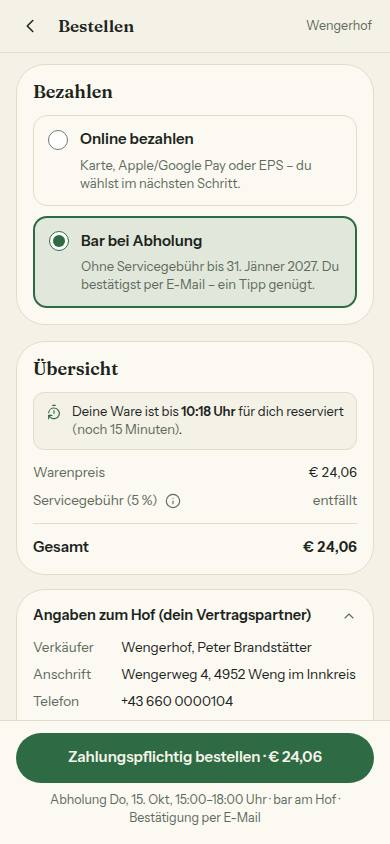
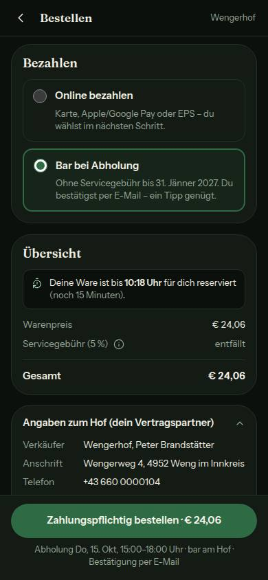
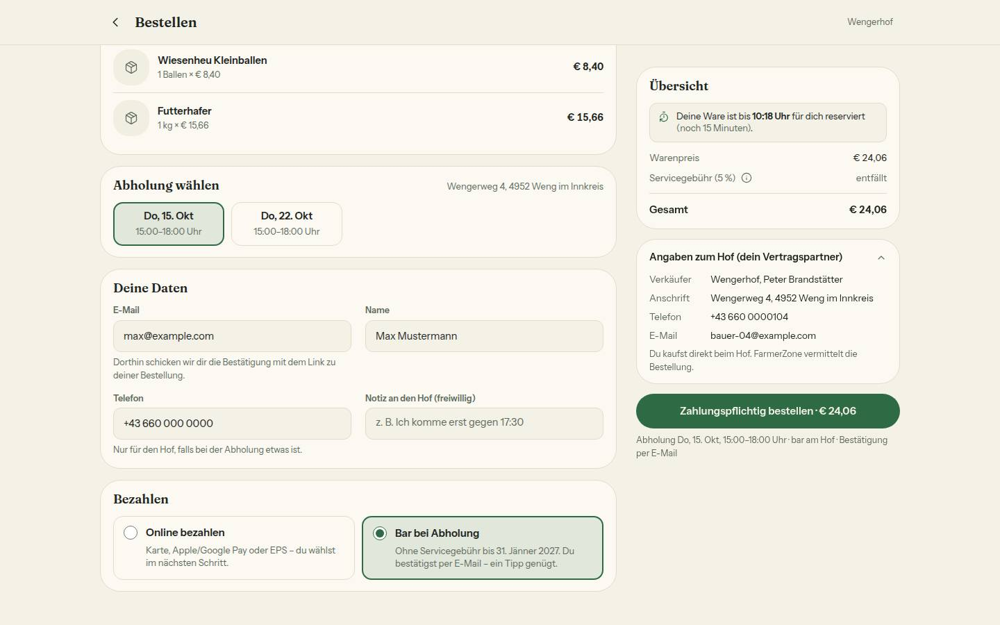
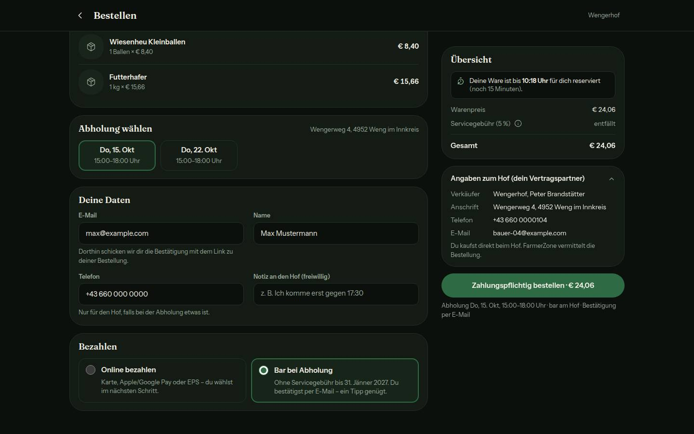

# Bericht Nr. 82 — Kasse glätten (Register N10)

Branch `nacht/2026-10-13/82-kasse-glatt`, Basis main f367433. Keine Migration, keine neuen Pakete; Beträge, Schema, `/api/checkout` und Reservierung unverändert — die Kasse zeigt Geld nur an (Beträge weiter allein aus `kassenBetraege`/`angezeigteBetraege`).

## Was geändert wurde (je Datei ein Satz)
- `src/components/checkout/checkout-form.tsx`: Raster `md:grid-cols-2` aufgelöst — Korb → Abholung (Adresse rechts im Kopf, am Handy darunter) → Deine Daten (ab 768 px E-Mail · Name / Telefon · Notiz, Notiz einzeilig und wachsend) → Betrieb → Bezahlen; loser Bar-Absatz weg, Stripe-Satz nur bei Online, Zeile unter dem Knopf aus `kaufknopfZeile`.
- `src/components/checkout/kasse-teile.tsx`: Zahlarten als Karten (ab 768 px nebeneinander, je Titel + Erklärung), Termine in einer Zeile mit Umbruch, Übersicht mit „Servicegebühr (5 %)", (i)-Knopf (`aria-expanded`, `aria-controls`, 44 px) und „entfällt", Korb ohne „Ein Korb pro Hof", `KassenRaster` mit `uebersichtZuletzt` (Handy-Reihenfolge wie im Quelltext).
- `src/lib/kasse.ts`: neue Erklärungen in `kassenZahlarten`, neu `gebuehrZeile` (Titel, Erklärung, „entfällt"), `kaufknopfZeile` und `ZAHLWEG_ONLINE`.
- `src/lib/konditionen.ts`: neu `BAR_OHNE_GEBUEHR_ZAHLART` („Ohne Servicegebühr bis 31. Jänner 2027.", Datum aus dem Stichtag); `BAR_OHNE_GEBUEHR_HINWEIS` bleibt für Startseite, Hofseite und Mini-Warenkorb.
- `src/components/checkout/kasse-skelett.tsx`: Ladeansicht in der neuen Form und Reihenfolge.
- Tests: `tests/kasse-formular.test.ts` (neu, 5 Tests: das echte Formular gerendert — Reihenfolge, Online vorbelegt auch im Testbetrieb, Bar-Zustand, kein loser Absatz), `tests/kasse.test.ts` (+12), `tests/kasse-seite.test.ts` (Übersicht und Zahlarten neu, +5), `tests/bargebuehr.test.ts` (ein `it` auf den neuen Wortlaut, siehe Annahmen).

Wiederverwendet: `KARTE`, `FELD`, `HINWEIS`, `KNOPF_GRUEN`, `AktionsLeiste`, `FOKUS_RAHMEN`, `abholSatz`, `servicegebuehrSatz`, `barHinweis`, das Kachelmuster der Termine (`has-[:checked]`) für die Zahlarten / Neu, weil: Eine Gebührenzeile mit aufklappbarer Erklärung und eine Zeile „Termin · Zahlweg" gab es nicht (Bausteinverzeichnis: nichts zu „aufklappen", „Erklärung" in der Kasse).

## Annahmen
- (i)-Text: „5 %, mind. € 0,50. Für Bereitstellung, Abwicklung und Zahlungsservice der Plattform." — Satz und Mindestgebühr aus der Hofeinstellung, Erklärsatz `SERVICEGEBUEHR_HINWEIS`.
- „entfällt" nur, wo bar wirklich günstiger ist (Bedingung von `barHinweis`); beim gebührenfreien Hof keine Zeile. Liegt ein Betrag vor, steht er da — „entfällt" nie darüber (Test).
- `UebersichtKarte` gilt auch im Zahlungsschritt: Dort klappt der (i)-Knopf nur den Erklärsatz auf, der Titel bleibt `zahlungsGebuehrText`; `stripe-payment.tsx` unverändert.
- Handy: Übersicht und Angaben stehen nach Bezahlen wie in mobil-k3-kasse-glatt; der Zahlungsschritt behält die Übersicht unter dem Korb.
- Die Notiz wächst über CSS `field-sizing` (wie `ui/textarea.tsx`); wo der Browser das nicht kann, lässt sie sich größer ziehen.
- `tests/bargebuehr.test.ts` liegt außerhalb der Grenze, prüfte aber den alten Wortlaut von `kassenZahlarten` („gleicher Betrag"); nur dieses `it` angepasst. Keine andere Nummer berührt die Datei (Lesemappen 75–79 geprüft).
- Texte mit Zusage (für das Register, N10): Online-Erklärung, `BAR_OHNE_GEBUEHR_ZAHLART` (B1), „Du bestätigst per E-Mail – ein Tipp genügt." (H3), `kaufknopfZeile`; Quelle je `src/lib/kasse.ts` bzw. `konditionen.ts`.

## Nicht gelöst
- `TESTBETRIEB_TEXT.kasse` bleibt länger als im Mockup („… Bitte wähle Bar bei Abholung."): Vorgabe „wie heute", `stripe-modus.ts` außerhalb der Grenze.
- Zahlungsschritt (`stripe-payment.tsx`) nicht geglättet — nicht Teil der Freigabe.

## Wie der Mensch es testet
1. Auf einer Hofseite mit Online-Zahlung etwas in den Korb, dann `/<hof>/checkout` am Handy (390 px) und ab 1024 px öffnen: Korb → Abholung → Deine Daten → Bezahlen → Übersicht → Angaben zum Hof → Knopf; „Online bezahlen" ist gewählt, unter dem Knopf „Abholung … · Bezahlung sicher über Stripe".
2. „Bar bei Abholung" tippen: Servicegebühr „entfällt", Gesamt = Warenpreis, Knopf „Zahlungspflichtig bestellen · € …", Zeile „… · bar am Hof · Bestätigung per E-Mail", der Stripe-Satz verschwindet.
3. Das (i) neben „Servicegebühr (5 %)" tippen: „5 %, mind. € 0,50. Für Bereitstellung …" klappt auf, noch einmal tippen klappt zu.

## Angepasste .md
`docs/ai/DESIGN_SYSTEM.md` (Kasse: Aufbau, Übersicht, Hauptknopf, Zahlarten), `docs/ai/TESTING_GUIDELINES.md` (§1: ganze Seite nach einem Effekt rendern), `DEVELOPMENT.md` (Eintrag Nr. 82), `docs/ai/BAUSTEINE.md` (erzeugt).

## Nacharbeit
- `TESTBETRIEB_TEXT.kasse` auf den Mockup-Satz kürzen? Der Zusatz „Bitte wähle Bar bei Abholung." steht quer zur Entscheidung, Online vorzubelegen — Entscheidung des Menschen.

## Regelvorschlag
Ursache: Die Kasse rendert auf dem Server nur ihr Skelett (Korb im Effekt aus dem localStorage); Reihenfolge und Vorbelegung ließen sich nur am Quelltext prüfen. Gegenmaßnahme (Prüfung vor Textregel): Prüfstand, der jeden Effekt einmal beim Rendern laufen lässt (`tests/kasse-formular.test.ts`); Ort: TESTING_GUIDELINES §1, dort eingetragen.

## Bilder (nachher; Axe 0 Verstöße bei 390 und 1440, beide Themes, online und bar — 1 Hinweis zur Handprüfung: Zeile unter dem Knopf in der festen Leiste, Hintergrund nicht bestimmbar, Token wie überall; Tippflächen 44–92 px)
Online:    
Bar:    

## Mockup-Abweichungen
- Uhrzeit „15:00–18:00 Uhr" statt „14–16 Uhr" in Terminen und Zeile unter dem Knopf: vorhandener Formatierer (`abholKacheln`/`abholSatz`); die Zeile bricht dadurch um (kasse-online-1440-hell, kasse-online-390-hell).
- Kaufknopf am Handy als Pille 50 px statt 52 px mit Radius 14 px: Kaufknopf laut Freigabe unverändert (kasse-online-390-hell).
- Feldbeschriftung gedämpft 12,5 px und Kartentitel 18 px statt 13 px in Textfarbe bzw. 19 px: geteilte Bausteine (`FELD_LABEL` auch in Registrierung und Hof anlegen, `KARTEN_TITEL` auch im Zahlungsschritt) (kasse-online-1440-hell).
- Echter Radioknopf (`accent-accent`) statt gezeichnetem Kreis; gewählte Karte wie die Termine `bg-accent/12` (kasse-bar-1440-dunkel).
- Testbetrieb-Satz länger als im Mockup (siehe „Nicht gelöst"); lokal läuft kein Testbetrieb, daher ohne Bild — belegt in `tests/kasse-formular.test.ts`.
