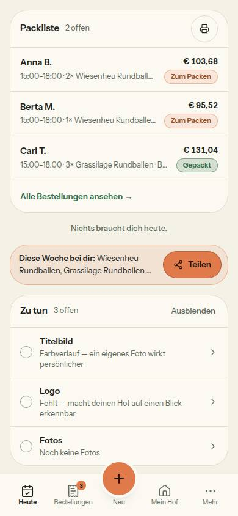

# Nr. 83 – Heute: Reihenfolge und leeres „Braucht dich“ (Register N11)

Branch `nacht/2026-10-13/83-heute-reihenfolge` (gestapelt auf 80, ad40f3e). Keine Migration, kein neues Paket, kein Netz außer localhost.

## Was geändert wurde
- `src/lib/heute.ts`: `heuteAufbau` ordnet die Hauptspalte Packliste → Braucht dich → Teilen (ohne Teilen: Packliste → Braucht dich); neue Textkonstante `BRAUCHT_DICH_LEER` („Nichts braucht dich heute.“); die Kommentare zu Reihenfolge und Leerfall nachgezogen.
- `src/components/heute/heute-teile.tsx` (nur `BrauchtDichKarte` und ein Import): ohne Eintrag ein gedämpfter Absatz ohne Karte (13 px, halbfett, `muted-foreground`, zentriert – Maße und Farbe wie die Zeile „Zu tun einblenden“), mit Einträgen die Karte wie bisher.
- `tests/heute-seite.test.ts`: Reihenfolge der Hauptspalte in allen acht Kombinationen (mit und ohne Teilen); Rendertest leer = Zeile ohne Abschnitt, Überschrift, Liste, Link und Kartenrahmen, gefüllt = Karte (Gegenprobe mit denselben Merkmalen).
- `tests/heute.test.ts`: zwei Beschreibungen angepasst; Quelltext-Prüfung: der Baustein nimmt den Satz aus `BRAUCHT_DICH_LEER`, kein zweites Literal und kein „Alles erledigt.“ mehr.
- Prüfung vor dem Commit: `pnpm typecheck` 0, `pnpm lint` 0 Fehler / 6 Warnungen (wie main, keine in meinen Dateien), `pnpm test` 352 Dateien / 7075 Tests grün. Vorher waren die vier angepassten Tests auf dem alten Code rot.

## Annahmen
1. Die Zeile ist ein Absatz ohne Knopf: Es gibt nichts zu tippen, darum keine 44-px-Fläche und keine Fokusmarke (die Zeile „Zu tun einblenden“ ist ein Knopf und hat beides).
2. Leer gibt es keine `h2` und keinen Abschnitt mehr (die Teilen-Zeile hat auch keine); Screenreader lesen den Absatz, finden „Braucht dich“ aber nicht mehr unter den Überschriften.
3. Der Name `BrauchtDichKarte` bleibt; sein Aufrufer `dashboard/page.tsx` liegt außerhalb der Grenzen.
4. Der Kommentar an `brauchtDich` („Leer heißt: Alles erledigt.“) liegt außerhalb von `heuteAufbau`, wäre aber falsch geblieben; eine Zeile nachgezogen.

## Nicht gelöst
- `src/app/(hof)/dashboard/page.tsx` (außerhalb der Grenzen): Der Kommentar im Kopf sagt noch „die Teilen-Zeile kompakt unter der Packliste“. Nur ein Kommentar, am Verhalten ändert sich nichts.

## Wie der Mensch es testet
- `/dashboard` mit einem sichtbaren Hof, bei dem nichts ansteht (keine überfällige Abholung, kein ausverkauftes Produkt, alle Produkte mit Kategorie, ein Beitrag in den letzten 6 Tagen): unter der Packliste steht leise „Nichts braucht dich heute.“, darunter die orange Teilen-Zeile; keine Karte „Braucht dich“.
- Dieselbe Seite, ein Produkt auf Vorrat 0 setzen: Die Karte „Braucht dich“ steht zwischen Packliste und Teilen-Zeile und sagt „… ist ausverkauft“.
- Hof pausiert oder noch nicht freigegeben: keine Teilen-Zeile, nach der Packliste kommt „Braucht dich“ bzw. die leise Zeile.

## Angepasste `.md`, Nacharbeit, Regelvorschlag
- `docs/ai/DESIGN_SYSTEM.md` (Heute: Reihenfolge, neuer Eintrag „Braucht dich“, Teilen-Zeile an zwei Stellen; Leerzustände: Zeile ohne Karte), `DEVELOPMENT.md` (Eintrag Nr. 83), `docs/ai/BAUSTEINE.md` (erzeugt, eine Zeile). Register N11 trägt der Doku-PR ein; Textkonstante mit Zusage: `BRAUCHT_DICH_LEER`.
- Nacharbeit: der Kommentar in `dashboard/page.tsx` (s. o.).
- Regelvorschlag: keiner. Die Reihenfolge ist eine Entscheidung (N11), kein Fehler; der Test der Hauptspalte hält sie fest.
- Wiederverwendet: `LEISE`, Maße der Zeile „Zu tun einblenden“, `heuteAufbau`. Neu, weil: nur eine Textkonstante, keine neue Komponente.

## Bild und Mockup-Abweichungen
Heute bei 390 px, hell, Seed-Hof 06 mit erfundenen Testdaten (drei Bestellungen für heute, ein Beitrag; danach entfernt, Zählung wie vorher). Die Zeile misst 358 × 20 px, ohne Rand und Hintergrund. Axe: 0 Verstöße hell und dunkel (ein unvollständiger Kontrastbefund liegt in der Packliste, nicht in der Zeile). Keine Mockup-Abweichung: Kein Mockup zeigt „Braucht dich“ im Normalzustand (N11: „Kein Mockup“, die Bilder sind die Vorlage).

