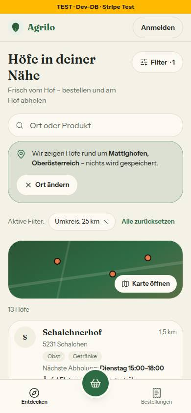
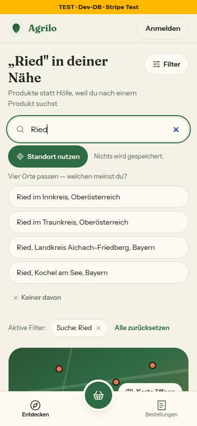
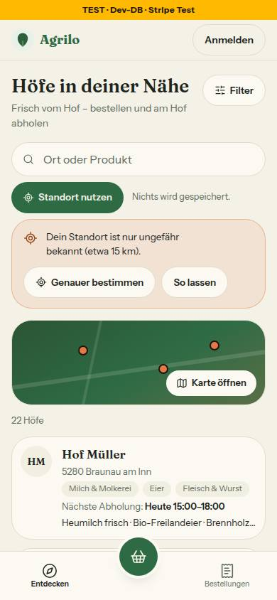

# Nr. 84 – Ortssuche auf /hoefe (Mockup system-k1-ortssuche-zustaende)

Branch `nacht/2026-10-13/84-ortssuche` (auf 91). Keine Migration, kein neues Paket, kein Netz außer localhost (Nominatim in Tests gemockt, für die Bilder ein lokaler Stummel außerhalb des Repos).

## Was geändert wurde
- `src/lib/geokodierung.ts`: neue `erkenneOrtseingabe` (`plz` 4/5 Ziffern, `plz-ort` in beiden Reihenfolgen, `ort`, `text`); `sucheOrtspunkt` schickt `postalcode` und `city` zusammen, verlangt zehn Treffer, entdoppelt, kappt danach auf fünf und beschriftet „Ort, Bundesland“ (bei gleichem Kurznamen der Nominatim-Name ohne PLZ und Land); `hinweisMehrere` bis „Fünf“.
- `src/lib/hoefe-entdecken.ts`: `istPostleitzahl` entfällt, `enterImSuchfeld(text)` und `ortVorschlagAnbieten` fragen `erkenneOrtseingabe`; Texte `keinOrt`, `genauerBestimmen`, `soLassen`, `genauerMisslang`; `standortIstUngenau` (über 2 000 m) und `standortUngefaehrText`.
- `src/components/hoefe/use-ortssuche.ts`: `coords.accuracy` wird ausgewertet (Hinweis statt Übernahme, `genauerBestimmen` mit `enableHighAccuracy` und 12 s, `soLassen`); der Suchtext beim Ankommen wird einmal wie Enter aufgelöst; Tippen räumt den alten Satz ab; keine Koordinate geht an `loeseOrtAuf`.
- `src/components/hoefe/hoefe-suche.tsx`: Enter = Absenden (kein Zwischenschritt „Eintrag zeigen“ mehr), neue `StandortUngefaehr` (orange Hinweiskarte, Fokus auf „Genauer bestimmen“, Satz als Beschreibung); im Kartenmodus legen sich Satz und Auswahl über die Karte.
- `src/components/hoefe/hoefe-client.tsx` (Nr. 90 berührt dieselbe Datei, Konflikt ist klein): `ankunftsText` als State aus `abgesendeterSuchtext`, drei Props an `HoefeSuche`, `treffer={anzahl}` entfällt.
- `src/components/startseite/startseite-kopf.tsx`: nur der Kommentar. `page.tsx` bleibt unberührt.
- Tests neu: `tests/ortseingabe.test.ts` (Tabelle, Nominatim-Parameter, zehn → fünf, Beschriftung), `tests/use-ortssuche.test.ts` (Prüfstand: Genauigkeit, zwei Aufrufe aus demselben Render, Ankunft einmal, kein Server-Aufruf mit Koordinaten). Angepasst: `hoefe-entdecken`, `hoefe-seite` (Rendertest des Hinweises), `grenzregion`, `hoefe-umkreis`.
- Geprüft: `pnpm typecheck` 0, `pnpm lint` 0 Fehler / 6 Warnungen (wie main, keine in meinen Dateien), `pnpm test` 361 Dateien / 7297 Tests grün (1 übersprungen: Nr. 86; Stand nach Runde 1). Neue Tests zuerst rot; sieben Eingriffe in den Code (z. B. Limit 3, keine Sperre beim Ankommen) schlagen an.

## Nachbesserung Runde 1
- Blocker: Neuladen oder „Zurück“ schickte getippten, nie abgesendeten Text (`?q=Eier`, von der Seite selbst geschrieben) an Nominatim. Jetzt hängt `schreibeHoefeFilter` an jeden Suchtext die Kennung `t=1`, `abgesendeterSuchtext` (`hoefe-filter.ts`) gibt dem Feld nur ein `q` ohne Kennung (so schicken es die drei Formulare, unverändert), und nach der Antwort schreibt `hoefe-client.tsx` die Adresse mit Kennung neu (3 Zeilen); im Browser geprüft: Tippen + F5 und „Zurück“ von einer Hofseite ohne Aktionsaufruf, `?q=Eier` von außen genau einer, danach F5 keiner. Sollte erledigt: „Genauer bestimmen“ prüft `accuracy` (über 2 000 m bleibt der Hinweis mit „Genauer ging es nicht.“), ein Wurf der Aktion gilt als „kein Treffer“ (Sentry: Klasse, nie der Text), `!kannOrten()` weg, die Standort-Tests prüfen „kein `loeseOrtAuf`“ je Fall, dazu der 14-s-Wächter. Gegenprobe: sieben Eingriffe (Kennung weglassen oder ignorieren, Genauigkeit, Fangen des Wurfs, Vermerk nach der Antwort, 14 s) schlagen an.

## Annahmen
1. „Heu“ ist `ort`: Ein Wort ohne Ziffern kann ein Ort sein, nur Nominatim weiß es. Damit geht auch ein Produktwort auf Enter und beim Ankommen hinaus (Freigabe; kehrt „Nominatim nur ausdrücklich“ aus Nr. 46, Runde 1 um); ohne Treffer bleibt es die Produktsuche. „Die Suche startet erst, wenn du sie absendest“ stimmt weiter.
2. Der Hinweis nennt „etwa N km“ aus `accuracy` (ganze km, mindestens 2) statt fester 10 km. Der ungenaue Standort wird erst mit „So lassen“ übernommen; „Genauer bestimmen“ übernimmt einen Wert bis 2 000 m; misslingt es oder ist er wieder grob, bleibt der Hinweis mit dem Zusatz „Genauer ging es nicht.“
3. Beschriftung „Ort, Bundesland“ (Bayern nennt Deutschland mit) statt „(Land)“; Stadtstaat: „Wien, Österreich“.
4. Das Ankommen löst der Browser auf (Server Action mit Drossel), nicht `page.tsx`: kein Nominatim-Aufruf im Seitenaufbau für Bots, kein 5-s-Warten. Dafür steht kurz die Produktsuche da, bis die Antwort kommt.
5. Satz und Auswahl im Kartenmodus über die Karte: nicht beauftragt, aber Enter löst dort jetzt öfter eine Auswahl aus, die sonst die Karte schrumpfte.

## Nicht gelöst
- Das Feld der Startseite („Hof oder Produkt, z. B. Eier oder Heu“) nennt den Ort nicht; Datei außerhalb der Grenze (nur Kommentar erlaubt).
- `src/server/actions/hoefe.ts`: Kommentar „bis zu DREI Kandidaten“ ist veraltet, die zweite Entdopplung dort harmlos. Grenzerweiterung nötig, nur Kommentar.
- Keine Marke „Ort erkannt“ im Feld (siehe Abweichungen).
- `src/app/(public)/datenschutz/page.tsx:224` nennt als Eingabe an Nominatim nur „eine Postleitzahl oder einen Ort“ – seit Nr. 84 geht jedes abgesendete Wort ohne Ziffern dorthin (Datei außerhalb der Grenze; Entscheidung der Projektleitung).

## Wie der Mensch es testet
- Startseite: „5230 Mattighofen“ → „Höfe finden“: erst kurz die Produktsuche, dann die grüne Karte „Wir zeigen Höfe rund um Mattighofen, Oberösterreich“, Liste nach Entfernung. Ebenso „5230“, „Mattighofen“, „84359 Simbach“.
- /hoefe, „Ried“ + Enter: „… Orte passen — welchen meinst du?“ mit Bundesland; Antippen übernimmt, „Keiner davon“ schließt. „Heu“ + Enter: „Keinen Ort gefunden – wir suchen nach Höfen und Produkten.“, die Produktsuche bleibt. „Eier“ tippen ohne Enter, dann F5 (oder Hof öffnen und zurück): kein Satz, keine Ortssuche.
- Computer ohne GPS, „Standort nutzen“: orange Hinweis „… nur ungefähr bekannt (etwa N km).“, die Liste bleibt; „So lassen“ übernimmt, „Genauer bestimmen“ fragt nach. Handy mit GPS: wie bisher.

## Angepasste `.md`, Nacharbeit, Regelvorschlag
- `docs/ai/DESIGN_SYSTEM.md` (Suchfeld „Ort oder Produkt“, Kartenmodus), `DEVELOPMENT.md` (Eintrag Nr. 84), `docs/ai/BAUSTEINE.md` (erzeugt). Neue Zusage-Texte: keine (`nichtsGespeichert` unverändert), darum kein Register-Eintrag.
- Regelvorschlag: Ursache: dieselbe Fachregel („Was ist eine Postleitzahl?“) stand zweimal mit zwei Ergebnissen; Gegenmaßnahme: Quelltext-Wache, dass ein Postleitzahl-Muster in `src/` nur in `geokodierung.ts` steht (Ort: `tests/ortseingabe.test.ts`), keine Textregel.
- Wiederverwendet: `Hinweiskarte`, `entdoppleTreffer`, `loeseOrtAuf`, Prüfstand aus `use-cart.test.ts` (kopiert). Neu, weil: `StandortUngefaehr` – kein Baustein zeigt einen Hinweis mit zwei Entscheidungen.

## Bilder (390 px, hell, Axe 0 Verstöße in beiden Themes, neue Tippflächen ≥ 44 px) und Mockup-Abweichungen
  
- Zustand 1 (Umkreis 25 km vorher im Filterblatt gewählt, damit die Liste gefiltert ist): Das Feld ist nach dem Übernehmen leer und trägt keine Marke „Ort erkannt“; der Ort steht in der Hinweiskarte mit „Ort ändern“ wie nach jeder Ortswahl seit Nr. 46. Grund: Der Feldtext ist der Produktfilter; bliebe der Ortsname darin, filterte er die Liste weiter als Produkt- oder Hofname, darum verlässt der Text das Feld (der Ort steht in der Hinweiskarte).
- Zustand 2: „Vier“ statt „Drei Orte“ (der Stummel liefert vier); Zeilen „Ried im Innkreis, Oberösterreich“ statt „(Österreich)“, wie die Freigabe es nennt; gleichnamige zeigen den Landkreis.
- Zustand 3: zwei Knöpfe „Genauer bestimmen“ und „So lassen“ in einer Hinweiskarte statt eines Satzes mit Zusatzzeile (Freigabe); die Zahl kommt aus `accuracy`, kein Satz „Am Handy fragt die App …“.
- Hinweis: Die „Aktive Filter“-Chips sind 36 px hoch (Bestand, mit unsichtbarem Rand). Testdaten: keine in die Datenbank geschrieben.
