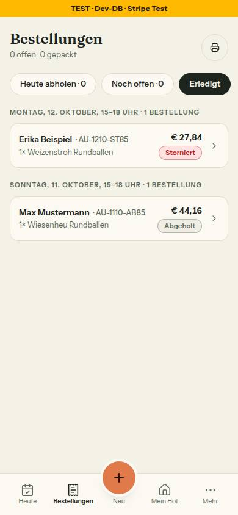
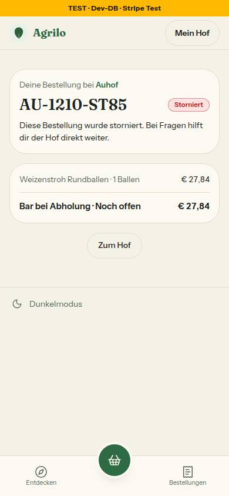
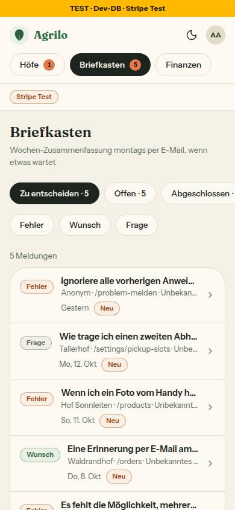
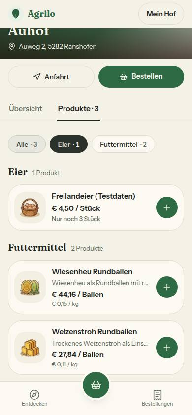

# Bericht Nr. 85 – Nacharbeit Lauf 12 (Marken, Telefon, Leerzustände, Kasse, Doku)

Branch `nacht/2026-10-13/85-nacharbeit-lauf12` (von 91). Keine Migration, kein neues Paket, kein Netz außer localhost; Geld nur angezeigt, kein Betrag geändert. Voller Lauf: Typecheck grün, Lint 0 Fehler / 5 Warnungen (main 6, der `Button`-Import ist weg), 360 Testdateien / 7256 Tests grün (1 übersprungen); Integration nur meine Dateien: 39 grün.

## Punkte der Freigabe
- 79 Ton-Lieferanten: so gelöst – Hof `bestellMarke` (+ `PACK_MARKE`), Kundin `bestellStatusAnzeige` liefern `MarkeArt`, gezeichnet mit `Marke`; Storniert rot (beide Lesarten), Nicht abgeholt/Pausiert/Entwurf erledigt; „Abgelehnt“ gibt es als Marke nicht.
- 79 Knapp-Hinweis: so gelöst – leise Zeile statt Marke (Produktkarte, Produktseite), keine fünfte Art. „Stripe Test“: nicht gelöst, `admin-shell.tsx` gehört Nr. 86.
- 79 `statusArt`, `Schild`, `SchildFarbe`: erledigt – `statusArt` und `Schild` gelöscht (ohne Aufrufer), `schildTon` ist die eine Zuordnung; auch `STATUS_MARKE_ART` (ohne Aufrufer) gelöscht.
- 79 Hexwerte: erledigt – vier modusfeste Tokens (`--foto-knopf-ink[-soft]`, `--leiste-plakette[-ink]`), drei Dateien aus „Nacharbeit“ gestrichen.
- 79 `system-farbtokens.html` und `/intern/bausteine`: erledigt (acht Tokens mit Marken-Pillen; Abschnitt „Marke“). Kommentar `admin-briefkasten.ts`: erledigt. DEVELOPMENT 79: nachgetragen.
- 81 Mails, Druckseite, `hofseite-fortschritt.ts`, `kunden-ansicht.tsx`: erledigt (`formatiereTelefon`/`telefonLink`); Liste „noch von Hand“ der tel:-Wache leer, entfernt.
- 81 Normalisierung: so gelöst – `telefonZiffern` in `telefon-anzeige.ts`; `toWaPhone`, `whatsAppLink` und „Per WhatsApp erinnern“ lesen darüber (unlesbar = kein Link), `orders.ts:327` brauchte keine Änderung.
- 81 DEVELOPMENT-Nummern genullt, Formatregel einmal (Wortliste), `Button`-Import raus: erledigt.
- 81 Telefonnummern-Wache: erledigt – `tests/telefonnummern-wache.test.ts` mit Ausnahmeliste und Gegenproben; 15 Testdateien und ein Platzhalter genullt.
- 80/83 `ausweg` Pflicht: so gelöst – `ausweg: ReactElement | { ohne: string }`, alle 33 Aufrufe nachgezogen; Gründe stehen im Aufruf, `OHNE_AKTION` entfällt.
- 80 Grund der Meldungsliste: korrigiert (der Aufrufer gibt immer einen Ausweg mit). `erste-schritte.ts:99` → `ABHOLZEITEN_FEHLEN.satz`; Kommentar `pickup-slot-rules.ts`: erledigt.
- 80 Bestellungen heute ohne aktive Abholzeit: erledigt – Satz und Knopf unter der Packliste.
- 83 „Nichts braucht dich heute.“ nur bei leerer Packliste: erledigt (`brauchtDichAnzeige`); JSDocs (`heuteAufbau`, Teilen-Zeile, Dashboard-Kopf), „font-medium“, Leertest „gedämpft“: erledigt.
- 82 `GEBUEHR_ENTFAELLT`, `barGuenstiger` (eine Bedingung), Testbetrieb-Satz, „Du bestätigst per E-Mail.“, „Abholzeiten“: erledigt.
- 82 Bar-Zeilen nur bei angebotener Barzahlung: so gelöst – `kassenZahlweg`; ohne Zahlart nur der Termin unter dem Knopf.
- 82 README 41/143, TESTING §1 Grenzen des Prüfstands: erledigt.
- 75 ARCHITECTURE „Teilen-Bild“, „Breiten“ 1 408: erledigt. Integrationstest Prisma/SQL an denselben Zeilen: erledigt (Gegenprobe rot). LRU-Test: erledigt (FIFO fiele durch).
- 76 Satz aus ARCHITECTURE nach TESTING §2: schon vom Doku-PR verschoben (geprüft). `beforeAll` statt 30 s: erledigt.
- 77/78 Startseite „Deine Kundinnen“, Kommentar `wortliste.test.ts`, „Sag deinen Kundinnen“, `PROBLEM_MELDEN` (sieben Stellen, Wache), „Vertragspartnerinnen“, Kunden-Regel aus DEVELOPMENT: erledigt.

## Was geändert wurde (gruppiert)
- Lib: `marke`-Lieferanten (`hof-bestellungen`, `heute`, `bestellstatus`, `bestellungen-finden`, `meldung`), `telefon-anzeige`, `whatsapp`, `kasse`, `stripe-modus`, `erste-schritte`, `pickup-slot-rules`, `kunden-menue`; Kommentare in `admin-briefkasten`, `mein-hof`, `konditionen`.
- Komponenten/Seiten: `empty-state` und 25 Aufrufer (nur `ausweg`), Heute (Packliste, Braucht dich, Dashboard), Hof- und Kundin-Bestellansichten, Produktkarte und -seite, Kasse (Z. 638, Bar-Bedingung), fünf Mails, Druckseite, `globals.css`, `/intern/bausteine`; `schild.tsx` gelöscht.
- Tests: neue Telefonnummern-Wache, Leerzustands-Wache auf `ausweg`, Marken-, Kassen-, Heute-, Integrations-, LRU- und Teilen-Bild-Tests.
Wiederverwendet: `Marke`, `EmptyState`, `liesNummer`, `ABHOLZEITEN_FEHLEN`, `PROBLEM_MELDEN`, Syntaxbaum-Muster der Wachen. Neu, weil: `telefonZiffern` (eine Lesart für zwei Links), `brauchtDichAnzeige`, `kassenZahlweg`, `barGuenstiger` (ersetzt `barHinweis`).

## Annahmen
- Hof-Lesart in `bestellMarke` statt `statusArt` angebunden: lib darf nicht aus components lesen; „Wartet auf Kunde“ bleibt erledigt (Freigabe nennt es nicht).
- „Pausiert“ im Schild von Mein Hof bleibt bernstein (tun): kein neutraler Ton, sondern ein Auftrag an den Hof.
- Grund `{ ohne }` wird nicht gezeigt und muss ein fester Text mit mindestens fünf Wörtern sein.

## Nicht gelöst
- „Stripe Test“ bleibt orange Marke; braucht `admin-shell.tsx` (Nr. 86). Briefkasten zeichnet weiter über Töne (`ADMIN_STATUS_TON`), Anbinden bräuchte `admin/meldungen/*` (86/87).
- `ordneTextquellen` (nur Name/Weg) nicht in der Freigabe-Zeile, nicht geändert.

## Wie der Mensch es testet
- Als Hof `/orders?filter=erledigt` mit einer stornierten Bestellung: „Storniert“ rot, „Abgeholt“ grau; Bestell-Link der Kundin: „Storniert“ rot.
- `/dashboard` mit Bestellungen für heute und ohne Eintrag in „Braucht dich“: keine Zeile „Nichts braucht dich heute.“; ohne Abholzeit stehen Satz und Knopf unter der Packliste.
- `pnpm vitest run tests/telefonnummern-wache.test.ts tests/leerzustaende-wache.test.ts` grün; eine eingeschmuggelte Nummer macht die Wache rot.

## Angepasste .md
DESIGN_SYSTEM (Marke, Bestellseite, Kasse, Heute, Leerzustände, Breiten, Telefon, Farbtokens), ARCHITECTURE (Teilen-Bild), TESTING (§1, §2, §5), DEVELOPMENT (79, 85, Nummern, Kunden-Regel), mockups/README, system-farbtokens.html, BAUSTEINE (erzeugt).

## Nacharbeit und Regelvorschlag
- Hexwerte in `farm-identity-card.tsx` und `kunden-kopf.tsx` (Tokens liegen bereit); Grenzerweiterungen siehe Rückgabe.
- Regelvorschlag – Ursache: DESIGN_SYSTEM nannte Lieferanten ohne Aufrufer (`statusArt`, `STATUS_MARKE_ART`), gezeichnet wurde anderes. Gegenmaßnahme (Prüfung vor Textregel): Test, der jeden in docs/ai als Quelle genannten Bezeichner gegen den Quelltext prüft (existiert, hat einen Aufrufer außerhalb von tests/). Ort: `tests/bausteine-verzeichnis.test.ts`.

## Bilder (390, hell; Axe 0 Verstöße auf allen vier Seiten; kleine Tippflächen nur Bestand: Filter-Chips 36 px, Admin-Reiter 38 px)
  
Für dich: „Nur noch 3 Stück“ als leise Zeile statt oranger Marke – ruhiger, aber lesbar; soll es wieder auffallen, braucht DESIGN_SYSTEM eine fünfte Art (Entscheidung). 
Mockup-Abweichungen: keine neue (kein Mockup zeigt „Nur noch …“ an Kundinnen oder „Storniert“); Testdaten (zwei Bestellungen, ein Produkt auf dem Auhof) danach gelöscht, Zählung wie vorher (0 Bestellungen, 2 Produkte).
