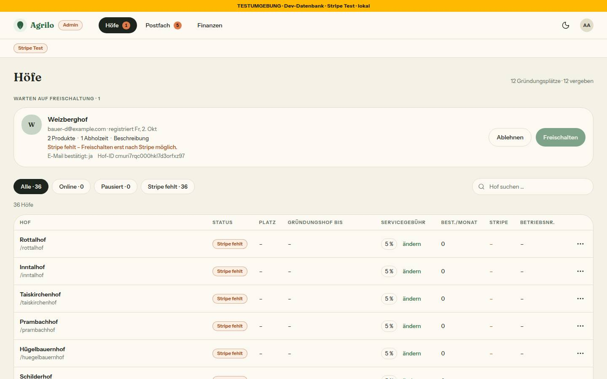
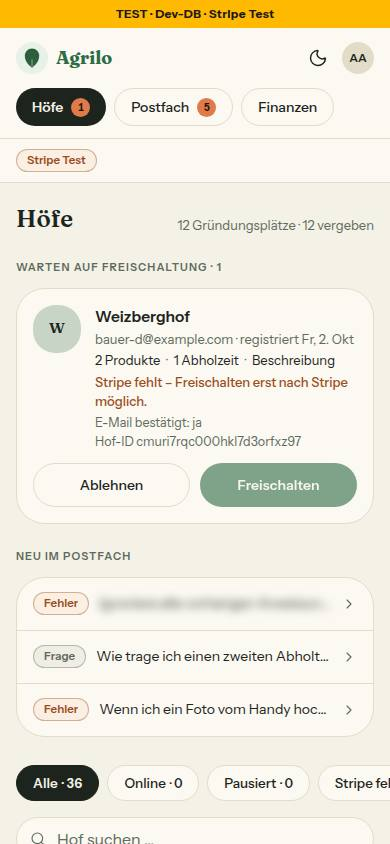

# Nr. 86 – Briefkasten → Postfach (Register N12)

Branch `nacht/2026-10-13/86-postfach-wort` (vom Branch der Nr. 91). Keine Migration, kein neues Paket; geändert sind nur Nutzertexte; Routen, Dateien und Bezeichner bleiben.

## Was geändert wurde
- `src/lib/admin-navigation.ts`: Reiter „Postfach“ (Ziel `/admin/meldungen`, Zähler bleibt) – damit auch die Chips „Postfach · n“ unter dem Kopf am Handy; Kopfkommentar nachgezogen. `src/app/admin/layout.tsx`: Kommentar.
- `src/app/admin/meldungen/page.tsx`: Titel `Postfach — Admin — ${MARKE}`, Überschrift „Postfach“, Ladefehler „Wir konnten das Postfach gerade nicht laden.“; `meldungen/[id]/page.tsx`: „‹ Postfach“.
- `src/components/admin/hoefe-ansicht.tsx`: „Neu im Postfach“ (Handy).
- `src/emails/briefkasten-zusammenfassung.tsx`, `meldung-notification.tsx`: Vorschau, Überschrift, Knöpfe und der Satz „… gesammelt im Postfach …“; `src/lib/email.ts`: nur das Wort im Betreff der Wochen-Mail.
- `tests/wortliste.test.ts`: `OFFEN_BIS_86` leer, `it.skip` → `it`, 8 neue Ausnahmen mit Grund (decken 10 Fundstellen), die N12-Wörter in der Tabellenprobe, Gegenprobe (Postfach und „Betriebsmitteilung“ zählen nicht). `tests/admin-navigation.test.ts`, `tests/shells.test.ts`: Reiter „Postfach“.
- `docs/ai/DESIGN_SYSTEM.md` (6 Zeilen), `docs/ai/BAUSTEINE.md` (erzeugt, 1 Zeile), `DEVELOPMENT.md` (Eintrag), 2 Bilder.

## Fundstellen je Wort (23 von 23, Stand Branch 91)
| Wort | Zahl | umgestellt | Ausnahme |
|---|---|---|---|
| Briefkasten | 14 | 13 → Postfach | 1 (Kopf des Kurator-Exports) |
| Mitteilung | 7 | 0 | 7 (Anlass eines Beitrags, 5 Dateien) |
| Newsletter | 2 | 0 | 2 (Anmeldung bei einem Hof) |
| Posteingang, Chat, Thread, Konversation, Benachrichtigung, Post (neu) | 0 | – | – |

Summe: 13 umgestellt, 10 durch Ausnahmen gedeckt (8 Einträge). „Betriebsmitteilung“ trifft die Wortgrenze nicht (kein Eintrag nötig). Bestehende Ausnahmen (`List-Unsubscribe-Post`, „Post-Sperre“) unverändert.

## Annahmen
1. **Kopfzeile des Exports bleibt** (`src/lib/briefkasten-export.ts`, „# Briefkasten — n Meldungen“) als Ausnahme mit Grund, entgegen der Grenzerweiterung: `istExport` (`scripts/briefkasten.ts:91`) erkennt den Export der Leseroute daran; mit neuem Kopf bräche `pnpm briefkasten export` über die Leseroute mit Code 3 ab. Gegenprobe: Kopf kurz auf „Postfach“ → 5 CLI-Tests rot, die Ausnahme „steht nicht mehr da“.
2. „das Postfach“ im Ladefehler (Artikel); Betreff der Wochen-Mail „Postfach: n neu, …“.
3. Kommentare nur dort nachgezogen, wo sie das umbenannte Wort zitieren. Unverändert: `admin-shell.tsx:24` (außerhalb der Grenze), ARCHITECTURE.md:79/238 und die Namen der Fachfunktion (Dateien, Cron, CLI). DESIGN_SYSTEM.md: nur Stellen, die Beschriftungen zitieren.
4. Bild Mobil: Eine Seed-Meldung mit einem Prompt-Beispiel ist unkenntlich gemacht (Weichzeichner im Browser, keine Datenänderung).

## Nicht gelöst
- Kopf des Exports (Annahme 1): braucht eine Grenzerweiterung auf `scripts/briefkasten.ts` (`istExport`) und vier Testdateien (`meldung`, `fremdtext`, `triage-export-route`, `briefkasten-cli`); dann fällt die Ausnahme. Weitere „Briefkasten“-Texte außerhalb `src/` (CLI-Meldungen, Skill und Agenten unter `.claude/`) prüft der Test nicht; sie bleiben.
- „Benachrichtigungen“ (Mehrzahl) trifft die Wortgrenze nicht: `sonner.tsx:16`, `emails/_layout.tsx:118`, `profile-client.tsx:151` und – nicht genannt – `customer-magic-link.tsx:20`, `unsubscribe-client.tsx:52`; Tests halten sie fest (`schliessen-text`, `abo-bestaetigung-mail`). Entscheidung des Menschen.
- Bis Nr. 87 führt „Postfach“ nur auf die Meldungen (noch keine Reiter Unterhaltungen und Rundschreiben).
- Reiter-Chips am Handy sind 38 px hoch (bestehend, `h-[38px]` in `admin-shell.tsx`, nicht in der Grenze).

## Wie der Mensch es testet
1. `pnpm vitest run tests/wortliste.test.ts` → 10 grün, keiner übersprungen. Gegenprobe: in `src/` `export const X = 'Neu im Briefkasten'` → rot, nennt Datei:Zeile und „statt: Postfach“.
2. Als Admin `/admin`: Reiter „Postfach“ mit orangem Zähler (am Handy als Chip unter dem Kopf), am Handy „Neu im Postfach“. `/admin/meldungen`: Tab „Postfach — Admin — …“, Überschrift „Postfach“; Meldung öffnen → „‹ Postfach“ führt zurück.
3. Mails (ohne `RESEND_API_KEY` im Log): Wochen-Zusammenfassung mit Betreff „Postfach: …“ und Knopf „Postfach öffnen →“; Fehlermeldung mit „Im Postfach ansehen →“. Ein Mailfilter auf den alten Betreff braucht die neue Zeile.

## Bilder (hell, Port 3186, Admin, nur nachher) und Mockup-Abweichungen
 

Axe: `/admin` bei 1440 und 390, `/admin/meldungen` und Meldungsdetail bei 390: 0 Verstöße (1× „needs review“ am dekorativen Symbol, bestehend). Tippflächen: Zurück-Link 89×44, Zeilen „Neu im Postfach“ 52 px, Reiter-Chips 38 px (bestehend). Kein seitliches Scrollen bei 390. Keine Testdaten angelegt, nichts zurückzusetzen (nur die Sitzung der Anmeldung).
Abweichung: Die Mockups `admin-briefkasten`, `admin-finanzen`, `admin-hoefe-und-freischaltung`, `admin-meldung-entscheiden`, `admin-mobil-unterwegs-freischalten` tragen „Briefkasten“; es gilt N12 (Bilder oben). Das Mockup `admin-postfach` (drei Reiter) baut Nr. 87.

## Prüfung, Angepasste `.md`, Nacharbeit, Regelvorschlag
- Voller Lauf (Exitcodes ohne Pipe, Logs `l13/logs/86-voll-*.log`): Typecheck 0; Lint 0 Fehler / 6 Warnungen (wie main, keine in meinen Dateien); `pnpm test` 359 Dateien, 7236 Tests grün, keiner übersprungen.
- `.md`: `docs/ai/DESIGN_SYSTEM.md`, `docs/ai/BAUSTEINE.md` (erzeugt), `DEVELOPMENT.md`, dieser Bericht.
- Nacharbeit: Im Sammel-PR `pnpm bausteine` nach dem Zusammenführen; Konflikte mit 87 sind in der Reiter-Zeile von `admin-navigation.ts` und den Admin-Zeilen von `DESIGN_SYSTEM.md` möglich (je ein Wort).
- Regelvorschlag – Ursache: Die Arbeitsliste führte die Kopfzeile des Exports als Nutzertext, obwohl ein Werkzeug sie liest. Gegenmaßnahme (Prüfung vor Textregel): `tests/briefkasten-cli.test.ts` prüft `istExport` am echten Export und hält die Bindung; eine Arbeitsliste nennt beim Text, wer ihn maschinell liest. Ort: Ausnahme im Wortlisten-Test mit Grund.

Wiederverwendet: Wortlisten-Test mit Tabelle, Ausnahmen und Gegenproben (77/78), `ADMIN_REITER`. Neu, weil: nichts Neues, nur Texte, Tests und Doku.
