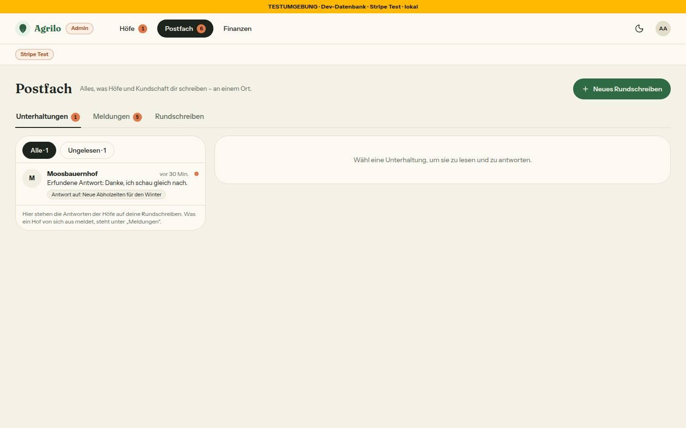
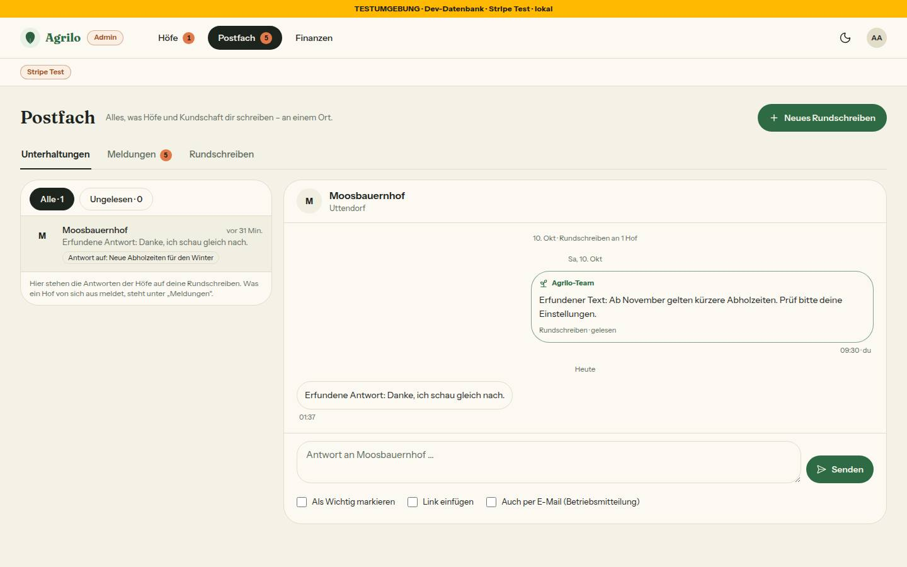

# Bericht Nr. 87 – Postfach Stufe 1: Nachrichten vom Team, Antworten, Admin-Reiter (N12)

## Was geändert wurde
- `prisma/schema.prisma`, `prisma/migrations/20261013210000_postfach/migration.sql`: vier neue Tabellen (Rundschreiben, Unterhaltung, Nachricht, UnterhaltungStand), drei Enums, Index je Fremdschlüssel, RLS, wiederholbar; nichts an bestehenden Tabellen (Regel 3, `prisma migrate diff` gegen main).
- `src/lib/postfach.ts`: Texte, Ziele, Link-Regel (relativ oder `PRODUKTION_HOST`), Lesestand je Seite, Liste/Heute/Faden, Empfänger-Filter — rein; Typen aus den Zod-Schemas.
- `src/schemas/postfach.ts`: Zod an der Grenze (cuid, Text ≤ 1000, Titel ≤ 80, Link, strikt, Enums 1:1 zu Prisma).
- `src/server/queries/postfach.ts`: Lesen mit `farmId` in der WHERE-Klausel; Zähler Hof/Team als eine SQL-Abfrage.
- `src/server/actions/postfach.ts`: Hof antwortet/liest (`getFarmForUser` — nicht `ladeHofbereich`, das umleitet und fünf Abfragen macht; Besitz in der WHERE-Klausel, 30 je Tag in zwei Stufen), Team antwortet/liest (Admin-Prüfung), Rundschreiben in EINER Transaktion; Mails und das Belegen der Mail-Stunde als Nachlauf.
- `src/emails/postfach-rundschreiben.tsx`, `postfach-antwort.tsx` (Fuß vom Team über `fusszeile`); `src/lib/email.ts`: `sendPostfachMail` über `sendRaw` (Post-Sperre Z3).
- `src/app/(hof)/postfach/**`: Liste, Faden (`id` per Zod), Antwortfeld, Nachladen (60 s), Ladeansichten, Bausteine (`teile.tsx`, auch vom Admin genutzt).
- `src/app/admin/postfach/**`: drei Reiter, die Seite lädt den offenen (Ladefehler: `AdminFehler`), Meldungen von /admin/meldungen umgezogen, Rundschreiben mit Formular; `admin/meldungen/page.tsx`: 308 auf den Reiter, Filter gehen mit.
- `bauern-navigation.ts` (Postfach nach Bestellungen, oben im Mehr-Blatt), `admin-navigation.ts` (Reiter `/admin/postfach`), `adminbereich.ts` (Zahl = ungelesene Antworten + Meldungen); `heute.ts`, `heute-teile.tsx`, `dashboard/page.tsx` (Karte zuerst, Ladefehler nimmt nur sie weg).
- Grenzerweiterungen, vom Dirigenten bestätigt: `hof-shell.tsx`, `farmer-nav.tsx`, `hofbereich.ts`, `(hof)/layout.tsx`, `slug.ts`, `next.config.ts`, `proxy.ts` (`/postfach`); Runde 1: `src/emails/_layout.tsx` (Prop `fusszeile`) und `admin-shell.tsx:67` (Screenreader-Text).
- Tests neu: `postfach`, `postfach-mail`, `postfach-ansicht`, `migration-postfach`, `integration/postfach.int`; angepasst: Navigation, Shells, Heute, Lader, Admin-Seiten, Wachen (Leerzustände, Zeitschaltung).

Wiederverwendet: EmptyState, FilterChip, Marke, Zaehler, ListGruppe/ListRow, UnterseitenKopf, Hinweiskarte, AdminFehler, ProgressBar, ZeichenZaehler, MeldungListe/Wunschliste, `getFarmForUser`, `datumKurz`, `uhrzeitInWien`, `createRateLimiter`/`bremseUeberAlleInstanzen`, `nachDerAntwort`. Neu, weil: Faden-Blasen, Team-Zeichen, Heute-Karte und das Rundschreiben-Formular gab es nicht.

## Annahmen
- „Alle Höfe“ = nicht stillgelegt, wartende eingeschlossen; „ohne Online-Zahlung“ = Stripe-Konto nicht bereit; „Futter ohne Nummer“ = verfügbares Futtermittel und keine Betriebsnummer (LFBIS-Regel).
- Lesestand reicht bis zur `createdAt` der gelesenen Nachricht (nicht „jetzt“); Öffnen setzt ihn nach dem Rendern per Action. Wer antwortet, hat gelesen. Team-Mail nur mit Haken, höchstens eine je Faden und Stunde (`Unterhaltung.letzteMailAm`, dieselbe Migration); Empfänger ist die Konto-Adresse des Hofs.
- Zwei Leerzustände ohne Aktion (vorerst in `OHNE_AKTION`, im Sammel-PR `ausweg={{ ohne }}`, Nr. 85): „Noch keine Nachricht vom Team“ – Höfe beginnen keine Unterhaltung, Nachrichten schreibt nur das Team, ein Problem oder Wunsch geht über „Problem melden“; „Noch kein Rundschreiben gesendet“ – das Formular „Neues Rundschreiben“ steht auf derselben Seite (ab 1024 px daneben, schmaler darunter).
- Die Rolle aus der Sitzung zählt in den Hof-Actions nicht, nur der Besitz (Cookie-Cache). Scheitert das Belegen der Mail-Stunde, meldet die Antwort des Teams „Antwort gespeichert.“ (keine Mail, nur die Fehlerklasse nach Sentry).

## Nicht gelöst
- Bremse-Eintrag gehört nach `DB_BREMSEN` (`src/lib/bremse-datenbank.ts`, außerhalb der Grenze) — steht als `POSTFACH_DB_BREMSE` in `src/lib/postfach.ts`.

## Wie der Mensch es testet
1. Admin auf `/admin/postfach?reiter=rundschreiben`: „Ausgewählte“, Hof suchen, Wichtig, Titel, Text, Link `/settings`, „An 1 Hof senden“ → „Rundschreiben an 1 Hof gesendet.“, Eintrag unter „Gesendet“ (0 von 1 gelesen).
2. Als dieser Hof `/dashboard`: Karte ganz oben; „Gelesen“ nimmt sie weg. `/postfach`: Faden mit Punkt; öffnen, antworten → beim Admin „Unterhaltungen · 1“; `/postfach/abc` → 404.
3. Admin antwortet mit „Auch per E-Mail“ → innerhalb der Stunde „Keine E-Mail: … schon eine“; die Mail (im Log) endet mit dem Fuß vom Team (`POSTFACH_MAIL_TEXT.fuss`), nicht „im Auftrag eines Hofes“. `/admin/meldungen?status=NEU` → 308 auf den Reiter Meldungen mit Filter.

## Angepasste .md
`docs/ai/DESIGN_SYSTEM.md` (Navigation, Heute, Postfach, E-Mail-Fuß, Admin), `docs/ai/ARCHITECTURE.md` (§5 Postfach), `docs/ai/TESTING_GUIDELINES.md` (Zeitschaltung: genau ein Takt), `docs/ai/BAUSTEINE.md` (erzeugt), `DEVELOPMENT.md`.

## Nacharbeit
Postfach-Bausteine aus `src/app/(hof)/postfach/teile.tsx` nach `src/components/postfach/` ziehen; Bremse nach `DB_BREMSEN`; Lesezeitpunkt je Seite (für „gelesen vor 1 Std.“) erst mit einer eigenen Expand-Migration. Prüfen, dass in der Produktion kein Hof den Slug „postfach“ trägt.

## Regelvorschlag
Ursache: Ein neuer Ordner auf oberster Ebene unter `src/app` brauchte drei Listen (Slug, `KEINE_HOFSEITE`, Proxy) außerhalb der Dateigrenze. Gegenmaßnahme: die Freigabe nennt bei jeder neuen Route diese drei Dateien automatisch in der Grenze. Ort: Vorlage der Dateigrenzen (docs/nachtlauf.md); die Wachen prüfen schon.

## Prüfung
typecheck grün; lint 0 Fehler, 6 Warnungen (wie main); `pnpm test` 363 Dateien / 7289 Tests grün; Integration 46 Dateien / 422 Tests grün (darin `postfach.int` 9/9, zweiter Lauf der Migration ohne Änderung). Axe 0 Verstöße, Tippflächen ≥ 44 px.

## Bilder und Mockup-Abweichungen
Testdaten (Rundschreiben an moosbauernhof, erfunden) per Formular bzw. `psql` angelegt, danach gelöscht (0/0/0/0 Zeilen).
     
     
- Liste ohne Pfeil zurück (Hauptpunkt, N1) — Bild Liste. Faden: Rückweg im Unterseiten-Kopf, Titel als h1 statt „Team“ im Kopf, Link-Knopf 44 statt 36 px — Bild Faden.
- Link-Knopf „Ansehen“ statt „Zu meinen Futtermitteln“: Das Schema hat kein Feld für einen Linktext — Bilder Faden, Unterhaltungen, Verfassen.
- Tageszeile „Sa, 10. Okt“ statt „10. Okt.“: Baustein `datumKurz` wie in jeder Liste des Hofbereichs, kein zweites Datumsformat; Uhrzeit auch unter der ersten Blase: `FadenVerlauf` setzt sie unter jede Blase gleich — Bild Faden älter.
- Admin-Faden „Rundschreiben · Wichtig · gelesen“ ohne „vor 1 Std.“: `gelesenBis` ist eine Lese-Position, kein Zeitpunkt (bräuchte eine Spalte, keine zweite Migration in diesem Lauf) — Bilder Unterhaltungen, Faden älter.
- Admin öffnet keinen Faden von selbst: Öffnen setzt den Lesestand des Teams, eine Antwort gälte sonst als gelesen, nur weil sie oben stand — Bild Ohne Faden.
- „Gesendet“ ohne Spaltenkopf „gelesen · gesendet“, die Lesequote als Balken unter der Zeile: Baustein `ProgressBar` (Zahl und Balken), bleibt auch einspaltig lesbar — Bild Rundschreiben.
- Zähler „44/80“, „212/1000“ erst ab 80 % Füllung: derselbe `ZeichenZaehler` wie in allen Formularen (CODING_STANDARDS §8; kein `maxLength`, die Grenze prüft das Schema) — Bild Verfassen.
- Admin: kein „Hof öffnen“ und keine Person/Tarif/Bestellzahl im Kopf (keine Admin-Hofseite), kein „Entwurf speichern“, kein Pfeil je Rundschreiben — Bilder Unterhaltungen, Rundschreiben.

## Nachbesserung Runde 1
Mail-Fuß: `EmailLayout` hat den freiwilligen Prop `fusszeile`, beide Postfach-Mails übergeben `POSTFACH_MAIL_TEXT.fuss` (Test mit Gegenprobe). Texte aus einer Quelle (Gruß, Zähler der HofShell, Platzhalter, Ladefehler über `AdminFehler`, Screenreader-Text am Admin-Reiter), neutral statt links/rechts, Erklärung nur mit Fäden, Ladeansicht ohne Chips, `id` per Zod, Nachlauf `letzteMailAm` fehlertolerant (Test), Rückgabetypen, strengere Zeitschaltungs-Ausnahme, Rendertest HofShell, Test der Umleitung.
`neuerLesestand`/`mailErlaubt` samt ihren zwei Unit-Tests entfernt: Sie prüften Funktionen, die kein Code aufrief; die wirksamen Regeln sind die WHERE-Klauseln, die `postfach.int` prüft. Typen `Seite`, `EmpfaengerRegel` aus Zod; `POSTFACH_FEHLER.speichern` entfernt; der Mail-Satz verspricht keinen Absender mehr. Neu: zwei Bilder (ohne Faden, älterer Faden).
