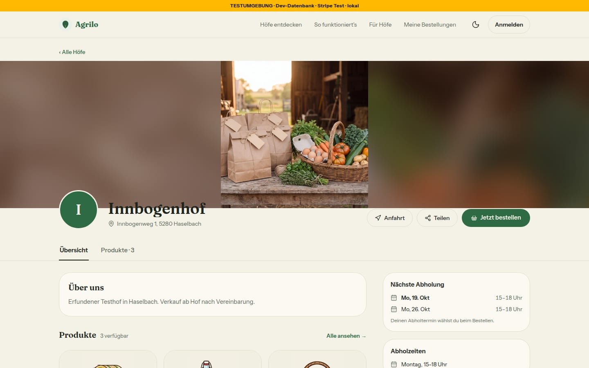
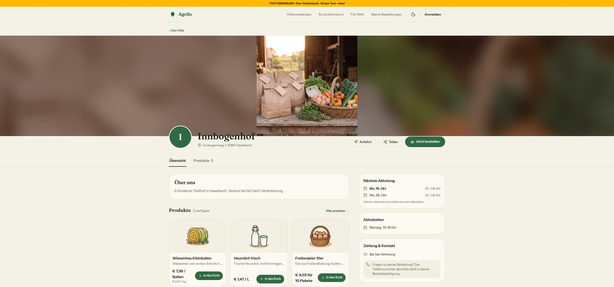
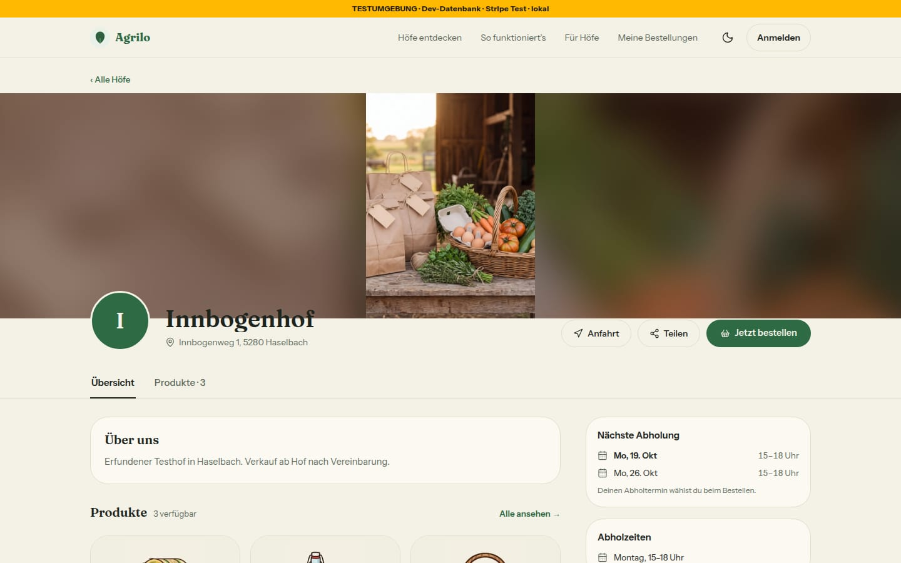
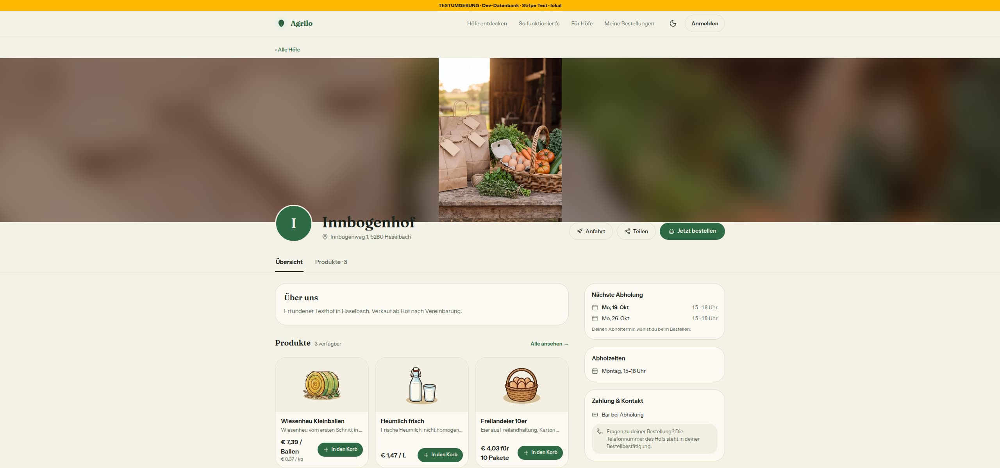

# Bericht Nr. 89 – Titelbild am Computer (Register N13)

Branch `nacht/2026-10-13/89-titelbild-computer` (von 91). Keine Migration, kein neues Paket; `hofseite-kunde.tsx` und `upload-pfade.ts` unberührt.
Wiederverwendet: `Titelbild`, `TitelbildBilder`, `useBildmasse`, `titelbildDarstellung`, `titelbildHinweis` (Nr. 72), Tönung `bg-primary-foreground/45` (Bild-Overlay), `cn`; Stichworte titelbild, banner, bild, hintergrund, 1920 im Bausteinverzeichnis: kein weiterer Treffer. / Neu, weil: nur Konstanten in `lib/titelbild.ts` (Grenze 1,5, Rundung ¾ px, Breite 1 920, `sizes`) — die Zahl 1 920 steht sonst an vier Stellen (Kasten, Kopie-Grenze, Konstante, `sizes`).

## Was geändert wurde
- `src/lib/titelbild.ts`: `titelbildDarstellung` liefert `ganz`, wenn die Breite kleiner ist als `TITELBILD_GANZ_UNTER` (1,5) × (Höhe − ¾ px) — Rundung und Dichteteilung der von `next/image` gelieferten Größe sind abgefangen (3:2 kommt als 640 × 427 oder 776 × 518 an); neu `TITELBILD_BREITE_MAX` (1 920) und `TITELBILD_SIZES`; der Satz für Mein Hof lautet „Quadrat oder Hochformat – …“ und erscheint bei allem, was ganz steht.
- `src/components/hofseite/titelbild.tsx`: Rahmen 220/300/360/420 px (Handy, ab 768, 1 280, 1 536); das scharfe Foto im Kasten `mx-auto max-w-[1920px]` in zwei Lagen (füllend mit `priority` und `onLoad`; ganz erst ab 768 px, `aria-hidden`); die unscharfe Kopie als EINE Lage über die volle Breite dahinter, immer im Baum (bei `ganz` ab 768 px sichtbar, bei `beschnitt` nur ab 1 920 px); beim Wechsel blenden ganze Lage und Kopie ein, die füllende aus (alle `transition-opacity` 500 ms); Weichzeichner 28 px, 20 px Überstand, Tönung 45 % wie im Mockup.
- `tests/titelbild.test.ts`: neu geschrieben, 53 Fälle (vorher 18): Tabelle der Seitenverhältnisse samt Grenze 1,5 und gelieferten Größen (640 × 427), Hinweissatz, Rahmenklassen, Kasten, Kopie-Grenze und `sizes` aus einer Zahl, die drei Lagen (Sichtbarkeit, Übergang, nur eine mit `priority`/`onLoad`, `aria-hidden`), `onLoad` → Maße → Lagen über einen Prüfstand für den einen Hook. Gegenprobe: 20 eingebaute Fehler (u. a. Rundung 0, Grenze 1,4, alte Regel „nur Hochformat“, Lage ohne `transition-opacity`, `priority` an der zweiten Lage, Kopie ohne `aria-hidden`, Kasten 1 800) — jeder macht mindestens einen Fall rot.
- `docs/ai/DESIGN_SYSTEM.md`: Hofseite/Titelbild neu gefasst (Höhen, Breite, Regel, Kopie, Wechsel, Maße); Mein Hof/Titelbild: der neue Satz. `DEVELOPMENT.md`: Eintrag Nr. 89. `docs/ai/BAUSTEINE.md`: erzeugt (zwei Zeilen). Sechs Bilder unter `docs/nachtlauf/berichte/bilder/89/`.

## Annahmen
- EINE Kopie über die volle Breite statt „eine im Kasten und eine dritte Lage außen“: Zwei Kopien mit verschiedenem Maßstab ergäben über 1 920 px eine Naht an der Kastenkante. Bis 1 920 px sieht es genauso aus; die Bilder bei 2 560 px zeigen keine Naht.
- Die Ränder über 1 920 px tragen bei `beschnitt` dieselbe Tönung wie bei `ganz` („dieselbe unscharfe Kopie“).
- Die Kopie steht immer im Baum (bei Querformat unsichtbar), sonst ginge sie nach dem Laden ohne Übergang an; Kosten: zwei verdeckte `` (Kopie, ganze Lage) mit derselben Adresse und demselben `sizes`; gemessen ein Abruf der Datei.
- Dauer 500 ms (der Auftrag nennt keine), bei „weniger Bewegung“ ohne Übergang. Die Stufen sind die Tailwind-Breakpoints `md`, `xl`, `2xl` (768, 1 280, 1 536 px bei Standardschrift).
- Die Grenze ist hart bis auf die Rundung: genau 3:2 bleibt an jeder Fensterbreite und Dichte beim Beschnitt, auch 1 499 : 1 000 (bis 1 080 px Breite liefert `next/image` dafür dieselben Maße wie für 3:2), erst 1 498 : 1 000 steht ganz; gerechnet wird mit den Maßen, die der Browser meldet, die Höhe ¾ Pixel kleiner (sharp rundet, der Browser teilt durch die Dichte und rundet ab).
- Die Fokus-Vorschau in Mein Hof bleibt unberührt; sie nimmt die Regel samt Rundung über `titelbildHinweis` (bei 640 × 427 steht dort kein Satz).

## Nicht gelöst
- Der Wechsel nach dem Laden bleibt, solange die Maße nicht gespeichert sind (Migration, laut N13 offen), blendet aber weich über. Gemessen (Dev-Server, 1 440 px, Quadrat): Kopie 0 → 1, ganze Lage 0 → 1, füllende Lage 1 → 0, zugleich in 500 ms; `object-fit` je Lage unverändert.
- Außerhalb meiner Grenze, nur Kommentar und Name: `bild-bausteine.tsx` (Z. 99–101: „gilt nur für Hochformat“, `hochformatHinweis`) und `hofseite-kunde.tsx` (Z. 317: „Hochformat ab md ganz“) nennen noch nur das Hochformat; die Anzeige stimmt.
- Bestand, nicht verändert: Ab 768 px ragt der Hofname einige Pixel in den unteren Rand des Titelbilds; auf der dunklen Kopie ist der Kontrast dort schwach (Axe führt `h1` unter „unklar“, wie in Bericht 72).
- Der Satz in Mein Hof sagt „Quadrat oder Hochformat“, steht aber auch bei 4:3 (ein Querformat, typisch für Handyfotos): Der Wortlaut steht in der Freigabe Lauf 13, §17 Nr. 89 (Konstante nach N6, Regel nach N13), nicht im Register.

## Wie der Mensch es testet
- Als Hof: Mein Hof → Hofseite → Titelbild ein quadratisches oder 4:3-Foto hochladen; danach `/<hof>` ohne Anmeldung am Computer öffnen (Fenster 1 440 und 2 560 px breit).
- Erwartung: Das ganze Foto steht mittig in voller Höhe (360 px, ab 1 536 px 420 px), links und rechts die weiche, dunkle Kopie; nach dem Laden blenden Foto und Kopie weich über (eine halbe Sekunde), nichts springt. Ein Querformat ab 3:2 füllt die Fläche mit dem gewählten Ausschnitt; ab 1 920 px stehen links und rechts unscharfe, dunkle Ränder. Unter 768 px wie vorher. In Mein Hof steht unter der Vorschau bei Quadrat, Hochformat und 4:3: „Quadrat oder Hochformat – am Computer zeigen wir es ganz, mit weichem Rand. Ein Querformat wirkt dort größer.“ Bei einem 3:2-Foto (1800 × 1200) steht dort nichts.

## Nachbesserung Runde 1
- Kein Sprung mehr: scharfes Foto in zwei Lagen, ganze Lage blendet mit der Kopie ein, füllende aus; gemessen 500 ms zugleich, ein Abruf, 390 px unverändert, Axe 0 Verstöße. Kein Bild ersetzt: Titelbild-Bereich bei 1 440 px gegen das alte Bild, mittlere Abweichung 0,02 von 255.
- Rundung: `breite < 1,5 × (hoehe − ½)`, vier Fälle plus Hinweis im Test (alt rot); mit sharp 256 von 2 240 Fällen alt falsch, neu 0. Sollte erledigt: Literal aus der Konstante, `aria-hidden` am Kopie-Bild, keine doppelte Regel in DEVELOPMENT, Quelle des Satzes.
- Zurückgesetzt: Banner von innbogenhof (GRADIENT, leer, leer, 50; verglichen), `public/_89` gelöscht, Server beendet.

## Nachbesserung Runde 2
- `RUNDUNG_PX` 0,5 → 0,75 (Entscheidung der Projektleitung): Chrome-Reihe über alle 1 921 Breiten, vier Quellen (1068 bis 6000 px), sieben Dichten von 1 bis 3 (Bildserver statt Dev-Server): mit ½ px bis zu 33 Fehlbreiten, mit ¾ px keine; Test 53 Fälle (vorher 46): 1499 × 1000 und fünf gemessene Fehlbreiten beschnitt, 4:3 ganz. Gegenprobe: mit 0,5 sieben Fälle rot, mit 0 elf, mit 1,5 einer.
- Sollte erledigt: Prüfstand mit Zustand je Aufrufstelle (Wert oder Updater), `findeDivMitInhalt`, `findeBildMit`. Keine Bilder, keine sichtbare Änderung.

## Angepasste .md
`docs/ai/DESIGN_SYSTEM.md`, `DEVELOPMENT.md`, `docs/ai/BAUSTEINE.md` (erzeugt).

## Nacharbeit
Maße beim Hochladen speichern (Expand-Migration, eigene Freigabe): `Titelbild` bekäme sie als Vorgabe, der Wechsel entfiele. `bild-bausteine.tsx` und `hofseite-kunde.tsx`: Kommentar und Name nachziehen. Satz in Mein Hof: Wortlaut für 4:3 klären. Hinweis des Prüfers: Bei einem späteren anderen `srcset`-Bild gibt es kein zweites `onLoad`. Helligkeitsdelle in der Mitte der Überblendung (füllende Lage 0,5 über Kopie 0,5, `bg-muted` scheint durch) — entfiele, wenn die füllende Lage erst nach dem Einblenden ausblendet (`transition-delay`); `priority` statt `preload` (Altbestand); Layout-Klassen als Testmerkmal (TESTING_GUIDELINES §1, Z. 114): Regelfrage für den Morgenbericht.

## Regelvorschlag
- Ursache: Eine Zahl, die als Tailwind-Klasse, in `sizes` und in der Regel stehen muss (1 920), lässt sich nicht aus einer Konstante bauen — Tailwind liest nur ganze Klassen; eine Änderung an einer Stelle bliebe still falsch (der Browser lüde die falsche Breite).
- Gegenmaßnahme: ein Test, der Kasten, Kopie-Grenze, `sizes` und Konstante vergleicht (steht in `tests/titelbild.test.ts`); keine Textregel nötig. Ort: `tests/titelbild.test.ts`.
- Ursache (Runde 1): Eine Regel auf `naturalWidth`/`naturalHeight` rechnet mit gerundeten, durch die Bilddichte geteilten Maßen; die Tabelle der Tests nannte nur glatte Seitenverhältnisse. Gegenmaßnahme: Fälle mit den gelieferten Größen (640 × 427) im Test; Ort: `tests/titelbild.test.ts`. Runde 2: Auch die Dichteteilung des Browsers ändert die Maße (776 × 518 statt 777 × 518) — die Fälle stammen darum aus einer Chrome-Reihe über alle Breiten und Dichten, nicht aus der Rechnung.

## Bilder und Mockup-Abweichungen
Testdaten: Seed-Hof `innbogenhof`, Titelbild vorübergehend auf drei erfundene Ausschnitte aus `public/landing/row-1.jpg` (unversioniert unter `public/_89/`, danach gelöscht). `bannerType`, `bannerUrl`, `bannerValue`, `bannerFocusY` vorher gesichert und zurückgesetzt: wieder GRADIENT, leer, leer, 50 (verglichen).
- Querformat 3:2:  
- Quadrat:  
- Hochformat 3:4:  
- Gemessen (Hochformat, hell): Rahmenhöhe 220 px bei 390 und 767, 300 bei 768 bis 1 279, 360 bei 1 280 bis 1 535, 420 ab 1 536; Kasten bis 1 920 px; Kopie ab 768 px an, darunter aus; kein waagerechtes Scrollen; die Bilder fragen dieselbe Datei (`w=1920`), in Runde 1 mit drei Bildern gemessen: ein Abruf.
- Axe (wcag2a/aa/21a/21aa), Hochformat, 390/1 440/2 560: 0 Verstöße; unklar nur `color-contrast` für Text über dem Bild (Bestand). Tippflächen: nichts Neues; der Teilen-Knopf bleibt bei 390 44 × 44 px, ab 768 px ist er ausgeblendet.
- Mockup `system-k2-titelbild-computer`: Höhen, Regel und Aussehen stimmen (Bilder oben). Zwei Abweichungen, beide ohne sichtbare Wirkung: Das Mockup zeigt Muster-Karten mit Rahmen und Radius, die Hofseite behält das randlose Titelbild über die volle Breite (wie Mockup web-k2-hofseite); die Tönung nimmt das Token `primary-foreground` (#231208), nicht #0B100C — Bild-Overlay-Regel des Design-Systems.
