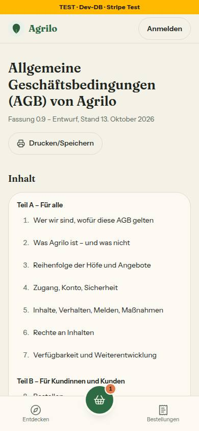
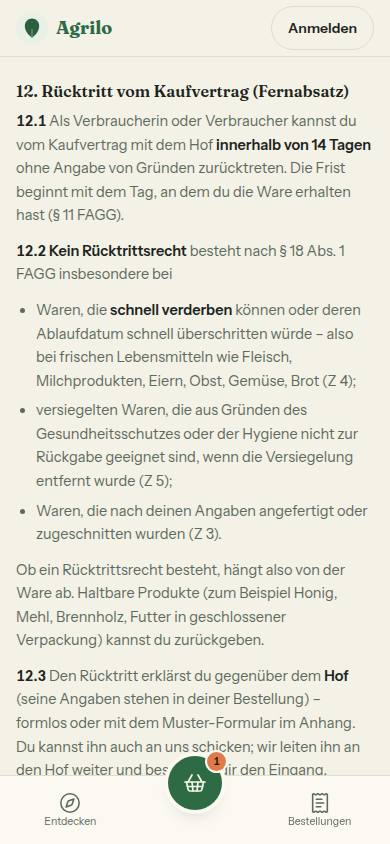
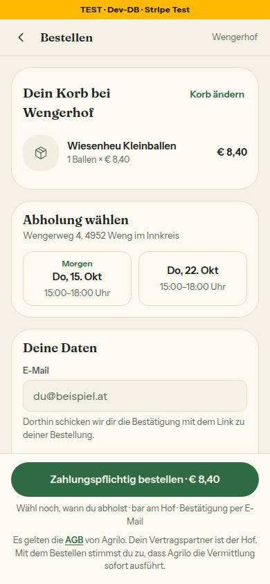

# Nr. 90 – AGB-Seite und Einbindung (Register O4)

Keine Migration, kein neues Paket. Wiederverwendet: `KundeShellMitSitzung`, `INFOSEITE_*`, `Hinweiskarte`, `ui/table`, `StartseiteFuss`, `KONTAKT_EMAIL`, `MARKE`/`PRODUKTION_HOST` / Neu, weil: kein Baustein für Rechtstext aus Daten, für einen Satz mit Links (`AgbSatz`) und für einen Druckknopf mit eigenem Text (`DruckenKnopf` heißt fest „Plakat drucken“).

## Was geändert wurde
- `src/lib/rechtstexte/agb.ts` (neu): der Entwurf als Daten – vier Teile, 29 Punkte, Anhang, „Kurz erklärt“; einmal per Skript aus `docs/recht/agb.md` erzeugt, kein Wort geändert, Name und Domain als Konstanten.
- `src/lib/rechtstexte/stuecke.ts` (neu): Textstücke (Fett, Link, Platzhalter); ohne den AGB-Text, damit Registrierung und Kasse ihn nicht laden. `agb-einbindung.ts` (neu): `AGB_PFAD` und die Sätze für Registrierung, Kasse, Mail und /hoefe.
- `src/app/(public)/agb/page.tsx` und `src/components/rechtstexte/*` (neu): die Seite in der KundeShell wie das Impressum – Titel, Stand-Vermerk, „Drucken/Speichern“, Inhaltsverzeichnis, „Kurz erklärt“, Teile, Anhang.
- `register-form.tsx`: „Mit der Registrierung stimmst du den AGB und den Konditionen für Höfe zu.“ statt des Links „… ansehen“, Kommentar auf O4. `checkout-form.tsx`: der Satz unter dem Kaufknopf; `max-md:mb-8`, weil die Leiste mit ihm 190 statt 125 px hoch ist.
- `order-confirmation.tsx`: eine Zeile mit absolutem Link (Prop `appUrl`, Vorgabe `PRODUKTION_ADRESSE` wie in `newsletter.tsx`). `startseite-abschnitte.tsx`: „AGB“ vor „Impressum“. `hoefe-client.tsx`: „Reihenfolge: …“ unter der Liste (Handy und Browser, nur mit Treffern).
- `datenschutz/page.tsx`: Abschnitt „Postfach“; Stand jetzt Oktober 2026. `slug.ts`, `next.config.ts`: `agb` reserviert (sonst wäre ein Hof „agb“ nie erreichbar) – **Grenzerweiterung**, `reservierte-slugs` verlangt sie.
- Tests neu: `agb-text` (Entwurf ↔ Daten, Zeile für Zeile), `agb-seite` (Rendertest), `agb-einbindung` (Kasse, Fuß, Mail, /hoefe, Sätze) – 38 Tests. Angepasst: `wortliste` (`AUSNAHME_DATEIEN`), `registrieren-formular`, `konditionen-uebergang` („Startphase“, Punkt 17.2), `fachwort-wache` („Kennzeichnung“, 18.2), Seitenlisten in `shells`, `kunden-kopf`, `alte-seiten-neues-design`, `hof-anmeldung`.
- **Nachbesserung Runde 1** (Prüfer-Befunde): Rückgabetypen an `AgbPage` und `OrderConfirmationEmail` (Signatur wie vorher, Vorgabe `p.appUrl ?? PRODUKTION_ADRESSE` an der Verwendungsstelle), O4-Wache in `registrieren-formular` wieder scharf (mit Gegenprobe), `rel="noopener noreferrer"` bei neuem Tab, `AGB_SEITE_TEXT` von `agb.ts` nach `agb-einbindung.ts` (die Ausnahme der Wortliste deckt nur noch Rechtstext), Register-Kommentar am Abschnitt „Postfach“; voller Lauf grün (362 Dateien, 7277 Tests, 1 übersprungen; Lint 0 Fehler, 6 Warnungen wie `main`).

## Annahmen
- „[Betreiber laut Impressum, Rechtsform, Anschrift, E-Mail]“: Das Impressum hat Name und Anschrift als Text in der Seite, keine Konstante, und keine Rechtsform. Statt sie ein zweites Mal in den Quelltext zu schreiben, steht dort „dem Betreiber laut Impressum (E-Mail: …)“ mit Link; „[E-Mail laut Impressum]“ ist `KONTAKT_EMAIL`.
- „Fußzeile der Kundenseiten“ ist dieselbe Komponente `StartseiteFuss` (Startseite, Für Höfe, Hofseite, Produktseite); `/impressum` kommt in `shells/` nicht vor, andere Seiten haben keine Fußzeile.
- Die Sätze stehen in `agb-einbindung.ts` statt in `lib/kasse.ts` und `lib/hoefe-entdecken.ts` (Dateien von 85 und 84); ein Umzug wären drei Konstanten.
- /agb in der KundeShell wie /impressum (der Datenschutz trägt noch den alten Kopf); Links in Registrierung und Kasse öffnen in neuem Tab, Trefferfläche 49 × 49 px (gemessen mit `elementFromPoint`).
- Mail: Link immer auf die Produktionsadresse, weil `email.ts` (Datei von 87) `appUrl` nicht durchreicht. Datenschutz: „können wir sie zusätzlich per E-Mail schicken“, Rechtsgrundlage lit. b.
- Grenzerweiterung (vom Dirigenten bestätigt): die neuen Dateien `stuecke.ts`, `agb-einbindung.ts` und `components/rechtstexte/*` stehen nicht wörtlich in §1 – Client-Grenze für den Druckknopf, `AgbSatz` in zwei Client-Formularen; Runde 1 ändert darin nur die Importzeile in `agb-ansicht.tsx` und `tests/agb-seite.test.ts` (Umzug von `AGB_SEITE_TEXT`).

## Nicht gelöst
- Betreiber, Anschrift und Rechtsform stehen nicht in den AGB: braucht eine Konstante im Impressum (`impressum/page.tsx`, 85, und `support.ts`), danach `PLATZHALTER_ANGABE.betreiber`.
- Die Mail verlinkt die laufende Fassung (die AGB nennen in 26.2 die Fassung bei der Bestellung); die „Hinweise für die anwaltliche Prüfung“ (10 Punkte) bleiben offen, der Stand-Vermerk bis zur Fassung 1.0.
- Bei Online-Zahlung ist der verbindliche Knopf „Jetzt bezahlen“ (`stripe-payment.tsx:182`, Datei außerhalb der Grenze): Dort steht der AGB-Satz nicht; für die anwaltliche Prüfung vorgemerkt (agb.md Hinweis 2).

## Wie der Mensch es testet
- `/agb` bei 390 px: Stand-Vermerk unter dem Titel, Tipp auf „12. Rücktritt …“ springt hin, „Drucken/Speichern“ öffnet den Druckdialog (Knopf und Verzeichnis fehlen im Druck, der Anhang steht auf einer eigenen Seite).
- `/register`: der Satz mit zwei Links, kein Haken. `/wengerhof/checkout` mit Produkt im Korb: der Satz unter „Zahlungspflichtig bestellen“. Startseite und Hofseite: Fuß „Rechtliches“ mit AGB vor Impressum. `/hoefe`: „Reihenfolge: …“ unter der Liste. `/datenschutz`: „Postfach“.
- Mail: Bestellung bestätigen; ohne `RESEND_API_KEY` steht die Mail im Server-Log. Unter den Knöpfen: „Es gelten die AGB von …“, der Link führt auf `/agb` der echten Seite.

## Angepasste `.md`, Nacharbeit, Regelvorschlag
- `DEVELOPMENT.md` (Eintrag), `docs/ai/BAUSTEINE.md` (erzeugt); `docs/recht/agb.md` unverändert. Nacharbeit: `DESIGN_SYSTEM` „Infoseiten“ (nicht in meiner Grenze): „/agb: Text aus `src/lib/rechtstexte/agb.ts`, Verzeichnis mit Sprüngen, Stand-Vermerk, Druckknopf“.
- Regelvorschlag – Ursache: Drei Wachen (Wortliste, Fachwort, zweites Exemplar) lesen jeden Text unter `src/`; ein wörtlicher Rechtstext trifft alle drei. Gegenmaßnahme: eine gemeinsame Liste der Rechtstext-Dateien in `tests/`, die alle drei lesen; Ort: `TESTING_GUIDELINES` §2. Dazu: Eine neue Route auf oberster Ebene braucht `slug.ts` und `next.config.ts` – in die Dateigrenze der Nummer (`docs/nachtlauf.md`).

## Prüfung und Bilder (390, hell; Infoseiten ohne Mockup, keine Abweichung)
`pnpm typecheck`, `pnpm lint` (0 Fehler, 6 Warnungen wie `main`), `pnpm test` (362 Dateien, 7277 Tests, 1 übersprungen). Axe: `/agb` 0 Verstöße hell und dunkel, `/register`, Kasse, `/hoefe` 0; `/datenschutz` hat 3 alte (Kopf, Links ohne Unterstreichung). Tippflächen: 30 Verzeichnis-Links 44–59 px, Knopf 185 × 44. Kasse: eine „incomplete“-Meldung zum Kontrast unter der festen Leiste (wie schon die Fußnote). Testdaten: Reservierung des Korbs gelöscht (`DELETE 1`, Rest 0, Vorrat 46 unverändert).

   
